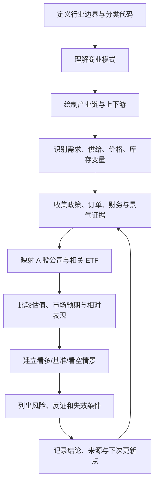

# 02｜统一行业研究方法

## 研究流程图

下面是标准研究流程的总览。它用于帮助理解工作顺序，不代表所有行业都必须机械地按单一路径执行。

## 一、研究流程

1. **定义边界**：确认分类体系、代码、业务范围和相邻行业。
2. **理解商业模式**：谁付钱、为何付钱、定价方式、收入确认和成本结构。
3. **绘制产业链**：上游供应商、中游环节、下游客户、替代品与瓶颈。
4. **确定驱动变量**：需求、供给、价格、库存、资本开支、政策、技术、利率和汇率。
5. **判断景气阶段**：区分领先、同步和滞后指标，判断证据是否一致。
6. **映射 A 股公司**：核实分部收入、业务占比、客户、产能、订单和竞争位置。
7. **检查估值与预期**：分析市场已计入多少增长，避免将好行业等同于好价格。
8. **验证市场表现**：观察行业指数、成交额、上涨广度、相对强弱和 ETF。
9. **建立反证与风险**：明确哪些变化会推翻当前结论。
10. **持续跟踪**：记录来源、发布日期、数据截止日期和下次更新点。

## 二、行业档案模板

每个细分行业建立独立 Markdown 文件，至少包含以下栏目。

### 1. 基本信息
- 行业名称、分类体系与代码
- 分类版本、生效日期、研究边界和相邻行业
- 研究状态：未开始 / 初步扫描 / 深度研究 / 持续跟踪
- 最近更新日期

### 2. 一句话解释与商业模式
说明行业生产什么、解决什么问题、客户是谁、客户为何付钱；列出主要产品、收入模式、成本结构、资本密集度、周期属性和竞争优势来源。

### 3. 产业链结构

| 环节 | 产品/服务 | 代表企业 | 供需/价格指标 | 主要风险 |
|---|---|---|---|---|
| 上游 | 待研究 | 待核实 | 待补充 | 待补充 |
| 中游 | 待研究 | 待核实 | 待补充 | 待补充 |
| 下游 | 待研究 | 待核实 | 待补充 | 待补充 |

代表企业必须核验主营业务，不得只凭概念标签归类。

### 4. 需求、供给、价格与库存
- 需求来源、占比和领先指标
- 供给、产能、资本开支、开工率和交付周期
- 产品价格、原料价格、加工价差和库存
- 进出口、海外因素与替代技术
- 当前供需判断及证据

### 5. 宏观和政策传导

| 变量/政策 | 原始事实与来源 | 传导路径 | 受影响环节 | 可能时滞 | 反向影响/风险 |
|---|---|---|---|---|---|
| 待补充 | 待补充 | 待补充 | 待补充 | 待补充 | 待补充 |

区分政策目标、措施出台、资金落地、企业订单和财务兑现，不能把它们视为同一件事。

### 6. 行业景气指标
至少选择适合行业的订单/销量、产品价与原料价、库存、产能利用率、资本开支、收入利润、现金流或进出口指标。逐项记录单位、频率、样本范围、发布时间、来源、领先/同步/滞后属性和局限。

### 7. A 股公司映射

| 公司/代码 | 对应环节 | 业务证据 | 相关业务占比 | 竞争位置 | 映射置信度 | 待核实事项 |
|---|---|---|---|---|---|---|
| 待补充 | 待补充 | 年报/公告等 | 待核实 | 待研究 | 高/中/低 | 待补充 |

不能因为公司拥有某项技术、专利或少量试点项目，就认定它是行业核心受益者。

### 8. ETF 映射

| ETF代码/名称 | 跟踪指数 | 行业覆盖 | 规模与流动性 | 费用/跟踪情况 | 匹配度 | 局限 |
|---|---|---|---|---|---|---|
| 待补充 | 待核实 | 待核实 | 需用最新数据核验 | 待核实 | 高/中/低 | 待补充 |

匹配度应基于指数规则和实际成分股，不可只凭 ETF 名称判断。

### 9. 市场表现与估值
记录行业指数、基准、相对强弱、成交额、上涨广度、估值口径、历史区间、盈利周期位置、市场预期和数据截止日期。历史研究只能使用目标时点已公开的数据，防止未来数据泄漏。

### 10. 核心判断
分别列出：
- **已核实事实**：来源、日期和统计口径清楚。
- **分析判断**：说明从事实到结论的推理过程。
- **待验证假设**：支持证据、反证和验证期限。
- **看多/基准/看空情景**：成立条件和失效条件。
- **关键风险**：按影响程度和发生可能性排序。

### 11. 跟踪清单

| 跟踪事项 | 当前状态 | 数据来源 | 更新频率 | 下次检查时间 | 重新评估条件 |
|---|---|---|---|---|---|
| 待补充 | 待补充 | 待补充 | 日/周/月/季 | 待补充 | 待补充 |

## 三、证据来源规范

优先级建议：
1. 官方统计和监管来源：国家统计局、人民银行、财政部、发改委、工信部、能源局、海关总署、证监会、交易所等。
2. 上市公司一手披露：年报、季报、公告、招股书、投资者关系记录。
3. 行业协会与专业机构：确认样本范围和统计口径后使用。
4. 产业链数据供应商与专业研究：记录估算方法、覆盖范围和偏差。
5. 新闻、社交媒体和市场传闻：仅作线索，重大判断须追溯一手来源。

关键事实建议按以下格式记录：

> **事实：**简述  
> **来源：**机构/文件/链接  
> **发布日期：**YYYY-MM-DD  
> **数据期间：**YYYY-MM 或 YYYY-Qn  
> **统计口径：**单位、样本、同比/环比等  
> **可信度：**高 / 中 / 低  
> **局限：**如有

## 四、避免常见偏差

- 主动寻找反方证据，不只搜索支持自己观点的材料。
- 不把单月波动直接解释成趋势反转。
- 不混用同比、环比、累计值和季调数据。
- 不把名义金额变化直接等同于实际需求变化。
- 不用行业平均利润代表每家企业。
- 不把概念标签等同于真实收入敞口。
- 不以涨幅排名替代产业研究。
- 不把政策支持直接转化为盈利预测。
- 估值口径不可靠时，不给出精确估值结论。
- 研究观察清单不等于买入清单。

## 五、阶段性完成标准

- **全景扫描**：行业定义、主要驱动、核心指标、产业链位置和待研究问题齐全。
- **初步研究**：主要数据来源、供需状态、代表公司和风险齐全。
- **深度研究**：加入历史数据、盈利与估值情景、竞争格局和反证条件。
- **持续跟踪**：更新指标和结论变化，保留历史版本和数据截止日期。

研究深度可以不同，但所有行业都应进入目录，避免覆盖盲区。
