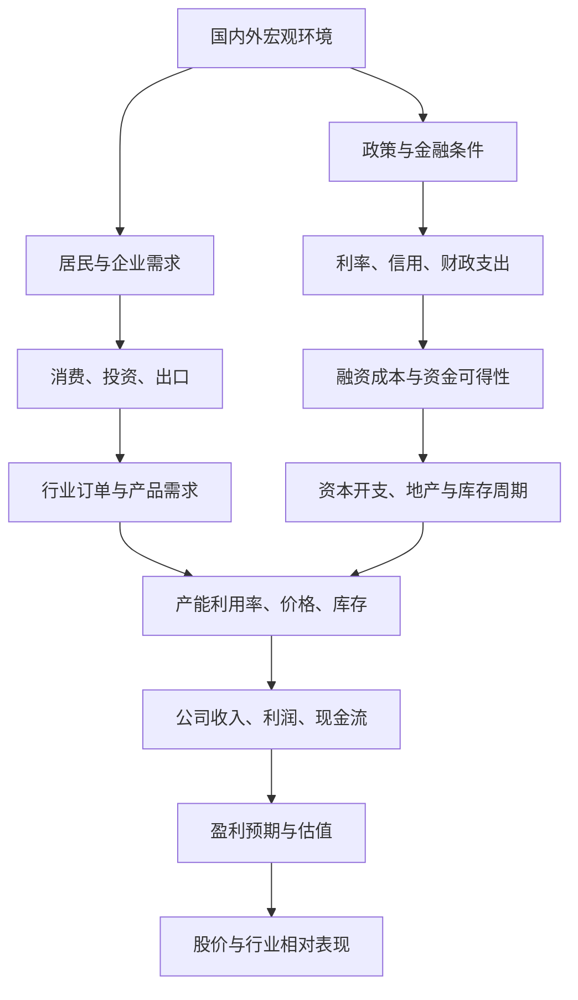
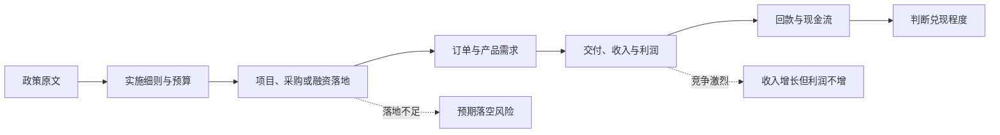

# 宏观经济与政策框架：A股行业研究入门

> 文档类型：研究手册（Markdown）｜版本：v0.1｜编写日期：2026-10-11  
> 本文是研究框架，不代表对当前经济数据或政策效果的实时判断。使用具体数值和政策时，必须注明发布日期、统计期、口径及官方来源。

## 1. 研究目的

宏观研究不是单纯预测指数，而是分析经济增长、需求、信用、利率、财政、汇率、全球周期和政策如何传导到行业订单、价格、库存、成本、公司盈利、现金流和估值。

核心链条：

**宏观变化 → 需求/融资/成本变化 → 行业订单、价格与库存 → 公司收入、利润和现金流 → 市场预期与估值。**

每个环节都要有证据，并记录可能推翻原判断的反证。

## 2. 宏观传导示意图

> 示意图，不表示变量之间存在固定、即时或单向的因果关系。

## 3. 六组宏观变量

| 变量组 | 重点观察 | 主要影响路径 | 常见误读 |
|---|---|---|---|
| 经济增长与生产 | GDP、工业增加值、服务业活动、PMI | 订单、产能利用率、盈利预期 | 单月回升不等于趋势反转 |
| 需求与消费 | 社零、居民收入、汽车家电销售、消费结构 | 销量、渠道库存、定价能力 | 总量增长可能掩盖品类分化 |
| 投资与地产 | 固定资产投资、基建、制造业投资、房地产销售与开工 | 建材、工程机械、家居、钢铁、化工等 | 投资额不等于实物工作量或利润 |
| 外贸与全球周期 | 进出口、海外制造业景气、运价 | 出口制造、航运、港口、机械、电子 | 金额受价格、汇率和产品结构影响 |
| 货币与信用 | 政策利率、市场利率、社融、贷款结构、信用利差 | 融资成本、资本开支、地产链、估值 | 信用总量增加不代表所有行业都受益 |
| 价格与成本 | CPI、PPI、能源、金属、化工品、汇率、工资 | 原材料成本、产品售价、毛利率、库存损益 | 上游涨价对上下游影响可能相反 |

指标应记录定义、发布时间、统计期、修订情况和可比性。同比、环比、名义/实际、季调/未季调不可混用。

## 4. 政策如何传导到行业

研究政策时至少回答：

1. **政策目标是什么？** 稳增长、促消费、产业升级、能源安全、科技创新、风险化解或民生保障？
2. **政策工具是什么？** 财政拨款、税费调整、信贷支持、政府采购、监管规则、准入变化或价格机制？
3. **谁提供资金或资源？** 中央财政、地方财政、金融机构、企业或居民？
4. **谁是直接受益方？** 终端用户、设备供应商、工程承包商、运营商还是金融机构？
5. **何时可能兑现？** 文件发布、实施细则、预算、招标、订单、交付、收入确认、回款之间存在时滞。
6. **怎样验证效果？** 观察投资、招标、订单、交付、销量、价格、产能利用率、利润率和现金流。

**政策预期、订单兑现、盈利兑现、现金流兑现必须分开记录。**

## 5. 宏观情景与行业敏感性

| 宏观情景 | 可重点观察的行业方向（示例） | 需要验证的证据 |
|---|---|---|
| 制造业需求改善 | 工业自动化、机械设备、工业材料、部分电子 | 新订单、产能利用率、交货周期、利润率 |
| 地产销售和开工改善 | 建材、家居、工程机械、部分化工、银行 | 销售/开工、应收账款、回款、库存 |
| 居民消费改善 | 食品饮料、家电、汽车、旅游、零售服务 | 销量、客单价、渠道库存、促销强度 |
| 全球电子需求改善 | 半导体、电子元件、消费电子、相关设备材料 | 终端销量、库存、资本开支、订单与价格 |
| 大宗商品上涨 | 资源开采、部分上游材料 | 售价能否覆盖成本、税费和资本开支 |
| 融资环境改善 | 地产链、资本密集型行业、部分成长行业 | 融资是否落地、投资回报和现金流 |
| 汇率变化 | 出口制造、航空、进口原材料企业、跨境业务 | 收入与成本币种、套期保值、海外定价能力 |

本表是敏感性分析起点，不是当前行业排名或买卖建议。同一行业内，公司因成本结构、客户、负债和竞争力不同，表现也可能相反。

## 6. 宏观—行业—公司三层跟踪

| 层级 | 记录内容 | 更新节奏 | 研究产出 |
|---|---|---|---|
| 宏观层 | 增长、需求、信用、利率、汇率、商品价格、政策原文 | 按官方数据和政策发布更新 | 宏观环境与变化方向 |
| 行业层 | 订单、销量、价格、库存、产能、开工率、招标、资本开支 | 按行业数据频率更新 | 行业景气状态及领先/滞后指标 |
| 公司层 | 分部收入、毛利率、订单、应收、存货、经营现金流、资本开支 | 按公告和定期报告更新 | 盈利兑现与公司差异 |

不要强行把日度市场价格、月度行业数据和季度财报视作同一时点。

## 7. 每次行业研究都要回答的问题

- **需求：** 终端需求扩大、持平还是收缩？证据是什么？
- **供给：** 新增产能、退出产能和竞争格局如何变化？
- **价格：** 售价和原材料成本如何变化？谁更有议价权？
- **库存：** 库存增加是主动备货还是销售不畅？周转是否改善？
- **利润：** 销量、价格、成本和产品结构分别如何影响利润？
- **现金流：** 利润是否转化为经营现金流？应收和资本开支是否恶化？
- **预期：** 市场是否已提前反映改善？估值和盈利预期如何？
- **反证：** 哪些数据出现时，当前判断应下调或推翻？

## 8. 事实、判断、假设和反证

| 类型 | 写法要求 |
|---|---|
| 事实 | 说明数值、单位、统计期、发布日期、口径及原始链接 |
| 判断 | 解释推理链，不能把观点写成事实 |
| 假设 | 明确验证期限和需要观察的数据 |
| 反证 | 预先写清哪些结果会使逻辑失效 |

## 9. 官方资料入口

引用具体数据或政策时，应链接到实际发布页面，而不是只引用机构首页。

| 机构 | 适合查找的资料 | 官方入口 |
|---|---|---|
| 国家统计局 | GDP、工业、消费、投资、价格、房地产、人口 | https://www.stats.gov.cn/ |
| 中国人民银行 | 货币政策、金融统计、社融、利率相关信息 | https://www.pbc.gov.cn/ |
| 财政部 | 财政政策、预算、财政收支、税费政策 | https://www.mof.gov.cn/ |
| 国家发展改革委 | 宏观政策、投资、产业规划、价格和项目政策 | https://www.ndrc.gov.cn/ |
| 工业和信息化部 | 工业运行、制造业、电子、通信和产业政策 | https://www.miit.gov.cn/ |
| 海关总署 | 进出口贸易统计 | http://www.customs.gov.cn/ |
| 中国证监会 | 资本市场制度、上市公司监管相关制度 | https://www.csrc.gov.cn/ |
| 上海证券交易所 | 沪市公司公告、上市公司数据、市场规则 | https://www.sse.com.cn/ |
| 深圳证券交易所 | 深市公司公告、上市公司数据、市场规则 | https://www.szse.cn/ |
| 北京证券交易所 | 北交所公司公告与市场信息 | https://www.bse.cn/ |

## 10. 宏观数据记录模板

- 指标名称：
- 发布机构：
- 统计期：
- 实际发布日期：
- 数值与单位：
- 同比/环比/季调口径：
- 历史修订情况：
- 原始链接：
- 影响哪些行业：
- 传导机制：
- 可能的反向影响：
- 当前判断：
- 下次复核时间：

## 11. 常见研究陷阱

1. 把政策发布等同于订单落地。
2. 把宏观总量改善等同于所有行业改善。
3. 把商品价格上涨等同于所有相关公司受益。
4. 把收入增长等同于利润和现金流增长。
5. 忽略行业数据与财报之间的时间差。
6. 用后发布的数据解释过去的投资决策，造成未来数据泄漏。
7. 只寻找支持原观点的数据，不记录反证。
8. 只看行业景气，不看估值和市场预期。

## 12. 使用边界

本文是宏观研究方法文档，不是实时宏观判断或投资建议。判断当前经济处于何种阶段时，应另建有截止日期的数据快照，逐项引用最新官方数据。文中的行业示例不能误读为当前行业排名。

## 更新记录

- 2026-10-11：建立宏观变量、政策传导、行业敏感性、证据规范和官方资料入口框架。
