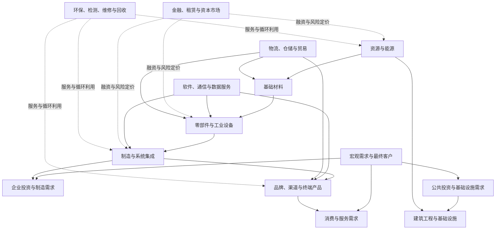
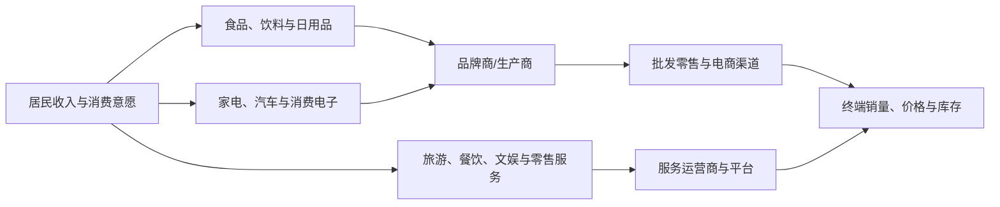
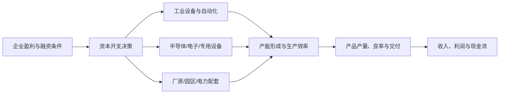
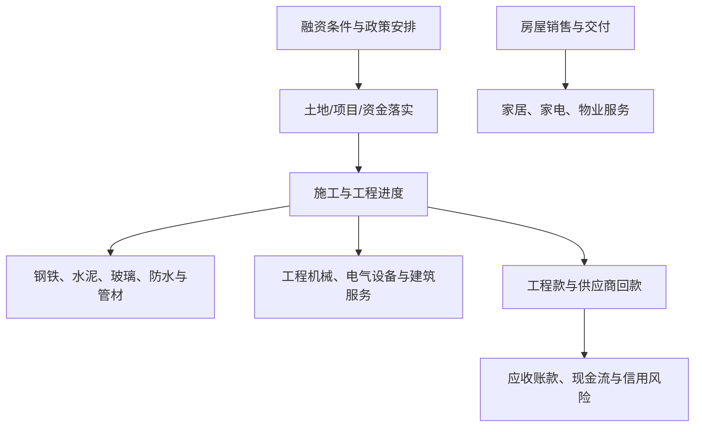
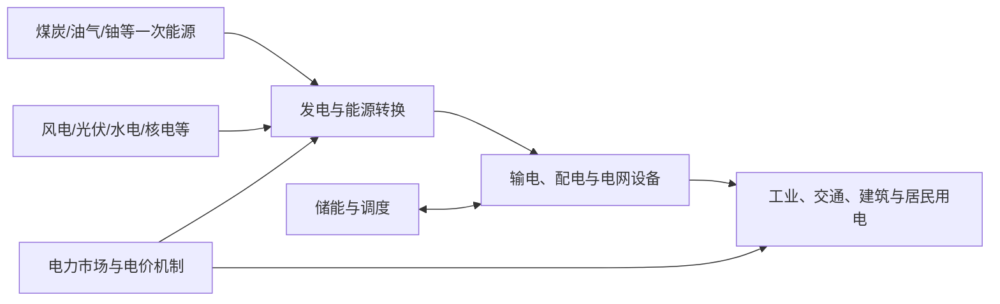
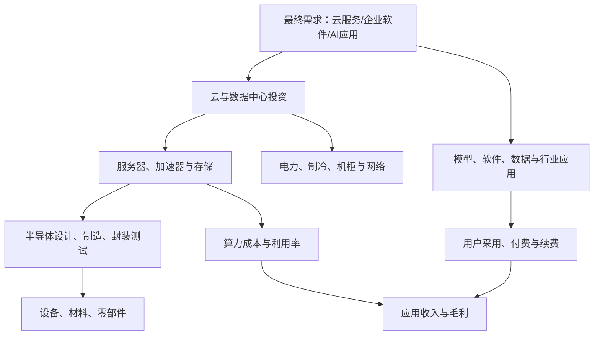
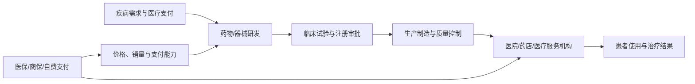

# A股产业链全景地图：从宏观需求到上市公司

> 文档类型：研究手册（Markdown）  
> 版本：v0.1  
> 编写日期：2026-10-11  
> 使用范围：A 股全市场产业链研究入门  
> 说明：本文是产业关系的概念地图，不是完整的公司供应链名单。行业之间存在交叉，真实供应关系必须用公司公告、年报、招投标和其他可核验资料确认。

## 1. 为什么需要产业链视角

行业分类回答“公司属于哪个行业”，产业链回答“价值如何从资源、技术和生产环节传递到最终需求”。两者不能互相替代。

例如，半导体设备公司可能被归入专用设备或电子相关分类，但其需求还取决于晶圆厂资本开支、先进制程投资、设备验证周期、国产化进展和客户采购节奏。单看行业标签无法解释订单和利润变化。

研究产业链，重点是弄清楚：

- 谁付钱，最终需求来自哪里？
- 哪些环节提供原材料、设备、技术和服务？
- 价值链中哪个环节具有议价权？
- 哪个环节最容易出现产能过剩、库存积压或价格战？
- 成本上涨时，谁能提价，谁只能承受成本？
- 哪些指标领先于公司财报，哪些指标只是滞后确认？

## 2. 全市场产业链总览

以下是跨行业的概念示意图。现实中有些行业横跨多个环节，服务、金融、软件和物流也可能同时为多个产业链提供支持。

> **示意图**：图中是常见经济关系，不表示所有行业都存在直接交易，也不表示固定的利润分配。

## 3. 按最终需求理解产业链

### 3.1 居民消费链

重点观察居民收入预期、消费频次、客单价、促销强度、渠道库存、品牌份额和经营现金流。消费需求增加并不保证利润同步增长；若竞争激烈、折扣扩大或渠道费用上升，销量增长也可能伴随利润率下降。

### 3.2 制造业投资链

重点观察资本开支公告、设备订单、交货周期、验收、产能利用率、良率、折旧和最终需求。资本开支增长可能是扩张，也可能是竞争压力下的重复投资。

### 3.3 地产、基建与城市更新链

重点观察项目实际开工和施工进度、实物工作量、招标、材料价格、工程回款、应收账款和坏账计提。政策规模、投资计划和企业真实收入之间可能存在较长时滞。

### 3.4 能源与电力链

重点观察燃料成本、利用小时数、上网电价、电力供需、输配电投资、电网招标、消纳和储能利用情况。发电设备需求、发电运营商盈利和电网投资是不同环节，不能只用一个“新能源”标签概括。

### 3.5 数字基础设施与 AI 链

重点观察资本开支、订单、交付、产能和良率，也要观察算力利用率、单位推理成本、客户付费、续费率和应用毛利。上游订单强不代表下游应用已经形成可持续盈利。

### 3.6 医药与健康服务链

重点观察研发管线、临床阶段、注册审批、医保准入、招采价格、医院终端使用、销售费用、现金消耗和专利到期。研发进展与商业化收入之间存在不确定性和时间差。

### 3.7 金融与资本配置链

重点观察净息差、资产质量、信用成本、保费结构、承销与经纪业务、资管规模、资本约束和市场成交。金融行业既受宏观影响，也通过信用供给和风险定价反过来影响实体经济。

## 4. A股行业研究的八类价值链角色

| 角色 | 典型商业模式 | 关键经营指标 | 常见风险 |
|---|---|---|---|
| 资源供给 | 开采、采选、能源供应 | 产量、品位、商品价格、单位成本、资本开支 | 商品周期、资源税费、环保与安全 |
| 基础材料 | 冶炼、化工、建材、材料加工 | 价差、库存、开工率、产能利用率 | 产能过剩、能源成本、价格战 |
| 设备与零部件 | 设备销售、部件供应、维修服务 | 新订单、在手订单、交付、验收、售后收入 | 客户资本开支波动、技术迭代、回款 |
| 制造与代工 | 加工制造、合同制造、系统集成 | 产能利用率、良率、单位成本、客户集中度 | 订单迁移、成本上升、议价能力弱 |
| 品牌与渠道 | 品牌溢价、批零差价、平台服务 | 销量、价格、渠道库存、复购率、获客成本 | 库存积压、促销竞争、品牌老化 |
| 工程与项目服务 | 工程承包、设计、施工、运维 | 新签合同、履约进度、毛利率、应收与现金流 | 回款延迟、项目减值、垫资 |
| 软件与知识服务 | 许可、订阅、实施、数据/技术服务 | ARR/续费、客户留存、毛利、研发费用、回款 | 客户预算削减、竞争、产品替代 |
| 运营与金融服务 | 持续运营、租赁、金融中介、资产管理 | 利用率、费率、资产质量、负债成本、现金流 | 监管、信用风险、利率与流动性 |

同一家公司可能同时承担多种角色，研究时应按真实收入和利润来源拆分。

## 5. 产业链中的利润、现金流与议价权

产业链位置本身不能决定谁最赚钱。需要分析：

- **供需关系：** 供给稀缺、客户替代成本高时，供应商可能有更强议价权。
- **技术壁垒：** 认证周期、良率、专利、工艺和可靠性可能形成壁垒，但壁垒会随技术迭代变化。
- **客户集中度：** 大客户可能带来稳定需求，也可能压价并延长账期。
- **资本强度：** 高资本开支和折旧可能侵蚀自由现金流，即使收入增长也未必创造股东价值。
- **库存与周期：** 价格上涨阶段的高利润可能来自周期高点，不能直接外推。
- **商业模式：** 一次性设备收入、耗材、订阅、维修和运营服务的收入持续性不同。
- **现金回收：** 预收款、应收账款、合同资产和存货变化会影响利润质量。

建议在每份行业档案中同时画出“实物流/服务流”和“资金流”，避免只看产品去向而忽略付款方和回款风险。

## 6. 从产业链寻找领先指标

| 环节 | 可能的领先指标 | 可能的滞后确认指标 |
|---|---|---|
| 原材料与资源 | 现货/期货价格、库存、进口量、开工率 | 公司实现价格、季度毛利、资本开支 |
| 工业设备 | 客户资本开支、招标、订单、在手订单 | 设备交付、验收、收入确认、回款 |
| 电子与半导体 | 终端销量、渠道库存、晶圆厂资本开支、设备订单 | 产能利用率、良率、分部利润、现金流 |
| 消费品 | 渠道库存、终端动销、价格促销、搜索/门店客流 | 公司收入、毛利率、销售费用率 |
| 地产与建筑 | 销售、土地成交、开工、施工、项目招标 | 建材收入、工程款回收、减值 |
| 医药 | 临床进度、审批、医保/招采、医院使用 | 产品销售、毛利、商业化现金流 |
| 软件与互联网 | 付费客户、活跃度、合同额、续费和使用量 | 确认收入、经营利润、自由现金流 |
| 金融 | 利率曲线、成交额、信用利差、保费需求 | 净息差、信用成本、承保利润、手续费收入 |

“领先”是相对于具体行业和目标变量而言，不能假设表中所有指标在所有周期都有效。应在专题研究中注明历史表现和局限。

## 7. 如何把产业链映射到上市公司

每个环节至少核实：

1. 公司是否真实生产或提供该产品/服务？
2. 相关业务收入占比和利润贡献是否披露？
3. 客户、订单或项目证据来自哪里？
4. 公司是核心供应商、普通参与者，还是仅有小规模试点？
5. 相关业务对未来利润的影响是否已经发生，还是只有概念预期？
6. 是否存在高客户集中度、关联交易、应收账款或资本开支风险？

### 公司映射记录模板

| 项目 | 记录内容 |
|---|---|
| 公司名称与证券代码 | 以交易所公告为准 |
| 产业链环节 | 上游/中游/下游/服务/综合 |
| 相关产品或服务 | 用公司披露的具体名称 |
| 业务收入/利润占比 | 写明财报期间与披露口径；未披露则注明 |
| 客户/订单证据 | 公告、年报、招投标或客户披露 |
| 证据日期与链接 | 可回溯到原始资料 |
| 映射置信度 | 高/中/低，并解释理由 |
| 主要风险 | 竞争、替代、回款、产能、政策等 |
| 待验证事项 | 下一步要找的证据 |

不要仅凭“概念股”标签、公司名称或新闻标题就认定公司是产业链核心受益者。

## 8. 产业链分析的常见误区

- **把行业分类当产业链。** 同一行业内公司可能处于不同上下游位置。
- **把供货关系当高利润。** 大客户供应商也可能利润率很低。
- **把订单当收入。** 订单可能取消、延期，收入确认还需满足交付与会计条件。
- **把收入当现金。** 应收账款和合同资产可能长期占用资金。
- **把扩产当景气。** 资本开支上升也可能导致未来供给过剩。
- **把国产替代当确定增长。** 还需验证性能、良率、客户认证、价格和持续复购。
- **把技术突破当商业化。** 需继续核实规模交付、毛利率和回款。
- **忽略产业链外溢。** 能源、物流、利率和汇率可能影响多个行业。

## 9. 与国家统计分类的关系

国家统计局的《国民经济行业分类》用于对经济活动进行统计分类；三次产业划分则按规定将经济活动归为第一、第二、第三产业。它们和申万行业分类、产业链关系图、市场主题标签不是同一概念。国家统计局介绍，现行《国民经济行业分类》基于 GB/T 4754—2017；三次产业划分于 2018 年根据该分类修订。来源：

- 国家统计局：《国民经济行业分类》入口：https://www.stats.gov.cn/sj/tjbz/gmjjhyfl/
- 国家统计局：《三次产业是怎样划分的》：https://www.stats.gov.cn/zs/tjws/tjbz/202301/t20230101_1903768.html

研究中应按用途选择分类口径，不应把三次产业、申万行业、产业链环节和投资主题混为一谈。

## 10. 后续如何使用本图谱

每个行业专题按以下顺序落笔：

1. 定义行业边界和主要产品/服务。
2. 放入对应的产业链示意图，并标出上下游。
3. 标明最终付款方和关键成本来源。
4. 列出需求、供给、价格、库存、订单和现金流指标。
5. 分别研究上游、中游、下游的盈利驱动与风险。
6. 将上市公司按真实业务敞口映射到产业链环节，并注明证据。
7. 结合估值与市场预期，形成看多、基准、看空三种情景。
8. 写明哪些新证据会改变判断。

## 更新记录

- 2026-10-11：建立跨行业产业链总览和消费、制造投资、地产基建、能源电力、数字基础设施与 AI、医药健康、金融资本配置等示意图；加入公司映射模板、领先指标和研究误区。
