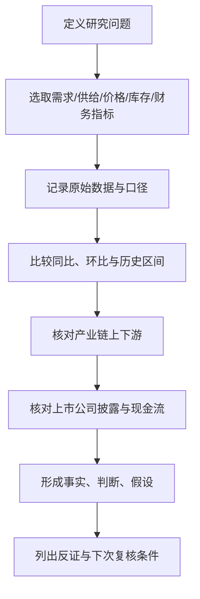

# A股行业景气指标字典：看什么、怎么解释、去哪里核实

> 文档类型：研究手册（Markdown）  
> 版本：v0.1  
> 编写日期：2026-10-11  
> 目的：统一各行业景气跟踪的指标定义、解释方式、数据来源与常见误读。  
> 重要说明：本文提供研究框架，不代表对任何行业当前景气程度的判断。指标需结合时间序列、行业特征、公司披露和市场预期分析。

## 1. 如何使用这份字典

对每个行业，不要只找一个“神指标”。至少建立五类观察：

1. **需求**：终端客户是否增加购买或投资？
2. **供给**：产能、产量、开工率和竞争者数量如何变化？
3. **价格与库存**：价格上涨来自需求旺盛、供给收缩，还是短期扰动？库存是在主动备货还是被动积压？
4. **盈利与现金流**：变化是否传导到毛利率、净利润和现金回收？
5. **预期与估值**：市场是否已经提前反映改善？基本面变好不等于股价必然上涨。

建议每次更新时记录：指标值、同比、环比、过去 3—5 年所处区间、数据发布日期、统计口径、来源链接、初步解释、反证和下一次复核日期。

## 2. 通用指标

| 指标 | 含义 | 常见解读 | 注意事项 |
|---|---|---|---|
| 同比增速 | 与上年同期比较 | 有助于降低季节性影响 | 基数异常会扭曲增速；最好同时看绝对值 |
| 环比增速 | 与上一期比较 | 捕捉短期拐点 | 必须考虑季节性、工作日和季调口径 |
| 订单/新签合同 | 未来业务需求线索 | 增长可能预示未来收入 | 订单可能取消、延期或低毛利；不等于收入 |
| 在手订单 | 尚未完成的订单存量 | 可观察订单可见度 | 要看履约期限、取消条款、客户质量和毛利 |
| 产能利用率/开工率 | 实际产出相对可用产能 | 较高水平可能改善单位成本 | 不同行业统计口径不同；高开工也可能是低价抢量 |
| 库存 | 生产、渠道或终端存货 | 去库可能意味着供需改善 | 必须区分原材料、在制品、产成品和渠道库存 |
| 价格/价差 | 产品售价或上下游价格差 | 反映供需和议价能力 | 原料价格上涨不一定利好所有产业链环节 |
| 毛利率 | 收入扣除营业成本后的比例 | 反映产品结构、价格和成本 | 需检查会计口径、业务结构和一次性因素 |
| 应收账款/合同资产 | 已确认或履约但未收回的款项 | 快于收入增长时需关注回款 | 需看账龄、客户、坏账计提和合同条款 |
| 经营现金流 | 经营活动现金净流入 | 可检验利润质量 | 受付款节奏、票据、预收和季节性影响 |
| 资本开支 | 购建长期资产的现金投入 | 反映扩张和设备投资 | 扩产也可能造成未来过剩；应与需求和回报率一起看 |
| 研发费用/研发强度 | 研发投入及其占收入比例 | 反映创新投入 | 投入不保证成功，需结合产品验证与商业化 |
| 估值分位 | 当前估值相对自身历史区间 | 反映历史相对位置 | 不是合理价值的直接答案；行业结构可能已变 |
| 分析师预期变化 | 盈利预测上调/下调 | 观察市场预期方向 | 预测有偏差；覆盖不足的小公司需谨慎 |

## 3. 宏观与全市场指标

| 指标 | 频率/来源方向 | 主要关联 | 解读提醒 |
|---|---|---|---|
| GDP及分行业增加值 | 季度；国家统计局 | 总需求与经济结构 | 总量不能替代具体行业数据 |
| 制造业 PMI 及新订单 | 月度；国家统计局 | 制造业景气和订单变化 | 扩散指数不是产出增速 |
| 工业增加值 | 月度；国家统计局 | 工业生产活动 | 同时看行业和产品产量 |
| 固定资产投资及分行业投资 | 月度累计；国家统计局 | 制造业、基建、地产投资 | 累计增速与单月变化不要混淆 |
| 社会消费品零售总额 | 月度；国家统计局 | 商品消费 | 不等同于全部居民服务消费 |
| CPI、PPI | 月度；国家统计局 | 消费价格、工业品价格 | PPI改善可能利好部分上游，也可能抬升下游成本 |
| 出口金额、数量及价格 | 月度；海关总署 | 外需与出口链 | 汇率、价格和数量的贡献要分开 |
| 社融、人民币贷款、M2 | 月度；人民银行 | 信用供给和融资环境 | 总量之外需看结构、期限与资金流向 |
| 财政收入、支出、专项债等 | 月度/季度；财政部等 | 公共投资与支付能力 | 预算、发行、拨付、实物工作量是不同阶段 |
| 利率、收益率曲线、信用利差 | 高频/日度；官方市场数据 | 融资成本、估值和信用风险 | 不同期限、信用等级不可混用 |
| 汇率 | 高频/日度；官方市场数据 | 出口收入、进口成本、外币负债 | 公司对冲和结算币种会改变实际影响 |

## 4. 主要行业指标字典

### 4.1 半导体、电子与半导体设备

| 维度 | 建议指标 | 为什么看 | 需要交叉验证 |
|---|---|---|---|
| 终端需求 | 手机、PC、汽车电子、服务器等出货量 | 判断芯片需求来源 | 品类结构、库存与终端售价 |
| 产业库存 | 芯片、模组、渠道库存及库存周转 | 区分补库和被动积压 | 公司存货、减值、交货周期 |
| 晶圆制造 | 晶圆厂资本开支、产能利用率、制程结构 | 影响设备、材料和代工需求 | 计划投资与实际付款、投产时间 |
| 设备订单 | 招标、订单、在手订单、客户集中度 | 观察设备需求 | 交付、验收、收入确认和回款 |
| 国产化进展 | 客户验证、重复采购、产品覆盖环节 | 判断替代是否商业化 | 不能只依据“送样”或概念描述 |
| 经营质量 | 毛利率、研发费用、存货、应收账款 | 观察产品竞争力和现金流 | 客户结构、产品组合、信用政策 |

**半导体设备特别提醒：** 设备采购到收入确认可能跨越较长时间。招标、订单、交付、安装、验收、回款是不同阶段。设备板块下跌时，应先判断订单周期、客户资本开支、估值预期与公司自身业务，而不是仅凭“国产替代”推断会反弹。

### 4.2 AI、云计算、服务器与数据中心

| 维度 | 建议指标 | 观察重点 |
|---|---|---|
| 云厂商投资 | 资本开支、数据中心建设计划 | 投资承诺是否转为实际采购 |
| 服务器与网络 | 订单、交付、平均售价、产品组合 | 量增是否被降价抵消 |
| 芯片与算力 | 供货周期、性能、可用性、集群利用率 | 供给约束与有效需求是否匹配 |
| 数据中心运营 | 上架率、利用率、PUE、电价、租赁价格 | 收入能否覆盖电力和折旧成本 |
| AI 应用 | 付费客户、使用频率、续费、客户留存 | 用户增长是否转为收入 |
| 单位经济性 | 单位推理成本、毛利率、获客成本 | 应用商业模式能否持续 |

### 4.3 新能源汽车与汽车零部件

| 维度 | 建议指标 | 观察重点 |
|---|---|---|
| 终端需求 | 产销、上险量、订单、交付、库存 | 终端销售是否强于批发出货 |
| 价格竞争 | 终端成交价、促销、车型折扣 | 降价对销量和毛利的影响 |
| 电池链 | 装车量、排产、库存、材料价格 | 区分短期排产与真实终端需求 |
| 零部件 | 客户定点、车型生命周期、单车价值量 | 定点不等于立即形成大额收入 |
| 产能 | 利用率、扩产计划、资本开支 | 判断供给过剩与折旧压力 |
| 现金流 | 应收账款、票据、经营现金流 | 大客户增长是否伴随账期拉长 |

### 4.4 光伏、风电、储能与电网

| 领域 | 建议指标 | 观察重点 |
|---|---|---|
| 光伏制造 | 硅料/硅片/电池片/组件价格、库存、开工率 | 价格下跌是成本下降还是供给过剩 |
| 光伏需求 | 新增装机、招标、并网、消纳 | 区分招标、出货、安装和并网 |
| 风电 | 招标量、项目核准、装机、海风施工 | 订单交付与项目进度 |
| 储能 | 招标、实际装机、利用小时、项目收益 | 不能只看规划规模或名义容量 |
| 电网设备 | 电网投资、招标金额、交货与验收 | 投资计划向设备公司传导的时滞 |
| 运营商 | 利用小时、电价、弃电率、融资成本 | 设备需求强不代表运营商利润高 |

### 4.5 有色金属、贵金属与矿业

| 指标 | 观察重点 | 常见误读 |
|---|---|---|
| 现货/期货价格 | 供需、库存、宏观预期 | 价格上涨不一定意味着企业产量增加 |
| 显性库存与库存变化 | 可见供需紧张程度 | 单一仓库库存不代表全部库存 |
| 产量、品位、回收率 | 企业可售产量与单位成本 | 产量增长可能来自低品位或高成本资源 |
| 加工费/冶炼费 | 原矿与冶炼环节供需 | 同一商品的矿山和冶炼厂可能受益相反 |
| 单位现金成本与资本开支 | 盈利弹性和项目回报 | 周期高点利润不宜直接外推 |
| 资源储量与项目进度 | 中长期供给能力 | 资源量不等于可经济开采储量 |

### 4.6 煤炭、石油、天然气与化工

- 煤炭：港口/坑口价格、库存、日耗、长协比例、产量、运输瓶颈、单位成本。
- 石油天然气：国际价格、价差、产量、炼厂开工率、库存、勘探开发资本开支。
- 炼化：原油成本、成品油价差、化工品价差、装置负荷、库存与检修。
- 基础化工：产品价差、行业产能、开工率、库存、出口、原料成本。
- 化肥农药：农产品价格、季节性需求、原料价格、渠道库存、出口政策。
- 共同提醒：同一轮原料涨价，可能利好资源端，却压缩加工端利润；需按产业链环节拆开。

### 4.7 钢铁、建材与工程机械

| 领域 | 建议指标 | 观察重点 |
|---|---|---|
| 钢铁 | 粗钢产量、库存、吨钢毛利、原料价差 | 产量、价格和成本需同时看 |
| 水泥 | 出货量、价格、库存、熟料产能利用率 | 区域性强，不能只看全国均值 |
| 玻璃 | 库存、价格、产线冷修与复产 | 供给调整对价格的影响 |
| 工程机械 | 销量、开工小时、出口、渠道库存 | 销量和设备实际使用强度不同 |
| 建筑工程 | 新签合同、履约进度、应收款、现金流 | 合同额不代表利润和回款 |

### 4.8 房地产、物业、家居与家电

- 房地产：商品房销售面积/金额、库存去化周期、土地成交、开工、施工、竣工、交付和开发商现金流。
- 物业：在管面积、收费率、收缴率、关联方应收款、增值服务收入。
- 家居：新房/二手房交易、装修需求、终端零售、渠道库存、促销和回款。
- 家电：零售量价、排产、出口、渠道库存、原材料价格、补贴政策和产品结构。
- 注意：地产销售、竣工交付、家居消费之间存在时滞；地产政策变化不应直接等同于所有相关公司的业绩改善。

### 4.9 食品饮料、农业与零售消费

| 子行业 | 重点指标 |
|---|---|
| 白酒及饮料 | 批价、终端动销、渠道库存、经销商回款、产品结构、促销 |
| 乳制品 | 原奶成本、终端销量、产品结构、渠道库存、促销力度 |
| 调味品与食品加工 | 原料成本、吨价、销量、渠道库存、产能利用率 |
| 生猪养殖 | 猪价、仔猪价、饲料成本、出栏量、完全成本、现金流 |
| 种业与农产品 | 种植面积、单产、天气、库存、进口、农产品价格 |
| 商超与零售 | 同店销售、客流、客单价、坪效、库存周转、租金与人工 |
| 电商与平台 | GMV、活跃买家、转化率、客单价、抽佣/广告收入、履约成本 |
| 旅游餐饮 | 客流、入住率、平均房价、翻台率、客单价、预订与取消 |

消费行业尤其需要区分“出厂/批发数据”和“终端真实动销”。销售额增长可能由提价带来，也可能由促销、补库存或渠道压货带来。

### 4.10 医药、医疗器械与医疗服务

- 创新药：临床阶段、入组进度、关键试验结果、注册申报、医保准入、商业化销售、现金消耗和研发管线集中度。
- 仿制药：集采中标价、销量、成本、产能利用率、产品集中度和毛利。
- 医疗器械：招标、装机、耗材使用、医院采购、经销商库存、售后服务。
- 医疗服务：门诊/住院量、床位利用率、平均收费、医保结算、应收账款和人员成本。
- 重点提醒：研发里程碑、获批、进院、采购、使用、回款是不同阶段；临床结果有不确定性，不能把研发管线直接按未来销售额计入估值。

### 4.11 银行、证券、保险与多元金融

| 子行业 | 重点指标 | 观察重点 |
|---|---|---|
| 银行 | 净息差、不良率、关注类贷款、拨备覆盖率、信用成本、资本充足率 | 资产质量与利润确认是否稳健 |
| 证券 | 成交额、两融余额、投行业务、资管规模、净资本、风险敞口 | 市场活跃度与业务结构 |
| 保险 | 保费、新业务价值、续期率、综合成本率、投资收益、偿付能力 | 承保和投资两端分开看 |
| 租赁/多元金融 | 融资成本、资产收益率、逾期率、集中度、期限错配 | 资金成本和信用风险 |

金融数据高度依赖监管口径和会计规则。应对照定期报告、监管披露和业务结构，不宜仅凭单季度净利润下结论。

### 4.12 交通运输、物流与航空机场

- 航空：客座率、票价、客公里收益、油价、汇率、航线结构、租赁成本。
- 机场：旅客吞吐量、国际航线占比、商业收入、免税销售、单位成本。
- 航运：运价指数、船舶供给、港口拥堵、燃油成本、合同运价。
- 港口：吞吐量、集装箱量、货种结构、装卸效率、资本开支。
- 快递物流：业务量、单票收入、单票成本、价格竞争、分拣效率、资本开支和现金流。
- 铁路公路：客货运量、周转量、通行费、运价、利用率和维护资本开支。

### 4.13 电信、软件、互联网与传媒

- 电信运营商：移动用户、ARPU、流量、宽带用户、资本开支、折旧、自由现金流。
- 企业软件：合同额、订阅收入、续费率、客户留存、实施周期、应收账款、研发投入。
- 互联网平台：活跃用户、使用时长、留存率、转化率、广告加载/定价、佣金、获客成本。
- 游戏：流水、递延收入、活跃用户、付费率、ARPPU、买量成本、产品生命周期。
- 影视传媒：项目储备、发行/上线、票房或播放表现、分账、制作成本和应收款。
- 注意：流量、下载、曝光和免费用户都不是收入；收入增长也要检查获客费用与现金流。

### 4.14 国防军工、航空航天与船舶

- 订单：合同公告、批产节奏、交付计划、客户集中度。
- 生产：产能、良率、关键零部件供应、交付周期。
- 财务：预收款、合同负债、存货、应收款、现金流、毛利率。
- 研发：试验验证、定型、批产、售后与维修服务。
- 风险：订单与交付节奏可能受预算、保密披露和项目验收影响；公开信息不完整时必须标注证据局限。

### 4.15 公用事业、环保与公路水务

- 电力：利用小时、电价、燃料成本、容量电价/辅助服务机制、负债成本。
- 水务燃气：供水/供气量、价格调整、管网损耗、资本开支、应收账款。
- 环保运营：处理量、处理单价、利用率、补贴回款、应收款和资本开支。
- 垃圾焚烧/固废：进料量、上网电量、处理费、设备利用率、回款。
- 研究时要把监管定价、特许经营期限、资本开支和资金回收放在一起。

### 4.16 农林牧渔与食品供应链

- 种植：播种面积、天气、单产、收购价、库存和政策性收储。
- 饲料：玉米/豆粕价格、配方变化、销量、单位毛利和客户结构。
- 养殖：出栏量、价格、完全成本、存栏、疫病风险、现金流。
- 水产：苗种、饲料、成活率、养殖周期、产量和批发价。
- 食品加工：原料采购价、库存、产品售价、产能利用率、渠道库存。
- 注意：农产品价格可能受天气、疫病、政策和进口影响，单一指标通常不足以判断周期。

## 5. 从指标到判断：标准化步骤

每次研究结论建议采用以下格式：

- **事实：** 可由来源直接核验的数据或公告。
- **判断：** 基于事实作出的解释，说明因果链。
- **假设：** 尚未得到充分证实的前提。
- **反证：** 哪些数据出现会削弱或推翻判断？
- **市场预期：** 目前价格可能已经反映什么？证据来自哪里？
- **风险：** 哪些因素可能导致逻辑失效？

## 6. 数据来源目录

优先使用原始发布机构和公司公告。第三方资讯可用于发现线索，但关键结论应回到原始来源核验。

| 来源 | 适合查询 | 链接 |
|---|---|---|
| 国家统计局数据发布 | GDP、PMI、工业、消费、投资、地产、价格等宏观与行业统计 | https://www.stats.gov.cn/sj/ |
| 国家数据查询平台 | 月度、季度、年度统计指标和历史序列 | https://data.stats.gov.cn/ |
| 中国人民银行 | 货币、信贷、社融、利率与金融统计 | https://www.pbc.gov.cn/ |
| 财政部 | 财政收支、政府债务与相关政策数据 | https://www.mof.gov.cn/ |
| 海关总署 | 进出口金额、数量、贸易伙伴和商品数据 | http://www.customs.gov.cn/ |
| 国家发展改革委 | 产业政策、项目、价格和投资相关信息 | https://www.ndrc.gov.cn/ |
| 工业和信息化部 | 工业、电子、通信、装备与产业政策信息 | https://www.miit.gov.cn/ |
| 国家能源局 | 电力、能源、可再生能源和能源项目数据 | https://www.nea.gov.cn/ |
| 国家药监局 | 药品和医疗器械审评审批信息 | https://www.nmpa.gov.cn/ |
| 上海证券交易所 | 上市公司公告、定期报告、规则与监管信息 | https://www.sse.com.cn/ |
| 深圳证券交易所 | 上市公司公告、定期报告、规则与监管信息 | https://www.szse.cn/ |
| 北京证券交易所 | 上市公司公告、定期报告与规则 | https://www.bse.cn/ |
| 巨潮资讯网 | 上市公司公告和定期报告检索 | https://www.cninfo.com.cn/ |
| 公司投资者关系/定期报告 | 业务分部、订单、产能、客户、财务与风险 | 公司官网及交易所公告 |

**使用提醒：** 链接为官方入口，不代表每个入口都提供所有行业指标，也不代表数据实时更新。使用时要确认发布日期、统计期间、单位、是否修订、是否为初值。

## 7. 指标记录模板

复制此模板到每个行业专题的“跟踪记录”部分：

| 字段 | 记录 |
|---|---|
| 行业/指标 |  |
| 指标定义与单位 |  |
| 数据期间 |  |
| 数据发布日期 |  |
| 原始值 |  |
| 同比/环比 |  |
| 近 3—5 年区间位置 |  |
| 来源与链接 |  |
| 统计口径/修订说明 |  |
| 事实描述 |  |
| 当前解释 |  |
| 反证或替代解释 |  |
| 关联上市公司/产业链环节 |  |
| 下一次复核日期 |  |

## 8. 指标使用的纪律

1. 不把不同来源、单位或统计口径的数据直接拼接。
2. 不把公告中的计划金额、意向订单、框架协议等同于已确认收入。
3. 不因单月异常就判断趋势反转；至少检查季节性、基数和连续数据。
4. 不把行业总量直接映射到单家公司；需核实公司份额、产品结构和客户。
5. 不把景气判断直接等同于买卖结论；还要考虑估值、预期、流动性和风险承受能力。
6. 历史回测或复盘必须使用当时已公开的数据，避免未来数据泄漏。
7. 如果找不到可靠指标，明确写“暂无可靠公开数据”，不要用猜测补齐。

## 9. 来源与版本说明

本文是指标框架与资料入口清单，编写日期为 2026-10-11。行业指标的具体频率、可获得性和定义可能发生变化；后续应在各行业专题中补充实际样例、历史序列和口径说明。本文没有声称已完成全部行业的实时数据采集，也没有对当前行业景气作统一评级。

## 更新记录

- 2026-10-11：建立通用指标、宏观指标、主要行业指标字典、官方数据来源目录和统一记录模板。
