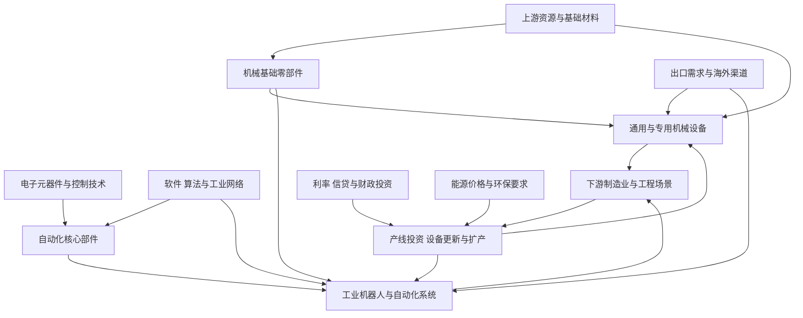

# 16｜机械制造与工业自动化产业链专题

> 研究范围：通用设备、专用设备、工业母机、工程机械、工业机器人、自动化核心部件与系统集成。本文用于全市场行业覆盖和产业链传导研究，不是个股推荐或买入评级。
>
> 数据口径：行业经营数据采用来源页面所列统计期；截至 2026-10-11。行业分类以申万 2021 版作为历史建设基准，最新分类版本仍需单独核验。

## 一、全景图：从上游材料到制造业资本开支

**阅读方式：**机械行业的需求来自下游企业的资本开支、设备更新、效率提升和海外销售。终端需求并不直接等于设备企业利润；还需经过客户预算、招标、订单、交付、验收、回款和售后服务等环节。

## 二、主要细分方向与产业链位置

| 细分方向 | 典型产品与业务 | 上游投入 | 下游需求 | 重点观察 |
|---|---|---|---|---|
| 通用设备 | 泵、阀、压缩机、风机、传动部件、通用机械 | 铸锻件、钢材、铜材、电机、密封件 | 化工、能源、电力、制造业、建筑设施 | 订单、产品价格、原料成本、售后收入 |
| 专用设备 | 面向特定工艺的生产设备、检测和加工设备 | 精密零件、控制系统、传感器、专用材料 | 电子、医药、食品、化工、新能源等 | 客户资本开支、订单质量、验收周期、客户集中度 |
| 工业母机与机床 | 金属切削机床、成形设备、数控系统、刀具 | 铸件、导轨、丝杠、主轴、伺服系统、数控系统 | 汽车、航空航天、模具、通用制造 | 新增订单、在手订单、数控化率、进口替代的实际订单 |
| 工程机械 | 挖掘机、装载机、起重机、路面机械、工业车辆 | 钢材、液压件、发动机、电驱系统、轮胎 | 基建、矿山、房地产施工、物流、海外工程 | 销量、开工小时、开工率、出口、渠道库存、应收账款 |
| 工业机器人 | 多关节机器人、协作机器人、移动机器人及工作站 | 减速器、伺服电机、控制器、传感器、结构件 | 汽车、电子、金属加工、物流、一般工业 | 装机量、订单、单机价格、国产供应链、客户复购 |
| 自动化核心部件 | 伺服、变频器、运动控制、传感器、机器视觉 | 功率器件、芯片、磁性材料、精密机械、软件 | 工业自动化、设备制造、产线改造 | 产品组合、毛利率、库存、渠道订单、研发投入 |
| 系统集成与工业软件 | 自动化产线、控制系统、工业数据采集与运维 | 控制硬件、工业网络、软件、工程实施能力 | 工厂数字化、柔性制造、设备联网 | 项目毛利、合同负债、验收、回款、重复性收入 |

## 三、上下游传导：哪些环节可能先变化

| 传导起点 | 可能的受影响环节 | 需要验证的中间证据 | 常见误判 |
|---|---|---|---|
| 制造业新订单改善 | 通用设备、专用设备、自动化部件 | 客户资本开支计划、采购订单、交付周期 | 制造业订单增加不一定转化为设备投资 |
| 基建、矿山及海外工程需求变化 | 工程机械及其零部件 | 实际销量、开工小时、出口交付、经销商库存 | 销量增长可能来自低基数或渠道补库 |
| 电子、新能源产线扩产 | 专用设备、机器人、检测设备 | 客户扩产计划、招标、订单、验收和回款 | 客户宣布投资不代表设备供应商已经获得订单 |
| 设备更新与节能改造 | 机床、泵阀、电机、变频器、自动化系统 | 更新预算、政策执行、项目开工、采购数据 | 政策出台不等于新增需求立即兑现 |
| 钢材、铜材、能源价格上涨 | 机械设备制造商成本端 | 产品调价能力、库存周期、合同价格条款 | 原材料涨价对不同企业影响并不相同 |
| 国产部件性能和可靠性提升 | 伺服、控制器、减速器、数控系统 | 客户验证、批量供货、复购率、售后故障率 | 样机突破不等于稳定量产和盈利 |
| 海外渠道与服务网络完善 | 工程机械、机床、自动化设备 | 海外订单、当地库存、售后覆盖、回款与汇率 | 出口收入增长可能伴随费用和应收风险 |

## 四、行业数据快照：增长不等于全行业景气同步

以下为来源公开的统计数据，适合用作研究起点，不能直接作为当前股票买卖信号。

### 1. 机械工业生产与投资分化

中国机械工业联合会转引国家统计局数据称，2026 年 1—8 月，通用设备制造业增加值同比增长 8.1%，专用设备制造业增长 9.2%，仪器仪表制造业增长 10.1%；同期通用设备制造业固定资产投资增长 0.9%，专用设备制造业投资下降 9.0%。同一时期，金属切削机床产量累计 58 万台、同比增长 8.8%；工业机器人产量累计 72.9 万套、同比增长 29.0%。

来源：[中国文化办公设备制造协会转载中国机械工业联合会数据，2026-09-29](https://www.ccoea.org.cn/news1.asp?vid=7353)

**解读限制：**产量增长可能反映供给扩张、产品结构变化或出口需求，并不必然意味着终端订单、企业利润和现金流同步增长。行业增加值、固定资产投资和单类产品产量属于不同统计指标，不可相互替代。

### 2. 制造业需求与资本开支背景

国家统计局公布，2026 年 9 月制造业采购经理指数为 50.1%，回到扩张区间；生产指数为 51.7%，新订单指数为 50.5%，原材料库存指数为 48.2%。该指数反映制造业景气扩散情况，不等同于机械设备企业订单增速。

来源：[国家统计局，2026 年 9 月采购经理指数，2026-09-30](https://www.stats.gov.cn/zwfwck/sjfb/202609/t20260930_1965449.html)

国家统计局公布，2026 年 1—8 月制造业固定资产投资同比下降 2.3%，工业投资下降 2.9%。这说明总量投资环境仍有压力，但不能据此否定所有细分设备领域的结构性增长；应继续检查高技术制造、出口、设备更新等具体需求来源。

来源：[国家统计局，2026 年 1—8 月固定资产投资，2026-09-15](https://www.stats.gov.cn/sj/zxfbhjd/202609/t20260915_1965309.html)

### 3. 工程机械：销售、开工与出口应交叉验证

中国工程机械工业协会公布的 2026 年上半年数据称，协会统计的十二大类主要产品累计销售 125.75 万台，同比增长 18.3%；出口量 53.15 万台，同比增长 25.8%。另一份 2026 年 9 月市场指数快报显示，主要产品月平均工作时长同比增长 3.32%，但主要产品月开工率同比下降 2.73 个百分点。

来源：[工程机械行业 2026 年上半年运行情况，2026-07-30](https://gcjx.xwboo.com/news/255222.html)；[工程机械 2026 年 9 月市场指数快报，2026-10-09](https://news.d1cm.com/20261009193153.shtml)

**解读限制：**销售增长、设备工作时长和开工率方向可能不同。还应核实统计覆盖范围、国内外结构、经销商库存、价格和企业现金流，不要只看销量单项指标。

## 五、跟踪指标清单

| 维度 | 优先指标 | 为什么重要 | 需要留意的反向证据 |
|---|---|---|---|
| 需求 | 新订单、在手订单、招标、客户资本开支、设备更新项目 | 判断需求是否进入供应商订单 | 订单增长但取消率上升、交付延期或毛利下降 |
| 生产 | 产量、产能利用率、交货周期、开工小时 | 判断供给和实际使用情况 | 产量上升但库存更快累积 |
| 价格 | 产品售价、原料成本、单位成本、产品结构 | 判断议价权和利润空间 | 降价抢单、原料涨价无法转嫁 |
| 库存 | 原材料、在制品、产成品、经销商库存 | 区分主动备货与被动积压 | 库存增速持续高于收入和订单 |
| 盈利 | 毛利率、营业利润率、费用率、分部利润 | 判断增长是否转化为利润 | 收入增长但利润率持续下滑 |
| 现金流 | 经营现金流、应收账款、应收票据、合同资产、存货 | 判断利润质量和资金占用 | 应收与存货增速显著高于收入 |
| 资本回报 | 资本开支、研发投入、固定资产周转、投入资本回报 | 判断扩产效率和竞争力 | 扩产过快、利用率不足、回报率下降 |
| 海外经营 | 海外收入、订单地区、渠道费用、汇率、售后成本 | 判断出海质量 | 收入增长但回款变慢、贸易限制增加 |
| 竞争 | 市占率、产品可靠性、客户复购、价格变化 | 判断优势能否持续 | 依赖单一客户、低价竞争或技术替代 |

## 六、三种情景与逻辑失效条件

### 偏强情景
- 下游资本开支和设备更新预算改善，并转化为可核实订单。
- 在手订单、交付和回款同步改善，库存增长受控。
- 产品结构改善或售后服务扩大，使毛利率和经营现金流同步改善。
- 海外业务增长有本地渠道和售后服务支撑。

### 基准情景
- 行业总量分化，部分设备受益于更新、出口或新技术投资，传统需求恢复缓慢。
- 企业间差异主要由产品竞争力、客户结构、订单质量和费用控制决定。
- 估值可能先反映预期，后续需要财报兑现。

### 偏弱情景
- 下游资本开支继续推迟，设备采购以压价和延迟交付为主。
- 同质化供给扩张，行业竞争加剧，产品降价快于成本下降。
- 应收账款、存货和合同资产持续上升，经营现金流转弱。
- 海外市场出现关税、认证、汇率、渠道或售后障碍。

**逻辑失效条件：**若订单改善无法转化为收入和现金流、库存与应收持续恶化、价格竞争吞噬利润，或关键技术方案被替代，则不能仅凭行业政策、产量增速或主题热度维持原有判断。

## 七、上市公司与指数基金映射规则

本专题暂不把概念股名单当作结论。建立公司映射时，逐家公司核实：

1. 最近年度报告和中期报告中的主营产品、分部收入、分部利润及客户行业。
2. 机械业务是核心收入还是少量试点、代理销售或参股投资。
3. 订单、合同负债、存货、应收账款和经营现金流是否相互印证。
4. 海外收入是否披露具体区域、当地经营费用及回款情况。
5. 竞争优势是否能从产品性能、客户认证、规模成本、售后网络或持续研发中找到证据。

映射指数基金时，核对基金跟踪的指数名称、编制规则、成分股和权重、行业集中度、规模、成交额、费用、跟踪误差及最新持仓日期。机械、机器人、工业母机和高端装备等主题可能存在重叠，但不等于持仓结构相同。**不得仅凭基金名称判断其真实行业敞口。**

## 八、建议的持续研究顺序

1. 先补齐机械制造相关一级、二级、三级行业的分类对应关系，并注明分类版本。
2. 分开建立工程机械、机床与工业母机、通用设备、专用设备、机器人、自动化部件六类细分档案。
3. 每月更新订单、产量、价格、库存、出口、投资和财务指标，记录数据发布日期和统计期间。
4. 再将上市公司业务敞口与行业链条逐一对应，最后核验相关指数基金的实际持仓。
5. 对每个判断记录反证条件，避免把政策、产量或股价上涨直接等同于基本面改善。

## 九、来源与复核清单

- [中国机械工业联合会数据转载：2026 年 1—8 月机械工业生产情况，2026-09-29](https://www.ccoea.org.cn/news1.asp?vid=7353)
- [国家统计局：2026 年 9 月采购经理指数，2026-09-30](https://www.stats.gov.cn/zwfwck/sjfb/202609/t20260930_1965449.html)
- [国家统计局：2026 年 1—8 月固定资产投资，2026-09-15](https://www.stats.gov.cn/sj/zxfbhjd/202609/t20260915_1965309.html)
- [中国工程机械工业协会 2026 年上半年运行数据转载，2026-07-30](https://gcjx.xwboo.com/news/255222.html)
- [工程机械 2026 年 9 月市场指数快报，2026-10-09](https://news.d1cm.com/20261009193153.shtml)

> 复核提醒：协会数据转载页面应尽量追溯协会原文；行业产量、销售、开工率、固定资产投资及企业财务指标的统计范围并不完全一致。后续更新时记录原始来源、发布日期、统计期间、单位和修订情况。
