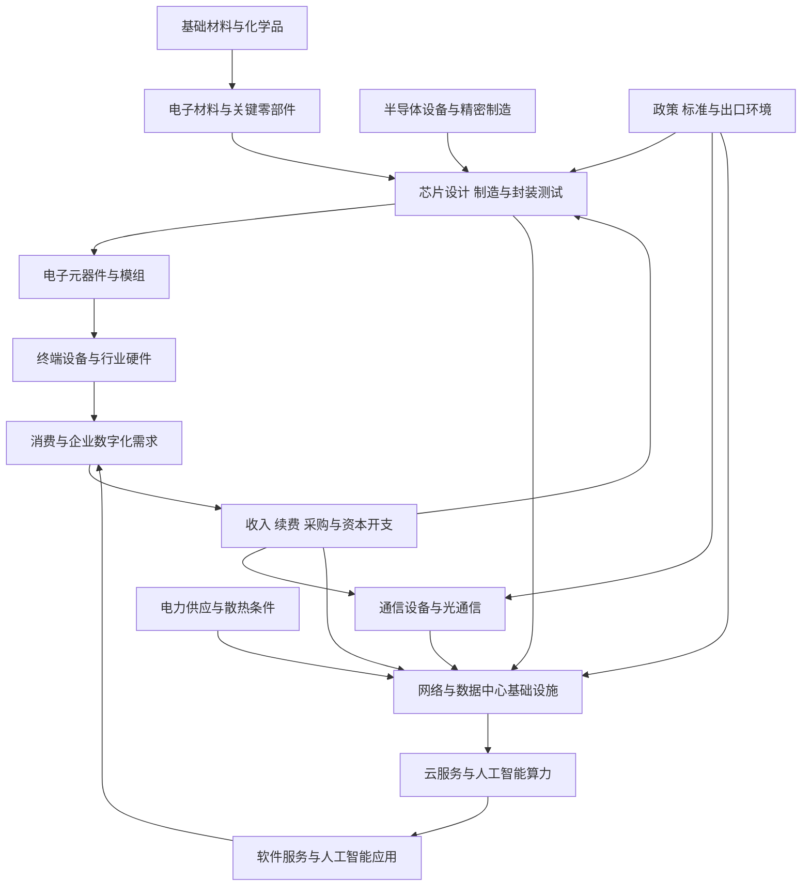

# 17｜电子、通信、计算机与人工智能产业链专题

> 研究范围：电子元器件、消费电子、半导体设计制造封测、半导体设备与材料、通信设备与光通信、数据中心基础设施、计算机硬件、基础软件与行业软件、云服务及人工智能应用。
>
> 研究边界：这是一份全市场产业链研究卡，不是热门概念清单或个股买入建议。半导体设备已有独立档案，本专题将其放回更大的电子—通信—计算机产业链中，重点分析跨环节传导。
>
> 数据截止口径：采用来源页面所示的 2026 年统计期；申万 2021 版仅作为历史行业分类基准，最新分类版本仍待单独核验。

## 一、全景图：从材料、芯片到数字应用

**核心逻辑：**产业链上游的技术突破和产能扩张，必须经过客户认证、实际订单、交付、产品价格与现金回款，才能转化为企业利润。人工智能应用增长也不意味着所有芯片、服务器、光模块、软件企业都按相同比例受益。

## 二、细分环节地图

| 细分环节 | 主要业务 | 上游投入 | 下游客户或需求 | 重点验证 |
|---|---|---|---|---|
| 电子材料与元件 | 电子化学品、基板、被动元件、连接器、传感器 | 化工材料、金属、陶瓷、精密加工 | 芯片、通信、汽车电子、消费电子、工业设备 | 规格升级、客户认证、稼动率、价格与库存 |
| 半导体设计 | 处理器、存储、模拟、功率、接口及专用芯片 | 设计工具、知识产权、晶圆代工、封装测试 | 服务器、通信、汽车、工业、消费终端 | 产品组合、客户集中度、设计导入、库存周期 |
| 晶圆制造 | 逻辑、存储、特色工艺、功率器件制造 | 设备、硅片、光刻胶、特种气体、超纯化学品 | 芯片设计公司及终端制造商 | 产能利用率、良率、资本开支、折旧与单位成本 |
| 封装测试 | 传统封测、先进封装、测试服务 | 基板、引线框架、封装材料、测试设备 | 芯片设计公司、晶圆制造企业、终端厂商 | 产能利用率、封装技术、客户认证、资本回报 |
| 半导体设备 | 薄膜沉积、刻蚀、清洗、量测、检测等 | 精密零部件、真空系统、射频电源、软件 | 晶圆厂、封测厂、科研与制造机构 | 招标、订单、验收、重复采购、售后服务收入 |
| 消费电子与终端 | 手机、个人电脑、可穿戴设备、智能终端、零部件模组 | 芯片、屏幕、电池、摄像头、结构件 | 居民消费、企业采购、品牌厂商 | 出货量、换机周期、渠道库存、单机价值量 |
| 通信设备与光通信 | 无线接入、传输、光模块、光纤光缆、网络设备 | 光芯片、激光器、电子元件、通信芯片 | 电信运营商、云服务商、数据中心、企业网络 | 资本开支、招标、订单交付、产品迭代、毛利率 |
| 服务器与数据中心 | 服务器、存储、交换设备、机柜、电源、散热 | 处理器、存储、网络芯片、电源、制冷系统 | 云服务商、运营商、企业、科研机构 | 服务器出货、客户资本开支、交期、利用率、回款 |
| 计算机与基础软件 | 计算机设备、操作系统、数据库、中间件、安全软件 | 芯片、硬件平台、研发和渠道投入 | 政企客户、金融、制造、医疗、互联网 | 采购预算、订阅续费、合同负债、应收账款、研发效率 |
| 云服务与人工智能应用 | 云资源、模型服务、智能办公、行业应用、数据服务 | 算力、数据、模型、软件工程、行业知识 | 企业、开发者、个人用户及公共机构 | 付费客户、续费、推理成本、毛利率、客户留存 |

## 三、跨行业上下游传导

| 起点变化 | 可能传导方向 | 需要的证据 | 不能直接得出的结论 |
|---|---|---|---|
| 人工智能应用使用量增加 | 算力租用、服务器、网络、存储、电源与散热需求 | 客户资本开支、服务器订单、交付、算力利用率、付费收入 | 不能推导所有人工智能概念公司都能获得收入 |
| 数据中心扩建 | 服务器、交换机、光通信、电源、制冷、配电 | 项目开工、采购订单、设备验收、利用率、回款 | 不能把项目规划金额等同于供应商已确认收入 |
| 晶圆厂扩产 | 半导体设备、材料、零部件、洁净室及工程服务 | 资本开支兑现、招标、设备搬入、验收、产能利用率 | 不能把晶圆厂投资一比一换算成每家设备公司的收入 |
| 终端出货回升 | 芯片、面板、模组、连接器和零部件 | 终端销量、渠道库存、订单、产品价格、客户排产 | 不能只凭单月出货判断整个周期反转 |
| 芯片价格上涨 | 设计、制造、存储或分销等不同环节 | 具体品类价格、库存、供给集中度、合同周期 | 芯片各品类周期不同，不能使用单一价格代表整个半导体行业 |
| 新一代通信技术部署 | 网络设备、光通信、射频与终端升级 | 运营商招标、云厂商采购、部署进度、设备利用率 | 技术标准发布不等于商业部署立即放量 |
| 企业软件与人工智能工具普及 | 软件许可、云服务、集成和运维需求 | 付费用户、续费率、合同金额、交付成本 | 下载量、试用量和演示效果不等于可持续收入 |
| 出口限制、关税或供应链变化 | 芯片、设备、材料、通信设备和终端企业 | 具体产品范围、许可、替代周期、客户地区、供应链备份 | 不可把政策新闻直接等同于某家公司受益 |

## 四、近期公开数据：总量增长与环节差异并存

### 1. 电子信息制造业：生产、收入、利润和投资的表现并不相同

工业和信息化部公布，2026 年 1—8 月，规模以上电子信息制造业增加值同比增长 15.7%；集成电路产量同比增长 22.3%，电子元件产量同比增长 13.1%；出口交货值同比增长 8.2%；营业收入同比增长 20.1%，利润总额同比增长 1.1 倍；固定资产投资同比增长 8.1%。

来源：[工业和信息化部：2026 年 1—8 月电子信息制造业运行情况，2026-09-30](https://wap.miit.gov.cn/jgsj/yxj/xxfb/art/2026/art_a6c6b6fe6e4d4b408c44c54c1b25c4ed.html)

**解读限制：**这是电子信息制造业的宽口径统计，不能代表所有细分行业或单家公司。利润增速还需结合基数、成本、产品结构和分行业表现解读；不能把集成电路产量增速直接当作芯片设计公司盈利增速。

### 2. 工业生产：电子行业贡献突出，但仍需跟踪需求质量

国家统计局公布，2026 年 8 月规模以上电子行业增加值同比增长 17.2%；人工智能相关需求带动传感器、光纤等产品产量分别同比增长 42.6% 和 20.7%。同期，电子元器件及设备制造增加值同比增长 22.9%，计算机制造增加值同比增长 11.9%。

来源：[国家统计局：2026 年 8 月工业生产数据解读，2026-09-15](https://www.stats.gov.cn/sj/zxfbhjd/202609/t20260915_1965330.html)

**解读限制：**产量和增加值反映生产端变化，不等同于最终需求、价格、毛利率或现金流。应结合客户订单、渠道库存和企业财报确认增长质量。

### 3. 数据中心与智能算力：关注服务收入和利用效率，而非只看建设规模

中国信息通信研究院《智能算力服务研究报告（2026 年）》称，2025 年我国智能算力服务市场规模突破 1300 亿元，并从算力资源服务、算力互联互通服务、算力应用服务等方面分析产业链。

来源：[中国信通院：《智能算力服务研究报告（2026 年）》，2026-05-08](https://www.citmt.cn/news/202605/123124.html)

**解读限制：**报告中的市场规模是特定口径下的行业测算，不等同于上市公司收入，也不代表所有参与者都能获得同等利润。需要进一步拆解算力租用价格、利用率、折旧、电费、融资成本、客户集中度和回款周期。

## 五、重点指标与财务核验

| 维度 | 重点指标 | 核验问题 |
|---|---|---|
| 终端需求 | 手机、个人电脑、服务器、网络设备出货量与客户库存 | 增长来自最终销售还是渠道补库？ |
| 半导体周期 | 晶圆厂利用率、库存天数、产品价格、资本开支、良率 | 需求恢复是否传导至产能利用率和利润？ |
| 设备与材料 | 新签订单、在手订单、验收、合同负债、客户集中度 | 订单能否按期交付并形成回款？ |
| 通信与光通信 | 运营商和云服务商资本开支、招标、交付周期 | 需求是否已进入供应商订单和收入？ |
| 数据中心 | 算力利用率、服务器部署、电费、制冷成本、折旧 | 投资能否获得合理的利用率与回报？ |
| 软件与人工智能 | 付费客户、续费率、合同负债、单客户收入、推理成本 | 用户使用能否转化为可持续毛利和现金流？ |
| 经营质量 | 毛利率、研发费用率、存货、应收账款、经营现金流 | 收入增长是否以压价、库存或赊销为代价？ |
| 竞争格局 | 市占率、客户认证、产品性能、替代周期、研发效率 | 优势是持续能力还是短期供需缺口？ |
| 海外风险 | 海外收入地区、出口管制、关税、汇率、供应链替代 | 订单能否交付，是否存在合规与回款风险？ |

## 六、三种情景与反证条件

### 偏强情景
- 终端库存处于合理区间，新增订单由实际需求支持。
- 数据中心、通信和人工智能相关资本开支转化为设备采购、交付和可持续服务收入。
- 半导体设备和材料企业的订单、验收、复购及现金回款同步改善。
- 软件企业的付费客户和续费增加，单位服务成本下降，毛利率改善。

### 基准情景
- 行业总量仍有增长，但不同产品、客户和供应链位置分化明显。
- 部分高端产品需求较强，通用产品仍受价格竞争、库存和资本开支波动影响。
- 市场可能提前计入增长预期，估值变化快于财务数据兑现。

### 偏弱情景
- 终端需求放缓或渠道库存增加，客户推迟采购。
- 数据中心投资回报不达预期，建设进度延后或算力利用率不足。
- 芯片、设备或元件供给扩张快于需求，价格下跌侵蚀利润。
- 出口限制、客户集中、技术替代或回款风险影响交付和现金流。

**逻辑失效条件：**如果订单、验收、付费收入和经营现金流不能相互印证，库存与应收持续恶化，或估值已明显高于可验证的盈利增长，则不能仅凭人工智能、国产替代或技术升级的叙事维持乐观判断。

## 七、上市公司与指数基金映射规范

本专题不以概念标签直接认定受益公司。逐家公司核验最近年度报告、中期报告及公告中的主营产品、分部收入、利润、客户行业、订单、研发投入、存货、应收和现金流。

对跨行业公司，应拆分其在电子元件、半导体设备、通信、服务器、软件或人工智能业务中的实际收入占比；若公司没有披露可验证的业务规模，应标记为“敞口待核实”，不以新闻提及或合作演示代替收入证据。

映射指数基金时，逐一核对跟踪指数、编制规则、成分股及权重、行业集中度、基金规模、成交额、费用、跟踪误差和持仓日期。半导体、通信设备、计算机、人工智能和电子主题基金可能重叠，但并非同一风险暴露。**基金名称不等于真实持仓，也不等于估值便宜。**

## 八、建议的持续研究顺序

1. 先明确电子、通信、计算机及软件相关分类的层级和版本，避免把产业主题误当作正式行业目录。
2. 分别建立电子元件、半导体设计制造封测、设备材料、消费电子、通信光通信、服务器数据中心、软件与人工智能应用专题。
3. 每月更新出货、价格、库存、资本开支、招标、订单、交付和财务数据，保留发布日期和统计期间。
4. 将上市公司主营业务、实际收入占比和指数基金成分映射到产业链环节。
5. 对每项判断记录反证和数据缺口，优先验证现金流与估值，而非只追踪热门主题。

## 九、来源与复核清单

- [工业和信息化部：2026 年 1—8 月电子信息制造业运行情况，2026-09-30](https://wap.miit.gov.cn/jgsj/yxj/xxfb/art/2026/art_a6c6b6fe6e4d4b408c44c54c1b25c4ed.html)
- [国家统计局：2026 年 8 月工业生产数据解读，2026-09-15](https://www.stats.gov.cn/sj/zxfbhjd/202609/t20260915_1965330.html)
- [中国信通院：《智能算力服务研究报告（2026 年）》，2026-05-08](https://www.citmt.cn/news/202605/123124.html)
- [工业和信息化部电子信息制造业统计分析入口](https://www.miit.gov.cn/gxsj/tjfx/dzxx/)

> 复核要求：优先追溯官方原始统计和上市公司正式披露；区分生产、销售、资本开支、订单、收入与利润口径。行业总量数据不能直接替代单家公司分析。
