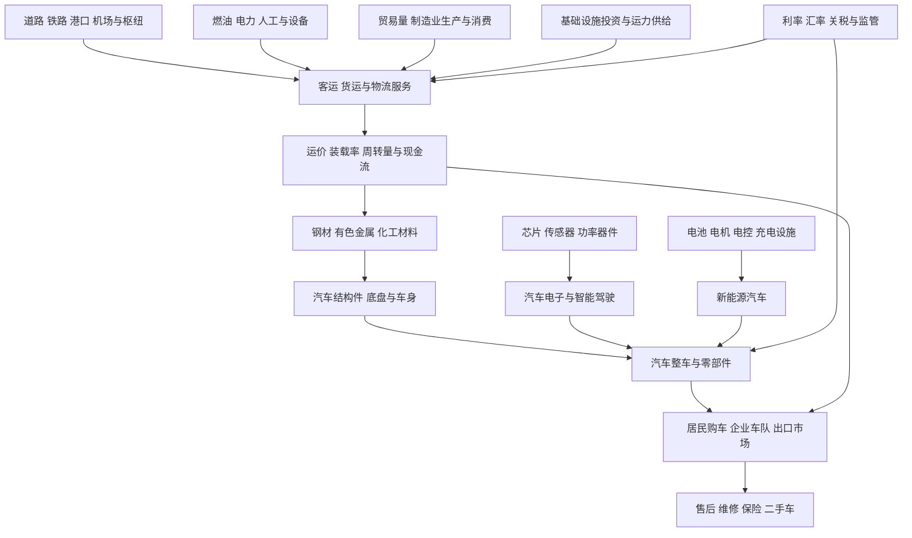

# 18｜汽车与交通运输产业链专题

> 研究范围：传统汽车与新能源汽车、汽车零部件、汽车电子与智能驾驶、动力电池与充电设施，以及公路、铁路、航空、机场、港口、航运、物流和快递。
>
> 研究定位：本专题用于全市场产业链覆盖和上下游传导研究，不是个股推荐。电池与新能源、电子通信、机械制造专题已有独立研究卡，本专题着重补齐汽车与交通终端需求、运力、运价、基础设施和跨行业关系。
>
> 数据口径：引用页面所列 2026 年统计期。申万 2021 版仅作为历史行业分类基准，最新分类版本仍待单独核验。

## 一、全景图：从汽车材料到运输服务

**核心判断链：**终端销量或货运需求变化，需要经过产品价格、渠道库存、产能利用率、运价、燃油和人工成本、资本开支及回款等环节，才能传导至企业利润。汽车出口增长与航运运价变化也不能直接画等号，必须区分运输方式、航线、货类和合同价格。

## 二、汽车产业链分层

| 细分方向 | 主要业务 | 上游投入 | 下游需求 | 重点跟踪 |
|---|---|---|---|---|
| 传统燃油汽车 | 乘用车、商用车、发动机及传动系统 | 钢材、铝材、橡胶、发动机和变速箱部件 | 居民换购、企业车队、商用运输 | 批发与零售、折扣、库存、单车利润 |
| 新能源汽车整车 | 纯电、插电式混合动力及其他新能源车型 | 电池、电驱、电控、车身、电子系统 | 国内消费、企业车队、海外市场 | 交付量、售价、单车毛利、售后成本、出口回款 |
| 汽车零部件 | 底盘、制动、转向、热管理、车身、内外饰 | 金属、橡塑、精密加工、模具 | 整车厂、售后市场、海外客户 | 配套车型生命周期、单车价值量、客户集中度 |
| 动力电池与电驱 | 电芯、模组、电池包、电机、电控 | 锂、镍、钴、石墨、铜、磁材及功率器件 | 新能源汽车、商用车、储能 | 原材料成本、价格传导、产能利用率、良率、库存 |
| 汽车电子与智能驾驶 | 车载计算、传感器、车载网络、驾驶辅助、座舱 | 芯片、摄像头、雷达、软件、通信模块 | 整车厂、智能化升级与售后 | 客户定点、量产时间、单车价值量、软件收入与责任风险 |
| 充电与换电设施 | 充电设备、运营平台、换电网络、配套电力设施 | 功率器件、线缆、变压器、土地和施工 | 私家车、车队、出租车、商用车 | 设备利用率、服务费、建设成本、回收期 |
| 汽车后市场 | 维修、零部件、保养、二手车与汽车服务 | 零部件、服务网点、技师、检测与数据 | 车主、车队、二手车交易 | 车龄结构、客户复购、服务毛利、合规与周转 |

## 三、交通运输产业链分层

| 细分方向 | 主要业务 | 需求与投入 | 重点指标 | 主要风险 |
|---|---|---|---|---|
| 公路运输与高速公路 | 公路货运、客运、高速公路运营 | 制造业、消费、基建、燃油与人工 | 货运量、车流量、通行费、单位成本 | 运价竞争、燃油上涨、路段分流、资本开支 |
| 铁路与轨道交通 | 铁路货运、客运、城市轨道及装备 | 大宗货物、人员出行、铁路投资 | 货运周转量、客座率、运量、设备采购 | 固定成本高、建设周期长、客货结构变化 |
| 港口与航运 | 港口装卸、集装箱、干散货、油运、内河航运 | 外贸、能源、矿产、农产品、制造业货物 | 吞吐量、运价指数、船舶运力、装载率 | 运价周期、燃油、地缘冲突、港口拥堵 |
| 航空与机场 | 航空客运、航空货运、机场运营 | 商务与旅游出行、跨境贸易、燃油和飞机租赁 | 客座率、收益水平、货运量、航班量 | 油价、汇率、机队资本开支、竞争与安全 |
| 物流与供应链服务 | 仓储、合同物流、货代、供应链管理 | 电商、制造业、零售、进出口 | 单票收入、单票成本、周转效率、客户留存 | 价格战、人工成本、客户集中、应收账款 |
| 快递与即时配送 | 快递、仓配一体、即时配送 | 网络购物、商家发货、同城消费 | 件量、单票收入、单票成本、网点稳定性 | 低价竞争、加盟网络风险、劳动与合规成本 |
| 交通基础设施建设 | 公路、铁路、港口、机场及配套工程 | 财政资金、专项债、项目融资、施工设备 | 新开工、项目进度、订单、应收与现金流 | 回款周期长、地方财政约束、债务和项目延期 |

## 四、近期数据快照与解读边界

### 1. 汽车：出口强、内需承压，新能源占比提高

中国汽车工业协会公布，2026 年 1—8 月汽车产量和销量分别为 2025.5 万辆、2031.5 万辆，同比均下降 3.8%；汽车出口 715.3 万辆，同比增长 66.7%。同期新能源汽车产量 1066.8 万辆、销量 1065 万辆，同比分别增长 10.8% 和 10.7%。

来源：[中国汽车工业协会数据转载与 2026 年 8 月产销简析，2026-09-11](https://field.10jqka.com.cn/20260911/c679820547.shtml)；[中国新闻网：8 月新能源汽车国内销量比例，2026-09-11](https://www.chinanews.com/cj/2026/09-11/10694386.shtml)

**解读：**总量产销、国内销售、新能源销量与出口应分别跟踪。出口增长可能提升整车及配套供应链需求，但还要核验目的地、当地售价、渠道建设、售后投入、贸易限制、汇率和回款。销量增长也可能与降价促销并存，不能仅凭销量推断单车利润改善。

### 2. 交通运输：货运量和投资增长，利润仍由价格与成本决定

交通运输部发布的数据显示，2026 年 1—8 月全国交通固定资产投资 2.09 万亿元；营业性货运量 379.1 亿吨，同比增长 2.4%；港口货物吞吐量 120.6 亿吨，同比增长 0.5%；集装箱吞吐量 2.4 亿标箱，同比增长 4%。

来源：[交通运输部：前 8 月全国完成交通固定资产投资超 2 万亿元，2026-09-29](https://www.mot.gov.cn/xinwen/jiaotongyaowen/202609/t20260929_4225091.html)；[交通运输部数据入口](https://www.mot.gov.cn/shuju/)

**解读：**货运量、港口吞吐量、交通投资是不同指标。货运量增加不一定改善承运人的利润；若运力增速更快、价格下降或燃油人工成本上升，利润仍可能承压。投资额也不等于上市工程企业已获得订单或收到现金。

### 3. 汽车出口与运输服务：存在联系，但不是直接映射

汽车出口增长可能增加滚装船、集装箱、港口和海外仓配需求，但影响程度取决于运输方式、航线、合同条款和运力供需。研究时应分别跟踪：
- 汽车出口数量、目的地和车型结构；
- 滚装船运力、租船价格、航线利用率及港口装卸量；
- 集装箱运价与汽车出口变化是否发生在同一航线和同一时间；
- 相关上市公司收入中汽车运输业务的真实占比。

不得仅凭汽车出口增长，就判断所有港口、航运或物流公司同步受益。

## 五、产业链传导与关键证据

| 起点变化 | 可能影响环节 | 需要的中间证据 | 常见误判 |
|---|---|---|---|
| 国内汽车销量改善 | 整车、零部件、经销商、售后 | 零售、折扣、库存、单车毛利、回款 | 批发增长可能只是渠道补库 |
| 汽车出口增长 | 整车、零部件、港口、汽车运输 | 出口订单、目的地、运价、交付和当地销售 | 出口量增加不等于海外利润增加 |
| 新能源车渗透率上升 | 电池、电驱、热管理、汽车电子、充电 | 单车价值量、客户定点、量产、产品价格 | 渗透率上升不保证供应商份额上升 |
| 智能驾驶功能增加 | 传感器、车载计算、软件和测试 | 量产车型、装配率、单车收入、责任界定 | 发布会或试点不等于大规模收入 |
| 原材料价格波动 | 整车、零部件、电池及维修供应链 | 采购价、库存成本、合同调价、产品结构 | 原材料下跌不一定立即提高毛利 |
| 货运需求增加 | 公路、铁路、港口、航运、物流 | 运价、装载率、周转量、运力增速 | 货量增长不代表单位利润改善 |
| 运价上升 | 航运、货代及部分港口服务 | 合同期限、现货与长约占比、燃油和租船成本 | 运价指数不等于公司实际结算价 |
| 基建投资增加 | 施工、交通装备、材料、工程服务 | 项目资金来源、招标、开工、结算与回款 | 项目计划金额不等于订单和现金 |
| 燃油或汇率变化 | 航空、公路、航运、汽车出口 | 燃油套保、外币债务、收入币种、调价机制 | 同一变化对不同企业影响可能相反 |

## 六、跟踪指标清单

| 维度 | 汽车行业 | 交通运输行业 |
|---|---|---|
| 需求 | 国内零售、批发、出口、车型结构、客户订单 | 货运量、客运量、吞吐量、订单量、客座率 |
| 供给 | 产能利用率、渠道库存、在手订单、交付周期 | 船舶/车辆/飞机运力、装载率、班次、运力增速 |
| 价格 | 终端成交价、折扣、单车收入、零部件报价 | 运价、票价、通行费、单票收入、服务费 |
| 成本 | 电池与金属成本、研发、销售费用、保修成本 | 燃油、电力、人工、租赁、维护、折旧 |
| 经营质量 | 单车毛利、库存、应收、售后费用、经营现金流 | 单位运输成本、应收账款、资本开支、经营现金流 |
| 海外经营 | 出口目的地、渠道、认证、汇率、关税 | 航线结构、海外网点、港口和客户集中度 |
| 资本回报 | 新车型投入、产线建设、研发转化、产能回报 | 船舶/飞机购置、基础设施投资、资产周转 |
| 风险 | 价格战、召回、质量、客户集中、技术迭代 | 运价周期、燃油、地缘冲突、事故、安全与监管 |

## 七、三种情景与逻辑失效条件

### 偏强情景
- 汽车出口订单可以转化为稳定交付和海外终端销售，且价格、售后费用和回款可控。
- 新能源汽车销量增长同时带动核心零部件收入和利润，而非单纯依靠降价换量。
- 交通货运需求改善，运价和装载率提高，且运力供给没有更快扩张。
- 基础设施项目资金到位，施工进度、结算与回款同步改善。

### 基准情景
- 汽车行业总量增长有限，新能源、传统燃油、商用车和出口市场分化。
- 交通运输总量平稳，不同运输方式和细分航线的运价周期不同。
- 企业表现主要由成本控制、资产效率、客户结构、产品竞争力和现金流决定。

### 偏弱情景
- 国内购车需求不足，车企依靠大幅折扣维持销量，库存与应收增加。
- 海外贸易限制、渠道投入或售后成本侵蚀出口利润。
- 运输运力增长超过需求，货量增加但运价持续下降。
- 燃油、租赁、人工或融资成本上升，且无法通过调价转嫁。
- 基建项目延期、结算变慢或资金不足，工程企业现金流恶化。

**逻辑失效条件：**若销量增长不能带来利润与现金流改善，运价上涨无法覆盖成本，或应收、库存和资本开支持续恶化，就不能仅凭出口增长、渗透率提升、基础设施规划或主题热度维持原有判断。

## 八、上市公司与指数基金映射规则

### 上市公司
逐家公司核对最近年度报告、中期报告和公告：
1. 汽车业务、零部件、动力系统、智能驾驶、运输或物流业务的真实收入与利润占比。
2. 国内与海外收入、主要客户、车型配套、运输方式、航线和合同期限。
3. 销量或货量是否与产品价格、单位成本、库存、应收和现金流同步。
4. 资本开支、租赁负债、折旧、债务与现金流之间的关系。
5. 是否存在客户集中、召回、安全、贸易限制、环保或合规风险。

没有披露可验证业务规模的公司，应标记为“敞口待核实”，不能仅因概念标签或新闻报道认定为受益者。

### 指数基金
逐一核对跟踪指数、编制规则、成分股与权重、行业集中度、规模、成交额、费用、跟踪误差和最新持仓日期。汽车、新能源汽车、智能汽车、运输、港口、物流等主题之间可能重叠，但真实持仓和风险驱动不同。基金名称不等于真实业务敞口，也不代表估值便宜。

## 九、持续研究顺序

1. 核对汽车、运输及相关行业分类版本和层级，区分正式行业分类与主题概念。
2. 分别建立整车、零部件、动力电池与电驱、汽车电子、充电设施、港口航运、航空机场、铁路公路、物流快递档案。
3. 按月更新销量、出口、库存、运价、货运量、吞吐量、燃油成本和企业财务数据。
4. 将上市公司真实主营收入、利润和现金流映射到产业链位置。
5. 再核验指数基金持仓和估值，并记录每项判断的反证条件。

## 十、来源与复核清单

- [中国汽车工业协会数据转载与 2026 年 8 月产销简析，2026-09-11](https://field.10jqka.com.cn/20260911/c679820547.shtml)
- [中国新闻网：8 月新能源汽车国内销量比例，2026-09-11](https://www.chinanews.com/cj/2026/09-11/10694386.shtml)
- [交通运输部：前 8 月全国完成交通固定资产投资超 2 万亿元，2026-09-29](https://www.mot.gov.cn/xinwen/jiaotongyaowen/202609/t20260929_4225091.html)
- [交通运输部统计数据入口](https://www.mot.gov.cn/shuju/)
- [交通运输部交通运输经济运行情况入口](https://www.mot.gov.cn/shuju/fenxigongbao/jingjifenxi/index.html)

> 复核要求：优先追溯协会、政府部门和上市公司正式披露。记录发布日期、统计期间、统计范围和单位；严格区分销量、出货、运量、运价、收入、利润与现金流。
