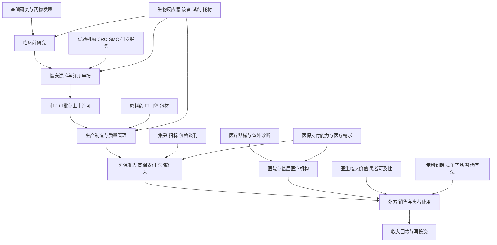

# 19｜医药与医疗健康产业链专题

> 研究范围：化学制药、中药、生物制品、创新药研发、合同研究与生产服务、医药流通、医疗器械、体外诊断、医疗耗材、医疗服务、医院、药店及商业健康保险相关支付环节。
>
> 研究定位：这是全市场行业覆盖专题，不是个股推荐。目标是识别研发、审批、支付、采购、临床使用和现金回款之间的传导，避免把政策、临床进展或销售增长直接等同于利润改善。
>
> 数据口径：政策与统计以所列官方发布为准。行业分类仍以经核验的分类版本为准；申万 2021 版仅作为历史建设基准。

## 一、全景图：从研发投入到患者支付

**核心传导链：**研发投入并不直接产生收入；需要经过临床验证、监管审批、生产放量、支付准入、医院或渠道覆盖、患者使用与回款。器械和医疗服务的路径不同，但同样要验证采购预算、真实使用量、价格、利用率、合规与现金回收。

## 二、医药健康的主要环节

| 细分环节 | 商业模式 | 上游投入 | 下游付款方或客户 | 核心指标 |
|---|---|---|---|---|
| 化学制药 | 仿制药、改良型新药、专利药研发与销售 | 原料药、中间体、辅料、研发与生产设备 | 医院、药店、医药流通、医保及患者 | 产品销量、单价、毛利率、集采中标、专利到期 |
| 中药 | 中药材种植采购、饮片、中成药研发生产 | 中药材、饮片、包材、生产与质量体系 | 医疗机构、药店、患者 | 药材价格、产品结构、渠道库存、质量追溯 |
| 生物制品与创新药 | 抗体、疫苗、细胞与基因治疗等研发生产 | 生物原料、细胞培养、纯化、冷链与检测 | 医院、患者、医保及商业保险 | 临床进度、成功概率、上市时间、销售放量、研发现金消耗 |
| 原料药与医药中间体 | 为制剂企业提供活性成分及中间体 | 化工原料、能源、环保设施 | 国内外制剂厂、合同生产企业 | 价格、产能利用率、客户认证、出口、环保成本 |
| 合同研究服务 | 临床前研究、临床试验、数据管理与注册服务 | 研发人才、实验设备、试验机构与数据系统 | 创新药企、生物技术公司、跨国药企 | 在手订单、订单转收入、项目取消率、海外收入与回款 |
| 合同生产服务 | 受托工艺开发、原料药或制剂生产 | 厂房、设备、质量体系、原材料 | 药企与生物技术公司 | 产能利用率、客户验证、批次交付、资本开支与现金流 |
| 医疗器械 | 影像设备、手术设备、监护、康复与专科器械 | 芯片、精密部件、传感器、软件与耗材 | 公立医院、民营医院、基层医疗机构 | 招标量、装机量、使用率、维保收入、应收账款 |
| 体外诊断 | 检测试剂、仪器、实验室方案 | 生化原料、抗体抗原、芯片、仪器和校准品 | 医院检验科、第三方实验室、疾控机构 | 检测量、试剂复购、单次检测价格、渠道库存 |
| 医用耗材 | 高值耗材、低值耗材、植介入产品 | 金属、聚合物、精密制造、灭菌与包装 | 医院、手术中心、经销渠道 | 手术量、集采价格、用量、产品迭代、单位成本 |
| 医疗服务 | 医院、专科医疗、体检、眼科、口腔与康复 | 医护人员、场地、设备、耗材 | 医保、商保、患者及企业客户 | 门诊与住院量、床位使用率、客单价、医生效率、现金回款 |
| 医药流通与药店 | 批发配送、零售药店、处方外流服务 | 药品采购、仓储物流、药师与门店 | 医院、药店、患者及医保 | 销售额、毛利率、周转天数、同店增长、应收与费用率 |
| 医疗数字化 | 医院信息系统、医疗数据、辅助诊断与运营软件 | 软件研发、数据治理、算力、安全合规 | 医院、医保部门、医疗集团 | 合同额、验收周期、续费、应收、产品合规边界 |

## 三、上游投入与跨行业关联

| 上游行业 | 对医药健康的供给 | 主要传导 | 需核验的证据 |
|---|---|---|---|
| 基础化工与精细化工 | 原料药中间体、溶剂、辅料、聚合物 | 原料价格影响生产成本和库存 | 采购价格、库存计价、产品调价周期 |
| 电子与半导体 | 影像设备、检测仪器、监护、实验室自动化的电子部件 | 芯片供应、性能和成本影响设备交付 | 关键部件来源、交期、国产替代认证 |
| 机械与自动化 | 生物反应器、制药装备、灌装包装、实验室自动化 | 设备投资影响产能和质量一致性 | 设备订单、验收、验证周期、客户资本开支 |
| 玻璃、塑料与包装 | 药瓶、预灌封注射器、包装材料与冷链包装 | 包材供应和质量要求影响生产连续性 | 包材认证、供应商集中度、批次质量 |
| 冷链与物流 | 生物制品、疫苗及部分药品运输储存 | 温控能力影响损耗、覆盖范围和合规成本 | 温控记录、配送覆盖、损耗率 |
| 信息技术与网络安全 | 临床数据、医院系统、药品追溯、医疗人工智能 | 数据治理与系统安全影响服务交付 | 项目验收、数据授权、合规和续费 |
| 金融与保险 | 研发融资、商业健康保险与医疗支付 | 融资成本和支付安排影响创新与可及性 | 现金跑道、融资成本、保险覆盖和实际赔付 |

## 四、政策与支付：医保、集采、医院准入不是同一件事

### 1. 医保目录与创新药支付

国家医保局于 2026 年 5 月 31 日发布 2026 年基本医保、生育保险和工伤保险药品目录及商业健康保险创新药品目录调整工作方案。2026 年 7 月 14 日公布的形式审查结果显示，基本医保目录申报涉及 664 个药品通用名，601 个通过形式审查；商业健康保险创新药目录 62 个申报通用名中，58 个通过形式审查。**形式审查通过只代表进入后续评审资格，不代表最终纳入目录。**

来源：[国家医保局：2026 年目录调整工作方案，2026-05-31](https://www.nhsa.gov.cn/art/2026/5/31/art_109_20816.html)；[国家医保局：2026 年目录调整形式审查结果，2026-07-14](https://www.nhsa.gov.cn/art/2026/7/14/art_109_21421.html)

研究时应继续跟踪正式目录、支付范围、谈判或竞价结果、执行日期、医院配备和真实销售。纳入目录可能扩大患者可及性，但降价幅度、适用人群、医院准入、处方量与商业化费用会共同决定企业实际收益。

### 2. 既有目录与执行落地

国家医保局发布的 2025 年版目录自 2026 年 1 月 1 日起执行。官方公布新增 114 种药品，其中包括 50 种 1 类创新药；调整后目录内药品总数为 3253 种。首版商业健康保险创新药目录纳入 19 种药品。

来源：[中国政府网转载国家医保局目录调整信息，2025-12-07](https://app.www.gov.cn/govdata/gov/202512/07/540932/article.html)；[国家医保局：新版目录变化，2026-01-07](https://www.nhsa.gov.cn/art/2026/1/7/art_14_19254.html)

上述数字反映的是目录政策，不等于企业新增收入。后续要核实实际配备机构、处方量、患者支付能力、销售费用和回款周期。

### 3. 集中带量采购与耗材价格治理

集采可能通过采购量承诺提高中选产品的销量确定性，也可能压低单价并重塑企业份额。分析必须拆分“价格下降、销量增加、单位成本变化、市场份额变化”四项，而不是单独观察中标与否。

对药品和耗材分别核实：
- 采购范围、约定采购量、执行地区与执行期限；
- 中选价格相对原价、竞争对手报价和企业成本的变化；
- 中选产品的交付能力、产能利用率和质量稳定性；
- 非中选产品是否存在替代、渠道调整或市场退出；
- 回款、配送费用、经销模式和应收账款变化。

### 4. 医院采购与实际使用

获批、进入医保、进入招标目录、医院采购、医生使用和患者持续治疗是不同阶段。设备还要经过招标、安装、验收、培训、临床使用与维保；医疗服务则要看客流、支付结构、医护人员效率和单次服务贡献。

## 五、近期医疗需求数据及其边界

国家卫生健康委发布的《2025 年我国卫生健康事业发展统计公报》经人民网 2026 年 8 月 28 日报道：2025 年全国医疗卫生机构总诊疗人次为 106.5 亿，比上年增加 5.1 亿；年末全国医疗卫生机构总数为 110.8335 万个；医院病床使用率为 78.0%；医院次均住院费用为 9768.9 元，按可比价格下降 1.0%；全国卫生总费用初步推算为 93367.2 亿元。

来源：[人民网：2025 年卫生健康事业发展统计公报数据，2026-08-28](https://health.people.com.cn/n1/2026/0828/c14739-40788199.html)

**解读边界：**
- 诊疗人次增长不等于所有医院、专科和服务企业收入同步增长。
- 次均费用下降可能来自价格治理、病种结构、服务效率或患者支付行为，需结合诊疗量和收入结构分析。
- 卫生总费用是宏观总量，不能直接推导某一家上市公司的市场空间或利润。
- 医疗资源数量增加也不代表设备供应商必然受益，仍需核对采购预算、招标、交付和回款。

## 六、研发链条：从临床进度到现金价值

| 阶段 | 关键证据 | 主要风险 | 对企业价值的验证 |
|---|---|---|---|
| 靶点与药物发现 | 作用机制、差异化、专利布局、早期数据 | 靶点失效、竞争拥挤、专利不足 | 仍属高不确定性研发投入，不以概念热度替代证据 |
| 临床前与试验申请 | 药效毒理、工艺与质量、申报资料 | 安全性问题、试验申请延迟 | 预算、试验准备和里程碑付款 |
| 一期临床 | 安全性、耐受性、药代数据 | 安全信号、入组慢、剂量受限 | 现金消耗、试验进度和后续融资需求 |
| 二期临床 | 初步疗效、剂量选择、目标人群 | 疗效不稳定、终点不达标 | 临床差异化和后续开发决策 |
| 三期临床 | 对照试验、主要终点、统计结果 | 失败、入组延迟、成本超支 | 申报准备、生产准备和资金跑道 |
| 审评审批 | 受理状态、审评问题、补充资料 | 审评延长、标签限制、未获批准 | 获批适应症与商业化可行性 |
| 上市与商业化 | 医院覆盖、处方、患者持续用药、真实世界证据 | 医保降价、竞品、销售投入过高 | 销售收入、毛利、费用率、回款和现金流 |
| 对外授权与合作 | 合同首付款、研发里程碑、销售分成条款 | 里程碑条件未达成、合作方调整 | 区分已收到现金、或有款项和未来预期收入 |

**研究纪律：**临床试验登记不等于试验成功；主要终点达成不自动代表获批；获批不自动代表医保准入；医保准入不自动代表销量兑现；合同总金额不等于当期现金收入。每一步都要记录公告日期、临床阶段、试验终点、适用人群、付款条件与实际现金到账情况。

## 七、细分行业景气指标

| 维度 | 药品与创新药 | 医疗器械与体外诊断 | 医疗服务与流通 |
|---|---|---|---|
| 需求 | 处方量、患者人数、适应症覆盖、续方率 | 招标、装机、检测量、耗材使用量 | 门诊住院量、床位使用率、同店销售、处方外流 |
| 供给 | 研发管线、临床入组、产能、竞品数量 | 产能、产品注册、渠道库存、维修能力 | 医护人员、床位、门店、仓储和配送网络 |
| 价格 | 医保支付标准、集采价、终端价、授权条款 | 中标价、设备单价、试剂单价、服务费 | 次均费用、药品毛利、单票配送收入 |
| 盈利 | 产品毛利、研发费用、销售费用、许可收入 | 产品毛利、研发费用、售后成本、渠道折扣 | 人员成本、租金、采购价差、管理费用 |
| 现金流 | 现金跑道、应收、预付款、研发资本化政策 | 合同负债、应收、验收周期、存货 | 医保回款、应收账款、库存周转、经营现金流 |
| 风险 | 临床失败、专利到期、支付政策、竞品替代 | 注册审批、集采降价、技术迭代、客户集中 | 医保结算、合规风险、价格竞争、固定成本 |

## 八、三种情景与反证条件

### 偏强情景
- 创新药临床数据体现清晰差异化，关键里程碑推进，资金能够支持后续研发。
- 进入支付目录后，医院配备和真实处方逐步增加，降价后的销量与产品结构足以支撑商业回报。
- 器械和诊断企业订单能够转化为安装、使用、耗材复购、维保收入及现金回款。
- 医疗服务企业诊疗量、服务质量、人员效率和经营现金流共同改善。

### 基准情景
- 创新药研发与商业化分化明显，少数产品贡献收入，部分管线持续消耗现金。
- 医保、集采和医院预算约束继续影响产品价格，企业需要通过差异化、成本效率和渠道管理竞争。
- 医疗服务需求总体存在，但不同专科、地区、支付方式和运营效率造成较大差异。

### 偏弱情景
- 临床试验失败或延期，融资环境恶化，企业现金跑道不足。
- 医保或集采降价未能由销量、成本下降或市场份额提升弥补。
- 器械招标、安装和验收延迟，医院预算约束导致应收账款增加。
- 医疗服务客流、客单价或人员效率下降，固定成本和扩张资本开支挤压现金流。
- 药品或器械出现质量、合规、临床安全或数据真实性问题。

**逻辑失效条件：**若临床与审批里程碑持续延后、核心产品无法商业化、销售增长依靠高额费用换取、应收账款和存货增速长期快于收入，或企业必须反复融资才能维持经营，就不能仅凭研发管线、政策支持或市场规模维持乐观判断。

## 九、上市公司与交易型开放式指数基金映射

### 上市公司核验
逐家公司阅读最新年度报告、中期报告、公告和产品注册信息，记录：
1. 药品、器械、服务或研发外包业务的收入、毛利、利润贡献与增长来源；
2. 产品所处研发阶段、已获批适应症、注册状态、主要临床证据和竞争产品；
3. 医保、集采、医院准入、招标中标和真实销售的进度；
4. 研发费用、销售费用、资本开支、应收账款、存货、合同负债与经营现金流；
5. 海外收入、授权合作、汇率、知识产权、质量和合规风险。

未公开或无法核验的业务敞口，统一标记为“待核实”，不以新闻标题、概念标签或单一试验登记作为盈利证据。

### 交易型开放式指数基金核验
对医药、医疗器械、生物科技、中药、创新药等相关指数基金，逐项核对跟踪指数、编制规则、成分股及权重、前十大集中度、规模、成交额、费用、跟踪误差和持仓日期。不同产品可能高度重叠，也可能在创新药、传统药品、器械和服务方面有明显差异。基金名称不能代替持仓核验，更不能代替估值与风险分析。

## 十、后续研究顺序

1. 分别建立化学制药、中药、生物制品、原料药、研发外包、医疗器械、体外诊断、医用耗材、医疗服务、医药流通和医疗数字化档案。
2. 追踪官方药品审批、临床试验登记、医保目录、集采规则、医疗服务统计和医院采购数据。
3. 对每个产品区分临床、审批、支付、准入、销售、利润与回款阶段。
4. 将上市公司真实业务敞口映射到产业链，记录收入、利润、现金流与估值。
5. 再核对相关指数基金持仓，防止把主题相近误认为风险相同。

## 十一、来源与复核清单

- [国家医保局：2026 年目录调整工作方案，2026-05-31](https://www.nhsa.gov.cn/art/2026/5/31/art_109_20816.html)
- [国家医保局：2026 年目录调整形式审查结果，2026-07-14](https://www.nhsa.gov.cn/art/2026/7/14/art_109_21421.html)
- [中国政府网：2025 年版基本医保与商业健康保险创新药目录，2025-12-07](https://app.www.gov.cn/govdata/gov/202512/07/540932/article.html)
- [国家医保局：新版医保药品目录变化，2026-01-07](https://www.nhsa.gov.cn/art/2026/1/7/art_14_19254.html)
- [人民网：2025 年卫生健康事业发展统计公报数据，2026-08-28](https://health.people.com.cn/n1/2026/0828/c14739-40788199.html)
- [国家卫生健康委统计信息入口](https://www.nhc.gov.cn/zwgk/tjxx1/ejflist_2.shtml)
- [国家药品监督管理局](https://www.nmpa.gov.cn/)
- [国家药品监督管理局药品审评中心](https://www.cde.org.cn/)

> 复核要求：记录数据发布日期、统计期间、单位、适用人群和政策生效日期。优先使用政府部门、监管机构、临床试验登记、上市公司正式披露及原始公告。区分计划、申请、批准、采购、使用、收入、利润和现金到账，不用预测值替代已实现结果。
