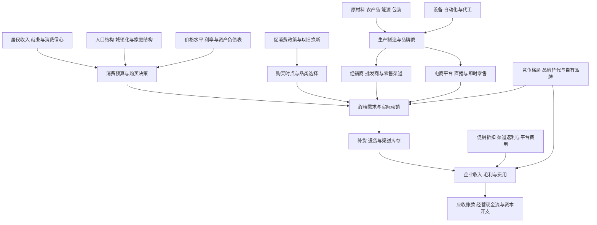
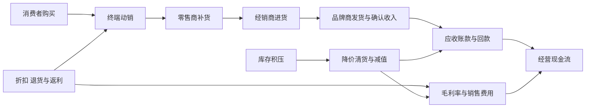

# 20｜消费零售与食品饮料产业链专题

> 研究范围：食品饮料、白酒与啤酒、乳制品、调味品、休闲食品、农产品加工、家电及耐用消费、纺织服装、化妆品与个人护理、商贸零售、电商平台、餐饮、酒店旅游及相关消费服务。
>
> 研究目标：从居民收入和消费意愿出发，沿着产品采购、生产、品牌定价、渠道库存、终端动销、费用投放和现金回款，判断需求变化最终如何影响上市公司利润。
>
> 口径说明：本文使用国家统计局公布的 2026 年 1—8 月消费数据作为最新已查到的官方统计截面，不把宏观零售增速直接当作单家公司收入增速。细分行业和公司业务分类需以最新官方分类、上市公司公告及实际主营业务为准。

## 一、消费产业链全景图

**核心原则：**零售额、出货量、终端动销、利润和现金流是不同指标。品牌商向经销商发货，可能只是库存从品牌商转移到渠道；只有结合终端销售、库存、折扣、回款和退货，才能判断需求是否真正改善。

## 二、主要细分行业与利润传导

| 细分行业 | 上游投入 | 主要客户与销售渠道 | 核心观察指标 | 常见误判 |
|---|---|---|---|---|
| 白酒 | 粮食、包材、能源、品牌与渠道建设 | 经销商、烟酒店、商超、电商、餐饮与团购 | 批价、终端成交价、库存、动销、回款、合同负债 | 将出厂价或经销商进货量当成终端需求 |
| 啤酒与饮料 | 麦芽、糖、果汁、铝罐、玻璃瓶、运输 | 餐饮、商超、便利店、电商 | 销量、吨价、产品结构、促销、包装成本、渠道覆盖 | 只看销量，不看高端化与单位利润 |
| 乳制品 | 原奶、饲料、包材、冷链 | 商超、便利店、电商、学校与餐饮 | 原奶价格、库存、产品结构、渠道周转、促销 | 原料降价必然带来利润改善，忽略竞争降价 |
| 调味品与食品加工 | 农产品、油脂、糖、包材、能源 | 餐饮、家庭消费、食品工厂、商超 | 销量、价格、原料成本、餐饮需求、库存和毛利率 | 把成本回落直接等同于净利润增长 |
| 休闲食品与零食 | 谷物、坚果、肉类、油脂、包材 | 商超、量贩零食店、电商、便利店 | 单店销售、门店数、客单价、复购、折扣和毛利 | 门店扩张掩盖单店效率下降 |
| 家电与耐用消费 | 铜、铝、钢、塑料、芯片、压缩机、物流 | 家庭、地产链、线上线下零售 | 零售量、均价、库存、促销、以旧换新、海外订单 | 将补贴带来的提前购买误认为长期需求 |
| 服装鞋帽与纺织 | 棉、化纤、染整、代工、物流 | 品牌门店、商场、电商、海外客户 | 新品售罄率、折扣率、库存、退货率、订单 | 只看收入，不看打折清货与存货减值 |
| 化妆品与个人护理 | 原料、配方、包装、代工、营销投放 | 电商、直播、专柜、商超、药店 | 复购、获客成本、投放回报、退货、客单价 | 流量增长被误当作品牌力和利润增长 |
| 商超与便利店 | 商品采购、租金、人工、仓储物流 | 居民日常消费 | 同店销售、客流、客单价、损耗、周转、门店回收期 | 用新开店收入掩盖老店疲弱 |
| 百货与购物中心 | 租赁物业、品牌组合、营销与物业运营 | 消费者、租户、品牌商 | 客流、出租率、租金、扣点、同店销售、资本开支 | 客流回升但租金收入与利润未同步 |
| 电商与平台零售 | 技术、仓配、流量、支付、商家服务 | 商家、品牌、消费者 | 商品交易额、变现率、获客成本、履约成本、退款率 | 把平台交易额当作平台确认收入 |
| 餐饮 | 食材、租金、人工、能源、外卖平台 | 个人消费者、企业与团体客户 | 同店销售、翻台率、客单价、人工占比、闭店率 | 门店数增加但单店现金流恶化 |
| 酒店与旅游 | 物业、人工、能源、交通、渠道佣金 | 个人、企业、旅行团 | 入住率、平均房价、每间可售房收入、客单价、预订提前期 | 只看出游人次，不看消费金额和单位收益 |

## 三、上下游关联：消费不是孤立板块

| 关联行业 | 对消费企业的影响 | 传导路径 | 需核验证据 |
|---|---|---|---|
| 农林牧渔 | 粮食、糖、油脂、肉类、乳品原料影响成本 | 农产品价格 → 采购成本 → 毛利率或终端价格 | 采购周期、合同价、库存计价和产品调价时滞 |
| 基础化工 | 树脂、纤维、涂料、表面活性剂和包装材料影响成本 | 化工价格 → 包材/原料成本 → 单位利润 | 主要原料占成本比例、供应商议价能力 |
| 有色与钢铁 | 铜、铝、钢材影响家电、包装和耐用品 | 金属价格 → 制造成本 → 零售价或利润 | 套期保值、调价周期、原料库存 |
| 电子与半导体 | 芯片、显示、传感器影响家电和智能消费品 | 元件供给与价格 → 交付、成本和产品升级 | 核心部件交期、替代认证、产品结构 |
| 机械与自动化 | 自动化设备改善生产效率和质量一致性 | 资本开支 → 产能、良率和人工成本 | 投资回收期、设备利用率、折旧负担 |
| 交通运输与物流 | 影响电商履约、冷链、门店配送和出口 | 运价、油价、配送密度 → 履约成本 | 单件配送成本、仓储利用率、时效与损耗 |
| 房地产与物业 | 影响家居、家电、装修和部分线下客流 | 交付、装修、租金与财富预期 → 购买需求 | 新房交付、二手房成交、装修订单和消费转化 |
| 互联网与广告 | 影响流量获取、品牌曝光和交易转化 | 平台流量规则 → 获客成本 → 销售费用率 | 投放回报、自然流量、复购和平台依赖 |
| 金融与支付 | 影响消费信贷、分期、商户融资与结算 | 融资成本、授信和支付周期 → 需求与现金周转 | 逾期率、手续费、回款周期与坏账 |
| 海外市场与汇率 | 影响出口品牌、代工企业和跨境电商 | 汇率、关税、海外需求 → 订单、售价与利润 | 地区收入、订单可见度、贸易壁垒与汇兑损益 |

## 四、2026 年消费数据：总量温和，品类分化明显

国家统计局 2026 年 9 月 16 日公布：2026 年 1—8 月社会消费品零售总额为 32.7569 万亿元，同比增长 1.1%；扣除汽车以外的消费品零售额增长 2.7%；餐饮收入增长 2.4%；网上零售额增长 4.6%，其中实物商品网上零售额增长 4.3%。以上为名义增速，不能直接视为扣除价格变化后的实际消费量增速。

来源：[国家统计局：2026 年 1—8 月社会消费品零售总额，2026-09-16](https://www.stats.gov.cn/english/PressRelease/202609/t20260916_1965341.html)

### 1—8 月部分限额以上商品零售额同比变化

| 品类 | 同比变化 | 初步观察方向 | 解释限制 |
|---|---:|---|---|
| 粮油、食品 | +7.2% | 基础食品相对稳健 | 不等于所有食品企业收入或利润同幅增长 |
| 饮料 | +5.6% | 需求保持增长 | 需分品类、价格带和渠道验证 |
| 烟酒 | +12.4% | 统计口径下零售额较强 | 不能直接推导白酒批价、库存和上市公司利润 |
| 化妆品 | +6.3% | 零售额增长 | 需结合促销、线上线下结构与获客成本 |
| 服装鞋帽、针纺织品 | +5.8% | 零售额改善 | 折扣、退货、库存与单店销售仍重要 |
| 日用品 | +4.1% | 日常消费较稳 | 需区分销量和价格因素 |
| 家用电器和音像器材 | -6.6% | 该统计口径下承压 | 补贴政策、前期透支、品类结构可能影响表现 |
| 家具 | -4.5% | 家居需求偏弱 | 还要看新房交付、装修和存量更新 |
| 汽车 | -13.2% | 汽车零售额同比下降 | 与汽车生产、批发、出口等指标口径不同 |

来源同上。上述商品数据属于限额以上单位商品零售统计口径，不覆盖所有企业；不同品类的价格、销量、渠道和统计范围也不同。不得据此直接排列上市公司投资价值。

## 五、消费政策和需求时点

消费促进、以旧换新、节假日活动和地方补贴可能改变购买时间、产品结构和销售渠道。研究时应区分三种效果：

1. **新增需求：**原本不会购买的消费者因此购买，带来净增量。
2. **提前购买：**未来数月的需求被提前到补贴期，短期增长后可能回落。
3. **渠道转移：**消费者从线下转线上、从一种品牌转向另一种品牌，行业总需求未必明显增加。

政策评估至少跟踪政策覆盖品类、实际补贴金额、参与地区、销售量、平均成交价、活动结束后的回落、企业毛利率和现金流。政策文件中的目标或预算不能当作已经实现的销售额。

官方统计入口：[国家统计局消费品零售统计](https://www.stats.gov.cn/english/PressRelease/index.html)；商务部消费市场信息：[商务部消费促进司](https://www.mofcom.gov.cn/xwfb/sjfzrfb/)

## 六、从渠道库存到利润与现金流

需要同时观察以下指标：
- **终端动销：**零售销量、消费者成交价、复购、客流、同店销售。
- **渠道库存：**库存天数、经销商库存、批价与零售价差、退货和返利。
- **价格体系：**建议零售价、实际成交价、促销强度、不同渠道价差。
- **利润质量：**毛利率、销售费用率、存货减值、合同负债和经销政策。
- **现金流：**应收账款、应收票据、经营现金流、预收款、库存周转。
- **资本效率：**门店投资回收期、单店收入、闭店率、仓储物流和资本开支。

**关键判断：**收入增长但应收账款和库存同步大幅增长、折扣加深、经营现金流持续弱于利润时，需要检查增长质量；成本下降但行业竞争导致售价同步下降时，也不能假设毛利率自然改善。

## 七、不同商业模式的比较方法

| 模式 | 重点观察 | 主要风险 |
|---|---|---|
| 品牌消费品 | 品牌溢价、复购、价格带、渠道控制、库存 | 品牌老化、渠道压货、消费降级、竞品替代 |
| 大众必需品 | 市占率、周转、规模效应、采购效率 | 原料上涨、低价竞争、渠道费用 |
| 可选耐用品 | 更新周期、购买意愿、均价、补贴依赖 | 需求透支、库存周期、技术迭代 |
| 零售渠道 | 同店增长、坪效、周转、供应链效率 | 租金人工刚性、线上替代、低价竞争 |
| 电商平台 | 变现率、商家留存、获客成本、履约成本 | 流量成本、监管、商家流失、补贴竞争 |
| 餐饮连锁 | 同店销售、单店利润、开店回收期、闭店率 | 过度扩张、食品安全、人工租金上涨 |
| 酒店旅游 | 入住率、平均房价、每间可售房收入、渠道佣金 | 供给增加、季节性、固定成本、出行结构变化 |
| 出口代工与跨境品牌 | 海外订单、客户集中、汇率、关税和产能布局 | 贸易壁垒、客户压价、海外库存和汇兑风险 |

## 八、上市公司研究清单

对每家公司至少核对：

1. **收入结构：**品牌、产品、地区、线上线下、直营与经销的收入占比。
2. **增长来源：**销量增长、提价、产品升级、新渠道、新门店或并购分别贡献多少。
3. **渠道质量：**经销商库存、终端成交价、退货、返利、应收账款和回款。
4. **盈利能力：**毛利率、销售费用率、管理费用率、存货减值与净利率。
5. **现金流：**经营现金流与净利润是否匹配，资本开支和分红是否可持续。
6. **竞争壁垒：**品牌认知、配方、供应链、门店密度、成本优势、用户复购或网络效应。
7. **风险：**消费偏好变化、价格战、食品安全、产品质量、渠道依赖、海外贸易政策和治理问题。

公司公告、定期报告和投资者关系记录优先于行业传闻。未公开的渠道库存和终端销售数据应标记为“待核验”，不能用未经证实的行业传闻代替事实。

## 九、交易型开放式指数基金映射

涉及食品饮料、主要消费、可选消费、家电、消费服务、零售或消费主题的指数基金时，逐项核对：
- 跟踪指数与编制规则；
- 成分股、权重、行业集中度和前十大持仓；
- 基金规模、日均成交额、买卖价差、管理费与托管费；
- 跟踪误差、分红方式、历史回撤与成分调整；
- 持仓披露日期及主题边界。

名称相近的基金可能持有完全不同的公司；“消费”也可能同时包含食品饮料、家电、零售和服务企业。不能只看基金名称或近期涨幅判断其风险和估值。

## 十、偏强、基准与偏弱情景

### 偏强情景
- 居民收入和就业预期改善，消费意愿增强；
- 终端动销提升、库存下降，促销强度回落；
- 品牌产品结构改善，提价或高端化能够被消费者接受；
- 零售企业同店销售与周转效率提高，经营现金流改善。

### 基准情景
- 消费总量温和增长，品类分化持续；
- 必需消费、可选消费、线下零售与线上渠道表现不一；
- 企业增长更多依赖份额、效率和产品结构，难以普遍提价；
- 估值分化取决于现金流、竞争壁垒和增长质量。

### 偏弱情景
- 收入和就业预期走弱，消费者延迟购买或转向低价产品；
- 促销加剧，品牌商、经销商和零售商利润同时承压；
- 渠道库存累积、退货上升、应收账款拉长；
- 门店扩张超过需求，租金人工和折旧挤压利润；
- 补贴结束后需求回落，前期增长被证明主要是购买时点前移。

**逻辑失效条件：**如果终端动销连续走弱、渠道库存上升、成交价下降、应收账款恶化，或者收入增长主要依靠高额促销与门店扩张，就应下调对盈利改善的判断。宏观零售增速、单月销量或平台交易额都不足以单独证明行业进入上行周期。

## 十一、后续研究顺序

1. 分别建立白酒、啤酒饮料、乳制品、调味品、休闲食品、家电、服装、化妆品、商超、电商、餐饮和酒店旅游细分档案。
2. 建立“居民消费—终端动销—渠道库存—企业收入—利润—现金流”指标链。
3. 对照上市公司报告核实品牌、产品、渠道、地区和业务收入占比。
4. 把原材料、能源、物流、地产、互联网平台和海外市场纳入跨行业传导矩阵。
5. 再映射相关指数基金，核对成分、权重、费用、流动性与估值，不以主题标签替代持仓分析。

## 十二、来源与复核清单

- [国家统计局：2026 年 1—8 月社会消费品零售总额，2026-09-16](https://www.stats.gov.cn/english/PressRelease/202609/t20260916_1965341.html)
- [国家统计局：2026 年 1—7 月社会消费品零售总额，2026-08-18](https://www.stats.gov.cn/english/PressRelease/202608/t20260819_1965078.html)
- [商务部：2026 年 5 月消费市场情况，2026-06-22](https://www.mofcom.gov.cn/xwfb/sjfzrfb/art/2026/art_0be457f701724a74932422166150ee1c.html)
- [国家统计局最新发布入口](https://www.stats.gov.cn/english/PressRelease/index.html)
- [商务部消费促进司](https://www.mofcom.gov.cn/xwfb/sjfzrfb/)

> 复核要求：记录发布日期、统计期间、单位、价格口径和统计覆盖范围。区分名义零售额、实际销量、企业出货、终端动销、平台交易额、确认收入、利润和现金回款；未公开的细分数据明确标记“待核验”。
