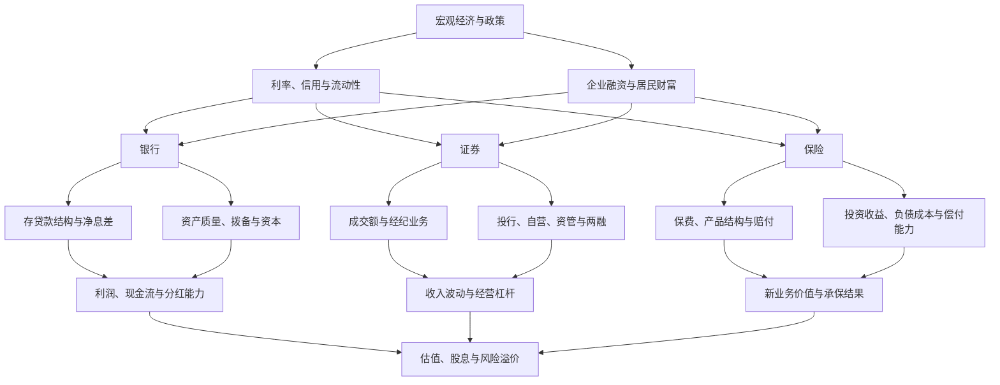
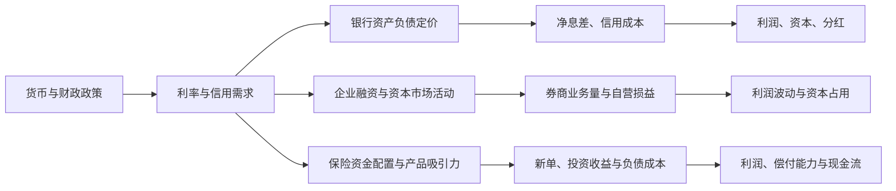

# 21｜银行、证券、保险与多元金融产业链专题

> 研究定位：从宏观金融条件出发，梳理银行、证券、保险、多元金融及金融科技服务的业务链条、关键指标、利润传导和反证条件。本文是研究框架，不构成买卖建议；涉及实时数据时以原始公告及其发布日期为准。
>
> 数据基准：截至 2026-10-11。官方统计发布存在时间差，宏观金融数据、监管统计与上市公司财报不可混为一谈。

## 一、金融行业全景图

图中为分析路径，不表示所有变量之间必然同向变化。政策、市场和公司财务之间存在时滞，需逐环节验证。

## 二、行业边界与商业模式

| 子行业 | 核心业务 | 主要收入/利润来源 | 首要约束 |
|---|---|---|---|
| 银行 | 吸收存款、发放贷款、支付结算及金融服务 | 利息净收入、手续费及佣金、投资收益 | 净息差、信用成本、资本充足、流动性 |
| 证券 | 经纪、投行、融资融券、自营、资产管理 | 交易佣金、承销保荐、利息收入、投资与资管收入 | 市场成交、风险偏好、监管、资本与风险限额 |
| 人身保险 | 寿险、年金、健康险等 | 保费、投资收益及保险服务结果 | 负债成本、产品结构、退保、资产负债匹配 |
| 财产保险 | 车险、责任险、财产险等 | 保费收入与承保利润、投资收益 | 赔付率、费用率、灾害损失、定价竞争 |
| 多元金融 | 信托、租赁、担保、期货、金融资产服务等 | 利差、手续费、服务费及投资收益 | 融资成本、信用风险、监管与业务集中度 |
| 金融科技服务 | 面向金融机构或用户提供软件、数据、支付及技术服务 | 软件许可、订阅、技术服务、交易服务等 | 客户预算、合规、续费率、回款和竞争 |

**口径提醒：**“金融科技”可能是金融机构的内部能力，也可能是独立公司的软件或服务业务。不能仅因公司名称、概念标签或少量相关收入，就将其视为纯金融科技标的。

## 三、宏观金融传导：从政策到公司财报

### 必须区分的几个变量

1. **利率下降不等于银行利润必然下降或上升。** 贷款收益率、存款成本、资产重定价速度、存款结构和负债竞争共同决定净息差。
2. **社融增长不等于银行贷款同步高增长。** 社融包括人民币贷款、政府债券、企业债券及其他融资；必须看融资结构、借款主体和资金需求。
3. **股市上涨不等于所有券商同步受益。** 成交额影响经纪业务，融资融券影响利息收入，投行受发行节奏影响，自营受持仓、对冲和市场波动影响。
4. **保费增长不等于保险利润同步增长。** 还要看产品期限、渠道费用、退保、赔付、投资收益、资产负债久期匹配及会计口径。
5. **政策支持不等于估值低。** 股价可能提前反映预期，需比较盈利质量、估值、股息可持续性和下行情景。

## 四、银行：重点看息差、信用成本和资本

### 1. 经营链条

存款来源与成本 → 贷款/债券等生息资产 → 利息收入与利息支出 → 净息差和净利息收入 → 拨备前利润 → 信用减值损失 → 净利润 → 资本补充与分红。

### 2. 关键指标清单

| 指标 | 研究用途 | 常见误读 |
|---|---|---|
| 净息差（NIM） | 衡量生息资产收益与付息负债成本之间的结果 | 只看一个季度，忽略重定价时滞和结构变化 |
| 生息资产收益率、计息负债成本率 | 拆解息差变化来源 | 将政策利率变动直接等同于全部资产负债同步重定价 |
| 贷款增速与结构 | 观察信贷投放及行业敞口 | 只看总量，不看按揭、企业、普惠和高风险行业结构 |
| 不良贷款率、关注类贷款、逾期贷款 | 观察资产质量变化 | 不良率稳定就认定风险没有增加 |
| 拨备覆盖率、信用成本 | 观察损失吸收和利润对风险的敏感度 | 把高拨备覆盖率孤立看作绝对安全或利润一定会释放 |
| 核心一级资本充足率 | 观察资本缓冲和业务扩张能力 | 忽略风险加权资产增速、分红与资本工具 |
| 成本收入比、手续费收入 | 判断经营效率和非息收入韧性 | 将一次性投资收益当作可持续经营能力 |
| 经营现金流与分红 | 结合银行业务特性观察现金及资本约束 | 机械套用工业企业现金流指标，不看监管资本和报表结构 |

### 3. 银行股研究问题

- 存款成本下降是否快于贷款收益率下降？
- 信贷需求来自真实融资需求，还是主要由政府债券等融资结构变化推动？
- 房地产、地方融资平台、小微企业和零售贷款风险是否出现迁移？
- 利润增长是核心利息收入改善，还是拨备、投资收益和税项带来的短期变化？
- 分红是否与资本充足、盈利质量和未来信贷扩张相匹配？

**反证条件：**息差持续下行、信用成本明显上升、关注类/逾期贷款恶化、资本缓冲收窄、分红依赖一次性收益，均可能推翻“低估值高股息即低风险”的简单判断。

## 五、证券：成交额是重要变量，但不是全部

### 1. 业务拆分

- **经纪业务：**市场成交额、客户资产、佣金率和财富管理转型共同影响收入。
- **投行业务：**股权与债券融资规模、项目储备、发行节奏、承销费率和合规质量。
- **融资融券等信用业务：**两融余额、利率、资金成本、担保品质量和风险控制。
- **自营投资：**权益、固定收益及衍生品配置；关注收益波动、对冲、风险限额与资本占用。
- **资产管理：**管理规模、产品结构、费率、业绩表现、客户留存及渠道分成。

### 2. 跟踪指标

| 指标 | 解释方法 | 需要交叉核验 |
|---|---|---|
| 沪深北市场成交额及持续性 | 判断经纪业务环境与市场活跃程度 | 佣金率、客户资产、市场份额 |
| 两融余额与融资成本 | 判断信用业务规模和资金需求 | 公司两融收入、坏账及担保品风险 |
| 股债融资规模、IPO与再融资节奏 | 判断投行业务机会 | 公司项目储备、承销费率、合规处罚 |
| 自营投资收益及其他综合收益 | 观察投资业务贡献和波动 | 持仓结构、利率风险、权益敞口、对冲 |
| 资管规模、净流入和费率 | 判断财富管理及资管业务质量 | 产品业绩、赎回、客户集中和渠道成本 |
| 净资本、风险覆盖率等监管指标 | 判断业务扩张空间 | 资本消耗、风险限额和监管要求 |

**重要提醒：**单日放量不能直接外推全年收入。券商经营具有较强的市场周期性；比较公司时需区分经纪业务占比、自营风格、投行业务储备、财富管理能力与资本实力。

## 六、保险：负债端与资产端必须合并分析

### 1. 业务链条

保费与产品结构 → 保险责任及负债成本 → 资产配置与投资回报 → 赔付/保险服务结果 → 利润、偿付能力和现金流。

### 2. 人身险与财险不能混用指标

| 方向 | 人身险重点 | 财产险重点 |
|---|---|---|
| 业务规模 | 新单保费、续期保费、渠道与产品结构 | 车险、非车险保费、客户与渠道结构 |
| 业务质量 | 新业务价值、继续率、退保、负债成本 | 综合成本率、赔付率、费用率、灾害损失 |
| 资产端 | 固收、权益、长期股权及其他资产收益 | 资产配置、流动性和投资波动 |
| 风险与资本 | 资产负债久期匹配、偿付能力、利率敏感度 | 巨灾风险、再保险安排、准备金充足性 |
| 现金与分红 | 可分配利润、资本约束和长期负债承诺 | 承保现金流、赔付波动和资本缓冲 |

### 3. 常见陷阱

- 保费高增长可能来自短期储蓄型产品或渠道变化，不能自动视为保障型业务价值提升。
- 投资收益受市场环境影响，需区分已实现收益、未实现变动和可持续收益能力。
- 财险综合成本率低于或高于 100% 的解释应结合险种、准备金、再保险和期间口径。
- 利率下行可能影响新投资收益和负债估值，具体影响取决于资产负债结构、会计分类及产品设计，不宜简单下结论。
- 保险公司披露的新业务价值、保险服务收入等指标口径可能不同，应优先采用公司正式披露及可比口径。

## 七、多元金融与金融科技：避免混为一谈

| 方向 | 上游/驱动 | 核心观察 | 主要风险 |
|---|---|---|---|
| 信托、融资租赁、担保 | 融资环境、企业投资与信用需求 | 资产规模、息差/费率、资产质量、资金来源 | 信用集中、期限错配、融资成本 |
| 期货及风险管理 | 商品波动、产业客户套保需求、交易活动 | 客户结构、经纪与风险管理收入、风险资本 | 市场波动、业务合规、净资本约束 |
| 金融资产服务 | 不良资产供给、回收环境、融资条件 | 收购价格、回收率、资金成本、处置周期 | 估值不确定、回款延迟、杠杆 |
| 金融软件与数据服务 | 金融机构 IT 预算、交易量、数字化需求 | 订阅续费、合同负债、毛利率、应收账款和回款 | 预算收缩、客户集中、合规与数据安全 |
| 支付与平台服务 | 交易规模、商户活跃度、服务费率 | 活跃客户、交易量、费率、合规成本 | 监管变化、竞争和费率压力 |

多元金融公司业务差异很大，应先读分部披露和主要资产负债项目，再决定与哪类公司比较。不要把不同商业模式仅按市盈率横向排序。

## 八、跨行业联动关系

- **房地产与银行：**房地产销售、房企现金流、抵押品价值和贷款风险可能影响银行资产质量；传导存在时滞。
- **资本市场与券商：**成交、融资、投资者风险偏好影响不同业务线，且公司之间敏感度不同。
- **利率与保险：**利率影响资产再投资收益、负债估值和产品吸引力；资产负债久期和会计分类决定具体影响。
- **企业盈利与信贷需求：**企业资本开支、现金流和订单变化影响融资需求与偿债能力。
- **居民收入与财富配置：**存款、基金、保险和证券产品之间的资金迁移会影响金融机构业务，但不能仅凭资金流向推断利润。
- **财政与债券供给：**政府债券发行可影响社融结构、债券市场供求和金融机构资产配置；需结合期限、收益率与资金使用情况。

## 九、官方数据入口与当前数据快照

以下数据用于展示如何建立证据链，不替代逐家上市公司财报分析。引用时保留发布日期、统计期和口径。

| 来源 | 已检索数据/入口 | 用途与限制 |
|---|---|---|
| [中国人民银行：2026年8月金融统计数据（国务院英文网转载）](https://english.www.gov.cn/archive/statistics/202609/15/content_WS6aa8a8f2c6d00ca5f9a0d2ef.html) | 2026-09-15 发布：8 月末社融存量 464.8 万亿元，同比增长 7.2%；人民币贷款余额 282.35 万亿元，同比增长 4.9%；M2 同比增长 7.5% | 宏观总量和融资结构背景；社融并不等于银行贷款或上市银行收入 |
| [国家金融监督管理总局：银行业保险业监管统计](https://www.nfra.gov.cn/) | 官方网站提供 2026 年二季度银行业、保险业资产统计及 2026 年 8 月保险业经营统计入口 | 进入原始统计表核验分项；监管统计与上市公司合并报表口径不同 |
| [中国证监会：证券市场月报](https://www.csrc.gov.cn/csrc/c100120/common_list.shtml) | 官方目录已列示 2026 年 9 月统计数据，发布日期为 2026-10-08 | 可追踪证券市场规模与结构；阅读具体表格时记录统计期间和单位 |
| [国家金融监督管理总局：2026 年二季度银行业保险业监管统计（英文页）](https://www.nfra.gov.cn/en/view/pages/ItemDetail.html?docId=1270720&itemId=983) | 2026-08-14 发布：截至 2026 年二季度末，银行业金融机构本外币资产总额 498 万亿元，同比增长 6.6%；保险公司及保险资产管理公司总资产 43.9 万亿元；2026 年上半年原保险保费收入 3.9 万亿元，同比增长 3.2% | 监管统计总量，不能直接推导上市银行或保险公司的盈利增速 |

### 数据使用规范

1. 先核对发布日期与统计期间，不把“最新发布”误写成“最新期间”。
2. 区分余额、期间流量、同比增速、环比变化和上市公司财务指标。
3. 关键数据优先使用央行、金融监管总局、证监会、交易所和公司公告原始资料。
4. 对转载数据尽量回溯原始发布页；如未回溯，明确标记为转载来源。
5. 公司层面以定期报告、临时公告和监管披露为准；宏观行业总量不能替代公司实际敞口。
6. 对不同会计准则或统计口径的公司，先统一口径再比较。

## 十、研究情景与反证

| 情景 | 银行观察 | 证券观察 | 保险观察 |
|---|---|---|---|
| 基准情景 | 息差压力、信用成本和资本状况大体可控 | 成交与融资活动处于常态区间，业务分化 | 保费与投资收益依公司产品和资产配置而分化 |
| 偏积极情景 | 负债成本下降、信用需求改善且资产质量稳定 | 成交持续改善并传导至多条业务线，自营风险受控 | 新业务价值改善、投资收益与承保质量相对稳健 |
| 偏谨慎情景 | 息差继续收窄、信用风险上升或资本承压 | 成交回落、投资损失扩大、投行业务承压 | 赔付恶化、退保上升、投资波动或偿付能力受压 |

上述是情景框架，不是当前市场结论。建立任何具体判断前，必须补齐最新原始数据、公司财报、估值与市场价格，并记录可能推翻判断的条件。

## 十一、上市公司与 ETF 映射工作流

1. 按正式行业分类列出银行、证券、保险、多元金融等公司。
2. 阅读年报中的分部收入、利润、资产负债、风险敞口和资本约束，确认主营业务。
3. 对金融科技公司，核实软件/服务收入占比、客户类型、合同负债、应收账款与回款。
4. 对 ETF 核对跟踪指数、成分股、权重集中度、规模、成交流动性、费用和跟踪误差。
5. 分开记录“行业相关”“主营受益”“概念关联”，不以概念名称替代业务证据。
6. 记录核验日期；ETF 持仓以其披露日为准，不能将季报持仓描述成实时完整持仓。

## 十二、后续跟踪清单

- [ ] 央行月度金融统计：社融结构、人民币贷款、M1/M2。
- [ ] 银行业监管统计与上市银行季度/年度报告：息差、资产质量、资本。
- [ ] 证监会与交易所统计：市场成交、融资活动、证券行业指标。
- [ ] 保险业经营统计与保险公司报告：保费、赔付、产品结构、偿付能力。
- [ ] 重点公司公告：分部收入、现金流、风险敞口、资本和分红。
- [ ] 估值与市场预期：估值分位、股息可持续性、盈利预测变化。
- [ ] 每次更新注明数据发布日期、统计期间、原始链接和判断失效条件。

## 十三、研究结论的最低标准

任何金融板块的投资判断都应回答：**利润由什么驱动、哪项指标领先、变化多久传导、市场是否已提前定价、什么证据会推翻判断。** 不能只凭低市盈率、高股息、降息预期或成交放量做出结论。

---

## 参考来源

- 中国人民银行金融统计相关数据，国务院英文网转载，2026-09-15：[2026 年 8 月金融统计](https://english.www.gov.cn/archive/statistics/202609/15/content_WS6aa8a8f2c6d00ca5f9a0d2ef.html)
- 国家金融监督管理总局：[官方网站与统计信息入口](https://www.nfra.gov.cn/)
- 国家金融监督管理总局，2026-08-14：[2026 年二季度银行业保险业监管统计（英文）](https://www.nfra.gov.cn/en/view/pages/ItemDetail.html?docId=1270720&itemId=983)
- 中国证券监督管理委员会：[证券市场月报目录](https://www.csrc.gov.cn/csrc/c100120/common_list.shtml)
