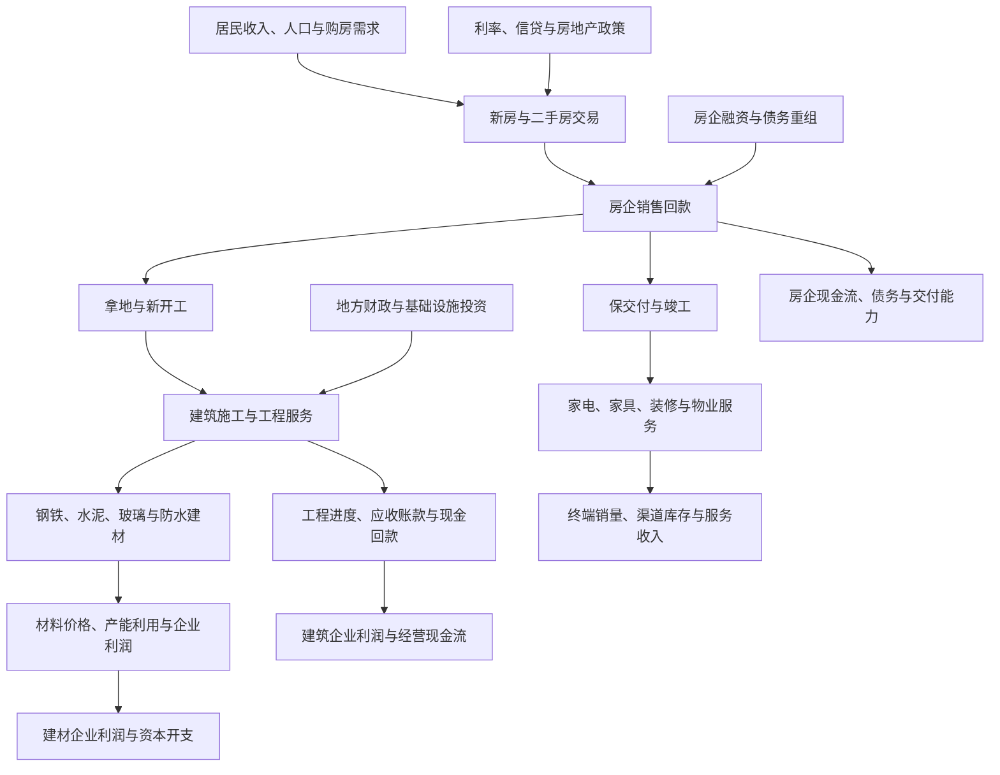
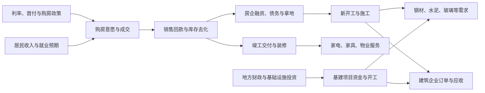

# 22｜房地产、物业、建筑与建材产业链专题

> 研究范围：房地产开发、物业管理、建筑施工与工程服务、钢铁水泥玻璃等建筑材料、家居家电及工程机械的跨行业传导。
>
> 数据截止说明：官方最新已检索到的房地产开发数据为 2026 年 1—8 月，发布日期为 2026-09-16。宏观统计不等于上市公司经营数据，所有同比数据均须保留统计期间和口径。

## 一、全产业链全景图

核心逻辑不是“地产销售回暖，所有相关行业都上涨”，而是追踪交易、回款、开工、施工、竣工、采购、验收和付款的先后关系。不同环节的时滞可能跨越多个季度。

## 二、链条分层与关键变量

| 环节 | 主要参与者 | 需求/收入来源 | 关键观察指标 | 常见风险 |
|---|---|---|---|---|
| 房地产开发 | 房企、城市更新与保障房项目主体 | 商品房销售、项目开发与资产处置 | 销售面积、销售额、均价、库存、到位资金、债务到期 | 销售回款不足、融资受限、交付压力 |
| 二手房与经纪 | 经纪平台、中介机构 | 经纪服务费、租赁及相关服务 | 成交面积、挂牌量、去化周期、佣金率 | 成交波动、费率竞争、区域分化 |
| 物业管理 | 物业服务、商业运营 | 物业费、增值服务、商业管理 | 在管面积、收费率、应收账款、续约与毛利率 | 收缴率下降、关联方风险、扩张质量 |
| 建筑施工 | 房建、基建、专业工程、装饰装修 | 工程合同、进度结算、项目交付 | 新签订单、合同负债、开工、结算、应收与现金回款 | 垫资、回款拖延、低毛利竞争 |
| 建筑材料 | 水泥、玻璃、玻纤、防水、管材、涂料等 | 房建、基建、装修及工业需求 | 价格、库存、产能利用率、区域供需、成本价差 | 产能过剩、价格战、能源成本上升 |
| 钢铁与工程机械 | 钢材、挖掘机、起重机、混凝土机械等 | 房建、基建、矿山、制造业和出口 | 钢材需求、设备销量、开工小时、出口、应收账款 | 下游投资偏弱、周期波动、信用风险 |
| 家居家电与装修 | 家电、家具、厨卫、装饰材料、家装服务 | 新房交付、二手房装修、更新需求 | 零售销量、安装交付、渠道库存、客单价、促销力度 | 需求滞后、补贴变化、渠道库存与竞争 |

## 三、最新官方数据快照：房地产仍需分环节观察

国家统计局于 2026 年 9 月 16 日发布 2026 年 1—8 月房地产开发和销售数据：

| 指标 | 2026 年 1—8 月同比 | 研究含义 |
|---|---:|---|
| 房地产开发投资 | -19.9% | 开发端投资活动仍明显收缩 |
| 房屋新开工面积 | -24.8% | 新项目启动偏弱，对施工前端材料需求形成压力 |
| 房屋竣工面积 | -23.7% | 竣工与交付相关需求仍承压，需结合项目和区域数据 |
| 新建商品房销售面积 | -12.1% | 新房交易量仍下降 |
| 新建商品房销售额 | -13.0% | 销售回款仍受压力，量价需分开观察 |
| 房地产开发企业到位资金 | -21.0% | 资金来源整体承压 |
| 个人按揭贷款资金 | -22.4% | 按揭相关资金流入偏弱 |
| 二手房网签交易面积 | +10.6% | 与新房走势不同，反映交易结构和市场分化 |

来源：[国家统计局《2026 年 1—8 月房地产开发和销售情况》](https://www.stats.gov.cn/english/PressRelease/202609/t20260916_1965342.html)，发布日期 2026-09-16。

**解读边界：**
- 全国累计同比不能替代城市分化。核心城市、人口流入地区与人口流出地区的销售、库存和价格可能显著不同。
- 二手房交易面积上升不等于新房开发投资已反转；二手交易对新增施工材料的拉动路径不同。
- 销售额与销售面积增速不同，可能同时受到成交结构和价格影响，不应仅用销售额推断价格。
- 资金到位、销售回款、融资与债务偿还之间存在时间差。不能将单月政策消息当作现金流已改善的证据。

## 四、宏观与政策如何传导

研究政策时，至少核实四件事：政策覆盖哪些城市和人群、何时生效、是否带来可观测成交或资金变化、变化能否传导到企业订单和回款。政策公告、销售反弹和企业利润兑现不是同一件事。

## 五、不同子行业的研究方法

### 1. 房地产开发：优先看回款和债务，而非只看销售标题

重点跟踪：
- 新房销售面积、销售额、均价与城市分布。
- 可售库存、去化周期、挂牌量与二手房成交。
- 开发投资、新开工、施工、竣工及土地购置。
- 预售资金、定金及预收款、个人按揭、国内贷款、自筹资金。
- 短期债务、债券到期、利息支出、现金及受限资金。
- 项目交付、资产处置、债务重组和股东支持。

反证条件：销售改善只集中于少数城市；销售回款没有改善；库存去化停滞；新增融资仍弱；交付和债务压力继续上升。

### 2. 物业管理：面积增长必须转化为收费和现金

关键指标包括在管面积、合约面积、第三方项目占比、物业费收缴率、应收账款账龄、关联方应收款、人员成本、增值服务利润和经营现金流。并购或低价扩张带来的面积增长，不等于股东回报同步增长。

### 3. 建筑施工：订单不是现金

沿着“中标—签约—开工—施工产值—计量结算—回款”逐段验证。关注新签合同额、合同负债、毛利率、应收账款、合同资产、经营现金流、减值损失和客户集中度。政府或国企客户的订单也要核对资金来源和付款周期。

### 4. 建材：价格、库存、产能利用率比单一需求叙事更重要

水泥关注区域价格、错峰生产、库存和出货；玻璃关注浮法与光伏玻璃各自的供需、库存和成本；防水、管材、涂料等关注原材料价格、地产/基建订单、渠道结构、应收和现金回款。不同材料需求来源并不相同，不能将“建材”视作单一周期。

### 5. 家居家电：区分交付拉动与存量更新

新房交付、二手房装修、家电更新政策和出口是不同需求来源。跟踪终端零售而非只看企业出货，观察安装量、客单价、渠道库存、促销强度、产品结构、出口和售后服务。房地产疲弱不代表所有家电需求必然同步下滑，存量更新和海外业务可能提供不同的驱动。

## 六、跨行业传导矩阵

| 起点变化 | 可能受影响行业 | 传导路径 | 验证指标 |
|---|---|---|---|
| 新房销售回升 | 房企、银行、经纪服务 | 成交→回款→偿债/拿地→信用风险变化 | 销售额、到位资金、债务、银行相关资产质量 |
| 新开工改善 | 建筑、钢铁、水泥、工程机械 | 项目启动→施工采购→设备与材料需求 | 新开工、施工面积、订单、出货和价格 |
| 竣工交付改善 | 家电、家具、装修、防水、物业 | 交付→安装与装修→终端销售及服务 | 竣工、交付、零售、安装量和渠道库存 |
| 基建资金加快落地 | 建筑、工程机械、水泥、钢材、电网设备 | 资金到位→开工→订单→施工与结算 | 专项债使用、项目开工、新签订单、回款 |
| 材料价格上涨 | 建筑施工、装修与材料企业 | 上游成本变化→合同调价/利润率变化 | 原料价格、合同条款、毛利率和应收 |
| 房企信用风险上升 | 银行、信托、债券、物业与供应商 | 违约/延期→减值、应收损失、现金流压力 | 逾期、减值、关联方敞口、回款率 |

## 七、观察清单：领先、同步与滞后指标

| 类型 | 指标示例 | 使用方式 |
|---|---|---|
| 领先 | 挂牌量、成交意向、土地成交、房企融资、项目开工计划 | 判断未来成交与施工的潜在方向，不单独作为结论 |
| 同步 | 销售面积与金额、库存、建材价格、工程招标和施工活动 | 验证当前供需与活动水平 |
| 滞后 | 竣工、企业收入、应收回款、减值、利润与现金流 | 验证最终兑现及风险是否已经进入报表 |

国家统计局 2026 年 8 月非制造业采购经理指数显示，建筑业商务活动指数为 46.9%，新订单指数为 42.4%，均低于 50 的临界点；该指标是景气扩散指数，不是产值同比增速。来源：[国家统计局《2026 年 8 月采购经理指数》](https://www.stats.gov.cn/english/PressRelease/202609/t20260901_1965170.html)，发布日期 2026-09-01。

中国建筑材料联合会公布的 2026 年 8 月建材工业景气指数为 99.1 点，处于非景气区间；投资需求指数为 98.7 点。来源：[国务院国资委转载的建材工业景气指数](https://wap.sasac.gov.cn/n16582853/n16582898/c35862558/content.html)，发布日期 2026-09-03。该指数适合作为行业信号，仍需与价格、库存、产量和企业财报交叉验证。

## 八、公司与 ETF 映射规范

1. 先确认公司主营业务和分部收入，再映射房地产开发、物业、建筑施工、建材、家居家电或工程机械。
2. 重点核对销售/合同收入、利润、经营现金流、应收账款、合同资产、债务、受限资金和减值。
3. 对跨行业公司按业务分部拆解，避免将地产概念等同于地产收入。
4. 对 ETF 核实跟踪指数、成分股、权重集中度、规模、流动性、费用和跟踪误差；区分地产开发、建筑材料、建筑装饰、家电等不同指数边界。
5. 不以 ETF 名称推断纯度，也不把季报持仓描述为实时持仓。
6. 任何投资结论都应同时记录估值、市场预期、反证条件和判断失效日期。

## 九、三种情景与逻辑失效条件

| 情景 | 观察特征 | 研究重点 |
|---|---|---|
| 基准 | 销售、投资和施工仍分化，城市与企业差异显著 | 以现金流和资产负债表区分公司，不假设全面反转 |
| 改善 | 成交回升扩散、回款改善、融资稳定、项目开工与材料采购跟进 | 检验改善是否从销售向订单、收入、现金流传导 |
| 恶化 | 销售和回款再度走弱、库存积压、项目延期、应收及减值上升 | 评估信用风险、资本开支压力和估值下行空间 |

**判断失效条件：**成交改善不能持续、到位资金未跟进、开工与订单未改善、回款恶化或减值扩大，均应重新评估“地产链复苏”假设。

## 十、每月复核清单

- [ ] 国家统计局房地产开发投资、销售、库存、资金来源。
- [ ] 70 城新建商品住宅与二手住宅价格指数，结合城市分化分析。
- [ ] 建筑业采购经理指数、固定资产投资与基建投资。
- [ ] 水泥、玻璃、钢材等价格、库存、产量和区域供需。
- [ ] 重点上市公司订单、合同资产、应收、经营现金流和债务。
- [ ] 家电家居终端零售、渠道库存、出口与促销强度。
- [ ] ETF 跟踪指数、成分权重、规模、流动性与跟踪误差。
- [ ] 记录数据发布日期、统计期间、来源链接及判断反证。

---

## 参考来源

- 国家统计局，2026-09-16：[2026 年 1—8 月房地产开发和销售情况](https://www.stats.gov.cn/english/PressRelease/202609/t20260916_1965342.html)
- 国家统计局，2026-09-16：[2026 年 1—8 月固定资产投资情况](https://www.stats.gov.cn/english/PressRelease/202609/t20260916_1965343.html)
- 国家统计局，2026-09-01：[2026 年 8 月采购经理指数](https://www.stats.gov.cn/english/PressRelease/202609/t20260901_1965170.html)
- 中国建筑材料联合会数据（国务院国资委网站转载），2026-09-03：[2026 年 8 月建筑材料工业景气指数](https://wap.sasac.gov.cn/n16582853/n16582898/c35862558/content.html)
