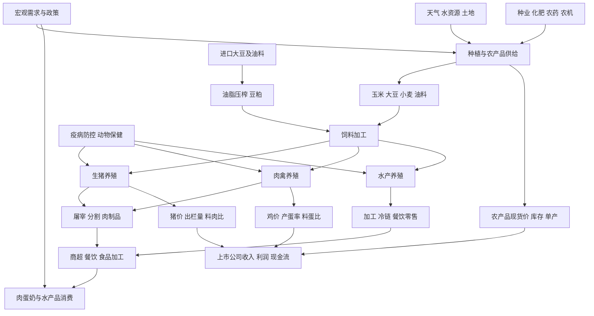
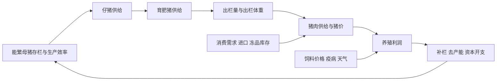

# 23｜农林牧渔产业链专题

> 研究范围：种植业、种业、农资、饲料、生猪、肉禽、牛羊、乳业、水产养殖、动物保健与农产品加工。  
> 数据口径：本专题可确认的官方数据截至 2026 年 9 月；价格周报按各自采集日标注。行情与公司财报更新时需重新核验。  
> 核心原则：农产品价格上涨不必然意味着所有农业公司受益；必须识别产业链位置、成本结构、产能周期、合同传导与现金回款。

## 一、全产业链全景图

## 二、先看产业链利润，不只看涨跌幅

| 环节 | 主要收入来源 | 核心成本/约束 | 优先跟踪指标 |
|---|---|---|---|
| 种业 | 种子销售、品种授权 | 育种周期、审定、制种成本、推广 | 审定品种、制种面积、销售量、研发投入 |
| 种植 | 粮食、油料、棉花、糖料等销售 | 天气、土地、化肥农药、人工、收储政策 | 播种面积、单产、产量、库存、现货价 |
| 农资与农机 | 化肥、农药、种子、农机销售 | 上游原料、渠道库存、季节性、竞争 | 价格差、订单、开工率、渠道库存 |
| 饲料 | 配合饲料、预混料销售 | 玉米、豆粕、添加剂、配方替代 | 原料价格、吨毛利、销量、客户结构 |
| 生猪 | 商品猪、仔猪、种猪销售 | 饲料、防疫、仔猪、人工、折旧、资金 | 猪价、出栏体重、完全成本、母猪存栏 |
| 肉禽与禽蛋 | 白羽肉鸡、黄羽肉鸡、鸡苗、鸡蛋 | 饲料、鸡苗、疫病、产能调整 | 鸡苗价格、鸡肉价、蛋价、料肉比/料蛋比 |
| 牛羊与乳业 | 牛羊肉、生鲜乳及乳制品 | 饲草料、养殖效率、屠宰加工、冷链 | 活畜价、奶价、存栏、单产、渠道库存 |
| 水产养殖 | 鱼虾蟹及加工品 | 饲料、苗种、病害、天气、运输 | 养殖面积、成活率、塘口价、饲料成本 |
| 动物保健 | 疫苗、兽药、诊断与服务 | 注册审批、研发、招采、养殖周期 | 批签发、产品结构、客户渗透、应收账款 |
| 屠宰与食品加工 | 屠宰加工、肉制品、品牌食品 | 原料采购、产能利用率、冷链、渠道 | 屠宰量、吨利、库存、周转天数、现金流 |

## 三、核心传导：玉米、豆粕与饲料

1. 玉米与豆粕是养殖成本的重要变量，但具体敏感度取决于畜种、配方、采购周期和套保方式。
2. 饲料企业能否受益，取决于原料成本变化能否传导到售价、配方优化、销量和客户结构；原料下跌也可能伴随产品售价下调。
3. 养殖企业需要同时看售价和单位成本。猪价上涨但饲料、仔猪或防疫成本更快上涨时，利润未必改善。
4. 大豆进口、压榨利润、豆粕供应、玉米新季上市与替代品会共同影响饲料成本，不能只看单一现货报价。
5. 建议建立月度表：玉米现货价、豆粕现货价、育肥猪配合饲料价、猪价、鸡价、养殖完全成本、企业出栏量与经营现金流。

## 四、生猪周期：从母猪到现金流的时滞

- **领先变量**：能繁母猪存栏、仔猪价格与供应、生产效率、补栏和淘汰节奏。
- **同步变量**：商品猪出栏量、出栏体重、屠宰量、猪肉价格、饲料成本。
- **滞后变量**：上市公司利润、经营现金流、负债与资本开支。
- **不能简单套用固定周期**：生产效率提升、规模场占比、疫病、政策调控和消费结构变化都可能改变时滞与波动幅度。
- **周期底部不是只看猪价低**：应观察高成本产能是否退出、现金流能否支撑、母猪产能是否持续调整、供给压力是否真实减轻。

## 五、官方数据快照与解读

### 1. 2026 年上半年畜牧业数据

国家统计局 2026 年 7 月公布的上半年数据：
- 猪牛羊禽肉产量 5050 万吨，同比增长 4.3%；猪肉产量 3119 万吨，同比增长 3.3%；禽肉产量 1390 万吨，同比增长 9.4%。
- 上半年生猪出栏 37246 万头，同比增长 1.7%；二季度末生猪存栏 42491 万头，同比增长 0.1%。
- 二季度末能繁母猪存栏 3780 万头，同比下降 6.5%，为正常保有量 3750 万头的 100.8%。
- 上半年生猪生产者价格同比下降 23.1%（统计局同期解读口径）。

来源：[国家统计局：全国夏粮实现丰收，畜牧生产稳定发展](https://www.stats.gov.cn/sj/sjjd/202607/t20260716_1964140.html)，发布日期 2026-07-16。上述为上半年统计，不应当作 10 月的实时供需数据。

### 2. 2026 年 9 月第 4 周畜产品与饲料价格

农业农村部监测全国 500 个县集贸市场和采集点，采集日为 2026-09-24：
- 全国生猪平均价格 11.36 元/公斤，环比下跌 1.0%，同比下跌 16.0%。
- 仔猪平均价格 20.20 元/公斤，环比下跌 2.0%，同比下跌 30.5%。
- 猪肉、鸡肉、玉米、育肥猪配合饲料、肉鸡配合饲料价格环比持平；豆粕、蛋鸡配合饲料等环比上涨。
- 这些是全国监测均价，不等于每个省份、企业采购价或养殖场完全成本。

来源：[农业农村部：9 月第 4 周畜产品和饲料集贸市场价格情况](https://xmsyj.moa.gov.cn/jcyj/202609/t20260930_6488298.htm)，发布日期 2026-09-30。

### 3. 农产品供需预期

农业农村部市场预警专家委员会 2026 年 9 月 CASDE 报告指出，新季玉米集中上市期临近，下游以刚需采购为主、库存相对偏低，预计新陈玉米衔接总体平稳；大豆进口量与压榨量估计有所调整。该报告属于供需分析预测，应与后续产量、到港、库存、现货和压榨利润验证。

来源：[2026 年 9 月中国农产品供需形势分析（CASDE-No.123）](https://scs.moa.gov.cn/jcyj/202609/t20260911_6487612.htm)，发布日期 2026-09-11。

## 六、上市公司与 ETF 映射：先核业务，再看标签

以下仅是研究候选，不构成买入建议；主营收入、最新产能、业务占比、财务状况与基金持仓需以最新年报、季报、公告和基金文件核验。

| 产业链 | 可作为研究起点的上市公司 | 需要核验的关键问题 |
|---|---|---|
| 生猪养殖 | 牧原股份、温氏股份、新希望、天邦食品 | 完全成本、出栏量、母猪效率、负债、现金流 |
| 饲料与养殖综合 | 海大集团、新希望、禾丰股份 | 饲料销量、原料传导、养殖敞口、应收与周转 |
| 种业与种植 | 隆平高科、登海种业、苏垦农发 | 品种竞争力、制种与销售、政策、土地与天气风险 |
| 动物保健 | 生物股份、中牧股份、瑞普生物 | 产品结构、招采、批签发、研发和客户需求 |
| 禽类与食品 | 圣农发展、益生股份、民和股份、立华股份 | 鸡苗/鸡肉价格、产能、饲料成本、产品结构 |
| 水产与饲料 | 通威股份、粤海饲料、天马科技 | 饲料销量、养殖业务敞口、鱼虾价格与病害 |
| 乳业 | 伊利股份、光明乳业 | 原奶成本、产品结构、渠道库存、促销与现金流 |

ETF 研究顺序：
1. 先查基金合同与跟踪指数，确认是否为农业、畜牧养殖、粮食、种业或食品主题；不要把食品饮料指数当作纯养殖工具。
2. 核对前十大持仓、成分股权重、行业集中度、规模、成交额、费率、折溢价与跟踪误差。
3. 观察主题指数是否集中于少数养殖龙头，避免把“农业”名称误认为覆盖整个农林牧渔链。
4. 如果没有足够纯粹且流动性合适的 ETF，使用指数成分股和产业链指标作观察工具，不因 ETF 名称而强行交易。

## 七、情景分析与反证

| 情景 | 需要看到的证据 | 反证/风险 |
|---|---|---|
| 养殖利润修复 | 猪价改善、单位成本下降、出栏与现金流质量稳定 | 猪价短暂反弹但供给继续增加；成本同步上升 |
| 饲料盈利改善 | 原料采购成本下降、售价调整滞后、销量或产品结构改善 | 原料下跌快速传导至售价，毛利未改善 |
| 种植与种业改善 | 天气/单产、种子销售、品种推广和回款共同验证 | 审定或政策利好未转化为销售；渠道库存积压 |
| 禽类景气改善 | 鸡苗、鸡肉或蛋价改善，补栏节奏合理，饲料成本可控 | 产能集中释放、疫病或需求疲软压价 |
| 动保需求改善 | 养殖存栏、疫病防控投入、产品销售与回款增长 | 养殖亏损导致压价、招采延迟、应收账款上升 |

**研究结论必须分开写：**
- 已知事实：官方统计、价格监测、上市公司财报和公告。
- 分析判断：基于供需和成本传导提出的解释。
- 待验证假设：未来价格、产能去化、利润拐点与市场预期。
- 失效条件：出现什么数据时必须撤回原判断。

## 八、每月复核清单

- [ ] 更新国家统计局季度畜牧业、粮食与农产品生产数据。
- [ ] 更新农业农村部生猪、仔猪、猪肉、玉米、豆粕、饲料周度价格。
- [ ] 更新能繁母猪、仔猪供给、出栏量、出栏体重与屠宰量。
- [ ] 记录玉米、大豆到港、压榨利润、库存与新季上市节奏。
- [ ] 对比上市公司出栏量、完全成本、饲料销量、毛利率、经营现金流和负债。
- [ ] 核验 ETF 最新跟踪指数、持仓、规模、成交额和折溢价。
- [ ] 将新数据与上一期比较，注明发布日期、统计期和是否修订。
- [ ] 记录反证，不以股价涨跌替代基本面验证。

## 九、官方数据入口

- [国家统计局数据发布](https://www.stats.gov.cn/sj/)
- [国家统计局农业与畜牧业统计解读](https://www.stats.gov.cn/)
- [农业农村部市场预警与农产品供需分析](https://scs.moa.gov.cn/jcyj/)
- [农业农村部畜牧兽医局价格监测](https://xmsyj.moa.gov.cn/jcyj/)
- [上市公司公告与定期报告](https://www.cninfo.com.cn/)
- [基金法律文件与定期报告](https://www.sse.com.cn/)

> 本专题用于行业研究与风险识别，不提供确定性收益承诺。价格、周期和政策变化都可能使结论失效；交易前需重新核验最新数据、估值、流动性与自身风险承受能力。
