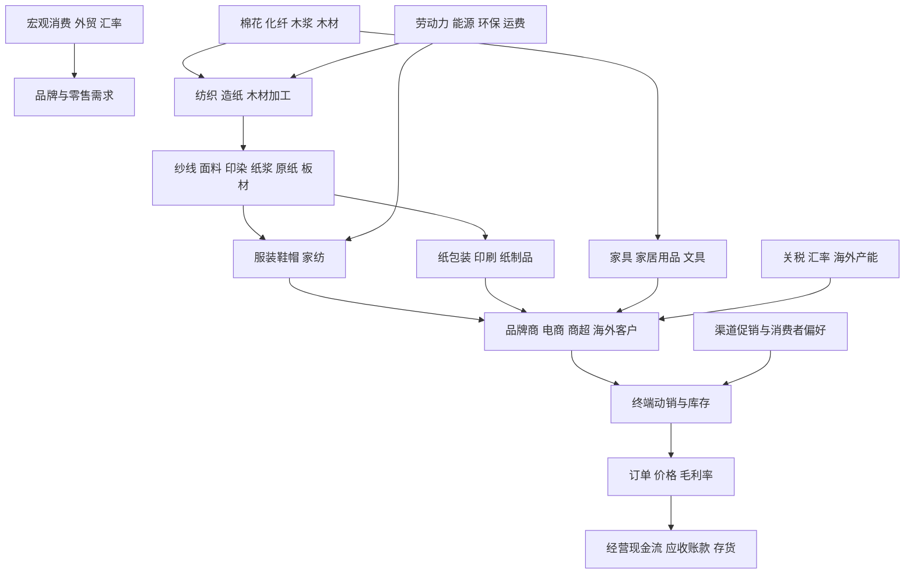
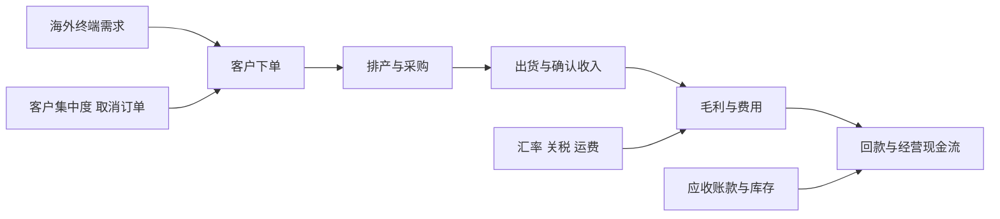

# 24｜纺织服装与轻工产业链专题

> 研究范围：纺织原料、纺纱织造、印染、服装鞋帽、品牌与代工、家纺、造纸、包装、家具、文具及轻工消费品。  
> 数据截止：引用可核验的 2026 年上半年行业数据，以及国家统计局截至 2026 年 8 月的工业价格数据。更新时须核对最新发布。  
> 核心原则：出口增长不等于利润增长，订单增长不等于现金流改善，原料涨跌对上下游公司的影响方向可能相反。

## 一、全产业链全景图

## 二、产业链分段与关键指标

| 环节 | 商业模式 | 主要成本与风险 | 重点指标 |
|---|---|---|---|
| 棉花与化纤原料 | 棉花种植、聚酯/锦纶等化纤生产 | 原料价格、能源、天气、供需与贸易政策 | 棉花现货与期货、聚酯原料价差、库存、开工率 |
| 纺纱织造 | 将纤维转为纱线、坯布 | 原料采购时点、设备利用率、人工与能源 | 纱布价格、产销率、库存天数、吨毛利 |
| 印染与面料 | 染整、功能性和差异化面料 | 环保投入、订单波动、交付与质量 | 订单能见度、加工费、产能利用率、客户集中度 |
| 服装代工与制造 | 按品牌订单设计、采购、生产与交付 | 工资、汇率、关税、客户议价、产能迁移 | 新订单、产能利用率、单位加工费、交期、客户集中度 |
| 服装品牌与零售 | 品牌溢价、渠道销售、授权与电商 | 获客成本、折扣、库存过季、渠道费用 | 同店销售、全价售罄率、折扣率、库存周转、复购 |
| 家纺与鞋帽 | 品牌、代工、渠道和电商 | 原料、季节性、设计迭代、库存 | 订单、终端动销、单价、库存与退货率 |
| 造纸与纸制品 | 纸浆制纸、纸加工、生活用纸与特种纸 | 木浆/废纸成本、能源、环保、产能过剩 | 纸价、浆价、吨毛利、开工率、库存、停机检修 |
| 包装与印刷 | 瓦楞纸箱、彩盒、标签、印刷加工 | 原纸成本、客户议价、运费、应收账款 | 加工费、订单、原纸价差、客户集中度、回款 |
| 家具与木制品 | 家具生产、定制、出口、品牌零售 | 木材、板材、五金、房地产后周期、物流 | 海外订单、门店客流、客单价、交付、应收与存货 |
| 文具及其他轻工 | 文具、个人消费品、日用轻工产品 | 原材料、渠道、产品迭代与品牌竞争 | 新品收入、渠道库存、毛利率、复购与现金流 |

## 三、关键传导关系

### 1. 棉花、化纤到服装制造

原料涨价可能先推高纱线、面料和制造成本，但企业能否提价取决于订单合同、库存采购时点、产品差异化和客户议价权。若订单价格已锁定、原料库存偏低，短期利润可能被挤压；若原料降价，持有高价库存的企业也可能出现库存损失。

### 2. 海外订单到上市公司利润

需要分别核实订单金额、交付节奏、收入确认、汇率影响、贸易条款和现金回款。单纯引用“海外订单增长”不能证明净利润会增长。

### 3. 品牌服装与渠道库存

- 终端销售优于批发出货：观察零售额、同店、售罄率、退货率和折扣。
- 补库可能是需求改善，也可能是渠道压货；需结合终端动销与经销商库存判断。
- 新品上市、品牌营销和门店扩张会增加费用，收入增长未必同步带来利润率提升。
- 电商大促可拉动短期销量，但需扣除折扣、平台佣金、投流成本和退货。

### 4. 造纸、包装与家具

- 造纸企业的利润取决于纸价与浆、废纸、能源成本的价差，以及开工率和新增产能。
- 包装企业通常同时受到原纸成本和下游客户议价影响；原纸涨价未必能及时转嫁。
- 家具同时受出口、地产后周期、更新需求和渠道结构影响；地产销售改善到家具收入可能存在较长时滞。
- 纸品和家具均要关注资本开支、产能利用率、存货、应收账款与经营现金流。

## 四、近期数据快照

### 1. 2026 年上半年纺织品服装出口

中国纺织工业联合会根据海关总署统计快讯发布：
- 2026 年上半年全国纺织品服装出口额 1459.6 亿美元，同比增长 1.4%。
- 其中纺织品出口 730 亿美元，同比增长 3.5%；服装及衣着附件出口 729.6 亿美元，同比下降 0.7%。
- 行业协会报告指出服装出口数量增长、平均单价下降，提示应区分销量增长和产品价格/附加值。

来源：[中国纺织工业联合会：上半年全国纺织品服装出口 1459.6 亿美元](https://www.cntac.org.cn/zixun/shuju/202607/t20260715_4417275.html)，发布日期 2026-07-15；[中国纺织工业联合会：2026 年上半年服装行业运行情况](https://www.cntac.org.cn/zixun/shuju/202608/t20260813_4418784.html)，发布日期 2026-08-13。

### 2. 2026 年上半年服装生产与内销

行业协会引用国家统计局数据：
- 规模以上服装企业工业增加值同比增长 2.2%，服装产量同比增长 1.81%。
- 限额以上单位服装商品零售额 5598.9 亿元，同比增长 6.8%；穿类商品网上零售额同比增长 6.2%。
- 服装出口额同比下降 0.7%，出口数量同比增长 4.8%，出口平均单价同比下降 5.7%。

来源：[中国纺织工业联合会：2026 年上半年服装行业运行情况](https://www.cntac.org.cn/zixun/shuju/202608/t20260813_4418784.html)，发布日期 2026-08-13。

**解读边界：**内销零售、规模以上产量、出口金额是不同口径，不能直接拼成同一条增长率；平均单价变化也可能受产品结构影响，不能单独推断企业利润。

### 3. 工业价格与原料成本

国家统计局 2026 年 7 月工业生产者价格数据显示，纺织原料类购进价格同比上涨 3.2%，纺织业出厂价格同比上涨 1.7%，纺织服装、服饰业出厂价格同比下降 1.4%，造纸和纸制品业出厂价格同比上涨 1.2%。不同产业链环节的价格表现并不一致。

来源：[国家统计局：2026 年 7 月工业生产者出厂价格数据](https://www.stats.gov.cn/sj/zxfbhjd/202608/t20260809_1965007.html)，发布日期 2026-08-09。

### 4. 宏观背景

国家统计局 2026 年 8 月国民经济发布显示，1—8 月货物出口同比增长 14.6%，但总体出口增长不代表纺织服装所有子行业同步改善；仍需观察行业订单、单价、客户地区、关税和利润率。

来源：[国家统计局：8 月份国民经济运行情况](https://www.stats.gov.cn/sj/zxfbhjd/202609/t20260915_1965307.html)，发布日期 2026-09-15。

## 五、上市公司研究映射

以下为产业链研究起点，不代表买入建议。实际业务占比、海外收入、客户集中度、产能布局和最新财务数据须按公司定期报告核验。

| 方向 | 研究候选 | 需要重点核实 |
|---|---|---|
| 纺织制造与代工 | 申洲国际（港股）、健盛集团、华利集团、开润股份 | 客户集中度、订单、海外工厂、单位人工成本、汇率与资本开支 |
| 面料与纺织材料 | 鲁泰A、百隆东方、华孚时尚 | 棉价、纱线价差、库存采购时点、产能利用率 |
| 服装品牌与零售 | 海澜之家、森马服饰、报喜鸟、比音勒芬 | 终端动销、折扣、库存、渠道效率、经营现金流 |
| 家纺 | 罗莱生活、水星家纺、富安娜 | 线上线下结构、促销、库存周转、品牌竞争 |
| 造纸 | 太阳纸业、晨鸣纸业、山鹰国际、博汇纸业 | 纸浆/废纸成本、纸价、产能利用率、负债和现金流 |
| 包装与印刷 | 裕同科技、奥瑞金、东港股份 | 客户结构、原料传导、订单、加工费、回款周期 |
| 家具与家居 | 顾家家居、敏华控股（港股）、欧派家居、索菲亚 | 海外订单、地产后周期、门店效率、存货、应收与现金流 |
| 文具与轻工消费 | 晨光股份、创源股份 | 新品贡献、渠道库存、原料成本、品牌和海外业务 |

## 六、ETF映射与使用边界

1. 先核验基金跟踪指数、基金合同、成分股和行业权重；“消费”“可选消费”或“轻工”类基金未必直接覆盖纺织制造、造纸和家具全链。
2. 核对最新定期报告持仓日期、基金规模、成交额、费率、折溢价与跟踪误差。
3. 对产业链暴露较分散的主题，不应仅凭名称认定为纯纺织服装 ETF；如果没有流动性和覆盖度都合适的产品，使用成分股与行业指标观察即可。
4. 不能把单一出口龙头的订单改善外推为整个行业全面复苏。

## 七、三种情景与逻辑失效条件

| 情景 | 需要看到的证据 | 反证或风险 |
|---|---|---|
| 出口制造改善 | 新订单、出货、单价或产品结构改善；海外工厂利用率提升；回款稳定 | 订单增长依靠降价、毛利下滑、客户集中或关税抵消收益 |
| 国内品牌复苏 | 终端零售、售罄率、复购改善，折扣和库存压力下降 | 批发出货增加但终端动销弱，促销费用吞噬利润 |
| 造纸/包装价差修复 | 纸价相对原料成本改善、开工率上升、库存健康 | 新产能释放导致价格回落，原料上涨无法转嫁 |
| 家具出口或内销改善 | 订单、交付、客单价与现金流同时改善 | 地产传导滞后、海外需求变化、运费或贸易壁垒上升 |

## 八、每月复核清单

- [ ] 更新海关纺织品、服装、家具及轻工产品出口金额、数量和单价。
- [ ] 更新国家统计局服装产量、零售、工业价格与消费数据。
- [ ] 跟踪棉花、化纤、纱线、面料、木浆、废纸和原纸价格及价差。
- [ ] 对比主要企业订单、产能利用率、毛利率、库存、应收账款和经营现金流。
- [ ] 对品牌零售区分批发出货、终端动销、折扣、退货和库存周转。
- [ ] 核验 ETF 跟踪指数、最新持仓、规模、成交额、费用和折溢价。
- [ ] 记录数据发布日期、统计期间和口径，禁止用后续数据解释历史时点。
- [ ] 记录反证与逻辑失效条件，不以股价涨跌替代基本面。

## 九、官方与行业数据入口

- [国家统计局数据发布](https://www.stats.gov.cn/sj/)
- [中国海关统计资讯](http://www.customs.gov.cn/)
- [中国纺织工业联合会数据分析](https://www.cntac.org.cn/zixun/shuju/)
- [中国造纸协会](https://www.paper.com.cn/)
- [巨潮资讯网：上市公司公告与定期报告](https://www.cninfo.com.cn/)
- [上海证券交易所：基金与上市公司信息](https://www.sse.com.cn/)

> 本专题用于行业研究与风险识别，不提供确定性收益承诺。行业景气、公司盈利和证券价格之间存在时滞；交易前须核验最新财务、估值、流动性和风险承受能力。
