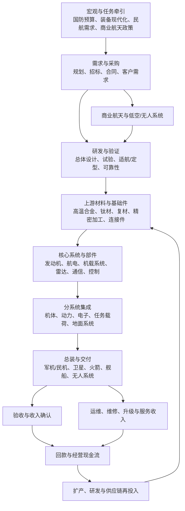

# 国防军工与航空航天产业链专题

> 研究口径：A 股产业链研究，不涉及非公开军事信息。数据截止：2026-10-11。公开披露存在保密、延迟和统计口径差异，未披露不代表不存在，也不得用传闻填补空白。

## 一、产业链全景图

**关键认识：**预算和政策是需求背景，不等于上市公司当期收入。订单、交付、验收、收入确认、回款是不同节点，必须分别核验。

## 二、细分链条与观察指标

| 细分链条 | 主要环节 | 领先/同步指标 | 主要风险与反证 |
|---|---|---|---|
| 航空装备 | 军用飞机、运输机、民用航空器、机体结构 | 交付节奏、产能利用、客户集中度、存货与合同负债 | 交付延迟、验收变化、收入确认波动 |
| 航空发动机 | 发动机整机、零部件、维修保障 | 交付/维修需求、研发投入、质量与可靠性、应收账款 | 研制周期长、良率爬坡、现金流承压 |
| 航电与机载系统 | 飞控、导航、通信、显示、机载计算 | 配套型号进展、批产份额、产品升级、回款 | 型号节奏变化、系统集成和验证延后 |
| 军工电子 | 雷达、电子对抗、通信、导航、传感器 | 订单、交付、研发费用、存货与应收变化 | 技术迭代、项目延期、竞争加剧 |
| 航天发射与卫星 | 运载火箭、卫星平台、载荷、地面站、测控 | 发射次数、卫星组网进度、有效载荷交付、商业合同 | 发射失败、预算与项目节奏、商业需求兑现不足 |
| 舰船与海洋装备 | 船体、动力、电子系统、特种装备 | 新接订单、手持订单、交付周期、造船价格 | 原料/汇率、项目周期、产能与现金流占用 |
| 无人系统 | 无人机、无人艇、控制与感知系统 | 批量订单、实际交付、客户复购、单位成本 | 竞争激烈、产品快速迭代、监管与出口限制 |
| 商业航天 | 卫星互联网、遥感、导航应用、发射服务 | 发射与组网进度、商业合同、终端/数据服务收入 | 资本开支大、回收周期长、商业模式未验证 |
| 材料与精密制造 | 高温合金、钛合金、复合材料、精密锻造/加工 | 认证周期、产品结构、产能利用、毛利率 | 认证壁垒也可能成为客户集中和爬坡风险 |

## 三、景气如何传导到利润

1. **需求形成：**国家预算、采购计划、民航订单、商业航天项目构成需求背景；公开信息要以正式文件、公告或公司披露为准。
2. **合同形成：**意向、框架协议、招标中标、正式合同并非同一状态。不要把合作签约新闻直接当成可确认收入。
3. **生产交付：**核心材料和部件认证周期长，产能提升可能受到设备、工艺、质量和供应链制约。
4. **验收与收入：**需阅读公司会计政策、合同履约义务及收入确认说明；合同负债上升可能反映预收款，但不能单独证明利润增长。
5. **现金流：**军工和大型装备项目可能出现利润增长但应收、存货或合同资产上升，需同时检查经营现金流、回款周期和减值。
6. **二次需求：**维修、备件、升级和服务有时比一次性交付更平滑，但必须验证公司真实业务构成。

## 四、2026 年公开数据快照

- **国防预算：**国防部于 2026 年 3 月公开表示，2026 年全国一般公共预算安排国防支出 1.94 万亿元，比上年执行数增长 6.9%。这是国家层面预算口径，不可按比例分配到某家上市公司收入或利润。[来源：国防部，2026-03](https://www.mod.gov.cn/gfbw/qwfb/16447679.html)
- **装备制造景气：**商务部公开转载的统计信息显示，2026 年 7 月规模以上铁路、船舶、航空航天行业增加值同比增长 13.6%。这是宽口径工业分类，不是军工订单、军品产量或上市公司利润的直接替代指标。[来源：商务部数据服务，2026-08](https://data.mofcom.gov.cn/article/zxtj/202608/65128.html)
- **产业政策：**工信部在 2026 年相关发布中将航空航天列入新兴支柱产业重点方向，并提及低空经济等领域。政策方向提供长期背景，但仍需逐层验证项目落地、客户付费和企业现金流。[来源：工信部，2026](https://www.miit.gov.cn/xwfb/bldhd/art/2026/art_934ddb14d33e4cd5b787d88a15c5c0eb.html)
- **公司财报案例：**航发动力 2026 年半年报摘要披露，上半年营业收入同比增长 47.21%，归母净利润同比增长 59.32%，但经营活动现金流净额仍为负 74.61 亿元。该案例说明收入、利润与现金流必须并看；需回到完整半年报核验变化原因、合同资产、存货及应收款项。[来源：上交所公司公告页](https://www.sse.com.cn/assortment/stock/list/info/company/index.shtml?COMPANY_CODE=600893)
- **公司财报反例：**中航沈飞 2026 年半年报摘要披露，上半年营业收入同比下降 57.68%，归母净利润同比下降 58.37%，经营现金流净额同比下降 81.48%。半年报受交付节奏和确认时点影响可能较大，不能将单期数据机械外推为全年趋势。[来源：上交所公司公告页](https://www.sse.com.cn/assortment/stock/list/info/company/index.shtml?COMPANY_CODE=600760)

**数据解释原则：**官方宏观指标、公司财报和证券市场主题指数是不同层次证据。宏观增速不等于细分行业增速；行业增长不等于每家公司受益；利润增长不等于现金流改善。

## 五、上市公司研究映射（候选，不是推荐）

| 观察环节 | 候选公司 | 研究时核验什么 |
|---|---|---|
| 军用飞机整机与航空装备 | 中航沈飞（600760）、中航西飞（000768） | 主营构成、交付确认节奏、合同负债、应收与现金流 |
| 航空发动机 | 航发动力（600893） | 研制/批产业务构成、存货、应收、经营现金流、研发投入 |
| 航电与机载系统 | 中航机载（600372） | 业务重组后的口径、系统配套范围、收入确认与回款 |
| 连接器与电气互连 | 中航光电（002179）、航天电器（002025） | 军民品比例、产品结构、客户集中、产能利用率 |
| 舰船与海洋装备 | 中国船舶（600150） | 手持订单、新接订单、交付、造船周期、汇率与原材料 |
| 军工电子与信息系统 | 国睿科技（600562）、航天电子（600879） | 雷达/电子/航天业务分部、合同履约、应收与存货 |
| 卫星与空间基础设施 | 中国卫星（600118） | 卫星制造与应用业务边界、组网项目、商业收入占比 |
| 精密制造与新材料 | 航宇科技（688239）、广联航空（300900）、光启技术（002625） | 产品实际应用、客户认证、产能爬坡、订单可见度和估值预期 |

上述名单仅用于建立研究池。公司业务可能跨多个环节，实际暴露必须以最新年报、半年报、公告和投资者关系记录为准；不得仅凭“军工概念”标签归类。

## 六、ETF 与指数映射

可先研究中证军工、国防军工、军工龙头、航空航天等指数及其跟踪产品，但**不要假定存在纯粹的商业航天、航空发动机或某一单独军工细分 ETF**。每次核验：
- 指数编制方案与成分股范围是否匹配研究主题；
- 最新定期报告持仓日期、前十大权重和行业集中度；
- 规模、成交额、买卖价差、管理费与托管费；
- 跟踪误差、折溢价及基金是否更名、转型或清盘；
- 指数是否过度集中于少数大市值公司。

ETF 是行业暴露工具，不是行业基本面证据；成分股名称与主题相近，不代表盈利驱动一致。

## 七、情景与证伪清单

| 情景 | 需要看到的证据 | 证伪信号 |
|---|---|---|
| 偏强 | 交付和验收节奏改善，订单/合同负债与收入相互印证，回款跟上 | 订单披露增加但交付延后，现金流持续恶化 |
| 基准 | 长周期研发和生产持续推进，收入按项目节奏波动 | 关键项目反复延期，库存和应收增速显著高于收入 |
| 偏弱 | 采购节奏推迟、质量问题、成本上升或商业航天融资收缩 | 订单取消/变更、减值增加、产能利用不足、融资依赖上升 |

每个判断都应写出反证条件。若只有政策热度、股价上涨或单一宏观数据，没有企业订单、交付和财务证据，结论应保持“待验证”。

## 八、每月跟踪清单

- [ ] 国防预算执行、公开采购政策和正式项目公告有无变化。
- [ ] 工信部、民航局、国防科工相关公开统计是否更新，统计口径是否可比。
- [ ] 重点公司的新签订单、合同负债、存货、合同资产、应收账款、减值和经营现金流。
- [ ] 航空发动机、机载系统、材料及精密制造环节的认证、产能和交付约束。
- [ ] 卫星/火箭发射与组网项目进度，区分发射成功、合同金额和商业收入。
- [ ] ETF 指数方案、规模、流动性、费率、折溢价与成分权重是否发生变化。
- [ ] 记录支持证据、反证、数据日期及下一次复核日期。

## 九、主要公开来源

1. [中华人民共和国国防部：2026 年国防支出安排](https://www.mod.gov.cn/gfbw/qwfb/16447679.html)
2. [商务部数据服务：2026 年 7 月工业行业数据](https://data.mofcom.gov.cn/article/zxtj/202608/65128.html)
3. [工业和信息化部：装备工业统计分析入口](https://www.miit.gov.cn/gxsj/tjfx/zbgy/index.html)
4. [工业和信息化部：推进新型工业化相关发布](https://www.miit.gov.cn/xwfb/bldhd/art/2026/art_934ddb14d33e4cd5b787d88a15c5c0eb.html)
5. [上海证券交易所：航发动力公司公告](https://www.sse.com.cn/assortment/stock/list/info/company/index.shtml?COMPANY_CODE=600893)
6. [上海证券交易所：中航沈飞公司公告](https://www.sse.com.cn/assortment/stock/list/info/company/index.shtml?COMPANY_CODE=600760)

> 本专题用于产业研究与风险识别，不构成个股或 ETF 买卖建议。军工信息公开程度有限，必须区分“没有披露”和“没有需求”，也不能将保密导致的数据缺口当成利好证据。
