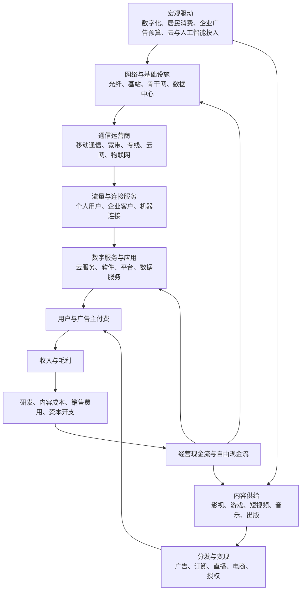

# 通信运营、传媒与互联网服务产业链专题

> 数据截止：2026-10-11。行业总量数据用于识别方向，不直接等同于单家上市公司业绩；公司业务边界和 ETF 暴露须按最新公告、定期报告及指数文件核验。

## 一、中文产业链全景图

## 二、行业边界：先拆开，再看交叉

| 领域 | 主要商业模式 | 关键经营变量 |
|---|---|---|
| 电信运营 | 移动通信、宽带、专线、云网、物联网 | 用户净增、ARPU、流量、套餐结构、资本开支、折旧、自由现金流 |
| 通信设备与光通信 | 网络设备、光模块/器件、光纤光缆、测试设备 | 客户资本开支、订单、交付、产品代际、良率、库存和毛利率 |
| 互联网平台 | 广告、交易佣金、会员、增值服务、云与技术服务 | 活跃用户、留存、付费率、单用户收入、获客成本、监管和现金流 |
| 软件与数据服务 | 软件许可、订阅、项目交付、云服务、数据产品 | 经常性收入、续费率、合同负债、应收账款、研发投入、回款 |
| 游戏 | 自研/代理、内购、订阅、海外发行 | 新品上线、流水、递延收入、用户留存、买量成本、版号与生命周期 |
| 影视与内容制作 | 电影、剧集、综艺、动画、版权 | 项目排期、票房/播放、版权分账、制作成本、减值和回款 |
| 广告营销与传媒渠道 | 品牌广告、效果广告、营销服务、媒体资源 | 广告主预算、投放转化、客户集中、应收账款、平台政策 |
| 数字阅读、音乐与出版 | 订阅、版权、广告、授权、实体出版 | 付费用户、ARPPU、版权成本、续费、内容合规 |

**分类提醒：**通信设备不等于通信运营；互联网平台不等于软件企业；文化产业统计口径与上市公司申万行业分类不完全一致。综合集团必须按业务分部分析，避免把所有数字化业务都归为同一主题。

## 三、景气传导：需求如何进入财务报表

1. **网络基础设施：**运营商资本开支、数据中心建设和云服务需求先影响设备采购与交付，再传导至设备商收入；要观察订单、交付、应收和库存，不能只看招标金额。
2. **通信运营：**用户规模和流量增长不一定带来收入同步增长；套餐降价、流量单价下降、业务结构变化和折旧可能压制利润。要把业务量、业务收入、资本开支与自由现金流放在一起。
3. **互联网平台：**流量只有通过广告转化、交易、订阅或企业服务形成收入才有经济价值。活跃用户增长若伴随获客成本上升、补贴增加或变现率下降，利润可能不改善。
4. **广告营销：**广告主预算、平台流量分配和投放回报共同决定收入；需区分品牌广告与效果广告、总额法与净额法，以及广告投放额和服务商确认收入。
5. **游戏与内容：**研发立项、制作、审批、上线、用户获取、留存和付费是连续但不同的阶段。新品热度不是利润；还需看分成、买量成本、递延收入、项目减值与现金回款。
6. **AI 与云服务：**AI 推理/训练需求可能增加算力、网络和云资源消费，也可能提高资本开支和折旧。关注客户付费、使用量、单位成本、续费和现金回报，不能将模型调用量直接当作收入。

## 四、2026 年公开数据快照

| 公开数据 | 近期结果 | 如何解读 |
|---|---|---|
| 通信业，工信部，2026 年 1—8 月 | 电信业务收入 1.16 万亿元，同比下降 2.2%；按上年不变价计算的电信业务总量增长 7.6%；5G 用户 13.11 亿户，占移动电话用户 70.9%；移动互联网流量增长 17.3% | 流量与连接用户仍在增长，但收入下滑，说明不能仅凭流量增长推断运营商收入或利润上行 |
| 软件业，工信部，2026 年 1—8 月 | 软件业务收入 102820 亿元，同比增长 8.8%；利润总额增长 1.3%；软件出口增长 12.5%；云计算和大数据服务收入增长 11.1% | 收入增速高于利润增速，需继续拆解成本、业务结构和回款 |
| 互联网和相关服务业，工信部，2026 年 1—8 月 | 互联网业务收入增长 8.9%；利润总额增长 12.7%；研发经费投入增长 15.0%；生活服务领域收入下降 0.3% | 总体增长掩盖子领域分化；利润改善也要结合企业范围、业务结构和现金流 |
| 规模以上文化及相关产业，国家统计局，2026 年上半年 | 营业收入 72026 亿元，同比增长 4.6%；文化新业态收入增长 9.6%；利润总额下降 7.5%；文化服务业收入增长 8.1%，文化传播渠道收入下降 3.2% | 新业态收入较快增长，但整体利润承压，传媒渠道和内容服务不能一概而论 |

数据来源：
- [工信部：2026 年前 8 个月通信业经济运行情况，2026-09-28](https://www.miit.gov.cn/jgsj/yxj/xxfb/art/2026/art_5fb391bfb8dd487ca5c89cf0f3bab44c.html)
- [工信部：2026 年 1—8 月软件业运行情况，2026-09-30](https://wap.miit.gov.cn/jgsj/yxj/xxfb/art/2026/art_f77c0fabc2f34461b8ce96892998419d.html)
- [工信部：2026 年 1—8 月互联网和相关服务业运行情况，2026-09-30](https://wap.miit.gov.cn/jgsj/yxj/xxfb/art/2026/art_d0c77114058041d9a8616b342cc5d1e9.html)
- [国家统计局：2026 年上半年规模以上文化及相关产业企业营业收入，2026-07-30](https://www.stats.gov.cn/sj/zxfb/202607/t20260730_1964244.html)

统计口径提醒：工信部通信业、软件业、互联网企业与国家统计局文化企业的范围不同，不可直接相加或当作同一行业样本。以上为截至本专题编写日可核验的公开数据，不代表每家公司最新一期业绩。

## 五、上市公司研究映射（候选，不是推荐）

| 研究环节 | 候选公司 | 重点核验 |
|---|---|---|
| 电信运营 | 中国移动（600941）、中国电信（601728）、中国联通（600050） | ARPU、用户结构、云/产业数字化收入、资本开支、折旧、自由现金流和股东回报 |
| 通信设备与网络 | 中兴通讯（000063）、烽火通信（600498） | 运营商与企业客户需求、订单交付、应收款、研发投入、海外业务风险 |
| 光通信与光器件 | 中际旭创（300308）、新易盛（300502）、天孚通信（300394）、光迅科技（002281） | 客户集中、产品迭代、订单与交付、毛利率、扩产、应收和估值预期 |
| 互联网平台与企业服务 | 三六零（601360）、用友网络（600588）、金山办公（688111） | 业务收入构成、订阅续费、企业付费、研发投入、获客和现金流 |
| 游戏与数字内容 | 三七互娱（002555）、恺英网络（002517）、吉比特（603444）、完美世界（002624） | 产品周期、流水与收入确认、买量成本、递延收入、版号和海外表现 |
| 影视、视频与内容 | 芒果超媒（300413）、光线传媒（300251）、中文在线（300364） | 内容排期、版权收益、项目成本、用户付费、应收和减值风险 |
| 广告营销与传媒服务 | 分众传媒（002027）、蓝色光标（300058） | 广告主预算、媒体资源利用率、毛利率、应收账款、经营现金流和客户集中度 |

公司名单只用于建立候选研究池。主营业务、收入占比和业务变化以最新年报、半年报、交易所公告为准；不可将股价表现或“AI/算力/传媒概念”当成实际利润来源。

## 六、ETF 与指数映射

可以按研究目的分别观察通信设备、通信服务、传媒、游戏、软件、计算机及数字经济等指数产品。不要假设某只 ETF 能完整代表整条产业链。

每次核验：
- 跟踪指数的正式名称、编制规则、选样范围和权重限制；
- 前十大成分股及其业务收入暴露，是否集中于少数公司；
- 基金规模、成交额、买卖价差、费率、跟踪误差和折溢价；
- 传媒指数是否偏游戏/出版，通信指数是否偏光通信设备而非运营商；
- 软件或数字经济指数是否混入硬件、电子或其他主题；
- 基金是否更名、转型、暂停申购或清盘，持仓数据的报告日期。

ETF 是风险暴露和交易工具，不替代对成分股商业模式、盈利质量和估值的研究。

## 七、横向比较：用什么指标分辨真正改善

| 子行业 | 首要指标 | 容易误判的指标 | 关键反证 |
|---|---|---|---|
| 运营商 | 服务收入、ARPU、资本开支、自由现金流 | 流量、用户数单指标 | 用户增长但收入/ARPU持续下降，资本开支与折旧挤压现金流 |
| 通信设备 | 订单、交付、毛利率、应收周转 | 招标或中标金额 | 订单增长未转化为收入、应收持续积压 |
| 光通信 | 高速产品收入、客户验证、交付和毛利率 | 行业扩容预测 | 订单集中、技术迭代导致价格下跌或扩产超前 |
| 平台与软件 | 付费用户、续费率、经常性收入、获客成本 | 下载量、注册量、访问量 | 用户增长但付费转化差、续费下降、获客成本升高 |
| 游戏 | 新品生命周期、流水、留存、利润贡献 | 首发热度或榜单排名 | 买量成本高、流水衰减快、研发项目减值 |
| 影视内容 | 项目回款、版权分账、成本控制 | 预告片热度、播放量 | 高投入低分账、回款拖延、库存版权减值 |
| 广告营销 | 广告主预算、客户续约、净利率和现金流 | 广告投放总额 | 收入增长依靠低毛利转售，账期延长、现金流恶化 |

## 八、情景与证伪清单

- **偏强情景：**通信业务量能转化为收入或套餐价值提升；设备订单顺利交付；互联网与内容业务付费转化改善；利润增长同时伴随回款和现金流改善。
- **基准情景：**流量、用户和数字化需求继续增长，但价格竞争、内容成本、研发投入与资本开支使利润表现分化。
- **偏弱情景：**运营商价格竞争加剧；设备客户资本开支延后；互联网获客成本上升；内容项目回报低于预期；应收、减值和资本开支挤压现金流。

**必须记录的反证：**
1. 收入增速是否连续落后于业务量增速？
2. 利润增长是否由一次性收益或成本确认时点驱动？
3. 应收、合同资产和存货是否持续快于收入增长？
4. 研发投入和资本开支能否形成可持续的付费收入？
5. ETF 的指数成分是否真的对应所研究的细分业务？

## 九、每月跟踪清单

- [ ] 工信部通信业、软件业、互联网服务业统计是否更新，口径是否可比。
- [ ] 运营商财报中的用户、ARPU、资本开支、折旧、自由现金流是否改善。
- [ ] 通信设备与光通信企业的订单、交付、客户集中、存货及应收周转。
- [ ] 互联网企业的收入分部、利润、研发投入、付费率和现金流。
- [ ] 游戏版号、新品上线、用户留存、买量成本与递延收入。
- [ ] 影视内容的制作排期、分账、版权资产与项目减值。
- [ ] 广告营销企业的客户预算、毛利率、账期和经营现金流。
- [ ] ETF 的指数规则、成分权重、规模、成交和费率是否变化。
- [ ] 每条判断均注明来源、发布日期、数据期间、支持证据、反证和复核日期。

> 本专题用于产业研究与风险识别，不构成个股或 ETF 买卖建议。不要用单一宏观增长率、流量、用户规模或市场热度代替企业盈利和现金流验证。
