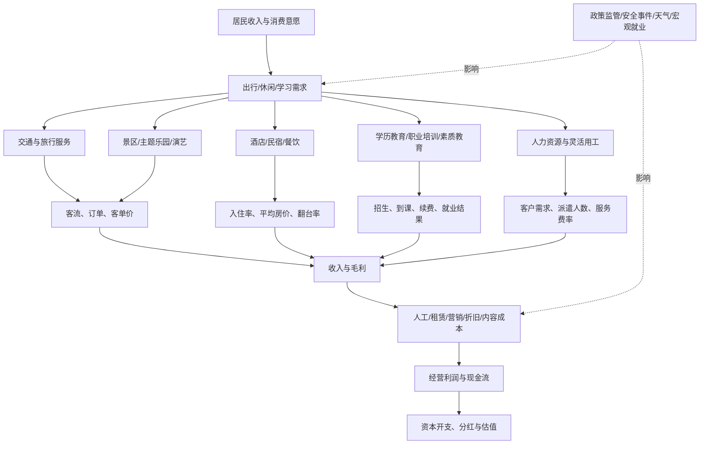

# 社会服务、旅游酒店与教育产业链专题

> 更新日期：2026-10-11  
> 研究定位：A 股全市场行业研究；用于建立产业链观察框架，不构成个股买卖建议。行业热度、公司盈利与股价表现必须分别验证。

## 一、研究结论先行

社会服务不是单一周期行业，而是由可选消费、出行流量、服务供给、平台获客与人力成本共同驱动的多个子行业组成。本专题覆盖旅游服务、景区与演艺、酒店住宿、餐饮服务、人力资源服务、教育与职业培训等。

核心判断顺序：
1. **需求是否真实增长**：客流、订单、入住率、到店消费、招生与续费等。
2. **单位经济模型是否改善**：客单价、房价、入住率、单客获客成本、教师/员工利用率。
3. **增长能否转化为利润与现金**：毛利率、费用率、预收/合同负债、应收账款、经营现金流与资本开支。
4. **估值是否已透支预期**：股价涨幅、盈利预测变化、估值分位、拥挤度与解禁/减持风险。

旅游人次增长不代表人均消费、企业利润同步增长；招生增加不代表续费质量提升；酒店入住率上升也不必然抵消人工、租赁和翻新成本。

## 二、中文产业链全景图

## 三、子行业拆解与关键指标

| 子行业 | 主要收入驱动 | 关键成本与约束 | 优先跟踪指标 |
|---|---|---|---|
| 旅行社、在线旅游及目的地服务 | 订单量、客单价、佣金率、入境游 | 流量采购、履约、退款、价格竞争 | 订单/间夜、预订提前期、取消率、佣金率、获客成本 |
| 景区、主题乐园、演艺 | 入园人数、门票/二消、演出场次 | 天气、季节性、维护折旧、营销、项目投资 | 客流、客单价、二次消费、单客贡献、经营现金流 |
| 酒店、住宿 | 可售客房、入住率、平均房价、每间可售房收入 | 租金/物业、人工、能源、翻新折旧、加盟管理成本 | 入住率、平均房价、每间可售房收入、同店收入、净开店数 |
| 餐饮服务 | 门店数、翻台率、客单价、同店销售 | 食材、人工、租金、平台佣金、损耗 | 同店销售、翻台率、客单价、闭店率、门店回收期 |
| 人力资源服务 | 招聘需求、派遣/外包人数、服务费率 | 招聘渠道、交付团队、回款周期、合规成本 | 新签客户、在岗人数、客户集中度、应收账款、现金流 |
| 职业教育与技能培训 | 招生、客单价、课程完成率、就业服务 | 获客、师资、场地、退费、政策与合规 | 招生转化、退费率、续费率、就业/考试结果、预收款 |
| 学前/素质/民办教育相关服务 | 在校人数、课程频次、学费及服务收入 | 生源变化、监管、师资、校舍与合规投入 | 生源/续班、利用率、收费政策、现金回款、合规事件 |

### 经营指标口径提醒

- 酒店的每间可售房收入（RevPAR）通常由平均房价与入住率共同决定；需要结合直营/加盟、同店/新店和城市层级看。
- 景区客流应同时看门票收入、二次消费、游客停留时间和单位客流成本。
- 餐饮收入增长要拆为开店扩张与同店增长，不能把新店贡献当成存量经营改善。
- 教育业务须区分学历教育、职业培训、学科类培训、素质教育及教育信息化；政策适用范围不同，不可混为一个赛道。
- 人力资源公司需要观察就业景气、客户行业结构、应收账款与经营现金流，合同额并不等于当期收入。

## 四、需求与财务传导

### 1. 旅游、酒店、景区与演艺

居民出行意愿和交通供给改善，先影响预订和客流，再通过客单价、入住率、门票与二次消费影响收入。利润兑现取决于价格纪律、人工与租赁成本、折旧摊销以及营销投入。若客流增长但客单价下降、折扣扩大或成本上升，利润增速可能落后于客流。

### 2. 餐饮服务

消费频次与到店流量影响销售，食材成本、人工效率、租金与平台佣金决定毛利和门店利润。连锁化扩张应重点检查新店爬坡期、同店销售、闭店率和现金回收期。加盟模式需识别收入来自加盟服务、供应链还是直营经营。

### 3. 教育与职业培训

招生需求通过转化率、客单价与课程履约转化为收入；预收学费并不等于已赚取收入，退费义务和履约成本必须纳入。职业培训还要看就业市场、考试政策、培训结果与复购口碑。教育数字化供应商则应另看客户预算、项目验收、应收账款和回款。

### 4. 人力资源服务

招聘需求与企业用工变化影响客户订单、在岗人数和服务费率。宏观就业承压时，部分招聘服务可能走弱，而灵活用工、外包、薪酬福利等细分业务表现可能不同。需区分业务结构，避免用单一就业指标推断所有公司。

## 五、近期公开数据与解读

数据日期优先采用官方已发布口径；不同统计体系的范围与可比口径不同，不可直接拼接成上市公司收入预测。

1. **2026 年国庆假期文旅数据**：文化和旅游部于 2026-10-09 发布，国庆假期 7 天国内出游 8.26 亿人次，国内出游总花费 7383.75 亿元；按可比口径日均分别同比增长 6.3% 和 4.3%。人次增速高于花费增速，提示应进一步观察人均消费、目的地结构与企业成本，而不是只看总客流。来源：[文化和旅游部：2026年国庆节假期国内出游8.26亿人次](https://www.mct.gov.cn/whzx/whyw/202610/t20261009_967315.htm)。

2. **2026 年上半年国内旅游**：国内居民出游 34.63 亿人次，同比增长 5.4%；国内出游总花费 3.21 万亿元，同比增长 2.0%。这是文旅部数据经中国网转述的抽样调查结果，使用时应注明口径，不应与国庆假期数据直接累加。来源：[中国网：文化和旅游部公布上半年国内居民出游数据](https://travel.china.com.cn/txt/2026-08/10/content_118640617.shtml)。

3. **2026 年 1—8 月消费与服务零售**：国家统计局公布社会消费品零售总额同比增长 1.1%，餐饮收入增长 2.4%；社会消费商品和服务零售总额同比增长 2.5%，服务零售额增长 4.9%。服务零售增长较快，但不意味着所有服务子行业同步增长。来源：[国家统计局：2026年1—8月份国民经济运行情况](https://www.stats.gov.cn/sj/zxfbhjd/202609/t20260915_1965307.html)；[2026年1—8月份社会消费品零售总额](https://www.stats.gov.cn/sj/zxfb/202609/t20260915_1965311.html)。

4. **文化产业的收入与利润并非同向**：2026 年上半年全国规模以上文化及相关产业企业营业收入同比增长 4.6%，文化服务业增长 8.1%，但利润总额同比下降 7.5%。该数据覆盖文化及相关产业统计范围，并非所有传媒、演艺或上市公司。来源：[国家统计局：2026年上半年全国规模以上文化及相关产业企业营业收入增长4.6%](https://www.stats.gov.cn/sj/zxfb/202607/t20260730_1964244.html)。

### 数据使用边界

- 国庆假期数据是短期节假日表现，不等于全年趋势或上市公司财务业绩。
- 国内出游人次与出游花费来自抽样调查；统计期、可比口径和范围必须保留。
- 社会消费品零售总额、服务零售额和文旅调查指标的定义不同，不能相加或简单替代。
- 规模以上文化企业数据不是传媒板块整体，更不能直接作为单家公司的业绩增速。

## 六、上市公司研究映射（候选，不代表推荐）

| 观察方向 | 可作为起点的上市公司/类型 | 需要核验的核心问题 |
|---|---|---|
| 旅游综合服务与免税零售 | 中国中免（601888） | 旅游客流、消费转化、渠道与价格竞争、库存和营运资金；免税零售不等同于旅行社业务 |
| 酒店住宿 | 锦江酒店（600754）、首旅酒店（600258） | RevPAR、同店表现、直营/加盟结构、租赁负担、开店质量与现金流 |
| 景区与现场演艺 | 宋城演艺（300144）等景区/演艺运营商 | 客流、演出供给、二消、项目折旧、异地项目回报与安全风险 |
| 餐饮服务 | 按当前主营业务筛选的餐饮上市公司 | 同店销售、门店净增、食材人工成本、加盟与直营结构、闭店和回收期 |
| 人力资源服务 | 科锐国际（300662）等人力资源服务商 | 招聘与灵活用工业务结构、客户集中度、应收账款、现金流与合规 |
| 教育与职业培训 | 按当前主营业务和监管边界筛选的教育服务上市公司 | 学科/非学科、职业培训、学历教育、教育信息化的业务占比；退费、预收款和政策变化 |

**公司核验规则**：每家公司均需查看最新年报/半年报、主营业务构成、分部收入利润、经营现金流、应收账款、合同负债、重大诉讼与监管公告。表中只提供研究入口，不保证公司当前业务纯度，也不代表估值便宜。教育类公司尤其需要核验当前实际经营范围与适用政策，不以证券简称或历史业务标签判断。

## 七、ETF 与指数映射核验

本专题横跨多个申万行业及主题，不能假设存在一只能够完整代表“社会服务”的 ETF。执行时按以下步骤核验：

1. 在交易所、基金公司官网和指数公司官网查询旅游、酒店餐饮、休闲服务、文化传媒、教育等相关指数与 ETF；确认产品是否仍上市、规模、成交额、跟踪误差、费率和流动性。
2. 打开指数编制方案，核对样本空间、行业分类、权重上限、定期调整规则与前十大成分股。
3. 对比指数成分股与本专题子行业：旅游零售、酒店、景区、传媒、教育可能被分散到不同指数，主题名称不等于纯行业暴露。
4. 对小规模、低成交额或持仓高度集中的产品设置流动性警戒；不要仅因净值低、单价低或近期跌幅大就认定便宜。
5. 记录数据日期：基金季报持仓是阶段性披露，指数每日成分、基金申赎清单与完整实时持仓不是同一概念。

可先通过交易所基金列表、基金公司产品页及指数公司编制方案交叉验证；未完成逐只核验前，不在专题中硬编码未经确认的 ETF 代码。

## 八、反证条件与主要风险

出现下列情况时，应下调对相关细分行业盈利改善的信心：

- 客流或订单增加，但客单价、入住率、同店销售或单位收入下降。
- 收入增长而毛利率下降，销售费用、人工、租金或折旧增速更快。
- 经营现金流长期弱于利润，应收账款与合同资产增长明显快于收入。
- 酒店和景区扩张依赖高资本开支，项目回收期拉长或新店爬坡不及预期。
- 教育业务出现退费上升、续费下滑、招生渠道成本上升或政策合规风险。
- 人力资源服务的客户需求减弱、客户集中度过高、回款周期延长。
- 行业新闻热度上升，但盈利预测没有上修、估值已经大幅扩张。
- 极端天气、公共安全、食品安全、交通中断、突发事件或监管变化影响经营。

## 九、月度跟踪清单

每月更新以下信息，并标注来源、统计期、发布日期和可比口径：

- [ ] 国内旅游人次、出游花费、人均花费；节假日数据与平日数据分开记录。
- [ ] 入境旅游、国际航班与主要目的地客流（以官方公布为准）。
- [ ] 酒店入住率、平均房价、RevPAR、同店表现和净开店数。
- [ ] 景区客流、门票/二次消费、演艺场次和单位客流收入。
- [ ] 餐饮同店销售、翻台率、客单价、闭店率与门店回收期。
- [ ] 职业教育招生、续费、退费、考试/就业结果及政策公告。
- [ ] 人力资源服务订单、在岗人数、客户行业结构、应收账款与现金流。
- [ ] 重点公司最新财报、业绩预告、盈利预测变化、估值与股东减持。
- [ ] 相关 ETF 的规模、成交额、跟踪指数、成分股变化和流动性。
- [ ] 记录至少一条不支持原判断的证据，防止只搜集利好。

## 十、官方数据入口

- [文化和旅游部](https://www.mct.gov.cn/)：旅游市场、政策、节假日数据与行业通知。
- [国家统计局](https://www.stats.gov.cn/sj/)：消费、服务业、住宿餐饮、教育与文化体育相关统计。
- [教育部](https://www.moe.gov.cn/)：教育政策、教育事业统计与监管信息。
- [人力资源和社会保障部](https://www.mohrss.gov.cn/)：就业、人力资源服务和职业技能培训政策。
- [中国证监会](https://www.csrc.gov.cn/)及[上海证券交易所](https://www.sse.com.cn/)、[深圳证券交易所](https://www.szse.cn/)：上市公司披露、基金产品与交易信息。

---
**使用原则**：先验证需求，再验证单位经济模型，再验证利润与现金流，最后才讨论估值和交易。任何单一节假日数据、政策表述、行业主题或 ETF 名称，都不足以单独构成投资结论。
