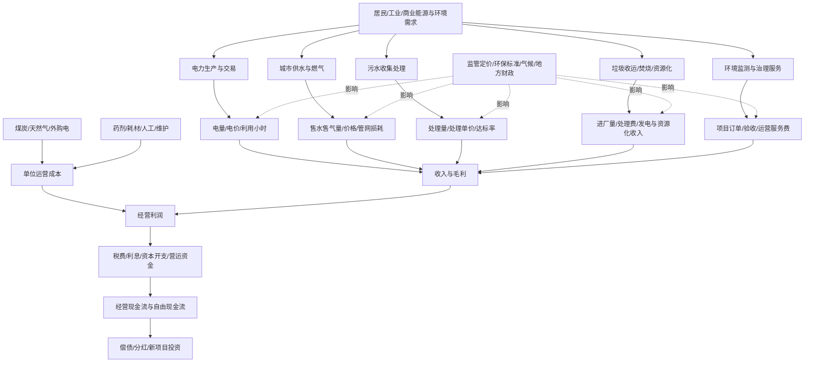

# 公用事业、环保与综合服务产业链专题

> 更新日期：2026-10-11  
> 研究定位：覆盖电力公用事业、水务、燃气、垃圾处理、污水治理、环境监测与综合运营服务。电网设备、新能源设备及上游材料已在相关专题中研究，本篇重点看运营端的价格机制、利用率、成本、资本开支、回款和现金流。

## 一、核心结论

公用事业与环保行业常被视为“防御型”或“政策驱动”板块，但不能简单等同于低风险、稳定高分红。其盈利通常取决于四组变量：

1. **价格与机制**：上网电价、市场化交易比例、燃料联动、居民/非居民水气价格、垃圾处理费与污水处理费结算机制。
2. **销量与利用率**：发电量、利用小时、售电量、供水量、售气量、垃圾处理量及设施负荷率。
3. **单位成本**：煤价/气价、外购电、药剂、人工、维护、环保合规和设备更新成本。
4. **资本与现金流**：项目建设、折旧、融资成本、应收政府及企业客户款项、自由现金流和分红覆盖能力。

环保项目尤其要区分“签约金额—开工—建设—验收—运营—回款”各阶段。政策目标、项目中标和收入确认之间存在时间差，不能把订单额直接视作利润。

## 二、中文产业链全景图

## 三、子行业拆解与关键指标

| 子行业 | 收入驱动 | 主要成本/风险 | 关键指标 |
|---|---|---|---|
| 火电运营 | 上网电量、电价、容量电价及辅助服务 | 煤价、运费、利用小时、融资成本、环保投入 | 发电量、利用小时、入炉煤价、度电燃料成本、单位利润、负债 |
| 水电运营 | 来水、发电量、电价、跨区交易 | 来水波动、生态约束、折旧、检修 | 来水量、发电量、利用小时、单位成本、分红覆盖 |
| 核电及其他稳定电源 | 核准/投产容量、利用率、电价 | 建设周期、资本开支、核安全与退役安排 | 在运/在建容量、利用小时、项目进度、资本开支、负债 |
| 城市燃气 | 售气量、价差、接驳及综合能源服务 | 上游气源价、顺价滞后、管网维护、安全合规 | 工商业/居民气量、购销价差、应收账款、管网损耗 |
| 水务与供水 | 售水量、水价、污水处理服务费 | 能耗、药剂、管网漏损、折旧、应收款 | 供水/污水量、单价、漏损率、吨水成本、回款周期 |
| 垃圾焚烧与固废 | 垃圾处理量及处理费、发电、资源化 | 项目建设、设备维护、入厂量、补贴结算 | 设计/实际处理能力、负荷率、处理费回款、发电收入、应收款 |
| 环境治理工程 | 设备、工程合同、运维服务 | 项目延期、验收、客户信用、竞争与垫资 | 新签订单、合同资产、应收账款、验收周期、经营现金流 |
| 环境监测与综合服务 | 设备销售、监测运营、咨询及运维 | 政府/企业预算、技术更新、项目竞争 | 经常性服务收入、续约率、订单质量、毛利率、回款 |

## 四、利润与现金流传导

### 1. 电力运营

电量由需求、天气、机组可用率和电力市场调度共同影响；利润再受电价、燃料成本、容量补偿及辅助服务收入影响。火电不能只看煤价或电价单边变化，要同时测算“度电收入—度电燃料成本—其他变动成本”。水电要把来水和水库调度影响与经营改善区分开。

### 2. 水务与燃气

这类业务具有区域特征，价格受监管机制影响，销量也受人口、产业结构、天气与节水政策影响。即使收入稳定，管网维护、折旧、融资成本和应收账款也会影响自由现金流。燃气公司还需关注上游采购成本向终端传导是否及时，以及居民与工商业客户结构。

### 3. 环保运营与工程

运营类项目的核心是设施负荷率、处理单价、达标运营、回款和设备更新；工程类项目则要检查合同质量、垫资比例、项目验收和客户信用。若应收账款、合同资产长期快于收入增长，即使利润表盈利也可能面临现金流和减值风险。

### 4. 资本开支和分红

高资本开支行业需要区分维护性与扩张性资本开支。分红不能只看股息率，还要核对自由现金流、净负债、到期债务、项目承诺和周期性利润。高分红可能来自成熟资产，也可能只是短期盈利高点或股价下跌导致的表观收益率上升。

## 五、近期官方数据与解读

1. **全社会用电量**：国家能源局 2026 年 9 月 20 日公布，2026 年 1—8 月全社会用电量累计 71,730 亿千瓦时，同比增长 4.3%；其中第二产业用电量同比增长 4.4%，第三产业增长 7.1%。8 月全社会用电量 10,332 亿千瓦时，同比增长 1.7%。用电量是需求量指标，不等于发电企业利润增速。来源：[国家能源局：8月份全社会用电量再破万亿，负荷创历史新高](https://www.nea.gov.cn/20260920/bd277235282140f4b43e9e0f5f0af3d9/c.html)。

2. **电力市场交易**：国家能源局 2026 年 10 月 9 日转述数据显示，2026 年前 8 个月全国各电力交易机构累计完成交易电量 51,800 亿千瓦时，同比增长 19.2%。交易电量增长说明市场化交易规模扩大，但需进一步核验各公司交易电价、交易结构和风险管理，不能直接推断电价上升或盈利改善。来源：[国家能源局：前8月电力市场交易电量同比增长19.2%](https://www.nea.gov.cn/20261009/1bbdc84ad4374cd8bbad6bde37543ec9/c.html)。

3. **公用事业相关固定资产投资**：国家统计局公布，2026 年 1—8 月电力、热力、燃气及水生产和供应业固定资产投资同比下降 6.9%；水利、环境和公共设施管理业投资同比下降 11.0%。投资数据是建设活动指标，不等于行业收入或利润；需注意项目周期、价格因素和统计分类。来源：[国家统计局：2026年1—8月份全国固定资产投资基本情况](https://www.stats.gov.cn/sj/zxfbhjd/202609/t20260915_1965309.html)。

4. **规模以上公用事业企业利润**：国家统计局公布，2026 年 1—8 月电力、热力、燃气及水生产和供应业规模以上工业企业营业收入同比增长 0.9%，利润总额同比下降 12.0%。该口径覆盖相关规模以上工业企业，不等于所有上市公用事业公司；它提醒研究者不要把“公用事业”标签自动等同于利润稳定增长。来源：[国家统计局：2026年1—8月份全国规模以上工业企业利润增长15.7%](https://www.stats.gov.cn/sj/zxfbhjd/202609/t20260928_1965425.html)。

5. **环保统计边界**：生态环境部公开生态环保产业统计调查试点方案，涵盖污染防治设备、产品与环境服务等不同活动。环保上市公司业务可能同时包含工程、设备、运营和资源化，统计分类与证券行业分类未必一致。来源：[生态环境部：生态环保产业统计调查试点工作方案](https://www.mee.gov.cn/xxgk2018/xxgk/xxgk06/202504/W020250407374940423028.pdf)。

### 数据使用边界

- 全社会用电量不能替代单家公司售电量、利用小时或利润。
- 电力交易电量是成交规模，不是电价、毛利或净利润的直接代理。
- 固定资产投资下降可能反映建设节奏，也可能影响未来新增订单；需要结合项目储备和在手合同判断。
- 规模以上工业企业统计范围与上市公司范围不同，不能把行业总量直接套用到公司。
- 环保工程的合同额、收入确认、应收款与现金回收是不同阶段，需分别记录。

## 六、上市公司研究映射（候选，不代表推荐）

| 方向 | 研究起点 | 需要核验 |
|---|---|---|
| 水电运营 | 长江电力（600900） | 来水、发电量、电价、资本开支、分红与自由现金流 |
| 火电运营 | 华能国际（600011）等 | 电价、燃料成本、利用小时、容量电价、负债与现金流 |
| 城市燃气 | 深圳燃气（601139）等 | 售气结构、购销价差、顺价机制、接驳收入与应收款 |
| 水务与污水处理 | 重庆水务（601158）、首创环保（600008）等 | 水价、处理量、管网漏损、项目回款、资本开支与负债 |
| 垃圾焚烧/固废 | 伟明环保（603568）、瀚蓝环境（600323）等 | 入厂量、处理费、发电收入、项目负荷率、应收款与新增投资 |
| 综合环保与资源化 | 中国天楹（000035）等 | 业务结构、项目质量、现金流、海外/新业务执行风险 |

公司只是研究入口，不代表当前估值合理或适合交易。每家公司均需核验最新年报/半年报、主营构成、分部收入与利润、资本开支、净负债、经营现金流、应收账款、合同资产、股息支付和重大事项。若公司同时涉及设备制造、工程建设、新能源或其他业务，应按分部拆解，不能直接归类为纯运营商。

## 七、ETF 与指数映射核验

1. 先区分公用事业运营、火电、水电、燃气、水务环保和环保设备；主题相似不代表成分股相同。
2. 在交易所、基金公司与指数公司官网核对 ETF 是否存续、跟踪指数、费率、规模、成交额、跟踪误差及申赎机制。
3. 查看指数编制方案、样本空间、权重限制和定期调整规则；确认成分股是否以运营资产为主，还是偏向电网设备、环保设备或新能源制造。
4. 检查前十大成分集中度、行业交叉暴露和国有企业权重，评估其与本专题目标的匹配程度。
5. 记录数据日期；基金季报持仓、指数成分公告、每日申赎清单和完整实时持仓不是同一概念。
6. 不因净值低、股息率高或近期跌幅大就认定便宜；还需检查盈利可持续性、负债和自由现金流。

未完成逐只核验前，不硬编码未经确认的 ETF 代码。后续应将实际可交易产品与指数编制方案、流动性和持仓重叠逐一对照。

## 八、反证条件与主要风险

- 用电量增长但公司电量、电价或利用小时未改善。
- 燃料、外购电、药剂、人工或融资成本上升，抵消收入增长。
- 水价/气价调整滞后，购销价差收窄或管网损耗恶化。
- 项目建设延误、验收延迟、地方财政支付变慢，导致应收账款与合同资产积累。
- 运营设施负荷率不足、设备故障、排放不达标或环保处罚增加。
- 资本开支与债务扩张快于经营现金流，分红依赖新增融资或处置资产。
- 股息率上升主要来自股价下跌，利润或自由现金流却下降。
- 电力市场机制、环保标准、特许经营或收费政策发生变化，影响资产回报。
- 极端天气、来水异常、燃料供应波动或安全事故冲击经营。

## 九、月度跟踪清单

- [ ] 全社会用电量、分产业用电量与电力交易量，记录统计期和发布日期。
- [ ] 重点电力公司发电量、利用小时、电价、燃料成本和辅助服务收入。
- [ ] 煤炭/天然气采购价、外购电成本及价格传导情况。
- [ ] 水务、燃气企业售量、价格调整、漏损率、应收账款与回款周期。
- [ ] 垃圾焚烧/污水处理设施处理量、负荷率、处理费结算与达标率。
- [ ] 环保工程新签订单、合同资产、验收、应收账款、减值与经营现金流。
- [ ] 资本开支、在建工程、净负债、利息支出和到期债务。
- [ ] 分红金额、自由现金流覆盖、分红政策及重大项目承诺。
- [ ] 相关 ETF 规模、成交额、指数成分和行业暴露变化。
- [ ] 至少记录一条反对当前判断的证据，避免只收集政策利好。

## 十、官方数据入口

- [国家能源局](https://www.nea.gov.cn/)：用电量、电力市场交易、电源建设和能源政策。
- [国家统计局](https://www.stats.gov.cn/sj/)：工业企业利润、固定资产投资和价格统计。
- [生态环境部](https://www.mee.gov.cn/)：环境质量、污染治理政策、排放标准和环保产业统计。
- [国家发展和改革委员会](https://www.ndrc.gov.cn/)：能源价格机制、公用事业收费和特许经营相关政策。
- [上海证券交易所](https://www.sse.com.cn/)与[深圳证券交易所](https://www.szse.cn/)：上市公司公告、基金产品及交易信息。

---
**使用原则**：以运营数据判断需求，以价格和单位成本判断毛利，以回款和资本开支判断现金质量，最后再看估值和分红。政策方向、订单公告、股息率或单一宏观指标都不能单独构成投资结论。
