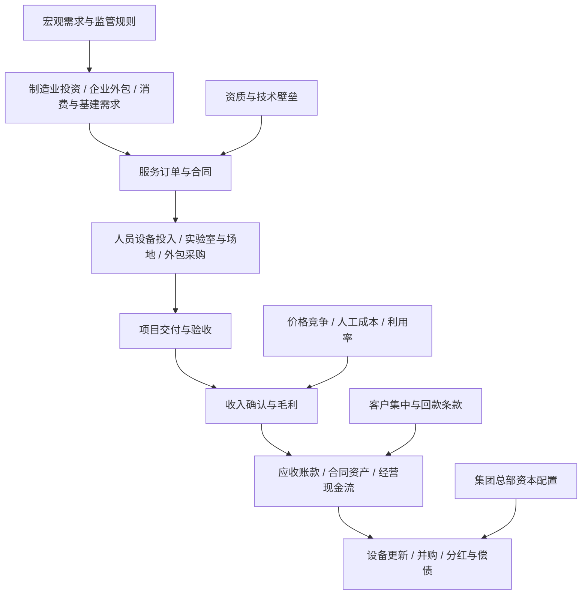

# 29｜综合行业、商业服务与产业链交叉传导专题

> 研究定位：补齐跨行业商业服务与多元业务模式的研究视角。本文不是申万分类的替代品，也不把“综合”“服务”当作单一景气行业；分析单位应尽量落到具体业务分部、客户与合同现金流。数据更新：2026-10-11。

## 一、研究边界与核心结论

本专题重点覆盖四类容易在行业地图中被遗漏或重复归类的对象：

1. **多元化经营集团**：同时涉足地产、消费、制造、资源、金融或服务的集团。关键是分部收入、分部利润、资产占用和资本配置，而不是集团名称。
2. **生产性商业服务**：检验检测认证、工程咨询与技术服务、工业运维、供应链管理、仓储及贸易服务等。其需求来自制造业投资、产品质量与合规要求、企业外包和供应链效率。
3. **资产与设施运营服务**：园区运营、物业管理、设备租赁、设施管理等。重点看出租率/利用率、续约率、单价、客户集中度、维护资本开支与收款。
4. **资源循环与专业服务交叉领域**：再生资源回收、环境检测、节能服务等。按实际收入来源与资产模式分别映射到环保、公用事业、材料或商业服务，不按概念名称重复计数。

核心判断：**商业服务并非天然轻资产或高毛利；集团业务多元化也不自动等于风险分散。** 投资研究必须穿透到分部与现金流，并区分行业归属、产业链位置和市场主题。

## 二、中文产业链与盈利传导图

## 三、业务模式拆解

| 子方向 | 客户与付费逻辑 | 关键经营指标 | 常见风险 |
|---|---|---|---|
| 检验检测与认证 | 制造商、政府/机构或消费者为测试、验证、认证付费 | 新签订单、实验室利用率、单项目价格、复购、资质覆盖、人员产出 | 同质化压价、资质合规、设备折旧、应收增长 |
| 工程咨询与技术服务 | 按项目、里程碑或工时收费 | 新签合同、在手订单、验收率、项目毛利、应收周转 | 项目延期、验收推迟、客户预算收缩、回款拖延 |
| 供应链与贸易服务 | 赚取服务费、价差、仓储/加工费或供应链管理费 | 货量、周转天数、单位服务收入、资金占用、风险敞口 | 低毛利高周转、存货跌价、信用风险、贸易真实性 |
| 设施/园区/物业运营 | 租金、物业费、综合设施服务费 | 出租率、续约率、单位面积收入、欠费率、维护开支 | 空置、租户集中、收费承压、资本开支高于预期 |
| 设备租赁与工业运维 | 租赁费、运维合同费、可用率服务费 | 设备利用率、日租金、续租、维修率、资产回报率 | 设备残值下跌、闲置、融资成本、客户违约 |
| 多元化集团 | 各业务分部的产品/服务收入 | 分部收入与利润、资本开支、ROIC、净负债、关联交易 | 交叉补贴、低效投资、分部披露不足、治理折价 |

## 四、近期公开数据与解读

### 1. 服务业总体景气并不等于所有服务公司盈利改善

国家统计局于2026年9月15日公布：2026年1—8月全国服务业生产指数同比增长4.7%；8月同比增长4.1%。8月租赁和商务服务业生产指数同比增长9.0%，交通运输、仓储和邮政业增长4.8%，信息传输、软件和信息技术服务业增长9.6%。这反映服务业产出总体增长，但指数不是上市公司收入或利润，且行业内部差异可能很大。

来源：[国家统计局《8月份国民经济运行平稳、发展向新向优》](https://www.stats.gov.cn/sj/zxfbhjd/202609/t20260915_1965307.html)

### 2. 检验检测是有规模的生产性服务，但要检查盈利质量

市场监管总局2026年6月发布的2025年度统计数据显示：全国取得资质认定的检验检测机构共54,340家，从业人员158.64万人；2025年行业营业收入5,303.08亿元，同比增长8.76%，出具检验检测报告5.71亿份。行业规模增长并不代表每家机构都能提升利润；投资者仍需关注单价、实验室利用率、并购贡献、人员成本和应收账款。

来源：[市场监管总局：我国认证认可检验检测行业发展持续向新向优向好](https://www.samr.gov.cn/xw/sj/art/2026/art_d1e3f65cacd540eeb88a1a0f96548f6b.html)

### 3. 监管检查是质量与合规要求的信号，不等于直接订单

市场监管总局等八部门发布2026年度检验检测机构监督抽查通知，覆盖生态环境监测、机动车检验、进出口商品、食品、医疗器械等领域。它提示行业合规与报告质量的重要性，但不能据此推断特定上市公司必然获得订单或利润增长。

来源：[市场监管总局等八部门关于开展2026年度检验检测机构监督抽查工作的通知](https://www.samr.gov.cn/zw/zfxxgk/fdzdgknr/rkjcs/art/2026/art_7dd67d8b59db4c79b973c7d7972d4a0a.html)

## 五、公司研究映射：从主营业务开始核验

以下是研究样本，不构成推荐名单。应以最新年报、半年报、交易所公告核验主营业务、分部占比、客户结构和最新财务情况；公司代码与业务标签不能替代正式分类。

| 公司样本 | 可研究的业务切口 | 必须核验的问题 |
|---|---|---|
| 华测检测（300012） | 第三方检验检测与认证服务 | 有机增长与并购贡献；实验室利用率、单价、人员成本和现金回款 |
| 广电计量（002967） | 计量、检测与技术服务 | 业务领域结构、研发与设备投入、订单转收入周期 |
| 国检集团（603060） | 检验检测及技术服务 | 建材相关需求与其他检测业务的差异；分部盈利和应收 |
| 苏试试验（300416） | 环境与可靠性试验设备、试验服务 | 设备销售与试验服务的收入结构、产能利用率和订单可见度 |
| 建研院（603183） | 工程技术、检测与咨询等 | 房建/基建需求敏感度、项目验收、应收和经营现金流 |
| 厦门象屿（600057） | 供应链管理及相关服务 | 贸易毛利率、资金周转、存货与信用风险、经营现金流 |
| 中储股份（600787） | 仓储物流与相关服务 | 仓储资源利用率、物流服务收入、土地/资产价值与主营盈利的区分 |

**核验顺序：** 最新定期报告 → 分部收入与利润 → 经营现金流及应收/合同资产 → 客户集中度与关联交易 → 重大合同和资本开支 → 行业分类与主题映射。不要仅凭名称、概念标签或单一公告判断主营敞口。

## 六、跨行业传导矩阵

| 上游/外部变量 | 直接影响对象 | 可能的正向传导 | 可能的反向/滞后传导 |
|---|---|---|---|
| 制造业投资与设备更新 | 检测、计量、工程服务、工业运维 | 新项目与测试需求增加 | 客户延后资本开支，订单转收入滞后 |
| 出口与产品合规要求 | 检验检测、认证、供应链服务 | 测试项目、认证与追溯需求增加 | 出口结构变化、价格竞争、客户压价 |
| 地产与基建活动 | 工程咨询、建材检测、物业/园区 | 新建、改造和存量运维需求 | 新开工下行、应收账款与坏账压力 |
| 人工与租金成本 | 劳动密集型服务、实验室、设施运营 | 自动化/数字化可提升效率 | 工资上涨快于单价，利润率被压缩 |
| 利率与信用条件 | 租赁、贸易、资产运营、集团总部 | 融资成本下降、资产利用改善 | 杠杆上升或客户违约放大损失 |
| 并购与资产处置 | 多元化集团、检测服务集团 | 扩张能力与区域覆盖提升 | 商誉减值、整合失败、资本配置效率下降 |

## 七、ETF与行业指数映射方法

本专题覆盖多个商业模式，**不存在天然唯一的“综合商业服务ETF”**。不应为凑齐映射而强行指定单只ETF。

1. 先确定上市公司正式行业分类，再确定研究问题对应的产业链位置。
2. 通过基金合同、跟踪指数编制方案和最新成分股清单确认ETF实际覆盖，不以名称中的“服务”“科技”“央企”等词直接推断。
3. 对检验检测、供应链服务、园区运营等细分方向，若没有足够纯度的指数，应使用股票样本篮子或宽基/主题指数作辅助参照，并标注成分重叠。
4. 记录ETF代码、跟踪指数、规模、成交额、跟踪误差、前十大权重和行业暴露；数据日期要明确，避免用旧成分表描述当前敞口。
5. 比较公司与ETF时区分业务收入敞口和指数权重敞口；两者不是同一概念。

## 八、反证清单：哪些信号会推翻“行业景气向上”

- 行业统计收入增长，但样本公司的有机收入、单价或毛利率持续下降。
- 新签订单增加，但验收、合同资产和应收账款增长更快，经营现金流长期弱于利润。
- 利润增长主要来自并购、资产处置或补贴，核心业务没有改善。
- 实验室/设备扩张快于订单，利用率下滑、折旧和人员成本上升。
- 供应链服务收入规模很大但毛利率极低，资金占用、存货或信用风险显著上升。
- 多元化集团的分部披露不足，资本开支长期偏离高回报业务，净负债与关联交易增加。
- 监管规则变化提高合规成本，却未形成可验证的新增订单或服务单价提升。

## 九、每月跟踪清单

- [ ] 更新国家统计局服务业生产指数、规模以上服务业营收等官方数据，并记录发布日期与统计口径。
- [ ] 对检测服务样本更新新签订单/合同、收入、毛利率、应收账款、合同资产和经营现金流。
- [ ] 对供应链样本更新周转天数、存货、信用减值、融资成本与经营现金流。
- [ ] 对园区/设施/租赁样本更新利用率、续约、租金/服务单价、欠费与维护资本开支。
- [ ] 对多元化集团逐项更新分部收入、分部利润、资本开支、净负债与重大资产交易。
- [ ] 核验最新ETF成分、权重与成交流动性；无纯度合适的ETF时明确记录“无直接映射”。
- [ ] 至少记录一条反证；若只有宏观数据改善而公司现金流恶化，不将结论升级为盈利改善。

## 十、研究结论

本专题的价值在于建立跨行业服务模式的统一核验框架，而非将多元化公司归为一个可交易板块。研究时优先选择业务边界清晰、分部披露充分、订单可追踪、现金流可验证的公司；对综合集团与低毛利贸易服务保持额外审慎。所有判断应以最新公告和可复核数据更新，历史统计仅用于建立基准，不代替公司层面的盈利分析。
