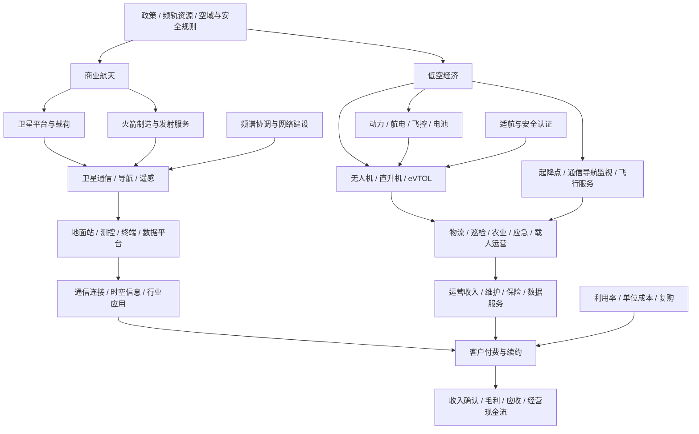

# 30｜商业航天、低空经济与卫星应用产业链专题

> 研究定位：拆解商业航天、卫星通信/遥感、低空航空器与低空基础设施，建立可验证的产业链、商业模式和上市公司映射。本文不把政策、发射次数或概念标签直接视为上市公司收入。数据更新：2026-10-11。

## 一、先划清产业边界

本专题包含两条相关但不同的主链：

- **商业航天与卫星应用**：卫星/载荷制造、火箭与发射服务、地面测控和终端、卫星通信、导航增强、遥感数据及行业应用。
- **低空经济**：无人机及有人低空航空器、eVTOL 等新型航空器、动力与航电、通信导航监视、起降设施、飞行服务、运营与保险。

两者可能共享通信、导航、感知、材料、电子元器件和数据处理能力，但客户、认证体系、交付周期和商业化路径并不相同。低空经济也不等于 eVTOL；无人机物流、农林植保、工业巡检、应急救援、飞行培训和城市空中交通各自的监管与单位经济性不同。

国家发展改革委已发布《低空经济及其核心产业统计分类（试行）》，用于明确低空经济统计边界；研究时应优先沿用正式统计口径，再单独维护投资主题映射。[来源：国家发展改革委《低空经济及其核心产业统计分类（试行）》](https://zfxxgk.ndrc.gov.cn/wap/iteminfo.jsp?id=20580)

## 二、中文产业链全景图

## 三、商业航天链条：从制造到服务收入

| 环节 | 产品/服务 | 主要需求与关键指标 | 主要风险 |
|---|---|---|---|
| 卫星平台与载荷 | 卫星平台、通信载荷、遥感载荷、导航相关设备 | 在手订单、交付数量、单星价值、研发费用、验收与回款 | 项目周期长、定制化、可靠性要求高、客户集中 |
| 运载火箭与发射 | 火箭、发动机、发射场及发射服务 | 发射频次、可靠性、单次发射成本、产能与交付节奏 | 试验失败、发射延期、成本与复用技术兑现不及预期 |
| 测控与地面设备 | 测控站、天线、射频、基带、地面终端 | 地面站建设、终端出货、订单转收入、维护服务收入 | 星地系统标准差异、建设节奏波动、设备降价 |
| 卫星通信 | 宽带接入、移动卫星通信、物联网连接 | 可服务用户、活跃终端、流量/服务收入、续约与ARPU | 频轨资源、网络覆盖、终端成本、地面网络竞争 |
| 遥感与时空数据 | 影像、定位增强、数据处理与行业解决方案 | 数据复购、合同金额、项目毛利、商业客户比例 | 数据采购与项目制收入占比高、付费意愿不足 |
| 行业应用 | 应急、海事、农业、能源、交通、自然资源等 | 客户续约、项目转标准产品、回款周期 | 依赖政府项目、项目验收慢、难形成规模化订阅 |

2026年10月10日，工信部发布我国成功发射卫星互联网低轨27组卫星的消息，并说明此前开展了频率协调及空间无线电台执照、频率使用许可办理。它能证明星座建设和频率协调仍在推进，但**不能单独证明某家上市公司获得订单、实现收入或盈利改善**。

来源：[工业和信息化部：我国成功发射卫星互联网低轨27组卫星（2026-10-10）](https://www.miit.gov.cn/xwfb/gxdt/sjdt/art/2026/art_6a9b3eb13621415fb1d438e179946e1f.html)

工信部2025年发布的卫星通信产业指导意见提出支持低轨卫星互联网、手机直连卫星和卫星物联网等业务，并强调频轨资源、关键终端、标准体系与监管。该政策是产业方向与制度安排，不应被直接转换为利润预测。

来源：[工信部《关于优化业务准入促进卫星通信产业发展的指导意见》](https://wap.miit.gov.cn/zwgk/zcwj/wjfb/yj/art/2025/art_84617d8d84d84a3d8b8b3ef847f648d2.html)

## 四、低空经济链条：航空器、基础设施和运营

| 环节 | 业务范围 | 关键指标 | 需要警惕 |
|---|---|---|---|
| 无人机整机 | 工业、农业、测绘、巡检、物流、应急等 | 出货量、订单、产品结构、售后收入、客户复购 | 消费级与工业级需求不同，低价竞争及出口限制 |
| eVTOL与有人航空器 | 研发、试制、适航、生产和运营 | 适航进度、试飞里程、订单约束力、交付能力、单位成本 | 意向订单不等于确定订单；适航、基础设施和运营许可均影响商业化 |
| 动力与关键系统 | 电机、电控、电池、飞控、航电、通信链路 | 产品验证、客户定点、量产良率、单位价值、供应商份额 | 航空级可靠性与消费电子标准不同，验证周期较长 |
| 低空通信与监视 | 通信网络、导航定位、监视感知、识别与调度 | 覆盖范围、系统可用率、部署数量、运维收入 | 地方建设与全国标准/互联互通尚需区分 |
| 起降与保障设施 | 起降点、充换电、维修、飞行服务站 | 利用率、单点投资、收费模式、维护成本 | 先建后用、利用率低、投资回收期过长 |
| 运营服务 | 物流、巡检、农林作业、旅游、应急、载人 | 单次任务收入、飞行小时、载荷率、事故率、保险与维护成本 | 有飞行能力不代表有持续付费客户，安全事故可能改变监管条件 |

2026年2月，工信部等五部门发布支撑低空基础设施发展的实施意见，涉及信息通信能力、低空智联网与相关基础设施建设。2026年5月起，民用无人驾驶航空器系统运行识别相关强制性国家标准开始实施，体现运行识别与安全监管正在成为产业基础能力的一部分。

来源：
- [工信部等五部门：加强信息通信业能力建设支撑低空基础设施发展的实施意见（2026-02-10）](https://www.miit.gov.cn/zwgk/zcwj/wjfb/yj/art/2026/art_d1cb1667897e4c999a303d110b6691dc.html)
- [中国民航局：民用无人驾驶航空器系统运行识别规范解读（2026-01-20）](https://app.caac.gov.cn/XXGK/XXGK/ZCFBJD/202601/t20260120_229793.html)

## 五、A股公司研究映射：按实际业务逐家核验

下表是**研究样本而非推荐名单**。公司可能同时涉及传统航天、军工电子、卫星应用或低空概念；最新业务敞口必须用公司定期报告、临时公告和投资者关系记录核实，不能仅凭主题标签归类。

| 公司样本 | 可研究切口 | 关键核验问题 |
|---|---|---|
| 中国卫星（600118） | 卫星研制与相关业务 | 卫星研制与应用业务的收入结构、订单可见度、验收和回款 |
| 中国卫通（601698） | 卫星通信运营 | 卫星资源利用率、转发器出租/服务收入、资本开支和折旧 |
| 航天电子（600879） | 航天电子、测控与相关系统 | 航天任务与民用业务结构、应收与存货、经营现金流 |
| 航天宏图（688066） | 遥感数据与行业应用 | 项目制与产品化收入占比、应收账款、合同资产和客户集中度 |
| 四川九洲（000801） | 航空电子、通信及相关系统 | 低空相关业务是否形成独立收入、订单与利润贡献 |
| 莱斯信息（688631） | 空管与指挥信息系统等 | 低空相关项目占比、交付验收、项目回款和毛利率 |
| 中信海直（000099） | 通用航空运营服务 | 飞行小时、机队利用率、客户结构、维护开支与现金流 |
| 万丰奥威（002085） | 通用航空相关资产与业务布局 | 航空业务分部贡献、并购/资产事项影响、低空相关业务商业化证据 |

公司名单只是起点。应先读最新年报/半年报中“主营业务、分部信息、重大合同、研发进展、风险因素”，再检查交易所公告。对“意向订单”“战略合作”“签约框架”要记录是否具备数量、价格、交付周期、违约条款和资金来源。

## 六、产业链交叉传导：哪些环节先受益，哪些可能滞后

| 变化/催化 | 直接关联环节 | 传导路径 | 验证指标 |
|---|---|---|---|
| 星座建设提速 | 卫星制造、载荷、发射、测控 | 采购合同→研制交付→验收→收入与现金流 | 在手订单、交付进度、合同资产、应收 |
| 频率与业务准入改善 | 卫星通信运营、终端、地面设备 | 许可/频率→网络部署→终端接入→服务收入 | 牌照、频率许可、商用进展、活跃用户 |
| 遥感需求增长 | 载荷、地面处理、行业软件 | 数据获取→处理分析→行业客户采购→续约 | 付费客户、复购率、项目毛利、应收 |
| 低空基础设施建设 | 通信、导航、监视、起降与调度 | 政府/运营商投入→设施部署→运营维护 | 中标金额、合同期限、运维收入、利用率 |
| 无人机应用扩张 | 整机、动力、飞控、运营服务 | 客户试用→验证→批量采购→复购与服务收入 | 量产交付、单机毛利、售后、复购 |
| eVTOL商业化推进 | 航空器、航电、电池、起降设施、运营 | 试飞与认证→适航→运营许可→付费航线 | 适航节点、单位成本、航线许可、载客率 |

## 七、ETF与指数映射：先核验成分，再判断纯度

商业航天与低空经济往往横跨国防军工、通信、电子、计算机、机械、电力设备和交通运输等行业，不能默认存在一只覆盖完整产业链且足够纯的ETF。

1. **确定投资问题**：是研究卫星制造、卫星通信、遥感应用、无人机整机、eVTOL，还是低空基础设施。
2. **查跟踪指数编制方案**：核对指数选样规则、成分股与权重，记录数据日期。
3. **计算真实敞口**：逐家公司核实相关业务收入/订单；指数中“概念股”权重不等于相关业务收入占比。
4. **检查集中度与流动性**：记录前十大权重、单一行业集中度、规模、成交额、跟踪误差和费用。
5. **与宽基或行业指数比较**：如果主题指数与军工/通信/电子行业高度重叠，应明确其增量暴露，而不是重复计算同一风险。
6. **不强行填空**：没有合适指数时，标注“无直接纯度映射”，以研究样本篮子作为辅助，而不是臆造ETF代码。

## 八、反证清单：哪些信号会推翻乐观叙事

- 发射次数或政策文件增加，但相关上市公司订单、交付和现金流没有改善。
- 在手订单多为框架协议、意向订单或附带条件订单，未披露执行金额与交付期限。
- 收入增长主要来自一次性项目、并购或关联交易，主营业务毛利与现金流恶化。
- 卫星/航空器研发支出增加，但关键验证、适航或可靠性节点延误。
- 低空设施投入很大，但飞行量、收费率和设施利用率长期偏低。
- 遥感/数据服务项目数量增长，却没有形成可重复销售的产品或续费收入。
- 应收账款、合同资产、存货和资本开支增速持续高于收入；利润增长没有转化为现金。
- ETF指数名称与主题相符，但成分权重集中在传统军工/通信业务，实际主题敞口有限。

## 九、每月跟踪清单

- [ ] 更新工信部、国家发展改革委、民航局及相关部门的新规、许可与标准进度。
- [ ] 记录卫星互联网发射与组网公开信息，但将发射事实与公司订单分开。
- [ ] 对样本公司更新订单、交付、验收、分部收入、毛利率、应收、合同资产与经营现金流。
- [ ] 对低空运营样本跟踪飞行小时、任务量、客户复购、事故/安全事件及保险成本。
- [ ] 对eVTOL相关公司逐项核验适航、试飞、运营许可、实际交付和商业收费。
- [ ] 核对ETF跟踪指数、成分股与权重的最新日期，记录主题纯度和集中度。
- [ ] 至少记录一条不支持当前观点的证据；若只有政策热度而没有财务兑现，不升级盈利判断。

## 十、研究结论

商业航天与低空经济都可能形成长期产业机会，但两者的商业化路径和风险不同。商业航天要沿着“星座建设—设备交付—网络运营—客户付费”验证；低空经济要沿着“安全与适航—基础设施—实际飞行—单位经济性—重复付费”验证。投资研究应优先寻找收入来源清晰、交付和回款可验证的公司，谨慎对待概念映射、意向订单与远期市场空间。本文为研究框架，不构成投资建议。
