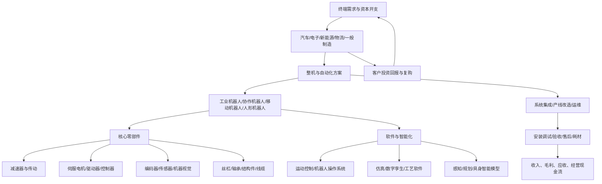

# 31｜机器人、工业自动化与具身智能产业链专题

> 研究范围：A股机器人及自动化相关产业链。本文用于行业研究，不构成个股或基金买卖建议。  
> 资料截止：2026-10-11。官方宏观统计、公司财报与市场主题口径不同，必须分别使用。

## 一、先给结论：把成熟自动化与具身智能分开研究

机器人不是单一行业，而是横跨工业设备、核心零部件、传感器、软件、系统集成和终端应用的产业链。研究时至少分为三层：

1. **成熟业务层**：工业机器人、伺服系统、控制器、减速器、机器视觉、工厂自动化和系统集成。重点看制造业资本开支、订单、交付、验收、售后收入与现金流。
2. **扩展应用层**：协作机器人、移动机器人/AGV/AMR、物流自动化、特种机器人。重点看场景适配、单机经济性、客户复购和部署规模。
3. **早期成长层**：人形机器人、具身智能模型、灵巧手与新型执行器。重点看实景任务成功率、有效工作时长、维护成本、可靠性、客户付费和重复部署；发布会、样机、意向订单不等于规模化收入。

**核心研究原则：**先验证真实场景和现金流，再讨论市场空间；产业政策提供方向，不自动构成上市公司利润。

## 二、产业链总览

## 三、产业链环节与关键观察指标

| 环节 | 产品/服务 | 关键需求与指标 | 主要风险 |
|---|---|---|---|
| 终端应用 | 汽车、3C、锂电、光伏、金属加工、仓储物流 | 制造业投资、设备更新、产线稼动率、客户资本开支 | 下游投资推迟、产能过剩 |
| 机器人整机 | 六轴、多关节、SCARA、协作、移动、人形 | 出货量、平均售价、市场份额、交付周期、客户集中度 | 价格竞争、产品同质化、项目验收延期 |
| 传动与减速器 | RV、谐波减速器、精密传动、丝杠、轴承 | 精度、寿命、良率、产能利用率、单机价值量 | 技术替代、良率不稳、扩产后供过于求 |
| 运动控制 | 伺服电机、驱动器、控制器、编码器 | 装机量、国产化、性能指标、渠道库存、售后率 | 价格战、客户自研、产品迭代 |
| 感知与视觉 | 机器视觉、3D视觉、力/触觉、位置与惯性传感 | 单机传感器数量、项目复购、识别精度、稳定性 | 演示效果与复杂环境实用性差距 |
| 末端执行器 | 夹爪、工具快换、灵巧手、力控组件 | 抓取成功率、负载、自由度、耐久性、维护成本 | 成本高、可靠性不足、实际场景需求未验证 |
| 软件与具身智能 | 运动规划、仿真、视觉算法、任务模型、数据采集 | 任务成功率、泛化能力、训练数据成本、推理成本 | 数据质量、泛化不足、安全性与算力成本 |
| 系统集成 | 工站、整线、仓储物流、工艺改造 | 新签订单、合同负债、项目毛利、交付周期、回款 | 一次性项目、验收拖延、应收和垫资 |
| 运维服务 | 备件、维修、升级、远程监控 | 服务收入占比、设备在线率、复购率、维护成本 | 服务网络成本、客户停产风险 |

## 四、当前官方证据与政策：观察数据，不直接外推公司业绩

### 1. 工业机器人产量增长，但要区分产量与企业盈利

国家统计局于 **2026-09-15** 发布的 2026 年 8 月国民经济运行情况显示：2026 年 8 月工业机器人产量同比增长 **34.6%**；同一时期规模以上工业增加值同比增长 5.2%，装备制造业增加值同比增长 12.1%。这是全国工业产品统计，不等同于某家A股公司的销量、收入或利润。

来源：[国家统计局《8月份国民经济运行平稳、发展向新向优》（2026-09-15）](https://www.stats.gov.cn/sj/zxfbhjd/202609/t20260915_1965307.html)

国家统计局工业司对 2026 年 8 月工业生产的解读还指出，工业机器人和机器人减速器产品产量分别同比增长 34.6% 和 11.4%。不同产品统计指标的覆盖范围、基数和产业链位置不同，不能将两者增长率直接比较成盈利增速。

来源：[国家统计局工业司《2026年8月份工业生产数据解读》（2026-09-15）](https://www.stats.gov.cn/sj/zxfbhjd/202609/t20260915_1965330.html)

### 2. 人形机器人政策已强调实景实训和部署验证

工信部、国务院国资委于 **2026-06-08** 发布《联合开展2026年度人形机器人与具身智能实景实训专项行动的通知》，提出面向工业、特种和服务场景开展实景训练、应用验证与常态部署，并强调真实作业成功率、效率提升、安全可靠性及经济可行性等指标。政策所列目标是工作部署目标，不应被写成已完成的商业交付结果。

来源：[工信部、国务院国资委专项行动通知（2026-06-08）](https://www.miit.gov.cn/zwgk/zcwj/wjfb/tz/art/2026/art_f291ccd3da4c47ce95741de63cc088e6.html)

### 3. 标准体系建设仍需关注征求意见与正式发布状态

工信部科技司于 **2026-08-24** 公示《国家人形机器人产业标准体系建设指南（2026版）》征求意见稿，征求意见期为 2026-08-25 至 2026-09-23。研究时必须区分“征求意见稿”“正式发布标准”“企业自定测试口径”，不把标准建设进展误读为产品已经达到产业化要求。

来源：[工信部科技司征求意见公示（2026-08-24）](https://wap.miit.gov.cn/jgsj/kjs/jscx/bzgf/art/2026/art_ef26915b2f0843d58a22f5a090690195.html)

## 五、公司研究样本：按业务环节拆分，不等于概念股名单

以下仅为进一步查阅年报、半年报和公告的**研究样本**，不是推荐名单，也不代表公司全部业务都属于机器人。

| 环节 | A股样本 | 需要核实的核心问题 |
|---|---|---|
| 工业机器人与自动化 | 埃斯顿（002747）、埃夫特（688165）、机器人（300024） | 机器人业务收入占比、出货、毛利率、海外业务、应收账款与经营现金流 |
| 工控、伺服与运动控制 | 汇川技术（300124）、鸣志电器（603728） | 伺服/控制业务实际占比、终端行业分布、订单与库存、产品毛利变化 |
| 精密传动 | 绿的谐波（688017）、双环传动（002472）、中大力德（002896） | 减速器类别、机器人客户验证、产能利用率、良率、价格和扩产节奏 |
| 视觉与传感 | 奥比中光（688322）、柯力传感（603662） | 机器人相关收入与其他业务的区分、客户导入、项目转批量的证据 |
| 结构件与汽车零部件延伸 | 拓普集团（601689）、三花智控（002050）、五洲新春（603667）、兆威机电（003021） | 机器人业务是否形成独立收入、量产节点、客户集中度、资本开支与折旧 |
| 关键部件及执行器链 | 按公司披露补充丝杠、轴承、执行器、灵巧手、力控部件样本 | 以实际产品、送样验证、定点、批量交付、收入确认分层，不凭合作新闻推断收入 |

### 公司核验顺序

1. 先读最新年度报告、半年报和交易所公告，记录业务分部口径、披露期间和收入占比。
2. 再核对客户定点、送样、验证、订单、交付、验收的具体阶段；“合作”“签约”不必然代表已交付。
3. 核对毛利率、应收账款、合同资产、合同负债、存货、资本开支和经营现金流。
4. 对“人形机器人概念”额外检查：是否披露具体产品、对应收入、客户、批量规模和盈利贡献。
5. 对多业务公司避免把集团总收入或汽车业务增长，直接当作机器人业务增长。

## 六、商业化传导：从客户预算走到自由现金流

| 阶段 | 领先/同步指标 | 必须追问 |
|---|---|---|
| 客户立项 | 资本开支预算、招标、试点场景 | 预算是否批准，项目是否有明确付款方？ |
| 供应商验证 | 样机、送样、测试、定点 | 是否通过可靠性和安全测试？有没有替代供应商？ |
| 订单形成 | 新签合同、订单金额、合同负债 | 是正式采购订单还是意向协议？是否附条件？ |
| 交付安装 | 出货、安装、现场运行 | 设备是否达到约定节拍与稳定性？ |
| 验收与收入 | 验收单、收入确认、毛利率 | 收入确认条件是否满足，是否存在延期？ |
| 回款与复购 | 应收账款周转、经营现金流、续购 | 付款周期是否拉长？客户是否扩大部署？ |

系统集成项目尤其需要关注垫资和应收。设备出货增长但应收账款更快增长、合同资产累积、经营现金流持续弱于利润时，应降低对利润质量的判断。

## 七、机器人主题ETF与指数映射

本专题不直接给出未经核实的ETF代码。筛选产品时，逐项查看基金合同、招募说明书、最新定期报告和跟踪指数编制方案：

- **指数边界**：是工业自动化、机器人产业、智能制造，还是更宽泛的高端装备/人工智能主题？
- **成分股纯度**：机器人相关业务收入占比如何？是否大量包含汽车、电子、计算机等跨行业公司？
- **权重集中度**：前十大成分占比、单一公司权重、行业集中度。
- **流动性与成本**：规模、日均成交额、管理费/托管费、买卖价差、跟踪误差。
- **持仓时点**：定期报告反映特定报告期末；不能把旧持仓当作实时权重。
- **主题与盈利分离**：指数成分覆盖机器人概念，不代表成分公司的机器人业务都已产生显著利润。

可将“工业自动化/机器人”作为成熟业务观察篮子，将“人形机器人/具身智能”作为高不确定性主题观察篮子；两者不可简单视为同一风险收益特征。

## 八、情景分析与逻辑失效条件

### 基准情景
制造业更新需求维持，工业机器人与工控需求逐步改善；人形机器人先在少数可控任务验证经济性，收入贡献在公司之间分化。

### 乐观情景
制造业投资与设备更新改善，订单转化为交付和现金回款；关键零部件在精度、可靠性、成本上达到量产要求；人形机器人在明确场景实现重复部署，且客户总拥有成本低于替代方案。

### 悲观情景
制造业资本开支走弱、设备价格竞争加剧；下游项目延迟，系统集成商应收上升；人形机器人仍以演示、研发和试点为主，订单缺乏可持续付费，供应链扩产快于需求。

### 需要推翻乐观判断的反证
- 工业机器人产量增长，但公司订单、收入和回款没有改善。
- 订单增长主要来自低毛利项目，或客户集中度和应收账款明显上升。
- 核心部件价格下跌幅度大于成本下降，毛利率持续收缩。
- 人形机器人客户验证周期延长、部署未复购、维护成本高或真实任务成功率不足。
- 公司披露的机器人相关业务仍很小，却被市场按成熟规模化业务估值。
- ETF主题成分与预期投资方向不匹配，或高权重成分主要由其他业务驱动。

## 九、月度跟踪清单

- [ ] 国家统计局工业机器人、减速器等产品产量及同比增速，记录数据月份与统计口径。
- [ ] 制造业PMI、固定资产投资、制造业投资及主要下游行业资本开支。
- [ ] 机器人整机、工控和核心零部件公司的订单、收入、毛利率、存货、应收与经营现金流。
- [ ] 汽车、电子、锂电、光伏和物流等下游客户的设备投资与扩产计划。
- [ ] 人形机器人实景应用的任务成功率、连续工作时长、故障率、维护成本、部署量与复购证据。
- [ ] 标准、监管、采购与应用示范政策的状态：征求意见、正式发布、执行、验收分别记录。
- [ ] ETF跟踪指数、成分股、权重、规模、成交额、费用和跟踪误差，使用最新可获得文件。
- [ ] 明确记录本月最强证据、最强反证和下一次复核日期，避免只记录利好新闻。

## 十、主要资料入口

1. 国家统计局，2026-09-15，《8月份国民经济运行平稳、发展向新向优》：https://www.stats.gov.cn/sj/zxfbhjd/202609/t20260915_1965307.html
2. 国家统计局工业司，2026-09-15，《2026年8月份工业生产数据解读》：https://www.stats.gov.cn/sj/zxfbhjd/202609/t20260915_1965330.html
3. 工业和信息化部、国务院国资委，2026-06-08，《2026年度人形机器人与具身智能实景实训专项行动通知》：https://www.miit.gov.cn/zwgk/zcwj/wjfb/tz/art/2026/art_f291ccd3da4c47ce95741de63cc088e6.html
4. 工业和信息化部科技司，2026-08-24，《国家人形机器人产业标准体系建设指南（2026版）》征求意见公示：https://wap.miit.gov.cn/jgsj/kjs/jscx/bzgf/art/2026/art_ef26915b2f0843d58a22f5a090690195.html
5. 上市公司最新年报、半年报、交易所公告及基金定期报告：按公司/基金逐一核对，不以新闻摘要替代原始披露。

> **研究纪律：**官方产量是产业背景，政策是方向信号，公司订单与财报才是盈利兑现证据；股价涨跌和主题热度不能代替基本面核验。
