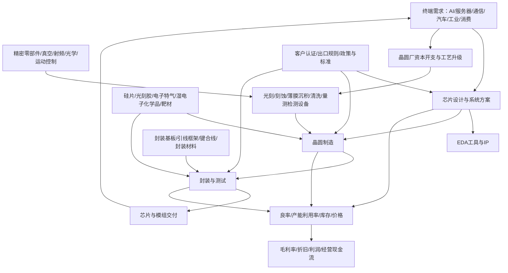

# 32｜半导体全产业链专题：设计、制造、封测、设备与材料

> 研究范围：半导体设计、晶圆制造、封装测试、设备、材料、零部件、EDA/IP，以及终端需求与资本开支传导。  
> 资料截止：2026-10-11。本文为产业研究框架，不构成个股或基金买卖建议。

## 一、先区分半导体产业链的不同周期

半导体不是一个同步涨跌的单一行业。设计、制造、封测、设备、材料处于不同的商业模式与周期阶段；同样是“国产替代”或“人工智能需求”，也可能因产品、客户认证、产能和竞争格局而产生完全不同的财务结果。

- **芯片设计**：轻资产或相对轻资产，关注产品迭代、客户导入、设计赢单、售价、库存、研发投入和现金流。
- **晶圆制造**：重资产，关注资本开支、产能利用率、良率、折旧、工艺节点、客户结构和单位成本。
- **封装测试**：关注先进封装需求、产能利用率、客户认证、单位价格、设备投资和良率。
- **设备**：关注客户资本开支、招标、订单、发货、安装、验收、重复采购与售后服务。
- **材料与零部件**：关注纯度/一致性、验证周期、客户导入、批量供应、价格和供货稳定性。
- **EDA、IP及软件**：关注客户设计项目、授权与续费、研发成本、产品覆盖和持续服务收入。

**核心原则：**行业总量增长不等于每家公司盈利增长；订单不等于收入，收入不等于现金流，国产化进展也不自动等于份额或利润提升。

## 二、产业链全景图

## 三、主要环节、商业模式与关键指标

| 环节 | 主要产品/服务 | 关键经营指标 | 典型风险 |
|---|---|---|---|
| 芯片设计 | CPU/GPU/NPU、存储、模拟、功率、射频、接口、MCU | 设计赢单、出货量、平均售价、库存、研发效率、客户集中度 | 产品迭代落后、客户自研、库存减值、价格竞争 |
| EDA与IP | 设计自动化软件、验证工具、处理器/接口IP | 授权合同、续费、客户项目数、研发投入、现金回款 | 研发周期长、生态壁垒、出口与授权限制 |
| 晶圆制造 | 逻辑、存储、模拟、功率、特色工艺 | 产能利用率、良率、晶圆价格、折旧、资本开支、单位成本 | 扩产过快、设备限制、工艺爬坡和折旧压力 |
| 封装测试 | 传统封测、先进封装、测试服务 | 产能利用率、单位售价、良率、客户结构、资本回报 | 价格竞争、技术升级投入、客户集中 |
| 半导体设备 | 光刻、刻蚀、沉积、清洗、量测、检测、热处理、涂胶显影 | 新签订单、发货、验收、重复采购、合同负债、售后收入 | 验收周期、研发验证、供应链瓶颈、客户资本开支下行 |
| 材料 | 硅片、光刻胶、电子气体、湿化学品、靶材、抛光材料、封装材料 | 客户认证、批量供货、纯度一致性、良率影响、价格、库存 | 认证时间长、产品迭代、客户集中、质量事故 |
| 零部件 | 真空、泵阀、射频电源、精密运动、光学、陶瓷、密封件 | 装机配套、验证周期、售后率、批量供货、毛利率 | 高可靠性要求、海外供应依赖、客户集中 |
| 终端与系统 | 数据中心、服务器、汽车电子、通信、工业控制、消费电子 | 出货、客户库存、资本开支、产品售价、终端需求 | 需求波动、技术路线变化、地缘贸易限制 |

## 四、近期官方数据：半导体增长信号需要分层理解

### 1. 2026年1—8月电子信息制造业

工业和信息化部于 **2026-09-30** 发布的运行情况显示，2026年1—8月规模以上电子信息制造业增加值同比增长 **15.7%**；集成电路产量同比增长 **22.3%**；行业营业收入同比增长 **20.1%**，利润总额同比增长 **1.1倍**；固定资产投资同比增长 **8.1%**。

来源：[工信部《2026年1—8月份电子信息制造业运行情况》（2026-09-30）](https://wap.miit.gov.cn/jgsj/yxj/xxfb/art/2026/art_a6c6b6fe6e4d4b408c44c54c1b25c4ed.html)

**口径限制：**上述为电子信息制造业宽口径统计，不等同于半导体全产业链，也不等同于任何单家上市公司的收入和利润。行业利润同比增幅还需结合基数、细分产品结构、成本和统计范围判断。

### 2. 2026年7月高技术制造业相关信号

国家统计局工业司于 **2026-08-17** 发布的解读显示，2026年7月集成电路制造业增加值同比增长 **109.3%**，电子工业专用设备制造业增加值同比增长 **34.8%**，电子专用材料制造业增加值同比增长 **30.8%**。

来源：[国家统计局工业司《2026年7月份工业生产数据解读》（2026-08-17）](https://www.stats.gov.cn/sj/zxfbhjd/202608/t20260817_1965049.html)

**口径限制：**行业增加值增长率可能受到基数、产能爬坡和统计分类影响，不能直接解释为产量、营收或利润同幅增长，更不能直接映射到个股涨幅。

### 3. 产业政策与税收支持

国家发展改革委等部门于 **2026-04-07** 发布2026年度享受相关税收优惠政策的集成电路企业或项目、软件企业清单申报通知，涉及符合规定的集成电路生产、设计、关键材料与零部件、先进封装测试等企业或项目。

来源：[国家发展改革委《发改高技〔2026〕487号通知》（2026-04-07）](https://zfxxgk.ndrc.gov.cn/web/iteminfo.jsp?id=20620)

**口径限制：**政策适用以正式条件、企业申报和审核结果为准；行业存在支持政策不等于每家公司符合条件，也不等于短期利润必然改善。

## 五、景气传导：从需求到财务结果

| 观察起点 | 可能传导路径 | 应验证的证据 | 常见误判 |
|---|---|---|---|
| AI服务器/数据中心需求提升 | 加速器、存储、网络芯片、先进封装、晶圆与设备需求 | 客户资本开支、产品订单、交期、出货、利用率、回款 | 把AI需求增长视为所有芯片品类同步受益 |
| 晶圆厂扩产 | 设备、材料、洁净室、精密零部件需求 | 实际资本开支、招标、订单、发货、安装与验收 | 将规划投资全额视为当期设备收入 |
| 产能利用率上升 | 固定成本摊薄、毛利率可能改善 | 产能利用率、良率、产品结构、折旧与单位成本 | 忽略工艺爬坡、折旧和价格下跌 |
| 国产设备导入 | 供应商验证、采购份额和售后服务可能提升 | 设备验证、重复采购、客户集中度、装机量、维护记录 | 将一次验证或试用等同于大规模替代 |
| 材料国产化 | 客户认证、稳定供货、产品组合改善 | 批量采购、良率、产品一致性、收入占比 | 将送样、合作协议等同于量产供货 |
| 存储或部分芯片涨价 | 库存收益、产品售价与利润变化 | 合同价格、库存成本、产品组合、客户库存 | 用单一产品价格代表全行业 |
| 出口管制或贸易限制变化 | 供应链、交付、客户地区和研发投入调整 | 规则范围、许可、替代周期、订单影响 | 把政策标题直接解读成个股利好/利空 |

## 六、A股公司研究样本：按环节建清单，勿按概念归因

以下为研究样本，不是推荐名单；业务范围和实际收入占比需以最新年报、半年报及公告核验。

| 环节 | 样本公司 | 研究时重点核对 |
|---|---|---|
| 晶圆制造 | 中芯国际（688981）、华虹公司（688347） | 产能利用率、工艺平台、资本开支、折旧、客户结构、毛利率与现金流 |
| 芯片设计 | 海思相关业务需按上市主体披露口径辨别；韦尔股份（603501）、兆易创新（603986）、澜起科技（688008）、卓胜微（300782）、圣邦股份（300661） | 产品组合、客户认证、出货、库存、平均售价、研发投入和客户集中度 |
| 设备 | 北方华创（002371）、中微公司（688012）、拓荆科技（688072）、盛美上海（688082）、华海清科（688120）、芯源微（688037）、精测电子（300567） | 分设备品类收入、订单、交付验收、合同负债、研发费用、客户复购和应收账款 |
| 材料与零部件 | 沪硅产业（688126）、安集科技（688019）、鼎龙股份（300054）、江丰电子（300666）、雅克科技（002409）、华特气体（688268） | 客户验证阶段、量产供货、产品良率影响、收入占比、扩产与价格 |
| 封装测试 | 长电科技（600584）、通富微电（002156）、华天科技（002185）、甬矽电子（688362） | 先进封装收入、产能利用率、客户结构、资本开支、折旧和回款 |
| EDA/IP及设计工具 | 华大九天（301269）、概伦电子（688206）、芯原股份（688521） | 授权与项目收入、续费、研发费用、客户验证和现金流 |

### 公司核验四步法

1. 从最近一期正式财报确认主营产品、分部收入与利润，不从主题网站推断业务规模。
2. 将“送样—验证—定点—批量采购—交付—收入确认”分阶段记录。
3. 检查订单与合同负债是否增长，存货、应收账款和合同资产是否同步恶化。
4. 对设备与材料企业，单独分析客户资本开支、验收周期、客户集中度、研发投入和售后服务收入。

## 七、ETF与指数映射：先看指数边界，再看成分

半导体相关ETF可能分别跟踪半导体产业、芯片、科创板芯片、集成电路或更宽泛的科技主题指数。不能只看基金名称，也不在未核对基金文件时臆造代码或成分。

核对清单：

- 跟踪指数的编制方案、样本空间、纳入条件与定期调整规则。
- 设计、制造、设备、材料、封测各环节的成分覆盖及权重。
- 前十大成分股集中度，单一公司对指数表现的影响。
- 基金规模、日均成交额、买卖价差、管理费/托管费、跟踪误差。
- 成分股真实业务敞口；跨行业企业不能因为被纳入主题指数就视为纯半导体公司。
- 持仓报告的截止日期。季报持仓不是实时持仓，不能用旧数据解释当日风险暴露。

**实用做法：**分别建立“半导体设计/芯片”“半导体设备材料”“宽口径半导体产业”观察篮子，避免将不同产业链位置当成同一种风险因子。

## 八、情景与反证

### 偏强情景
终端需求改善且库存健康，晶圆厂资本开支落实；设备订单、验收与重复采购改善，材料通过认证并形成批量收入；产品价格和良率足以覆盖折旧与研发投入。

### 基准情景
行业总量增长，但设计、制造、设备、材料和封测之间分化；高端需求较强，部分通用产品仍面临价格竞争，企业盈利兑现的时点不一致。

### 偏弱情景
扩产快于需求，产能利用率或产品价格下降；客户推迟资本开支，设备验收延后；库存和应收上升，经营现金流弱于利润；出口规则变化导致部分产品交付受限。

### 推翻乐观判断的反证
- 行业产量增长，但公司订单、收入或现金回款没有改善。
- 订单增加但验收延期、合同资产和应收账款明显上升。
- 产能扩张伴随利用率下滑、折旧增加或价格持续下降。
- 国产替代仅停留在送样或单次验证，缺少重复采购。
- 研发投入增长未带来产品迭代、客户扩张或商业化收入。
- ETF前十大成分集中于少数公司，且其利润主要由其他业务驱动。

## 九、月度跟踪清单

- [ ] 电子信息制造业增加值、集成电路产量、行业收入利润与固定资产投资，记录统计口径和发布日期。
- [ ] 主要终端出货、客户库存、晶圆厂资本开支与产能利用率。
- [ ] 芯片设计企业产品出货、价格、库存、研发效率和客户集中度。
- [ ] 设备企业订单、交付、验收、合同负债、重复采购与经营现金流。
- [ ] 材料企业客户认证、批量供货、产品良率、收入占比和扩产节奏。
- [ ] 封测企业先进封装产能、利用率、客户结构、折旧与现金回款。
- [ ] 出口管制、税收政策和产业标准的正式生效状态及具体适用范围。
- [ ] ETF指数规则、成分权重、规模、成交额、费用与跟踪误差。
- [ ] 每月写明最强证据、最强反证、仍缺少的数据和下次复核日期。

## 十、资料来源

1. 工业和信息化部，2026-09-30，《2026年1—8月份电子信息制造业运行情况》：https://wap.miit.gov.cn/jgsj/yxj/xxfb/art/2026/art_a6c6b6fe6e4d4b408c44c54c1b25c4ed.html
2. 国家统计局工业司，2026-08-17，《2026年7月份工业生产数据解读》：https://www.stats.gov.cn/sj/zxfbhjd/202608/t20260817_1965049.html
3. 国家发展改革委，2026-04-07，《关于做好2026年享受税收优惠政策的集成电路企业或项目、软件企业清单制定工作的通知》：https://zfxxgk.ndrc.gov.cn/web/iteminfo.jsp?id=20620
4. 公司层面：交易所公告、年度报告、中期报告、投资者关系活动记录；按每家公司的最新披露单独核验。
5. 基金层面：基金合同、招募说明书、跟踪指数编制方案、最新定期报告和交易所行情文件。

> **研究纪律：**半导体产业链要看细分环节，不看笼统标签；政策、产量、资本开支、订单、验收、收入和现金流是不同层级的证据，不得互相替代。
