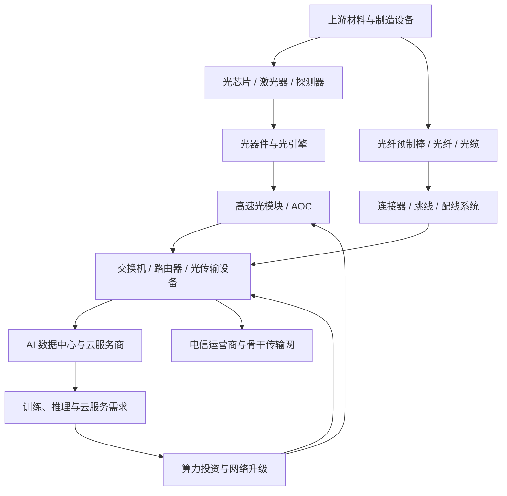

# 光模块、光通信与数据中心互连产业链专题

> 更新日期：2026-10-11。本文用于 A 股产业研究，不构成个股或 ETF 买卖建议。产业政策、公司披露与市场预期分别记录；公司样本仅用于研究，不代表推荐。

## 一、研究结论先行

AI 算力基础设施扩张增加了机柜内、机柜间以及数据中心之间的高速互连需求。光通信产业链的关键并非只看“AI 需求增长”，而是确认需求是否转化为可持续订单、产品交付、收入、利润和经营现金流。

工信部 2026 年《“人工智能+信息通信”创新发展实施意见》提出推进 400Gbps/800Gbps 骨干传输网络、城域高速光传输系统，并推动高速光电芯片、光电共封装器件及智算超节点光电互联技术研发验证。该政策说明方向和技术路线受到重视，但不能单独证明某家企业订单、份额或盈利必然增长。[政策原文](https://hubca.miit.gov.cn/zwgk/zcwj/wjfb/art/2026/art_1a6880738cfc4235afeda815d6ae8ab4.html)

研究上将产业拆成五层：光芯片与器件、光模块与有源光缆、光纤光缆与连接组件、交换与传输设备、数据中心/云服务商等终端客户。分别观察速率迭代、产品认证、产能交付、价格与良率、客户资本开支和供应商份额。

## 二、产业边界与全链路图

本文的“光通信与数据中心互连”是跨行业产业链视角，不等同于单一申万行业，也不意味着相关公司全部收入来自 AI 数据中心。

### 主要场景

- **机柜内连接（Scale-up）**：服务器、加速器与机柜内部高速互连，需比较铜连接、可插拔光学与共封装光学的成本、功耗、距离和维护要求。
- **机柜间连接（Scale-out）**：集群内部交换网络，关注端口数量、交换容量、速率升级、功耗及网络架构变化。
- **跨数据中心连接（Scale-across）**：数据中心之间互联及城域/骨干传输，关注距离、带宽、可靠性和光传输系统投资。
- **传统电信网络**：运营商资本开支、骨干传输、接入网络和海缆等需求与 AI 数据中心并不完全同步，应分开判断。

## 三、产业链分环节研究

| 环节 | 产品与商业模式 | 重点指标 | 主要风险 |
|---|---|---|---|
| 光芯片、激光器、探测器 | 发射/接收核心器件，涉及设计、制造、封装和测试 | 速率、良率、可靠性、客户认证、国产供应能力 | 技术迭代、良率不足、认证周期长、价格竞争 |
| 光器件、光引擎 | 调制、耦合、隔离、波分复用等组件 | 单位价值量、良率、供货周期、客户集中度 | 方案变化、关键器件短缺、成本上升 |
| 光模块、有源光缆（AOC） | 电信号与光信号转换、封装测试及整机交付 | 400G/800G/1.6T 产品出货结构、平均售价、毛利率、产能利用率、交付周期 | 代际切换、售价下行、客户集中、扩产后供需反转 |
| 光纤预制棒、光纤、光缆 | 传输介质和连接基础设施 | 价格、库存、产能利用率、产品结构、运营商招标 | 周期性供需、原料成本、传统通信需求波动 |
| 连接器、跳线、配线与无源组件 | 光链路布线、连接和管理 | 单机柜/单端口配套量、可靠性、交付与复购 | 标准变化、低价竞争、项目验收延迟 |
| 交换机、路由器、光传输设备 | 网络设备及系统集成 | 订单、合同负债、交付、毛利率、客户资本开支 | 客户自研、架构变化、竞争、软硬件适配 |
| 数据中心与云服务商 | 算力、云服务及网络基础设施采购方 | 资本开支、服务器部署、利用率、收入增长、投资回报 | 投资回报不达预期、项目延迟、能源与机房约束 |

## 四、景气如何传导到财务报表

逐段核验：

1. **需求**：云厂商资本开支指引是否上修，是否有实际数据中心建设、服务器部署和网络升级支撑。
2. **采购**：订单是否来自已认证客户；框架协议、意向订单和正式采购订单应分开记录。
3. **交付**：产能、关键器件、良率和海外制造布局能否支撑交付；产能扩张也可能先推高资本开支。
4. **收入确认**：区分发货、客户验收、合同负债变化和实际收入确认，留意季末集中交付。
5. **利润**：速率提升带来的单价和价值量，是否被器件成本、研发投入、良率损失或价格竞争抵消。
6. **现金流**：核对经营现金流、应收账款、存货、合同资产及资本开支。利润增长而应收与库存持续快于收入增长，需要进一步解释。

## 五、技术路线与迭代观察

- **速率迭代**：400G、800G、1.6T 等产品代际的推进速度和实际出货结构，应以公司披露和客户验证信息为准；行业路线图不等于每家公司都已量产。
- **可插拔光模块**：模块可维护性和成熟供应链是优势，需关注功耗、密度、散热及总拥有成本。
- **LPO/LRO 等方案**：可改变部分信号处理和功耗设计，但需考察系统兼容、误码率、维护性和实际部署，不宜仅凭技术名词判断赢家。
- **CPO/NPO 等近封装或共封装光学**：可能改善带宽密度与能效，也可能改变价值链分配、制造和维修方式。商业化时间、量产良率和产业链受益者需持续验证。
- **光纤与高速铜连接并存**：连接方案取决于距离、功耗、成本、布线和维护需求，不能简单假设所有连接都会立即光学化。

## 六、A 股研究样本：按真实业务敞口核验

以下为建立公司观察清单的样本，不构成推荐。业务范围会随并购、产品结构和客户变化；研究时必须回到最新年报、半年报、问询回复和公告核实分部收入、毛利、客户集中度及订单质量。

| 公司样本 | 研究切入点 | 必须核验的事项 |
|---|---|---|
| 中际旭创（300308） | 高速光模块及数据通信产品 | 不同速率产品收入与出货、海外收入、客户集中度、扩产和现金流 |
| 新易盛（300502） | 数据通信光模块 | 产品代际、客户结构、产能利用率、毛利率、应收与存货 |
| 天孚通信（300394） | 光器件及光互连相关产品 | 器件具体品类、客户认证、单一客户依赖、扩产节奏 |
| 长飞光纤（601869） | 光纤预制棒、光纤光缆及光互连相关业务 | 电信与数通业务区分、光纤价格、产品结构、分部盈利 |
| 亨通光电（600487） | 光纤光缆、通信网络与相关系统业务 | 光通信与其他业务分部、订单质量、项目回款和资本开支 |
| 光迅科技（002281） | 光器件、光模块及光通信产品 | 电信与数通产品结构、客户认证、技术代际和毛利变化 |
| 中兴通讯（000063） | 通信设备、承载网及数据通信设备 | 光通信相关收入边界、运营商/政企/数据中心需求和整体业务混合影响 |

**核验规则：**公司拥有光通信产品，不等于其业绩主要由 AI 数据中心驱动；“进入供应链”也不等于获得大规模订单。使用年报分部数据时，注意分部口径与产品口径可能不同。

## 七、ETF 与指数映射方法

本专题跨越通信设备、电子元件、光纤光缆、网络设备及部分计算机基础设施，不应假定存在完全纯粹的“光模块 ETF”。

建立候选 ETF 清单时逐项核对：

1. 基金合同、招募说明书和跟踪指数编制方案，确认指数的行业范围和选样规则。
2. 查看最新定期报告中的前十大持仓和完整持仓；记录持仓报告日期，不将季度持仓当作实时持仓。
3. 区分通信设备、通信行业、电子、人工智能、云计算等不同指数的暴露差异。
4. 核验基金规模、成交额、价差、管理费、托管费、跟踪误差、折溢价和流动性。
5. 不仅比较前十大权重，还要检查成分股覆盖、单一公司集中度及指数调仓规则。

没有核验基金官方文件前，不列未经确认的 ETF 代码，也不将主题名称当作纯度证明。

## 八、三种情景与逻辑失效条件

| 情景 | 可能出现的信号 | 研究应对 |
|---|---|---|
| 偏强 | 云厂商资本开支和部署计划持续兑现；高速产品出货结构提升；订单、收入和现金流同步改善 | 继续核验竞争格局、估值预期和供给扩张速度 |
| 基准 | 需求增长但产品降价，收入增加而毛利率变化有限；不同客户和速率产品表现分化 | 按公司与产品结构拆分，不用行业平均替代公司分析 |
| 偏弱 | 客户推迟建设、订单转交付放缓、产品降价加速、库存与应收上升、资本开支回报下降 | 重新评估产能利用率、盈利预测与估值假设，检查逻辑是否失效 |

**反证清单：**

- 云厂商资本开支增长，但网络采购、设备交付或实际部署没有同步增长。
- 订单增长主要来自低毛利产品，或价格下降快于成本改善。
- 单一客户贡献过高，客户切换供应商或自研方案改变份额。
- 速率升级使既有产品加速淘汰，企业未能及时完成认证和量产。
- 存货、应收账款和资本开支增长明显快于收入，现金流持续恶化。
- 市场估值已充分反映高增长，基本面即使改善也可能不及预期。

## 九、月度跟踪清单

- [ ] 工信部通信业统计、电子信息制造业统计与相关政策更新。
- [ ] 主要云服务商公开资本开支、数据中心建设和网络部署信息。
- [ ] 光模块企业按速率、客户和地区披露的出货及收入信息。
- [ ] 产品价格、关键器件供应、产能利用率和交付周期。
- [ ] 上市公司订单、合同负债、收入、毛利率、研发投入、存货、应收和经营现金流。
- [ ] 光纤光缆价格、运营商招标与数通需求是否同向。
- [ ] 主要 ETF 最新指数方案、定期报告持仓日期、规模、流动性与跟踪误差。
- [ ] 对照上月假设记录支持证据、反证、尚未验证的事项和下一次复核日期。

## 十、来源与口径

1. 工业和信息化部：《“人工智能+信息通信”创新发展实施意见（2026—2028年）》，2026-06-11 发布。涉及 400Gbps/800Gbps、光电芯片和智算网络技术方向。https://hubca.miit.gov.cn/zwgk/zcwj/wjfb/art/2026/art_1a6880738cfc4235afeda815d6ae8ab4.html
2. 工业和信息化部：《信息通信行业发展“十五五”规划》，2026 年公开。涉及超高速光传输、光接入、空芯光纤、光电融合、网络交换机等技术方向。https://hunca.miit.gov.cn/zwgk/zcwj/wjfb/art/2026/art_77c86dd282d9405ca68576970b2972ce.html
3. 工业和信息化部：工信数据入口，可用于复核通信业、电子信息制造业及软件业统计更新。https://www.miit.gov.cn/gxsj/index.html
4. 中际旭创 2026 年半年度报告公告页面：用于核验公司报告期业务、客户需求表述与财务数据。https://vip.stock.finance.sina.com.cn/corp/view/vCB_AllBulletinDetail.php?id=12518497&stockid=300308
5. 新易盛 2026 年半年度报告公告页面：用于核验产品与财务披露。https://data.eastmoney.com/notices/detail/300502/AN202608240006746577.html
6. 长飞光纤 2026 年半年度报告公告页面：用于核验光纤光缆、光互连组件及数据中心相关业务披露。https://vip.stock.finance.sina.com.cn/corp/view/vCB_AllBulletinDetail.php?id=12518986

**使用限制：**政策是产业方向信息，上市公司报告是企业披露，媒体转载的公告页面用于定位原始报告。所有数据需记录披露日、报告期、币种与统计口径；本专题不据此给出短期涨跌预测。
