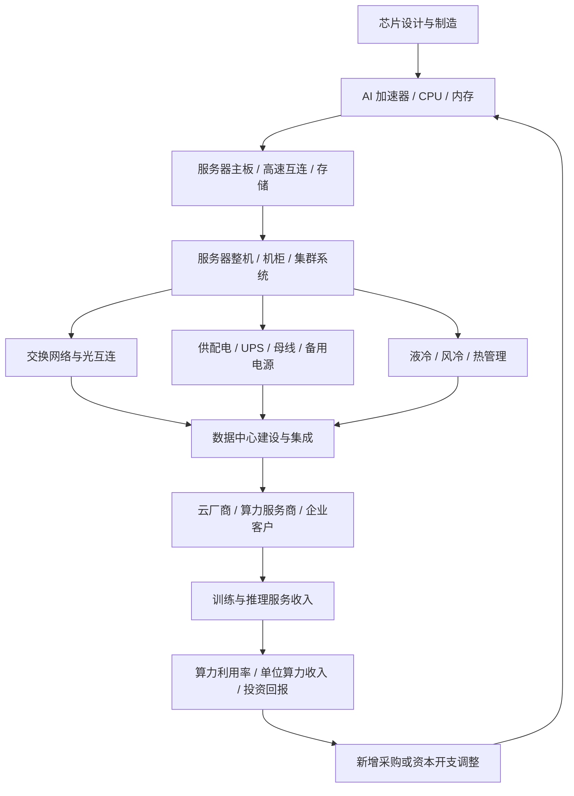

# AI 服务器、算力芯片与数据中心基础设施专题

> 更新日期：2026-10-11。本文用于 A 股产业研究，不构成投资建议。政策目标、行业统计、企业披露与市场预期分开处理；样本公司不代表推荐。

## 一、研究范围与关键判断

本专题研究人工智能算力从芯片、服务器、机柜和网络，到供配电、制冷、数据中心建设及云算力服务的产业链。核心不是简单判断“算力需求增长”，而是确认算力需求是否转化为设备采购、实际部署、利用率、服务收入、供应商利润和现金流。

工信部 2026 年上半年新闻发布会披露，截至 2026 年 6 月底，我国智能算力规模为 2185 EFLOPS（FP16），全国算力设施整体上架率为 71.4%。该数据描述的是全国行业总量与设施情况，不等于所有地区、运营商或上市公司都具有相同利用率，也不能直接推导设备供应商盈利。[工信部发布会](https://hca.miit.gov.cn/xwdt/xydt/art/2026/art_07afd3e803384225b75e4907246d3721.html)

工信部等五部门于 2026 年 9 月发布绿色算力设施推荐通知，提出能效、碳效、布局、上架率和绿色能源等要求。它提示算力建设不仅受芯片供应影响，也受到供电、制冷、能源结构、设施利用率和选址约束。[绿色算力设施推荐通知](https://wap.miit.gov.cn/jgsj/jns/nyjy/art/2026/art_28ea3a2e759a4e4981277d070ab6db04.html)

## 二、产业链全景

## 三、主要环节、经营指标与风险

| 环节 | 产品与价值位置 | 应观察指标 | 主要风险 |
|---|---|---|---|
| 算力芯片与加速卡 | GPU、AI 加速器、CPU、互连及板卡 | 性能/功耗、可供货量、客户验证、软件生态、售价与毛利 | 供应约束、产品迭代、软件适配、客户集中、贸易限制 |
| 存储与服务器配套 | 内存、SSD、主板、高速连接器、电源模块 | 单机配置、产品价格、交期、良率、库存与供应商份额 | 存储价格周期、规格切换、交付瓶颈 |
| 服务器整机与机柜 | 服务器设计、制造、系统集成和整柜交付 | 出货量、平均售价、订单、合同负债、毛利率、客户集中度 | 代工竞争、产品标准化、低毛利、客户自研 |
| 高速网络与光互连 | 交换机、网卡、光模块、铜缆与光纤连接 | 交换容量、端口速率、产品组合、网络采购、交付周期 | 架构迭代、技术替代、网络瓶颈 |
| 供配电与备用电源 | 变压器、开关设备、UPS、母线、柴油/储能备用电源 | 项目招标、交期、单机柜功率、验收、毛利和回款 | 电网接入延误、项目延期、原料涨价 |
| 制冷与热管理 | 风冷、液冷、冷却液分配、泵阀、冷却塔与热交换 | 单位制冷成本、能效、渗漏/可靠性、部署率、维护收入 | 技术路线变化、客户验证、可靠性事故 |
| 数据中心建设与运营 | 园区、机房、机电工程、托管与算力租赁 | 上架率、利用率、PUE、租赁价格、建设周期、资本开支 | 电力指标、融资成本、供需错配、折旧压力 |
| 云与算力服务 | GPU 云、训练/推理服务、企业云服务 | 利用率、单位算力收入、客户留存、服务毛利、回款 | 算力价格下跌、利用率不足、客户预算变化 |

## 四、从需求到上市公司财务的传导路径

必须分别验证以下环节：

1. **预算不等于订单**：资本开支指引、项目公告和框架协议都不是供应商已确认收入。应核对采购合同、合同负债、订单披露和后续交付。
2. **出货不等于利润**：整机业务可能规模大但毛利率低；需观察产品组合、价格、质保、研发和售后成本。
3. **建设不等于有效算力供给**：供电接入、机房建设、制冷、网络、芯片到货和软件部署任一环节都可能拖慢投产。
4. **装机不等于利用率**：应区分已安装算力、可调度算力、已售算力和实际利用率。
5. **利润不等于现金流**：检查应收账款、存货、合同资产、资本开支、折旧及融资成本。
6. **总量不等于公司份额**：国家级算力规模和行业投资增长无法直接替代公司订单、收入与毛利数据。

## 五、数据中心的电力、制冷和选址约束

AI 服务器提高了单机柜功率密度，数据中心的经济性越来越依赖供电能力、制冷效率、能源价格和利用率。重点关注：

- **供电侧**：电网接入批复、变电站与配电设备交付、备用电源、负荷管理及供电可靠性。
- **制冷侧**：风冷与液冷的适用边界、液冷系统可靠性、维护能力、能耗与全生命周期成本。
- **能效侧**：PUE 等设施指标应结合气候、负载率、测量边界和统计周期解释；不同项目不能不加调整地横向比较。
- **能源侧**：可再生能源比例、绿电交易、源网荷储和算电协同可能影响选址及运营成本，但政策要求不自动保证项目经济性。
- **建设侧**：土地、机电工程、消防、网络连接、设备交付和验收周期都可能造成投资回收延迟。

## 六、A 股研究样本与业务敞口核验

以下公司仅用于构建研究清单。需按最新年报、半年报、公告和问询回复核验实际业务、分部收入、利润贡献和客户结构；不能因为“算力概念”标签而推断其主要收入来自 AI。

| 公司样本 | 研究切入点 | 核验重点 |
|---|---|---|
| 中兴通讯（000063） | 服务器、存储、数据中心及通信设备 | 公司 2026 年半年报披露算力业务增长；需继续拆分产品结构、毛利率、现金流和客户需求，不把整体算力收入等同于单一 AI 服务器收入 |
| 浪潮信息（000977） | 服务器与数据中心计算系统 | AI 服务器收入与普通服务器区分、客户集中度、订单/存货、毛利率和营运资金 |
| 紫光股份（000938） | 网络设备、服务器与 ICT 解决方案 | 交换机、服务器及其他业务分部，项目交付、应收回款和利润率 |
| 工业富联（601138） | 服务器制造及通信网络设备等业务 | AI 服务器与其他产品占比、客户集中、制造良率、资本开支与现金流 |
| 英维克（002837） | 精密温控与数据中心热管理 | 数据中心业务占比、液冷产品进展、客户认证、订单与毛利率 |
| 申菱环境（301018） | 专用空调、数据中心及工业环境控制 | 数据中心业务收入、项目验收、应收账款和经营现金流 |
| 科华数据（002335） | UPS、电源系统、数据中心相关业务 | 电源与数据中心业务分部、项目建设周期、回款及资本开支 |
| 科士达（002518） | UPS、数据中心电源及相关产品 | 数据中心与其他电源业务拆分、产品价格、渠道库存与毛利变化 |

中兴通讯在 2026 年 8 月发布的半年报信息中披露，上半年算力营收同比增长超过 55%，占总营收 35.1%；服务器及存储产品营收同比增长近 60%，数据中心产品营收同比增长超过 90%。这些是公司口径披露，不应外推为全行业增速，也不能代替对毛利率、现金流及后续持续性的分析。[中兴通讯公司公告](https://www.zte.com.cn/china/about/news/20260821C1.html)

## 七、ETF 与指数映射规则

本专题横跨电子、计算机、通信、机械设备、电力设备和公用事业等多个行业，不能假设存在覆盖所有算力环节且纯度一致的单一 ETF。

筛选候选 ETF 时：

1. 先看基金合同、招募说明书和跟踪指数编制方案，明确指数是偏半导体、通信、计算机、人工智能、数据中心还是电力设备。
2. 查看最新定期报告的成分股与权重，记录报告期末日期；不能将季度持仓视为实时持仓。
3. 检查服务器、芯片、电源、液冷、数据中心运营等环节是否实际进入指数，还是仅有少数概念关联公司。
4. 核验规模、成交额、买卖价差、管理费、托管费、跟踪误差和折溢价。
5. 将 ETF 当作行业观察和资产配置工具，而不是以主题名称替代基本面研究。

未核对官方指数方案和基金文件前，不列未经验证的代码，也不宣称某只 ETF 是“纯算力 ETF”。

## 八、三种情景与逻辑失效条件

| 情景 | 可验证信号 | 需要注意 |
|---|---|---|
| 偏强 | 算力服务需求增加，资本开支落实，设备交付与上架率提高，利用率、现金流和投资回报同步改善 | 仍需判断估值是否已提前反映增长，以及供给扩张速度 |
| 基准 | 设备需求保持增长，但芯片/服务器价格、产品组合、能耗与折旧抵消部分收入增量 | 按环节拆分，不用算力规模增长代替盈利增长 |
| 偏弱 | 项目延期、利用率不足、算力服务降价、设备价格竞争加剧、应收与资本开支持续上升 | 重估供应商盈利、数据中心投资回收期和客户信用风险 |

**反证清单：**

- 算力规模继续增长，但设施上架率或实际利用率没有改善。
- 云厂商资本开支增长，但采购订单、设备交付或服务收入不匹配。
- 服务器收入增长而毛利率持续下降，现金流恶化。
- 数据中心建设完成但电力、制冷、网络或客户需求未到位。
- 设备折旧、融资成本和电费使算力服务的单位经济性恶化。
- 新增产能过快，算力租赁价格下跌并压低投资回报。
- 主题估值上涨远快于订单、利润和现金流改善。

## 九、月度跟踪清单

- [ ] 工信部算力规模、设施上架率、算力网络和绿色算力政策更新。
- [ ] 主要云厂商和运营商资本开支、数据中心项目与算力服务信息。
- [ ] AI 芯片、服务器、交换网络、存储和关键器件的供货及价格变化。
- [ ] 服务器与网络设备公司的订单、合同负债、收入、毛利率、库存和现金流。
- [ ] 数据中心项目的供电接入、投产、上架率、利用率与租赁价格。
- [ ] UPS、变压器、配电、液冷和温控公司的订单、交付、验收和应收账款。
- [ ] 电力价格、能效、PUE、绿电和设施运营成本变化。
- [ ] 候选 ETF 的最新指数规则、定期报告持仓日期、规模、流动性与跟踪误差。
- [ ] 记录支持证据、反证、尚未验证的假设和下一次复核日期。

## 十、来源与口径

1. 工业和信息化部：《持续向新向优发展！国新办就2026年上半年工业和信息化发展情况举行新闻发布会》，2026 年公开。披露截至 2026 年 6 月底智能算力规模及全国算力设施整体上架率。https://hca.miit.gov.cn/xwdt/xydt/art/2026/art_07afd3e803384225b75e4907246d3721.html
2. 工业和信息化部等五部门：《关于组织开展2026年度国家绿色算力设施推荐工作的通知》，2026-09-21 发布。用于核验绿色算力设施推荐要求、能效与布局约束。https://wap.miit.gov.cn/jgsj/jns/nyjy/art/2026/art_28ea3a2e759a4e4981277d070ab6db04.html
3. 工业和信息化部：《“人工智能+信息通信”创新发展实施意见（2026—2028年）》，2026-06-11 发布。涉及智算云服务、算力设施布局、算力网络及高速光互连。https://hubca.miit.gov.cn/zwgk/zcwj/wjfb/art/2026/art_1a6880738cfc4235afeda815d6ae8ab4.html
4. 中兴通讯：《中兴通讯2026年上半年营收780亿，再创新高，算力营收占比超35%》，2026-08-21。公司口径披露，需结合完整半年报财务报表进一步复核。https://www.zte.com.cn/china/about/news/20260821C1.html
5. 工业和信息化部数据发布入口：用于持续核验通信业、电子信息制造业和相关产业政策统计。https://www.miit.gov.cn/gxsj/index.html

**使用限制：**行业规模、算力性能口径、设施上架率、公司业务口径并不相同。所有数字应注明统计时点、计算精度、披露日期和原始来源；不要把行业总量直接映射为单家公司收入或股价涨幅。
