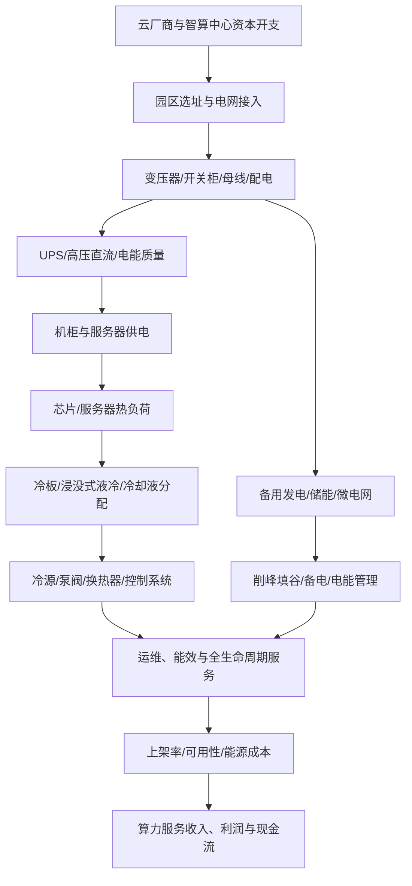

# 数据中心电力设备、液冷与储能产业链专题

> 研究日期：2026-10-11。本文用于产业研究，不构成个股或 ETF 买卖建议。公司仅作业务核验样本，不代表推荐；政策目标、项目规划与公司业绩之间必须经过订单、交付、验收、收入、利润和现金流验证。

## 一、研究边界：算力设施的“电力入口—电能质量—芯片散热—供能韧性”

本专题承接 [AI 服务器、算力芯片与数据中心基础设施专题](./34-AI服务器算力芯片与数据中心基础设施专题.md)，聚焦电力设备、供配电、备用电源、热管理与储能。它与传统电网设备、工业制冷、新能源储能存在交叉，但需求来源、产品规格、客户认证和项目交付周期并不相同。

核心问题不是“AI 数据中心建设是否增长”，而是：新增算力是否形成已批准且资金落实的项目；电网接入与设备交期是否构成瓶颈；设备商能否取得订单并按期交付；液冷/储能方案是否进入实际部署；最终收入是否带来毛利、现金流和合理资本回报。

## 二、产业链全景图

**关键边界：**电网侧的变压器与开关设备、机房内部的 UPS/配电、IT 侧的电源模块、液冷系统与电网级储能不是同一种产品。不能把同一家公司“涉及电力、液冷或储能”的宣传，直接当作其拥有大规模数据中心订单。

## 三、细分环节、核心指标与主要风险

| 环节 | 主要产品/角色 | 需要跟踪的指标 | 主要风险 |
|---|---|---|---|
| 电网接入与变压器 | 主变、配电变压器、开关设备、保护与监控 | 电网接入批复、招标金额、交付周期、订单与产能 | 项目审批和电网扩容慢于机房建设；原材料涨价 |
| 机房供配电 | 低压配电柜、母线槽、列头柜、智能配电 | 单机柜功率、产品认证、订单、交付验收、毛利率 | 竞争加剧、项目延期、客户集中 |
| UPS 与电源系统 | UPS、整流/逆变、模块化电源、备用发电 | 功率密度、转换效率、可靠性、订单、售后服务占比 | 技术路线变化、价格竞争、认证周期 |
| 高压直流与新型供电架构 | 直流供电、固态变压器等新路线 | 客户验证、系统效率、标准进展、量产节点 | 方案尚处验证期，市场空间可能被提前计价 |
| 液冷系统 | 冷板、冷却液分配单元（CDU）、泵阀、管路、快接、换热器、冷却液 | 项目采用率、单机柜热设计功耗、泄漏率、PUE、交付与维护 | 方案迭代、可靠性验证、客户自研、供应商切换 |
| 冷源与热管理 | 冷水机组、冷却塔、干冷器、风液混合系统 | 能效、全年运行成本、气候适配、维护成本 | 低温/高温工况差异，单一设备能效不代表全系统效率 |
| 储能与备用供能 | 电池储能、PCS、BMS、EMS、备用电源、微电网 | 功率/容量配置、循环寿命、可用率、消防安全、收益结构 | 数据中心备电与电网侧储能需求不同；收益机制不清 |
| 运维与能源管理 | 监控、预测性维护、能效优化、全生命周期服务 | 可用性、故障率、服务续约、运维收入、能耗成本 | 软件/服务难以形成独立收费；责任边界复杂 |

## 四、需求如何传导至公司财务

1. **项目公告不是收入。**框架协议、意向合作、送样和测试认证，证据强度低于有金额和交付节点的订单。
2. **订单不是利润。**若关键器件涨价、项目定制化程度高或现场调试成本超预期，收入增长可能伴随毛利率下滑。
3. **利润不是现金。**重点核对合同资产、应收账款、存货、经营现金流及票据结算；对大额项目核实验收条款与质保责任。
4. **数据中心建设不是单一周期。**园区建设、电网扩容、设备交付、服务器到货和上架运营的节奏可能错位。
5. **储能商业模式要单独计算。**作为备用电源、需量管理、峰谷套利或参与电力市场，价值来源和运行约束不同，不能把电池容量直接换算成利润。

## 五、政策与公开资料：能证明什么，不能证明什么

- 国家发展改革委、国家能源局、工业和信息化部、国家数据局于 2026 年 4 月印发《关于促进人工智能与能源双向赋能的行动方案》，强调人工智能与能源融合。该文件可作为政策方向证据，不是单家企业订单证明。来源：[国家能源局，2026-05-08 页面](https://www.nea.gov.cn/20260508/4dae97ca01d348e4871bb8654be34b3a/c.html)。
- 工业和信息化部《节能装备高质量发展实施方案（2026—2028年）》新闻发布会提到智算中心复合液冷、智能融合电力模块、高效 UPS 等方向，并披露已建成国家绿色算力设施的能效情况；这些内容支持能效与系统集成是行业关注点，但不代表所有项目均采用同一技术路线。来源：[工信部新闻发布会](https://www.miit.gov.cn/xwfb/xwfbh/bxwfbh/art/2026/art_4e9257192fe743ca84c33ffc78e94e0c.html)。
- 国家能源局 2026 年 6 月答复涉及 AIDC 新型储能标准研究、示范应用与新型储能政策体系，并披露截至 2026 年一季度末全国新型储能装机规模。该总量是全行业口径，不应直接推导数据中心储能需求或某家供应商收入。来源：[国家能源局，2026-06-26](https://www.nea.gov.cn/20260720/eb91852ee7d84761902d7c1a71bb5f5e/c.html)。
- 科华数据 2026 年半年度报告披露其 UPS 与数据中心基础设施产品布局，可用于核验公司公开披露的产品方向；应继续核对相关业务收入、毛利、客户集中度和现金流，不能只引用产品介绍。来源：[深交所披露的科华数据 2026 年半年度报告 PDF](https://disc.static.szse.cn/disc/disk03/finalpage/2026-08-28/546247bf-7c7f-4a0b-9f83-f6b37c8a10d9.PDF)。
- 曙光数创 2026 年半年度报告摘要披露其以冷却技术为核心的数据中心解决方案与业务定位。用于判断业务边界时仍需核对报告全文中的收入结构、订单、毛利和应收情况。来源：[曙光数创半年度报告摘要](https://data.eastmoney.com/notices/detail/920808/AN202608251828431038.html)。

**资料时点提醒：**以上来源的公开时间与统计期间不同。更新行业结论时，应以最新正式公告、报告原文和明确的报告期为准；媒体转述适合作为线索，关键数字应回到监管机构或上市公司原始披露。

## 六、A 股公司样本：按真实业务核验，不按概念归类

| 公司样本 | 研究方向 | 必须核验的内容 |
|---|---|---|
| 科华数据 | UPS、数据中心基础设施、储能相关业务 | 数据中心业务收入占比、订单/交付、产品毛利、海外客户与回款 |
| 科士达 | UPS、电源及数据中心基础设施 | 数据中心与储能业务分部、客户认证、订单转收入、应收和库存 |
| 曙光数创 | 数据中心冷却、液冷解决方案 | 液冷业务收入与毛利、项目验收、交付能力、应收和客户集中 |
| 英维克 | 精密温控、数据中心热管理 | 数据中心相关收入占比、液冷产品放量、毛利率和经营现金流 |
| 申菱环境 | 专用空调、数据中心及工业环境控制 | 数据中心业务真实规模、合同负债、交付验收与项目回款 |
| 佳力图 | 数据中心机房温控与节能服务 | 传统温控与新型液冷的收入区别、订单质量、应收和现金流 |
| 变压器与配电设备上市公司 | 电网接入、变压器、开关设备、配电 | 数据中心终端客户占比是否披露；不能把电网订单全算作 AIDC 需求 |
| 储能系统与电力电子上市公司 | PCS、BMS、EMS、电池及系统集成 | 数据中心项目是否已落地；区分电网侧、工商业与备电场景 |

上述为建立核验清单的样本，不构成完整公司名单或买入推荐。对于多元化公司，必须从年报/半年报分部披露、重大合同公告和投资者关系记录确认业务敞口；没有披露的比例不自行估算。

## 七、ETF 与指数映射的核验规则

本专题可能与电网设备、储能、数据中心、通信设备、算力基础设施等指数存在交叉，但**不应假设存在纯粹的“数据中心液冷 ETF”或把主题名称当作持仓证明**。

核验步骤：
1. 从基金管理人官网获取产品合同、招募说明书、最新定期报告及跟踪指数名称。
2. 从指数公司获取编制方案，确认成份股筛选范围、权重规则、调样频率与集中度。
3. 检查前十大成份股、行业分布、规模、成交额、费率、跟踪误差与折溢价。
4. 区分基金定期报告持仓时点与当前持仓；若需要当日估计，必须标注数据源、时间戳和估算方法。
5. 同一家公司可能横跨电力设备、储能、温控和算力主题，避免将多个 ETF 的主题名称简单相加成独立需求。

## 八、情景与反证：避免只看需求叙事

| 情景 | 可能出现的证据 | 应如何修正判断 |
|---|---|---|
| 偏强 | 项目获批并落实电力接入；订单与合同负债改善；交付验收加快；毛利和现金流同步改善 | 提高对实际订单、供应链瓶颈环节的研究优先级，仍需看估值 |
| 基准 | 项目持续推进但分期建设；供配电订单较稳，液冷方案逐步验证；利润兑现存在时滞 | 分开跟踪成熟业务和新技术业务，不把规划期需求提前计入利润 |
| 偏弱 | 电力接入延迟、客户削减资本开支；送样迟迟未转订单；库存/应收快于收入增长 | 下调业绩兑现确定性，复核产能扩张与估值预期 |
| 逻辑失效 | 订单取消或交付延期；产品可靠性问题；新方案绕过现有供应链；毛利持续下降且现金流恶化 | 不以行业长期空间为由忽略公司基本面恶化 |

## 九、月度跟踪清单

- [ ] 数据中心项目：立项、融资、开工、上电、上架是否分阶段披露。
- [ ] 电网与设备：接入批复、变压器/开关设备招标、交期与价格。
- [ ] 供电：UPS、高压直流、电源模块的认证、订单、量产和服务收入。
- [ ] 液冷：客户验证转量产、实际交付、故障/泄漏、维护成本及系统能效。
- [ ] 储能：明确应用是备电、需量管理、峰谷套利还是电网服务，核算全生命周期收益。
- [ ] 财务：合同负债、应收、存货、经营现金流、毛利率、资本开支与研发费用。
- [ ] 公司敞口：按最新年报/半年报核实分部口径，区分主营、试样、合作和概念。
- [ ] ETF：复核指数规则、最新公开持仓日期、成交流动性、费率与跟踪误差。
- [ ] 估值：比较当前股价所隐含的订单增速、利润率与现金流改善要求。
- [ ] 反证：记录不支持原判断的数据，避免只更新利好材料。

## 十、研究结论

数据中心电力与热管理的价值，来自高功率密度、可靠性、能效与建设交付的综合约束。变压器和配电设备更依赖电网接入及项目建设；UPS/电源依赖认证、可靠性和供电架构；液冷依赖客户验证、系统集成和维护能力；储能则必须明确收益场景及运行规则。分析时应把行业空间拆成可验证的订单、交付、验收、收入、利润和现金流，而不是用政策、规划或概念标签替代业绩证据。

## 来源清单

1. 国家能源局：《关于促进人工智能与能源双向赋能的行动方案》相关通知页面，2026-05-08。https://www.nea.gov.cn/20260508/4dae97ca01d348e4871bb8654be34b3a/c.html
2. 工业和信息化部：《节能装备高质量发展实施方案（2026—2028年）》新闻发布会。https://www.miit.gov.cn/xwfb/xwfbh/bxwfbh/art/2026/art_4e9257192fe743ca84c33ffc78e94e0c.html
3. 国家能源局：关于人工智能算力用电需求与 AIDC 新型储能的建议答复，页面标注制发日期 2026-06-26。https://www.nea.gov.cn/20260720/eb91852ee7d84761902d7c1a71bb5f5e/c.html
4. 科华数据：2026 年半年度报告全文，深交所披露。https://disc.static.szse.cn/disc/disk03/finalpage/2026-08-28/546247bf-7c7f-4a0b-9f83-f6b37c8a10d9.PDF
5. 曙光数创：2026 年半年度报告摘要。https://data.eastmoney.com/notices/detail/920808/AN202608251828431038.html

> 复核提醒：公司产品方向不等于已形成大规模收入；行业统计不等于单家公司收入；基金名称不等于持仓纯度。后续应逐家公司核验正式报告及重大合同，并记录来源发布日期、报告期与口径。
