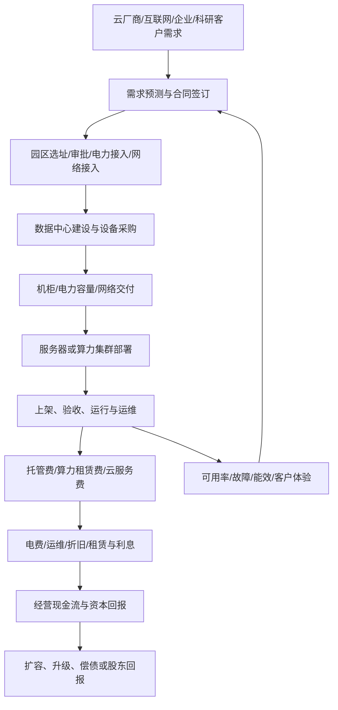

# 数据中心运营商、IDC 与算力租赁产业链专题

> 研究日期：2026-10-11。本文为产业研究，不构成个股或 ETF 买卖建议。公司样本仅用于业务核验，不代表推荐。运营商的核心资产不是“机柜数量”本身，而是能否在合规、电力、网络和客户约束下，把已建成的容量持续转化为可回款的服务收入与资本回报。

## 一、研究边界与核心问题

本专题承接 [AI 服务器、算力芯片与数据中心基础设施专题](./34-AI服务器算力芯片与数据中心基础设施专题.md) 与 [数据中心电力设备、液冷与储能产业链专题](./35-数据中心电力设备液冷与储能产业链专题.md)，重点研究设施运营方、IDC 托管、云与算力服务商之间的商业模式差异。

- **IDC 托管**：按机柜、功率、上电容量、场地及配套服务收费；可能是批发型定制园区，也可能是城市型零售机房。
- **云服务**：按计算、存储、网络、软件或服务使用量收费，经营结果取决于产品组合、客户留存、利用率和资本效率。
- **算力租赁 / AIDC**：可能按 GPU/服务器、算力卡时、整机柜或集群包周期收费。合同的最低消费、预付款、交付验收、设备所有权和残值风险差异很大。
- **自建自用数据中心**：属于企业自身基础设施，不一定有对外收入；不能简单用 IDC 估值方式比较。

核心问题：需求是否有可执行合同；机柜/算力容量何时可交付并上架；利用率和单价能否覆盖电力、折旧、运维、融资及网络成本；客户是否按期回款；扩张是否创造正向自由现金流。

## 二、产业链与收入模式

| 模式 | 主要计费方式 | 重要驱动 | 典型风险 |
|---|---|---|---|
| 批发型 IDC | 定制机房、约定功率/机柜、长期托管合同 | 大客户签约、按期上电、验收、稳定运营 | 客户集中、单一园区风险、资本开支大 |
| 城市型 IDC | 机柜、带宽、交叉连接、托管及增值服务 | 上架率、机柜月收入、客户结构、网络位置 | 同区域供给竞争、租金价格压力 |
| GPU/AI 算力租赁 | GPU/服务器/集群按小时、月度或包周期收费 | 设备到货、客户利用率、租约期限、价格与残值 | 芯片迭代快、折旧高、利用率波动、客户信用 |
| 云服务与算力平台 | 按用量、实例、存储、网络或服务包计费 | 使用量、留存、产品毛利、规模效应 | 价格竞争、资源闲置、软件研发成本 |
| 自建自用 | 通常无对外托管收入 | 内部业务需求、可靠性、能效和总拥有成本 | 过度建设、内部利用率不足、成本不可见 |

## 三、关键指标：不要把“规模”当成“回报”

| 指标 | 建议口径 | 解读与常见误区 |
|---|---|---|
| 规划机柜 | 项目规划容量 | 尚不代表已开工、已上电或可计费 |
| 在建/已建容量 | 分别记录建设中与完成建设的容量 | 已建仍可能因电力、验收或客户部署而不能运营 |
| 可用/已上电容量 | 满足合同和技术条件、可交付的容量 | 应明确按机柜、电力或 IT 负载计量，避免混用 |
| 上架率 | 已上架机柜数 ÷ 可用于上架的机柜数；注明公司口径 | 分母、统计时点、成熟/爬坡机柜定义不同，横向比较前先统一口径 |
| 功率利用率 | 实际 IT 负载 ÷ 可用 IT 功率 | 机柜已上架不代表设备满负载；高功率 AI 柜尤其要看电力负载 |
| 单机柜月收入 | 对应期间托管收入 ÷ 平均计费机柜数 | 受功率、服务内容、客户和计费口径影响，不宜跨模式简单比较 |
| PUE | 数据中心总能耗 ÷ IT 设备能耗 | 越低通常代表设施能效越高，但受气候、负载、统计边界影响 |
| 可用率与 SLA | 按合同定义统计服务可用性与违约 | 应同时看故障频率、持续时间、赔偿和客户体验 |
| 客户集中度 | 前五大客户收入/应收占比、单一客户占比 | 大客户可带来稳定需求，也会带来议价和续约风险 |
| 合同负债/在手订单 | 按公司披露口径记录 | 预收款不一定对应未来高毛利收入；框架协议不等于可执行订单 |
| 应收账款与回款 | 应收增长、账龄、减值、现金回收 | 收入增长但回款恶化，可能意味着合同质量或客户信用承压 |
| 自由现金流 | 经营现金流减资本开支（统一口径） | 扩张期可能持续为负；需区分建设期投入与长期结构性亏损 |
| ROIC 与资产周转 | 投入资本回报率、资产周转和折旧年限 | 高收入增长若依赖不断扩张资本，也可能稀释资本回报 |

## 四、绿色算力与区域布局：政策指标是筛选条件，不是盈利保证

工信部等五部门于 2026 年 9 月发布 2026 年度国家绿色算力设施推荐通知，要求算力设施具有独立、完整的物理边界与供配电、制冷系统，并对运行年限、规模、上架率、能效、服务器能效和可再生能源使用等提出条件；通知还强调对不符合要求的设施动态调整名单。来源：[工信部，2026-09-21](https://www.miit.gov.cn/jgsj/jns/gzdt/art/2026/art_ca5bc3edeff248dda5919a6d211489a5.html)。

国家发展改革委等部门关于深入实施“东数西算”工程的实施意见提出统筹算力布局、推动算力服务标准化，并提到根据需求推动长租向按需使用等更灵活模式发展。其政策意义是引导资源布局与利用率改善，而不是保证所有园区都能获得客户或取得理想回报。来源：[国家发展改革委，2023-12-25](https://zfxxgk.ndrc.gov.cn/wap/iteminfo.jsp?id=20303)。

**区域分析要点：**
1. 枢纽节点、网络时延、目标客户和能源条件必须同时匹配；电价低不等于总成本低。
2. 东部客户近、网络与交付生态成熟，但土地、电力容量和综合成本可能更高。
3. 西部能源与土地条件可能具备优势，但需要核实网络成本、时延适配、客户需求、跨区域调度和当地配套。
4. “绿电占比”“PUE”与“上架率”属于不同指标，不能互相替代，也不能只用设计值替代实际运行数据。

## 五、公开数据与公司案例：从实际披露提取指标

### 1. 数据港

数据港 2026 年半年度报告披露，主营业务包括 IDC、IDC 解决方案、云服务销售及算力业务；其 IDC 模式主要为客户提供服务器托管，按照服务器使用机柜上电数量收取托管服务费。报告披露截至期末已建成运营 36 座数据中心、总电力容量 401MW，折合 5kW 标准机柜 80,200 个；2026 年上半年营业收入 7.82 亿元、归母净利润 8,588.31 万元。上述是公司披露口径，仍需结合报告全文核对分部收入、资本开支、债务、现金流及客户集中度。来源：[数据港 2026 年半年度报告](https://money.finance.sina.com.cn/corp/view/vCB_AllBulletinDetail.php?id=12517577&stockid=603881)。

### 2. 光环新网

光环新网 2026 年半年度报告风险提示提到，报告期电费成本同比上升 30.70%，并提示新增项目投产后折旧成本、上架率不及预期、区域供需错配和机柜服务价格承压等风险。这些披露说明 IDC 业务不能只看新增机柜，还要追踪电费、折旧、价格、上架与现金流。来源：[光环新网 2026 年半年度报告公告页面](https://vip.stock.finance.sina.com.cn/corp/view/vCB_AllBulletinDetail.php?id=12548677&stockid=300383)。

### 3. 21Vianet（万国数据，境外上市样本）

公司 2026 年第一季度投资者材料列出城市型 IDC 的运营机柜数、上架率和单机柜月度经常性收入，并区分成熟机柜与爬坡机柜。该材料可用作指标定义的参考；境外上市公司披露口径与 A 股公司未必相同，不能直接横向比较。来源：[21Vianet 2026 年第一季度投资者材料](https://ir.21vianet.com/static-files/6f1dfc6b-1b44-44e8-a4a1-23b2b2510954)。

### 4. 电信运营商的算力业务

中国电信 2026 年半年度业绩说明会披露其上半年资本开支 324 亿元、算力网投资同比增长 97%，并披露智算利用率等运营指标。该资料可用于观察运营商资本开支结构和算力运营指标，但不应把集团整体资本开支等同于上市公司独立 IDC 业务收入。来源：[中国电信 2026 年半年度业绩说明会](https://roadshow.cnstock.com/fbh/zgdx202606)。

## 六、A 股公司样本与尽调重点

| 公司/类别 | 研究切入点 | 重点核验 |
|---|---|---|
| 数据港 | 批发型 IDC、客户定制托管 | 已建与可计费容量、客户合同、上架节奏、资本开支、负债与现金流 |
| 光环新网 | IDC 与云计算相关业务 | 业务分部、区域供需、电费、折旧、上架率、租金与回款 |
| 奥飞数据 | IDC 与算力基础设施 | 新项目投产时间、客户结构、实际计费容量、现金流与融资需求 |
| 润泽科技 | 大型数据中心与算力基础设施 | 项目交付、客户承诺、上电进度、资本开支和资产回报 |
| 宝信软件 | IDC 与工业软件等业务并存 | IDC 分部的真实贡献、园区利用率、资本强度及非 IDC 业务影响 |
| 万国数据等境外上市样本 | 城市型 IDC 与大型数据中心运营 | 只作为经营指标参考，注意上市地、会计口径和披露差异 |
| 电信运营商 | 云网、算力网络、智算集群 | 区分通信主业、云服务、算力租赁与资本开支口径 |

公司列表仅为研究样本。任何结论都应从最新年报、半年报、交易所公告和正式投资者材料验证；“签约规模”“项目储备”“算力合作”不能直接当作确认收入。

## 七、算力租赁专项：合同条款比宣传算力规模更重要

算力租赁的资产和现金流风险通常比传统托管更复杂，尤其当经营者自行购买昂贵 GPU/服务器并承担快速迭代风险时。至少核验：

- **资产归属**：设备由运营商、客户还是融资租赁方持有？是否存在回购、担保、抵押或关联交易？
- **合同确定性**：是否为正式生效合同；最低消费、预付款、验收、取消条款、违约责任与价格调整机制是什么？
- **设备利用率**：签约容量与实际使用量是否一致；空闲算力能否转售；不同客户之间是否存在兼容性或数据隔离限制？
- **折旧与残值**：会计折旧年限是否匹配技术迭代周期；二手设备残值、维修与升级成本如何估计？
- **能源与网络**：电力容量、功率密度、网络出口、跨区域时延与带宽成本是否已落实？
- **融资结构**：设备采购是否依赖短债、租赁负债或高成本融资；客户回款能否覆盖偿债？
- **利润质量**：剔除一次性收益、补助和非经常性项目后，经营毛利与经营现金流是否支持持续扩张？

**简化压力测试：**分别设置上架率/利用率下降、租赁价格下降、电费上升、投产延期、利率上升和设备残值下降情景，估算 EBITDA、经营现金流、利息覆盖和资本开支后的现金缺口。假设必须标注来源，不能把示例参数伪装成行业事实。

## 八、ETF 与指数映射规则

IDC、云计算、数据中心、通信运营商和算力租赁可能在不同指数中交叉出现。没有核验前，不把 ETF 名称当成行业纯度证明。

1. 通过基金管理人官网确认产品合同、跟踪指数、最新定期报告和费用。
2. 通过指数公司公布的编制方案核对选股范围、权重规则、调整频率与集中度。
3. 核对前十大成份股和实际业务：有些公司主营通信、软件、服务器或电源设备，IDC 只是其中一部分。
4. 区分指数行业分类与实际商业模式，避免把电信运营商的全部收入视为 IDC 收入。
5. 记录持仓披露日期、规模、成交额、跟踪误差与折溢价；不要用历史季报持仓冒充实时仓位。

## 九、情景与反证

| 情景 | 观察到的证据 | 对研究判断的影响 |
|---|---|---|
| 偏强 | 已上电容量增加，正式合同与客户部署同步；上架率、单机柜收入和回款改善 | 研究实际受益的区域和运营模式，但仍要看资本回报与估值 |
| 基准 | 项目分期投产，爬坡期较长；收入增长但折旧和电费同步增加 | 重点比较成熟机柜与新投放机柜的边际回报 |
| 偏弱 | 客户推迟部署、价格下滑、供给集中投产；应收和资本开支上升 | 下调利用率和自由现金流假设，审查融资与债务期限 |
| 逻辑失效 | 关键合同取消、上电持续延期、客户违约，或利用率不足以覆盖固定成本 | 不以“算力长期增长”掩盖资产回报恶化 |

## 十、月度跟踪清单

- [ ] 规划、在建、已建、已上电、可计费容量分别是多少？
- [ ] 上架率与功率利用率是否同时改善？分母定义是否一致？
- [ ] 成熟期与爬坡期资产的收入、毛利和资本回报分别如何？
- [ ] 单机柜月收入、服务内容、合同期限和续约价格如何变化？
- [ ] 电费、网络、人工、维护、折旧和融资成本的变化方向是什么？
- [ ] 新签合同是否有明确客户、金额、最低消费、交付和验收条款？
- [ ] 应收账款、账龄、合同资产、经营现金流和资本开支是否恶化？
- [ ] 客户集中度、关联交易、担保、租赁负债和短期偿债压力如何？
- [ ] 算力租赁合同是否覆盖设备折旧周期，并对价格下降和利用率下降留有余量？
- [ ] ETF 是否按最新指数规则和披露日期复核实际成份与权重？
- [ ] 哪些事实可以推翻当前判断？是否保留了明确反证？

## 十一、研究结论

IDC 是资本密集型基础设施生意，盈利取决于可交付容量、客户合同、上架/负载、单价、能源与网络成本、折旧、融资和回款的组合。算力租赁还额外承担设备技术迭代、利用率和残值风险。研究时应优先区分“规划—建设—上电—交付—上架—计费—回款”各阶段，避免将机柜规模、算力规模或项目签约额直接等同于利润和自由现金流。

## 来源清单

1. 工业和信息化部等五部门：《关于组织开展2026年度国家绿色算力设施推荐工作的通知》，2026-09-21。https://www.miit.gov.cn/jgsj/jns/gzdt/art/2026/art_ca5bc3edeff248dda5919a6d211489a5.html
2. 国家发展改革委等部门：《关于深入实施“东数西算”工程加快构建全国一体化算力网的实施意见》，2023-12-25。https://zfxxgk.ndrc.gov.cn/wap/iteminfo.jsp?id=20303
3. 数据港：2026 年半年度报告。https://money.finance.sina.com.cn/corp/view/vCB_AllBulletinDetail.php?id=12517577&stockid=603881
4. 光环新网：2026 年半年度报告公告页面。https://vip.stock.finance.sina.com.cn/corp/view/vCB_AllBulletinDetail.php?id=12548677&stockid=300383
5. 21Vianet：2026 年第一季度投资者材料。https://ir.21vianet.com/static-files/6f1dfc6b-1b44-44e8-a4a1-23b2b2510954
6. 中国电信：2026 年半年度业绩说明会。https://roadshow.cnstock.com/fbh/zgdx202606

> 复核提醒：数据中心容量、上架率、功率、收入与资本开支的定义可能不同。每次更新都应保留原始报告日期、统计期间、分母口径和是否经审计等信息。
