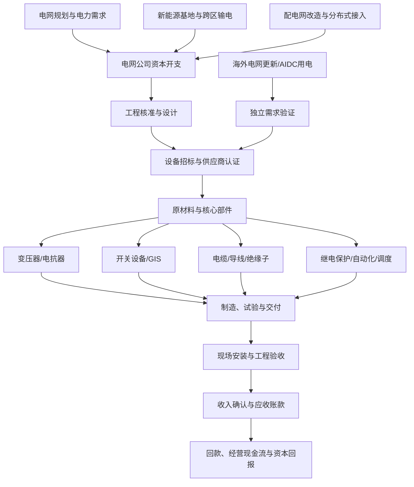

# 电网设备、变压器与特高压产业链专题

> 更新日期：2026-10-11  
> 研究定位：A股产业链研究，不构成个股推荐。政策规划、项目核准、招标、订单、交付、收入与现金流是不同阶段，必须分别验证。

## 一、研究边界

覆盖主网与配电网建设、特高压交流/直流输电、变压器、电抗器、开关设备、组合电器、保护与自动化、电线电缆、绝缘子及相关材料。电网运营商的固定资产投资是需求入口，不代表全部投资都转化为上市公司设备订单；数据中心、海外电网更新和新能源并网属于不同需求来源，应单独核实。

## 二、政策与当前证据

- 国家发展改革委、国家能源局于2025-12-26发布《关于促进电网高质量发展的指导意见》，强调加大电网投资、主配微网协同、配电网智能化及调度能力建设。政策方向须通过项目、招标和实际交付验证。来源：[国家能源局政策原文](https://www.nea.gov.cn/20251231/1be7eddc38c74ec09f528c126c9bdb1c/c.html)。
- 国家电网披露“十五五”固定资产投资预计4万亿元，较“十四五”增长40%。这是企业规划口径，不等同于每年实际支出，也不等同于设备供应商收入。来源：[国家能源局转载新华社报道，2026-01-30](https://www.nea.gov.cn/20260130/f5870f4fe28744139406827434f3859c/c.html)。
- 新华社2026-07-24报道，国家电网上半年固定资产投资超3100亿元、同比增长12.6%，并推进特高压、清洁能源送出及省间互济工程。该数据为电网投资进展，不可直接替代上市公司订单数据。来源：[新华社，2026-07-24](https://www.xinhuanet.com/energy/20260724/e1d977db8f8041879bb53c9f68183f63/c.html)。
- 国家能源局工程质量监督中心2026-07-22披露，攀西特高压交流工程已启动现场质量监督；公开信息称工程于2025年10月获核准，预计2028年建成。工程建设周期较长，关注招标批次、设备交货与验收节奏。来源：[国家能源局工程质量监督中心](https://prpq.nea.gov.cn/zjjjgzdt/14236.html)。
- 工信系统2026年发布的节能装备高质量发展相关材料指出，变压器能效标准与节能产品推广持续推进，并披露2025年变压器总产量约30亿千伏安。产量是行业供给指标，不代表高压/特高压产品的有效产能或利润水平。来源：[工信系统新闻发布会材料](https://jxca.miit.gov.cn/xwdt/bwyw/art/2026/art_d7c2f2ecbfdb486b9ef74b6ae3752adb.html)。

## 三、产业链全景

## 四、细分环节、指标与主要风险

| 环节 | 产品/商业模式 | 关键观察指标 | 主要风险 |
|---|---|---|---|
| 特高压工程 | 交流骨干网、直流输电通道及换流站设备 | 核准、招标批次、项目进度、设备交付与验收 | 项目延期、招标节奏不均、供应商份额变化 |
| 变压器与电抗器 | 电压变换、无功补偿及系统稳定设备 | 中标金额、产品结构、产能利用率、交付周期、毛利率 | 原材料涨价、产能瓶颈、质量责任、客户集中 |
| 开关设备与GIS | 高压开关、组合电器、断路器 | 订单、产品电压等级、认证周期、交付与质保 | 技术可靠性要求高、竞争加剧、项目延迟 |
| 电线电缆与导线 | 电力传输、架空导线及特种电缆 | 中标量、铜/铝价差、订单覆盖、库存与回款 | 原料价格波动、低毛利扩张、合同价格传导滞后 |
| 绝缘子及复合材料 | 绝缘、机械支撑与线路防护 | 线路建设需求、产品结构、良率、单位成本 | 同质化竞争、质量事故、替代材料 |
| 继电保护与电网自动化 | 保护控制、调度、通信与数字化系统 | 软件/设备订单、项目验收、研发投入、服务收入 | 标准适配、项目验收周期、软硬件竞争 |
| 配电网与智能化 | 配网设备、智能计量、柔性互联 | 配网投资、招标量、分布式新能源接入、供电可靠性 | 项目碎片化、地方预算与回款、价格竞争 |

## 五、从投资到上市公司利润的传导

1. 规划与政策：识别投资方向、预算口径和实施时间，不把目标值当作已发生支出。
2. 项目核准与招标：核验招标公告、中标候选人及最终结果，区分框架协议、预中标和正式合同。
3. 生产与交付：检查合同交期、产能利用率、关键部件采购、产品试验与客户验收。
4. 财务兑现：追踪合同负债、存货、应收账款、毛利率、信用减值、经营现金流和资本开支。
5. 股价预期：比较订单增速与估值隐含增速；订单增长若伴随应收、存货和融资需求更快增长，盈利质量可能弱于表面收入。

## 六、A股公司研究样本（非推荐）

| 公司样本 | 研究切入点 | 必须核验的边界 |
|---|---|---|
| 特变电工 | 变压器、电抗器及输变电成套设备 | 分拆国内/海外签约、产品类别、交付周期与实际收入；公司交流记录不等于审计财务数据 |
| 中国西电 | 输变电设备与高压电气装备 | 核验不同电压等级产品、订单来源、项目验收及分部盈利 |
| 保变电气 | 变压器及相关电力设备 | 关注产能、订单质量、毛利率、应收与经营现金流 |
| 平高电气 | 高压开关及GIS等设备 | 关注中标份额、交付节奏、产品结构和现金回收 |
| 思源电气 | 电力设备及电能质量相关产品 | 区分国内外业务、具体产品线和真实收入贡献 |
| 许继电气 | 继电保护、直流输电与电网自动化相关设备 | 核验工程项目、订单交付和分部收入，避免将所有电网投资等比例映射 |
| 金盘科技、明阳电气 | 变压器、成套电气设备及部分数据中心/海外需求 | 区分传统电网、海外电力设备与数据中心订单，检查在手订单转收入周期 |

公司资料入口示例：[特变电工2026年投资者关系记录](https://data.eastmoney.com/notices/detail/600089/AN202607091826843348.html)、[金盘科技2026年半年度业绩说明会](https://www.cnfin.com/announ/detail/index.html?announ=stib&code=688676&dannoun=stibdetail&id=842801754096)。投资者交流口径需与定期报告交叉核验，不能把订单金额直接当作营业收入或利润。

## 七、ETF与指数映射

- 可从电网设备、智能电网、电力设备、高端装备等主题指数入手，但名称相近的指数，其成分范围、集中度和权重可能差异显著。
- 核验顺序：基金合同/招募说明书 → 跟踪指数编制方案 → 最新定期报告持仓 → 最新可用成分股权重 → 规模、成交额、费率与跟踪误差。
- 不在未核实基金官方文件时填写未经确认的ETF代码；主题指数也可能混入新能源、电池、工业自动化或其他电气设备公司。
- 观察ETF时同时比较指数收益与估值、成分股订单兑现情况，不以主题标签代替产业链纯度。

## 八、情景与反证

| 情景 | 可能出现的证据 | 应对研究重点 |
|---|---|---|
| 偏强 | 投资计划逐步兑现；特高压及配网招标增加；中标后交付顺畅；毛利与现金流稳定 | 核验订单是否集中于真正受益产品及公司 |
| 基准 | 总投资增长，但不同项目、设备与供应商节奏分化 | 以中标、交付、验收和回款逐家公司跟踪 |
| 偏弱 | 项目延期或招标低于预期；竞争压价；原料涨价；应收与库存快于收入增长 | 检查利润质量、现金转换周期和估值预期 |

**反证信号：**公开投资规划增长但实际招标未跟上；中标额增加而收入确认延后；收入增长但毛利率明显下降；应收、存货和合同资产持续快增；经营现金流长期弱于净利润；海外订单存在认证、关税或本地化交付障碍。

## 九、月度跟踪清单

- [ ] 国家电网、南方电网及省级电网公开投资和招标进展。
- [ ] 特高压工程核准、开工、设备招标、交付和投运节点。
- [ ] 变压器、开关设备、线缆等细分品类中标量、份额与价格。
- [ ] 铜、铝、电工钢等原料价格与合同调价机制。
- [ ] 公司合同负债、存货、应收账款、毛利率和经营现金流。
- [ ] 国内电网、海外电网、数据中心三类需求分别核验，避免重复计算。
- [ ] ETF最新跟踪指数、持仓权重、规模、流动性与费用。
- [ ] 记录信息发布日期、数据所属期间及当时是否已公开，避免未来数据泄漏。

## 十、资料来源与口径

1. 国家能源局：《关于促进电网高质量发展的指导意见》，2025-12-26发布。https://www.nea.gov.cn/20251231/1be7eddc38c74ec09f528c126c9bdb1c/c.html
2. 国家能源局转载新华社：《4万亿元投资发力！国家电网“十五五”锚定新型电力系统建设》，2026-01-30。https://www.nea.gov.cn/20260130/f5870f4fe28744139406827434f3859c/c.html
3. 新华社：《国家电网上半年固定资产投资超3100亿元》，2026-07-24。https://www.xinhuanet.com/energy/20260724/e1d977db8f8041879bb53c9f68183f63/c.html
4. 国家能源局电力可靠性管理和工程质量监督中心：攀西特高压交流工程现场质监信息，2026-07-22。https://prpq.nea.gov.cn/zjjjgzdt/14236.html
5. 工信系统：《节能装备高质量发展实施方案（2026—2028年）》相关新闻发布会材料。https://jxca.miit.gov.cn/xwdt/bwyw/art/2026/art_d7c2f2ecbfdb486b9ef74b6ae3752adb.html
6. 特变电工投资者关系记录（2026年6月相关交流，二手公告页面）：https://data.eastmoney.com/notices/detail/600089/AN202607091826843348.html
7. 金盘科技2026年半年度业绩说明会问答（二手公告页面）：https://www.cnfin.com/announ/detail/index.html?announ=stib&code=688676&dannoun=stibdetail&id=842801754096

**使用限制：**本专题提供产业研究框架，不构成买卖建议。政策规划、行业产量、项目投资、公司中标、在手订单、确认收入及自由现金流分别代表不同阶段，必须按披露日期和口径交叉核验。
