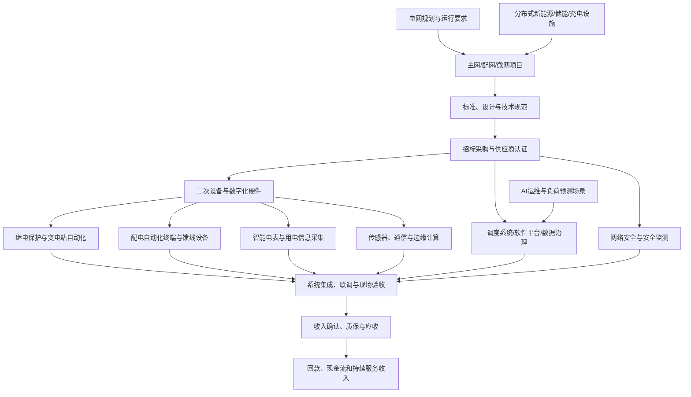

# 智能电网、继电保护、智能电表与电网数字化产业链专题

> 更新日期：2026-10-11  
> 研究定位：A股产业链研究框架，不构成投资建议。政策、技术路线、招标、中标、交付、验收、收入和回款是不同阶段，必须分开核实。

## 一、研究范围与边界

本专题聚焦电网数字化与二次设备，包括继电保护、变电站自动化、调度控制、配电自动化、智能电表与用电信息采集、通信网络、传感监测、巡检机器人、软件平台及网络安全。与第37篇的主变压器、开关设备、特高压一次设备相衔接，但不重复将一次设备市场规模映射为二次设备收入。

## 二、政策与行业背景

- 国家发展改革委、国家能源局2026年1月发布的《关于促进电网高质量发展的指导意见》提出建设主干电网、配电网与智能微电网协同的新型电网平台，并提出推进人工智能、数字技术在电网规划建设、设备管理、调控运行、供电服务和安全防御等场景的应用。政策目标是方向性证据，仍需通过预算、项目招标与公司订单验证。来源：[政策原文（国家能源局/政府公开转载）](https://www.nea.gov.cn/20251231/1be7eddc38c74ec09f528c126c9bdb1c/c.html)。
- 国家能源局2024年2月发布配电网高质量发展指导意见，提出配电网向源网荷储互动系统转型，推进配电自动化、状态感知、无人巡检、设备智能监测和数字化调控。2025年目标已是过去时，不能将目标本身当作已完成成果，需另找实际统计或项目验收数据。来源：[国家能源局政策原文](https://zfxxgk.nea.gov.cn/2024-02/06/c_1310765994.htm)。
- 国家能源局2026年4月印发《关于促进人工智能与能源双向赋能的行动方案》，提出到2027年初步构建支撑AI创新的安全、绿色、经济能源保障体系，推动能源领域高价值场景开放和数据集建设。此类方案扩大潜在应用场景，但不代表所有电网数字化供应商都能形成商业收入。来源：[国家能源局，2026-05-08公开](https://www.nea.gov.cn/20260508/4dae97ca01d348e4871bb8654be34b3a/c.html)。
- 国家能源局2026年1月新闻发布会披露，截至当时全国累计建成投运45条特高压输电通道，西电东送输送能力达到3.4亿千瓦，并指出新型电力系统对安全、调控和主配微协同提出更高要求。这是电网系统背景，不能直接换算成继电保护、智能电表或软件公司的订单。来源：[国家能源局新闻发布会，2026-01-30](https://www.nea.gov.cn/20260130/38f0c23622f14e80a89e7b8ac5cbdf64/c.html)。

## 三、产业链图

## 四、细分环节、商业模式与跟踪指标

| 环节 | 典型产品/收入 | 重点指标 | 主要风险 |
|---|---|---|---|
| 继电保护与安全自动装置 | 保护装置、测控、故障录波及相关系统 | 国网/南网分批招标、中标份额、产品电压等级、交付与验收 | 集中采购波动、认证壁垒、产品质量责任 |
| 变电站自动化与调度控制 | 站控系统、调度自动化、主站软件 | 项目数量、系统集成比例、验收周期、软件服务收入 | 项目制收入波动、实施成本、跨系统兼容 |
| 配电自动化 | FTU/DTU/配电终端、馈线自动化、主站 | 配电自动化覆盖与有效应用、终端招标、故障定位和复电指标 | 设备部署与实际使用脱节、地方预算及回款 |
| 智能电表与采集系统 | 单相/三相表、采集终端、用电信息采集 | 招标轮次、单价、型号结构、交付、质保及海外订单 | 产品价格竞争、换表周期、铜材/电子元件成本 |
| 电网通信与边缘设备 | 工业通信、交换、网关、边缘计算与时钟同步 | 设备认证、项目部署、单位价值、替换周期 | 标准迭代、网络安全要求、同质化竞争 |
| 传感监测与智能巡检 | 在线监测、无人机/机器人巡检、图像识别 | 设备装机、有效告警率、运维合同、复购率 | 试点多、规模化采购慢，算法误报漏报 |
| 电网软件与AI应用 | 运行分析、负荷预测、设备健康管理、数字孪生 | 付费项目、合同负债、验收率、续费率、研发费用 | 示范项目无法复制、定制开发侵蚀毛利 |
| 电力网络安全 | 安全监测、边界防护、身份与访问控制 | 合规招标、项目续期、客户集中度、服务收入 | 预算优先级变化、技术升级、交付责任 |

## 五、需求传导：从“智能化方向”到收入兑现

1. **场景与预算**：先识别新建变电站、老旧设备改造、配网扩容、智能电表轮换、分布式电源接入或AI运维等具体场景，不能用笼统的“数字电网”概念代替预算。
2. **规范与入围**：电网设备往往受技术标准、型式试验、供应商资质和既有系统兼容要求约束。进入供应商名单并不意味着获得稳定份额。
3. **招标与中标**：区分招标预算、推荐中标候选人、最终中标公告、框架协议和实际执行订单。框架采购上限不是必然采购额。
4. **生产与系统集成**：硬件要跟踪排产、交付与质量；软件要跟踪项目实施、联调、验收和运维人员成本。
5. **财务确认**：核对收入确认政策、合同资产、应收账款、合同负债、质保费用、毛利率和经营现金流。政府或国企客户并不意味着回款没有周期。
6. **复购与经常性收入**：区分一次性设备销售、系统集成、软件许可、运维服务和持续订阅；不能把一次性项目金额直接视作长期经常性收入。

## 六、A股公司研究样本（非推荐）

| 公司样本 | 研究切入点 | 核验重点 |
|---|---|---|
| 国电南瑞 | 电网自动化、继电保护、调度及相关系统 | 定期报告分部口径、招标中标与交付节奏，区分硬件和软件/系统集成 |
| 四方股份 | 继电保护、自动化与控制系统 | 核验不同产品线收入、研发投入、订单及应收 |
| 东方电子 | 配电自动化、调度与电力信息化相关产品 | 区分设备、软件与系统集成，检查项目验收和现金回收 |
| 许继电气 | 继电保护、自动化及直流输电相关二次设备 | 分清一次设备、二次设备与系统项目的收入贡献 |
| 国网信通 | 电力数字化、信息通信与云/数据服务相关业务 | 核验电网数字化收入的具体口径、关联客户、毛利与应收 |
| 威胜信息 | 能源计量、通信与物联网相关产品 | 区分电网/能源、公用事业及海外业务，检查产品结构与订单质量 |
| 林洋能源、海兴电力、炬华科技、迦南智能 | 智能电表、用电信息采集及海外计量 | 国内外招标、产品单价、交付周期、海外认证、汇率和回款风险 |

以上公司只是研究入口，不意味着主营业务全部来自该细分市场。应以最新年报、半年报、招投标公告和正式投资者关系材料核对实际收入与订单。可从[国家电网电子商务平台](https://ecp.sgcc.com.cn/)检索正式采购公告；媒体对中标份额的整理只适合作线索，不能替代招标文件与公司公告。

## 七、ETF与指数映射

- 可从智能电网、电网设备、电力设备、数字经济、工业软件或物联网等指数筛选，但这些主题并不等同于“继电保护+智能电表”纯主题组合。
- 核验顺序：基金合同及招募说明书 → 跟踪指数编制方案 → 最新定期报告持仓 → 成分股权重与业务收入 → 规模、日均成交额、费率和跟踪误差。
- 若指数由电力设备、自动化、通信、软件等多类公司构成，应拆分权重并判断核心敞口；不要仅凭ETF名称推断受益程度。
- 本专题不在未核验官方基金文件前填写ETF代码，也不把指数涨跌直接当作产业订单的领先指标。

## 八、情景分析与反证

| 情景 | 观察证据 | 分析重点 |
|---|---|---|
| 偏强 | 配网改造与二次设备招标持续；设备升级和分布式电源接入带来实际采购；订单顺利验收 | 核对公司具体产品份额、收入质量与估值预期 |
| 基准 | 政策方向明确，但招标批次、项目交付和软件验收节奏不均 | 以单项产品和客户订单跟踪，不用行业叙事替代财务 |
| 偏弱 | 项目预算延后、设备降价、软件项目难验收、应收和合同资产积累 | 关注现金流、信用减值、毛利率和研发投入回报 |

**反证信号：**
- 政策与试点很多，但公开采购和最终中标没有同步增长。
- 中标金额提升，但收入确认、交付或验收持续延后。
- 智能电表出货增长，平均售价和毛利率却持续下降。
- 数字化项目收入增加，实施费用、应收账款与合同资产增长更快。
- AI运维停留在试点展示，没有可重复采购、明确节省成本或付费续约。
- ETF成分股主要来自其他电力设备或泛数字经济行业，实际敞口与研究主题偏离。

## 九、月度跟踪清单

- [ ] 国网、南网及省级电网正式招标公告、中标结果和采购批次。
- [ ] 继电保护、配电终端、智能电表等品类的中标数量、金额、产品型号与价格变化。
- [ ] 配电网改造、分布式新能源接入、储能及充电设施的实际项目进展。
- [ ] 供应商资格、型式试验、产品标准和网络安全要求的变化。
- [ ] 公司分部收入、毛利率、研发投入、合同负债、应收、合同资产及经营现金流。
- [ ] 软件/AI项目的实际付费、验收、复购与服务收入，不以试点数量替代商业化。
- [ ] 智能电表国内外业务拆分、出口市场、汇率、认证和售后成本。
- [ ] ETF最新指数方案、成分权重、成交额、规模与费用。
- [ ] 每条信息记录发布日期、数据所属期间与当时可得性，避免未来数据泄漏。

## 十、资料来源与使用限制

1. 国家发展改革委、国家能源局：《关于促进电网高质量发展的指导意见》，2026年1月公开。https://www.nea.gov.cn/20251231/1be7eddc38c74ec09f528c126c9bdb1c/c.html
2. 国家发展改革委、国家能源局：《关于新形势下配电网高质量发展的指导意见》，2024-02-06。https://zfxxgk.nea.gov.cn/2024-02/06/c_1310765994.htm
3. 国家发展改革委、国家能源局、工业和信息化部、国家数据局：《关于促进人工智能与能源双向赋能的行动方案》，2026-04-08印发、2026-05-08公开。https://www.nea.gov.cn/20260508/4dae97ca01d348e4871bb8654be34b3a/c.html
4. 国家能源局新闻发布会：全国电网建设及新型电网发展情况，2026-01-30。https://www.nea.gov.cn/20260130/38f0c23622f14e80a89e7b8ac5cbdf64/c.html
5. 国家电网电子商务平台：正式采购公告和中标信息入口。https://ecp.sgcc.com.cn/

**使用限制：**本专题是研究框架，不构成买卖建议。政策目标、试点项目、招标预算、中标结果、合同执行、财务收入与现金回款必须按披露日期和统计口径分别核实。
