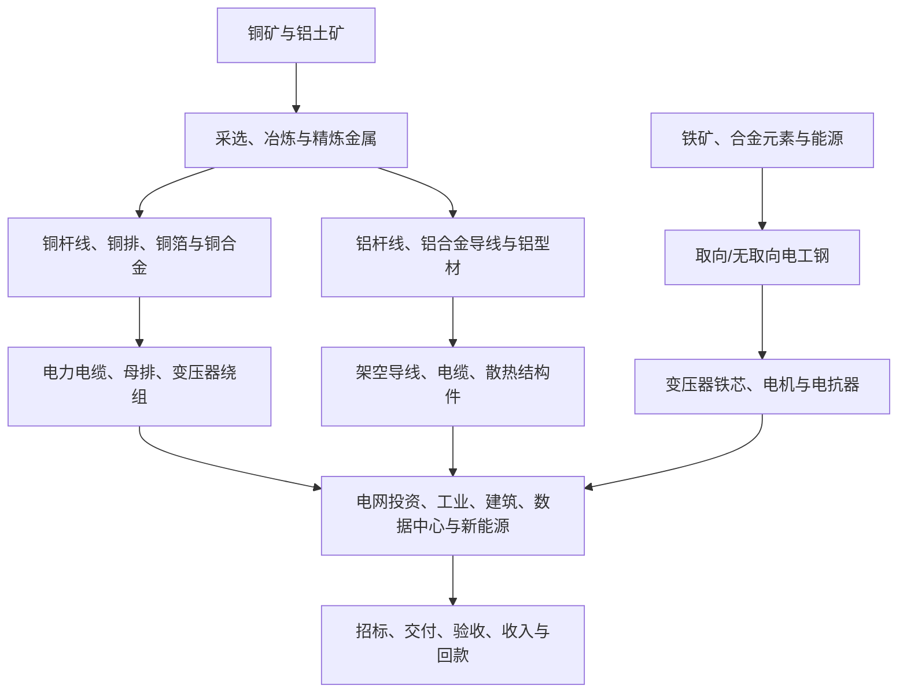

# 铜、铝、电工钢与电网设备核心材料专题

> 研究日期：2026-10-11  
> 定位：A股产业链研究与观察框架，不构成个股买卖建议。价格、供需与公司业务敞口须按最新公告和统计口径复核。

## 一、先给结论：不能把“原料涨价”简单等同于“产业链受益”

铜、铝是电缆、导线、母排、变压器绕组及多类电气设备的重要投入；电工钢则直接影响变压器铁芯、电机效率、损耗与制造成本。投资分析必须拆分三个不同问题：

1. **资源端赚什么钱：**矿山/冶炼企业的利润受商品售价、矿山品位、能源成本、加工费、冶炼回收率、税费和资本开支共同影响。
2. **加工端赚什么钱：**铜杆、铝型材、导线、铜排和电工钢深加工企业，利润往往取决于加工费、产品组合、良率、产能利用率与客户认证，而不只是金属价格。
3. **设备端能否转嫁成本：**电缆、变压器、开关柜及电气系统企业，受合同报价方式、铜铝联动条款、从投标到交付的时间差、库存计价与订单结构影响。原料上涨可能增厚名义收入，却压低毛利和经营现金流。

2026年一季度，工信部披露有色金属行业产量增长、铜铝均价同比上涨；这说明价格和产量都需要跟踪，但不能据此推断每一家企业的盈利方向。来源：[工信部《2026年一季度有色金属行业运行情况》](https://wap.miit.gov.cn/jgsj/ycls/ysjs/art/2026/art_e7f7db9f5d394eb98f27d9dbde0e6592.html)。

## 二、产业链全景

## 三、核心材料的经济属性

| 材料 | 关键细分 | 主要需求 | 需要观察的利润驱动 | 常见误判 |
|---|---|---|---|---|
| 铜 | 精炼铜、铜杆线、铜排、铜合金、铜箔 | 电缆、变压器、电机、电子与工业设备 | 铜价、加工费、原料周转、良率、客户结构 | 铜价上涨就认定所有铜加工企业受益 |
| 铝 | 电解铝、铝杆线、铝合金导线、型材 | 架空输电、导线、电缆、结构件 | 电力成本、氧化铝/预焙阳极成本、加工费、出口与产品结构 | 铝价上涨必然改善电缆毛利 |
| 取向电工钢 | 普通取向钢、高磁感取向钢（HiB） | 变压器、电抗器铁芯 | 牌号结构、铁损指标、技术工艺、产能利用率与售价 | 将全部硅钢视为同质商品 |
| 无取向电工钢 | 中低牌号、高牌号、薄规格低铁损产品 | 工业电机、新能源汽车驱动电机、家电电机 | 下游排产、牌号升级、供需与加工成本 | 仅凭新能源汽车销量推断全部高牌号需求 |
| 绝缘与特种材料 | 绝缘纸、树脂、漆包线材料、耐热/复合材料 | 变压器、电机、电缆与开关设备 | 配方/认证、可靠性、良率、原料价格及客户验证 | 忽略认证周期，把材料概念直接等同于收入 |

## 四、从原料价格到公司利润：四条传导链

### 1. 资源与冶炼企业

商品售价上升可能提高销售收入，但利润还取决于产量、单位成本、资源品位、冶炼加工费、能源成本、汇率、税费与资本开支。对于冶炼环节，原料采购条件和加工费可能抵消金属价格上涨带来的部分好处。研究时将矿山、冶炼、加工分开，查看分部毛利和经营现金流。

### 2. 铜铝加工企业

核心指标是加工费/加工价差、销量、产品结构、原料周转、存货跌价或价格变动损益、产能利用率、应收账款。高金属价格还会增加营运资金占用；即使收入随金属价格上升，利润和自由现金流也可能没有同步改善。

### 3. 电缆、导线和母排企业

合同通常可能采用固定价、铜铝价格联动或一定周期内的价格调整机制。要对照中标/签约时间、原料采购时间、交付时间与确认收入时间。若旧订单锁定低售价而原料采购成本上升，可能出现成本倒挂；若价格联动条款有效且调整及时，成本压力则可能较小。2026年半年度披露的电缆公司案例已提示，闭口价订单可能在原料上涨时挤压毛利。来源：[通达股份2026年半年度报告摘要](https://paper.cnstock.com/html/2026-08/21/content_2257278.htm)。

### 4. 变压器与电网设备企业

电工钢、铜、铝只是成本结构的一部分。还需同时核验产品售价、订单结构、产能利用率、交付周期、质保与验收、应收账款和合同资产。若中标价格早已确定、成本快速上涨而调价机制有限，订单增长不一定带来利润率增长。

## 五、关键跟踪指标与公开来源

| 指标 | 为什么重要 | 建议来源/口径 |
|---|---|---|
| 铜、铝现货与期货价格 | 观察成本与库存风险，不直接代表公司利润 | 上海期货交易所、上海有色金属网等；记录日期与现货/期货口径 |
| 铜精矿进口、精炼铜与铝产量 | 观察原料供应、冶炼与加工环节变化 | 海关总署、国家统计局、工信部及行业协会 |
| 电工钢产量、库存、牌号价格 | 区分供给扩张与高端牌号结构变化 | 中国钢铁工业协会、钢铁行业研究机构、钢厂公开资料 |
| 电网设备招标与中标 | 判断材料需求是否转化为订单 | 国家电网、南方电网及上市公司公告 |
| 铜铝联动/闭口价订单比例 | 判断成本传导能力 | 上市公司年报、半年报、招股书及投资者关系记录 |
| 存货、存货周转天数 | 衡量高价库存和跌价风险 | 财报附注；区分原材料、在产品与产成品 |
| 毛利率与加工价差 | 区分商品价格上涨和真实盈利改善 | 分产品/分部披露，避免只看综合毛利率 |
| 应收、合同资产、经营现金流 | 检验订单是否变现 | 财报与现金流量表；与收入和利润增速对比 |
| 资本开支与在建工程 | 判断新增产能、折旧与未来供给 | 财报、项目公告和环评/备案信息 |

工信部2026年一季度行业数据指出，铜、铝均价同比上涨，同时精炼铜、电解铝和铜材产量也在增长；观察周期时应同时核对价格、产量、库存与下游需求，而非单变量外推。来源同上。

## 六、A股公司研究样本：按真实业务拆分，不能按概念归类

以下仅是研究候选，不代表当前估值合理或构成买入名单。必须阅读最新定期报告中的分部收入、销量、产品与毛利披露。

| 环节 | 可核验研究样本 | 首要核验项 |
|---|---|---|
| 铜资源/冶炼 | 江西铜业、铜陵有色、云南铜业 | 矿山权益产量、冶炼加工费、资源自给率、资本开支和现金流 |
| 铝资源/冶炼 | 中国铝业、云铝股份、神火股份 | 电解铝产量、氧化铝/能源成本、产能约束与分部利润 |
| 铜铝加工 | 海亮股份、博威合金、鑫科材料等 | 铜加工产品结构、加工费、客户集中度、库存与回款 |
| 电缆/导线 | 亨通光电、东方电缆、杭电股份、通达股份等 | 电力/通信/海缆业务占比、原料联动条款、订单交付、毛利率和现金流 |
| 变压器/电网设备 | 特变电工、保变电气、中国西电、金盘科技等 | 变压器与其他业务分部、订单质量、交付验收、原材料传导与应收 |
| 电工钢 | 宝钢股份、首钢股份及相关材料企业 | 电工钢牌号和产量、产线能力、下游客户结构、产品盈利；须确认该业务在集团中的重要性 |

**重要限制：**集团业务多元化，不能把公司全部收入都归因于某一种金属或电工钢；某公司参与某个环节，也不意味着该环节对利润贡献重大。优先查阅最新年报/半年报、交易所公告与产品分部披露。

## 七、场景分析

| 情景 | 可能受益环节 | 可能承压环节 | 验证信号 |
|---|---|---|---|
| 铜铝上涨、加工费稳定或上升 | 资源端；具备定价权的加工商 | 固定价电缆/设备订单、营运资金压力大的企业 | 分部毛利、原料联动比例、存货和现金流 |
| 铜铝上涨、加工费被压缩 | 部分低成本资源端 | 铜铝加工、闭口价电缆、低毛利设备订单 | 加工价差下滑、毛利率下降、库存与应收增加 |
| 铜铝下跌、下游需求稳定 | 原料成本占比较高且能保住售价的加工/设备企业可能受益 | 高成本库存、资源端售价下跌 | 采购成本下降时滞、库存减值、订单价格是否稳定 |
| 电工钢高端化、普通牌号供给偏宽松 | 有高牌号能力、认证和客户关系的厂商 | 低端同质化产能 | HiB/高牌号占比、产品价差、产能利用率、客户认证 |
| 电网投资与海外订单上升，但验收变慢 | 有优质订单、交付能力强的企业 | 应收和合同资产快速增长的供应商 | 招标到交付周期、验收、回款、经营现金流 |
| 金属价格高位震荡、资金成本上升 | 库存周转快、现金流强、定价机制完善的企业 | 高库存、高应收、高杠杆的加工商 | 存货天数、短期借款、现金转换周期 |

## 八、反证与风险清单

- 金属价格上涨，但加工费下降、毛利率下滑，说明价格并未转化为加工利润。
- 收入与合同额增长，经营现金流持续为负、应收和合同资产增速更快，说明兑现质量可能恶化。
- 原料价格下跌并不必然利好：高价库存可能产生跌价损失，客户也可能要求降价。
- 电工钢产量增长不等于高端产品稀缺；必须拆分取向/无取向、牌号、铁损水平、库存和下游订单。
- 电网招标额、项目规划、在手订单与收入确认是不同阶段，不能混用。
- 公司公告只披露“产品可用于电网/新能源/数据中心”，但未披露对应收入或客户订单时，不应将其当成实质性业绩敞口。
- 大宗商品高波动、套保操作不当、汇率变化、贸易限制、客户集中、质量索赔与延期交付均可能造成损失。

## 九、ETF与市场观察方法

不在此处编造“铜 ETF”“铝 ETF”或电工钢主题基金代码。实际操作前，在交易所、基金管理人官网或正式基金文件中核对：
1. 跟踪指数及成分股，区分有色金属综合指数与铜、铝或钢铁细分敞口；
2. 前十大持仓、权重集中度和定期报告日期；
3. 规模、成交额、买卖价差、管理费与跟踪误差；
4. 指数成分的利润究竟来自资源、冶炼、加工还是设备，避免把商品价格走势等同于 ETF 净值表现。

对短线观察，先看相关金属价格与期货基差，再看产业链股票相对强弱、成交额和板块广度；对中期观察，优先看加工价差、订单质量、毛利率、库存和经营现金流。价格突破本身不构成买入理由。

## 十、月度复盘清单

- [ ] 更新铜、铝现货/期货价格与基差，标注数据日期。
- [ ] 更新铜精矿、精炼铜、电解铝及铜铝加工材产量/进出口。
- [ ] 更新电工钢取向/无取向、牌号、库存和价格变化。
- [ ] 复核电网设备招标、中标、交付、验收与回款。
- [ ] 检查重点公司产品结构、原料调价条款、分部毛利率。
- [ ] 对照存货、应收账款、合同资产、经营现金流与资本开支。
- [ ] 检查 ETF 跟踪指数、最新持仓、规模和流动性。
- [ ] 写明本月最强证据、最重要反证和下月待验证假设。

## 十一、来源与复核说明

1. 工业和信息化部：《2026年一季度有色金属行业运行情况》，2026-05-22。链接：https://wap.miit.gov.cn/jgsj/ycls/ysjs/art/2026/art_e7f7db9f5d394eb98f27d9dbde0e6592.html
2. 中国有色金属报：《2026年上半年有色金属工业运行情况新闻发布会问答录》，2026年公开报道。链接：https://www.cnmn.com.cn/ShowNews1.aspx?id=472796
3. Mysteel/中国冶金报：《市场化出清提速，上半年电工钢“减量提质”成色足》，2026-07-30。链接：https://news.mysteel.com/a/26073008/235C1221DE50CAAF.html
4. 通达股份2026年半年度报告摘要，2026年公开披露。链接：https://paper.cnstock.com/html/2026-08/21/content_2257278.htm
5. 杭电股份2026年半年度报告，2026年公开披露。链接：https://vip.stock.finance.sina.com.cn/corp/view/vCB_AllBulletinDetail.php?id=12534674&stockid=603618
6. 商务部2022年第22号公告：取向电工钢相关反倾销措施，供贸易政策背景参考。链接：https://www.mofcom.gov.cn/zcfb/zgdwjjmywg/art/2022/art_eb1d037d2f7a423188e1ac3e3e11a356.html

**复核要求：**本专题不把行业协会样本统计当作全行业普查，不把新闻报道代替上市公司原始公告，也不把2026年一季度或上半年数据当作10月实时价格。后续更新应明确数据截止日，并以官方统计、交易所公告和公司定期报告逐项复核。
