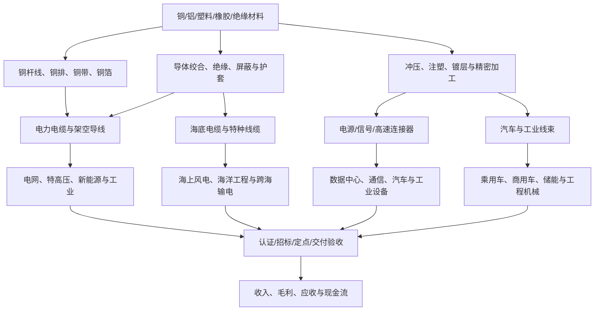

# 电缆、连接器、线束与铜加工产业链专题

> 研究日期：2026-10-11  
> 用途：A股产业链研究框架；不构成投资建议。行业景气、公司敞口与估值均需用最新披露复核。

## 一、核心判断

电缆、连接器、线束和铜加工看起来都与“铜”和“电气化”有关，但商业模式不同，不能作为同一类股票分析。

- **电力电缆/导线：**更依赖电网、特高压、新能源并网、轨交及工业投资；原料占成本较高，合同定价、招标价格、交付验收和回款决定利润兑现。
- **海底电缆与海洋工程线缆：**技术、认证、施工船舶、海缆敷设和项目执行能力重要，项目周期和交付风险较高；订单金额大不等于当期利润。
- **工业/汽车线束：**由汽车产量、车型平台、客户定点、单车价值量、自动化程度及客户降价要求驱动；线束产品的人工、物流和工艺成本同样重要。
- **连接器：**需区分通用连接器、高速通信连接器、汽车高压连接器、工业连接器及高可靠连接器。客户认证、产品迭代、可靠性和单一客户依赖影响盈利。
- **铜加工：**铜杆、铜线、铜排、铜带、铜箔、电磁线等细分市场差异显著。高铜价会增加营运资金占用，企业盈利更取决于加工费、良率、产品结构和客户账期。

2026年4月，中国有色金属加工工业协会受访时指出，铜铝加工各细分领域运行分化：铜板带、部分铜箔需求较好，铜线行业受电力基建与新能源配套支撑，而部分铝型材企业受到高铝价和传统需求偏弱影响；同时行业面临低价竞争、应收账款和资金周转压力。由此可见，不能用单一铜价或铝价指标代表整个加工行业景气。[来源：中国有色金属加工工业协会有关负责人答记者问，2026-04-24](https://www.cnmn.com.cn/ShowNews1.aspx?id=470381)。

## 二、产业链图

## 三、各子行业的盈利逻辑

| 子行业 | 需求领先指标 | 盈利关键 | 容易忽视的风险 |
|---|---|---|---|
| 电力电缆、导线 | 电网投资、招标批次、特高压开工、新能源并网 | 中标价、铜铝联动条款、产能利用率、产品结构 | 闭口价订单遇原料涨价、回款周期长、同质化低价竞争 |
| 海底电缆 | 海风核准/开工、送出工程、海缆招标、项目进度 | 高压等级与技术门槛、产线/船舶能力、项目毛利 | 项目延期、施工窗口、海况与敷设风险、资本开支 |
| 特种电缆 | 核电、轨交、航空航天、矿山、储能与工业设备项目 | 认证、可靠性、产品溢价、批次质量稳定性 | 认证周期长、订单不连续、质量索赔 |
| 汽车线束 | 汽车产销、车型定点、平台换代、单车线束价值 | 自动化率、单车配套、客户结构、制造效率 | 客户压价、车型生命周期、人工成本、客户集中 |
| 高压连接器 | 新能源汽车高压化、充电设施、储能、电动工程机械 | 高压/高电流产品认证、密封与耐久性、客户导入 | 新平台迭代、价格竞争、客户定点未转量产 |
| 高速/数据连接器 | 服务器与交换机平台、数据中心资本开支、速率升级 | 高速信号完整性、良率、验证周期、产品升级 | 技术路线变化、客户集中、量产良率不达预期 |
| 铜杆线/铜排/电磁线 | 电网、变压器、电机、家电、新能源和工业订单 | 加工费、良率、产品结构、库存周转、回款 | 铜价波动导致资金占用、加工费压缩、价格竞争 |
| 铜箔 | 电池、PCB、高频高速通信、储能需求 | 厚度/性能、良率、产能利用率、加工费 | 扩产周期错配、产品降价、技术迭代、客户验证 |

## 四、订单到现金流的核验路径

每个环节都可能产生时间差。尤其需要区分：

1. 意向合作、框架协议、客户定点、正式订单和可执行合同；
2. 订单金额、已交付金额、已验收收入和已收现金；
3. 产能规划、设备安装、认证完成和稳定量产；
4. 铜价上升导致的收入名义增长与真实加工利润增长。

国家市场监管总局、国务院国资委、国家能源局的电力设备质量治理指导意见，将电线电缆列为重点质量监管产品，并强调质量监督、交接验收和追溯管理。对于电力线缆供应商，资质、产品一致性、质量记录和交付验收不仅是合规事项，也可能直接影响订单获取和收入确认。[政策来源](https://www.samr.gov.cn/zljds/fwfh/sjwj/art/2023/art_ea50aa1ab4924f5f936f36223a9a3377.html)。

## 五、原材料与加工利润：不要只看收入

铜加工、线缆和连接器公司应重点跟踪以下指标：

- **定价机制：**铜价/铝价加加工费、周期联动价、固定总价、投标时点锁价、调价频率及套期保值政策。
- **库存：**原材料、在产品、产成品金额与周转天数；金属价格快速下跌时注意高价库存减值。
- **加工价差：**产品售价扣除主要原料成本后的差额，最好结合销量和产品规格分析。
- **毛利率：**按电缆、连接器、线束、铜加工等业务拆分，不只看集团综合毛利率。
- **现金流：**应收账款、合同资产、票据、经营现金流和短期借款；订单扩张可能伴随垫资扩张。
- **质量成本：**退货、返工、质保、客户索赔、认证和测试费用。
- **客户集中：**前五大客户占比、核心客户依赖、客户平台切换及年度降价条款。
- **资本效率：**产能利用率、在建工程、固定资产周转、设备折旧与扩产回报。

2026年7月铜产业月度景气报告提及电力电缆产量指数上升，电网投资、特高压建设及新能源并网配套需求是支撑因素之一；但同一行业报告也提示房地产相关铜消费偏弱。电力电缆景气不能外推到所有铜加工品种。[来源：中国铜产业月度景气指数报告（2026年7月）](https://www.cnmn.com.cn/ShowNews1.aspx?id=473018)。

## 六、A股研究样本：先核实收入与利润敞口

以下为研究样本，不是买入名单；具体业务占比、财务数据和当前估值需以最新交易所公告为准。

| 环节 | 研究样本 | 需要重点核验 |
|---|---|---|
| 电力线缆/导线 | 亨通光电、杭电股份、远程股份、球冠电缆、通达股份 | 电力/通信业务占比、铜铝定价方式、毛利率、订单质量与回款 |
| 海缆/海洋工程 | 东方电缆、中天科技、亨通光电 | 海缆与陆缆分部、项目执行能力、产能和船舶、交付节点及应收 |
| 特种电磁线/导体 | 精达股份、金杯电工、宝胜股份 | 铜基/铝基产品结构、加工费、客户结构、产能利用率 |
| 连接器/精密互连 | 中航光电、瑞可达、徕木股份、永贵电器 | 产品用途、汽车/工业/通信收入占比、定点转量产、客户集中 |
| 汽车线束及零部件 | 沪光股份、得润电子等 | 线束业务占比、车型生命周期、自动化率、客户降价与盈利质量 |
| 铜加工/铜箔 | 楚江新材、海亮股份、铜冠铜箔、嘉元科技等 | 铜材加工费、产品结构、良率、库存和现金流；不要将铜价上涨等同利润上升 |

**公司研究规则：**若公司只在公告或互动平台中提及“产品可用于AI、机器人、新能源、汽车”等场景，却没有披露收入、订单或量产进展，先记为待验证敞口，不把概念映射成盈利预测。

## 七、情景矩阵

| 情景 | 可能受益方向 | 可能承压方向 | 验证数据 |
|---|---|---|---|
| 电网投资和电缆招标加速 | 具备认证、交付和回款能力的电力线缆厂商 | 低价中标、产能不足或回款弱的厂商 | 招标份额、订单毛利、交付验收、经营现金流 |
| 铜价上涨且加工费跟涨 | 有定价权、库存周转快的加工企业 | 固定价订单、资金占用大的线缆企业 | 加工价差、调价周期、存货天数、套保损益 |
| 铜价下跌 | 采购成本下降且售价调整滞后的部分下游厂商可能短期受益 | 高价库存与资源端利润 | 存货跌价、采购/售价时滞、毛利率 |
| 新能源汽车高压化 | 有产品认证、量产能力的高压连接器与线束供应商 | 技术落后、单一车型依赖的供应商 | 新项目量产、单车价值、客户结构、良率 |
| AI数据中心互连升级 | 高速连接器、特种线缆等经过客户验证的供应商 | 仅有概念而无量产收入的公司 | 客户验证、量产节奏、产品单价、收入占比 |
| 海缆订单集中释放 | 有产能、施工能力和履约经验的企业 | 施工资源不足、项目管理弱的企业 | 核准/开工、交付计划、毛利与合同资产 |

## 八、反证清单

- 营收大幅增长但利润下降，可能是金属价格抬高名义收入、低价订单增加或产品结构恶化。
- 新签订单增加但应收、合同资产、存货和短期借款同步快速上升，需警惕“有收入、缺现金”。
- 高压连接器、线束或高速互连只有送样/认证，没有定点、量产和收入，不能视为业绩兑现。
- 海缆项目金额大，但延期、施工窗口错失、验收滞后或成本超预算，可能压低项目回报。
- 电缆招标份额提升但中标价格过低，可能带来规模增长而非利润增长。
- 原材料套保只能管理部分价格风险，不能消除加工费下跌、订单流失、信用风险和流动性风险。
- 行业标准更新可能提高质量门槛，也可能增加设备投入、认证成本和产品迭代压力。

## 九、ETF与交易观察

不直接编造“连接器ETF”“线束ETF”或“铜加工ETF”代码。实际筛选时核对基金管理人官网的最新基金合同、指数编制方案和持仓报告：

1. 先确认指数是否真正覆盖目标环节，而非仅因个别成分股涉及相关概念。
2. 查看前十大成分股权重，识别基金实际由电网设备、有色金属、汽车零部件还是通信设备主导。
3. 核对规模、成交额、买卖价差、跟踪误差、费率及最新持仓日期。
4. 区分主题轮动与盈利兑现：观察板块相对强弱、成交额、上涨家数和龙头持续性，再用订单、毛利率、应收及现金流验证。
5. 若研究短线，预先设定失效条件和单笔风险，不因低价或连续下跌而自动加仓。

## 十、月度跟踪清单

- [ ] 更新电网、特高压、海风、汽车与数据中心相关招标/资本开支数据。
- [ ] 更新铜铝价格、加工费、库存、基差与主要企业套保披露。
- [ ] 统计线缆公司新签合同、交付、验收、收入确认和回款变化。
- [ ] 跟踪连接器/线束客户定点、量产进度、客户集中度和年度降价压力。
- [ ] 核对分产品毛利率、产能利用率、存货周转、应收账款及经营现金流。
- [ ] 对比订单增速与利润、现金流增速，识别低价抢单或垫资扩张。
- [ ] 复核ETF真实持仓、指数规则、规模和流动性。
- [ ] 记录最强证据、最重要反证与下月需要验证的假设。

## 十一、资料来源与复核

1. 中国有色金属加工工业协会有关负责人就铜铝加工行业运行情况答记者问，2026-04-24：https://www.cnmn.com.cn/ShowNews1.aspx?id=470381
2. 中国铜产业月度景气指数报告（2026年7月）：https://www.cnmn.com.cn/ShowNews1.aspx?id=473018
3. 国家市场监督管理总局、国务院国资委、国家能源局《关于全面加强电力设备产品质量安全治理工作的指导意见》：https://www.samr.gov.cn/zljds/fwfh/sjwj/art/2023/art_ea50aa1ab4924f5f936f36223a9a3377.html
4. 杭电股份2026年半年度报告：https://vip.stock.finance.sina.com.cn/corp/view/vCB_AllBulletinDetail.php?id=12534674&stockid=603618
5. 精达股份2026年半年度报告摘要：https://paper.cnstock.com/html/2026-08/25/content_2258502.htm
6. 球冠电缆2026年半年度报告：https://money.finance.sina.com.cn/corp/view/vCB_AllBulletinDetail.php?id=12519220&stockid=920682
7. 全国标准信息公共服务平台：电线电缆相关标准检索：https://openstd.samr.gov.cn/bzgk/std/std_list_type?p.p1=2&p.p6=29.060&p.p90=circulation_date&p.p91=desc&r=0.03632009277704751

**复核说明：**协会数据反映其统计口径和受访企业情况，不代表全部企业；公司名单只是研究起点。正式形成投资判断前，须查看最新定期报告原文，确认分部收入、订单、毛利、存货、应收和现金流，并标注数据截止日期。
