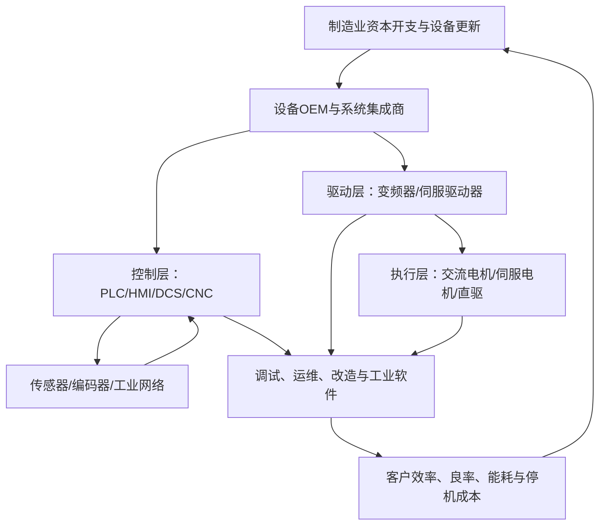

# 电机、工业控制、伺服系统与变频器产业链专题

> 研究定位：产业链研究档案，不是买入评级。数据截止：2026-10-11；市场资金与情绪指标须在交易日按可用行情源更新。

## 一、先给结论

工业自动化不是单一板块，而是由电机与驱动、伺服与运动控制、变频器、PLC/HMI、DCS/工业软件、传感与反馈、系统集成及运维服务构成的交叉产业链。研究时应分别判断：

1. **需求是否改善**：制造业资本开支、设备更新、机床与工业机器人需求、下游行业订单。
2. **公司是否真正受益**：产品份额、客户结构、细分业务收入和利润率，而非仅凭“机器人/AI/工业母机”概念。
3. **市场是否确认**：板块相对强度、上涨广度、成交额、资金指标、ETF申赎与价格趋势。
4. **交易工具是否匹配**：ETF指数成分、细分行业纯度、规模、流动性、费用和跟踪误差。
5. **风险收益是否合适**：估值隐含预期、拥挤度、回撤、订单兑现和现金流。

## 二、产业链全景

| 环节 | 典型产品 | 核心采购因素 | 关键经营指标 |
|---|---|---|---|
| 通用电机 | 异步电机、永磁电机、高效电机 | 效率、可靠性、价格、交期 | 产销量、铜/钢/磁材成本、产品结构、售后 |
| 变频器 | 低压、中压、高压变频器 | 能效、稳定性、适配性、渠道 | 出货量、均价、毛利率、渠道库存、应收 |
| 伺服系统 | 伺服驱动器、电机、编码器 | 精度、响应、可靠性、调试生态 | 配套率、客户认证、订单、份额、研发费用 |
| 控制器 | PLC、HMI、CNC、DCS | 稳定性、工程生态、兼容与服务 | 产品结构、项目周期、软件/服务收入、复购 |
| 运动控制与部件 | 控制卡、步进系统、编码器、传感器 | 精度、响应、耐用性、供应链 | 单机价值量、客户集中度、良率、替代进度 |
| 系统集成与服务 | 自动化产线、调试、改造、运维 | 工艺经验、交付与持续服务 | 在手订单、项目毛利、验收、回款、服务续约 |

## 三、需求从哪里来

- **离散制造**：电子、半导体设备、锂电、汽车零部件、包装、机床和物流设备，通常更关注伺服、运动控制、PLC与机器人。
- **流程工业**：化工、冶金、水处理、能源等，常关注DCS、过程仪表、可靠性、节能改造和全生命周期服务。
- **通用节能改造**：泵、风机、压缩机与暖通场景，变频调速可能降低能耗，但要核实改造投资回收期和实际订单。
- **机器人与高端装备**：提高伺服、编码器、控制器等需求的可能性，但整机产量增长不等于每家零部件公司都获得同等订单。
- **海外市场**：需观察当地认证、渠道、服务网络、贸易限制、汇率及海外收入回款。

## 四、从行业数据到公司利润的传导

必须逐段核验：行业统计只能描述整体环境；公司公告和财报才用于验证订单、份额、收入与现金流。订单增长若伴随应收和存货增速更快、经营现金流恶化，需下调对增长质量的判断。

## 五、市场监测：资金、情绪、趋势与广度

### 1. 资金行为

- 板块成交额及其相对过去20日均值的变化。
- 行业指数与主要相关ETF的份额变化、净申购估算、成交额和折溢价。
- 主力资金净流入属于数据商按成交口径估算的指标，不等同于完整、可审计的资金流；只能作为辅助。
- 融资余额观察杠杆参与程度，不应单独视为看多信号。
- 观察资金是否连续数日出现，并与价格、上涨广度交叉验证。

### 2. 情绪与板块广度

- 行业成分股上涨比例、中位数涨跌幅、创新高股票比例。
- 涨停/跌停、炸板率、连板高度等全市场风险偏好指标。
- 龙头股上涨而多数成分股走弱，属于结构性行情，不能误判为全面扩散。
- 关注高开低走、放量滞涨、冲高回落、领涨股补跌等退潮迹象。

### 3. 趋势与相对强度

- 对比全A、机械设备、自动化相关指数与候选ETF的5/20/60日表现。
- 记录成交额放大是否伴随上涨广度扩张。
- 区分突破、趋势延续、横盘蓄势和高位加速；单日放量不作为独立买入理由。
- 做历史回测时，指标只能使用当时已公开的数据，避免未来数据泄漏。

### 4. 初始观察矩阵（权重须回测）

| 维度 | 初始权重 | 可观测指标 | 主要误判风险 |
|---|---:|---|---|
| 价格趋势与相对强度 | 25% | 5/20/60日相对收益、回撤、趋势斜率 | 高位追涨、短期噪声 |
| 资金行为 | 25% | 成交额变化、ETF份额变化、连续性 | 估算口径不一致、申赎滞后 |
| 市场情绪与广度 | 20% | 上涨比例、中位数收益、涨跌停与炸板 | 少数权重股扭曲指数 |
| 行业基本面 | 20% | 订单、产量、投资、库存、毛利率 | 宏观数据不能替代公司业绩 |
| ETF可交易性 | 10% | 规模、成交额、价差、跟踪误差 | 名称相似但指数覆盖不同 |

这是一套待验证的初始框架，不是经过验证的预测模型。需分别回测短线情绪、趋势跟随和中期景气策略，不可用单一分数替代风险控制。

## 六、A股公司研究样本（不是推荐名单）

| 公司 | 初步观察方向 | 必须进一步核验 |
|---|---|---|
| 汇川技术（300124） | 伺服、变频器、PLC、工业自动化及新能源汽车相关业务 | 分部收入利润、通用自动化与汽车业务边界、订单和现金流 |
| 雷赛智能（002979） | 步进、伺服与运动控制 | 具体产品收入、下游分布、客户集中度、毛利率 |
| 英威腾（002334） | 变频器、控制与电驱相关业务 | 各业务分部贡献、渠道库存、海外业务与回款 |
| 埃斯顿（002747） | 工业机器人及自动化控制相关业务 | 机器人本体、核心部件、系统集成的盈利差异与现金流 |
| 中控技术（688777） | 流程工业自动化、控制系统与工业软件 | 项目订单、验收周期、服务收入、应收和回款 |
| 卧龙电驱（600580） | 电机与驱动相关业务 | 工业电机、其他电机业务和海外业务的分部贡献 |

公司产品范围不等于收入敞口。建表时应记录证券代码、申万行业、细分业务标签、最近报告期、分部收入占比、证据链接、披露日期、映射置信度和复核状态。缺乏分部披露时标记“待核验”，不得推定为高纯度标的。

## 七、ETF映射方法

不凭名称猜代码，不把“机器人ETF”“智能制造ETF”自动视为工业控制ETF。

1. 从基金公告核验基金全称、代码、跟踪指数及指数编制方案。
2. 检查指数成分股与权重，确认汇川技术、雷赛智能、英威腾等公司是否实际纳入及权重多少。
3. 判断指数主要暴露是自动化、机器人、机械设备、工业母机还是更广泛的高端制造。
4. 记录基金规模、近20日成交额、买卖价差、管理费托管费、跟踪误差和折溢价。
5. 记录持仓/指数数据的发布日期，区分每日行情、定期报告持仓和指数定期调整数据。
6. 若找不到足够纯度的ETF，明确写“暂无已核验的直接匹配工具”，再考虑行业指数或个股研究，不强行匹配。

## 八、情景矩阵

| 情景 | 产业证据 | 市场信号 | 研究动作 |
|---|---|---|---|
| 看多 | 订单、产量与客户资本开支改善，利润质量提升 | 相对强度走强、广度扩散、资金指标连续改善 | 进入重点观察，核对估值与ETF流动性 |
| 基准 | 需求分化，核心产品保持竞争力但增速不均 | 资金轮动快，趋势反复 | 以跟踪为主，避免追逐单日热点 |
| 看空 | 设备投资放缓、价格竞争、库存或应收上升 | 放量滞涨、广度恶化、领涨股补跌 | 下调优先级，检查逻辑失效与风险暴露 |

## 九、反证与风险清单

- 制造业投资或设备订单改善没有传导到相关公司新签订单。
- 订单增长但交付延期、验收变慢、应收账款和存货持续快于收入增长。
- 价格竞争导致产品均价和毛利率下滑，研发投入增加却未形成产品竞争力。
- 下游客户资本开支推迟，或单一行业客户占比过高。
- 国产替代只体现在试样/验证，未进入稳定量产与复购。
- 市场资金指标改善但板块上涨广度持续收窄，或ETF申赎与成交信号相互矛盾。
- 估值已经计入高增长预期，业绩略低于预期便可能引发大幅回撤。

## 十、月度跟踪清单

- [ ] 更新制造业PMI、制造业固定资产投资、机床与工业机器人等公开统计。
- [ ] 更新主要公司季报/半年报：订单、分部收入、毛利率、存货、应收、经营现金流。
- [ ] 更新行业指数与候选ETF：相对收益、成交额、份额变化、价差与跟踪误差。
- [ ] 记录行业上涨广度、中位数涨跌幅、龙头与非龙头的表现差异。
- [ ] 对照上月判断，标记哪些假设得到支持、被推翻或仍无证据。
- [ ] 保存数据截止日、披露日期、原始来源和历史版本，避免未来数据泄漏。

## 十一、来源与核验入口

1. 国家统计局：《国家数据》及工业生产月度发布：https://data.stats.gov.cn/
2. 国家统计局，2026年8月份工业生产数据解读（产品产量、行业增加值等）：https://www.stats.gov.cn/sj/zxfbhjd/202609/t20260915_1965330.html
3. 工业和信息化部等六部门，2026年度智能工厂梯度培育行动通知（2026-07-20）：https://www.ncsti.gov.cn/kjdt/tzgg/202607/t20260720_251553.html
4. 工业和信息化部等八部门，《关于推动工业互联网高质量发展的实施意见》（2026-06-29）：https://www.miit.gov.cn/jgsj/xgj/wjfb/art/2026/art_616aad2c6b1547b7a01422b0a419070d.html
5. 汇川技术2026年半年度报告：建议从巨潮资讯网按证券代码300124检索并核对完整报告及分部数据：https://www.cninfo.com.cn/
6. 其他公司报告、ETF招募说明书、指数编制方案和成分权重须逐一按最新披露核验。

**研究边界：** 本专题提供行业研究和数据核验框架，不构成个股或ETF买卖建议。产业增长、资金流入、情绪升温和价格趋势是不同证据；只有在时间口径一致、来源可追溯并经历史检验后，才适合进入量化策略。
