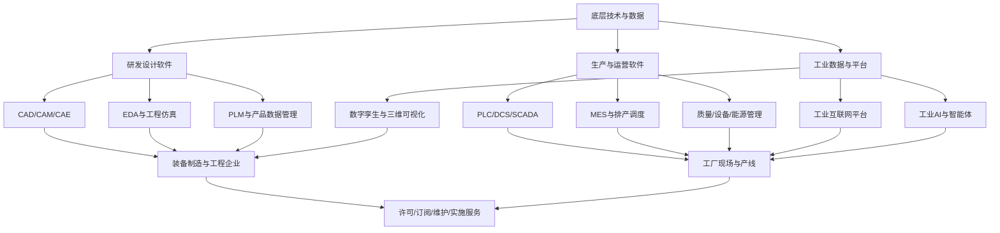

# 第44期｜工业软件、CAD/CAE、数字孪生与智能制造软件产业链专题

> 研究定位：A股产业链研究档案，不构成个股或ETF买卖建议。政策方向、技术能力、客户试用、合同订单、验收收入与现金流是不同阶段，不得混为一谈。公司样本只用于后续核验，不代表推荐。

## 一、核心结论

工业软件不是单一行业，而是贯穿研发设计、工程仿真、生产控制、制造执行、产品生命周期、工业数据平台和数字孪生的工具链。产业机会主要取决于三件事：一是关键软件能否解决复杂工程问题并持续迭代；二是客户能否完成从试点到部门/工厂级部署；三是软件厂商能否从一次性项目收入转向可续费许可、维护升级和可复用产品收入。

2026年政策信号已明确指向 CAD、CAE、EDA 与人工智能融合，以及将工业知识、工艺参数封装成可复用模型和组件；但政策只能说明方向，不能直接证明某家公司收入或利润增长。[工信部“人工智能+软件”专项行动新闻发布会](https://www.miit.gov.cn/xwfb/xwfbh/bxwfbh/art/2026/art_95c0b992336a4cb1b87ec3ccc576a669.html)

## 二、产业链全景

### 关键环节与商业模式

| 环节 | 主要需求 | 商业模式 | 关键验证点 |
|---|---|---|---|
| CAD/CAM | 二维制图、三维建模、加工编程 | 永久许可、订阅、维护 | 几何内核、兼容性、复杂模型性能、续费率 |
| CAE/工程仿真 | 结构、流体、电磁、热、声学及多物理场分析 | 软件许可、求解器授权、项目服务 | 求解精度、验证案例、计算效率、客户复购 |
| EDA/专用设计 | 芯片与电子系统设计验证 | 许可、订阅、技术服务 | 工具链覆盖、设计流程适配、客户认证 |
| PLM/PDM | 产品数据、版本、BOM与工程协同 | 软件许可、平台部署、维护 | 系统集成、数据迁移、跨部门使用深度 |
| MES/工业运营软件 | 生产执行、质量追溯、排产和设备协同 | 项目实施、软件许可、运维 | 项目可复制性、交付周期、验收及回款 |
| 数字孪生 | 设备/产线/工厂的模型、状态与仿真联动 | 平台许可、集成项目、持续服务 | 模型精度、实时数据接入、更新成本、持续付费 |
| 工业互联网与AI | 数据治理、预测维护、工艺优化、知识助手 | 平台/订阅、私有化部署、场景项目 | 数据质量、效果量化、推理成本、生产安全 |

## 三、产业景气如何传导到利润

工业软件的有效需求通常来自制造业研发投入、设备更新、国产化替代、工厂数字化和产品复杂度提升。不能把所有方向视为同步景气：CAD更偏设计工作流与用户习惯，CAE受高端研发、仿真验证和工程复杂度驱动，MES/数字孪生常受项目预算、现场改造与系统集成能力影响。

建议按以下链条逐层核验：

1. **需求形成：** 客户预算、招标、付费试用、正式采购；区分政策规划、框架协议和可执行订单。
2. **产品验证：** 试点范围、兼容性、性能、稳定性、关键业务场景覆盖；客户验收标准是否明确。
3. **商业转化：** 从单点试用扩展到部门、产线、工厂；观察付费客户数、续费率、扩容和复购。
4. **财务确认：** 合同负债、收入确认政策、项目验收、应收账款、回款周期及经营现金流。
5. **盈利质量：** 软件毛利率、研发费用率、销售费用率、实施人力成本、资本化研发及股份支付。
6. **可持续性：** 新版本迭代、生态兼容、客户迁移成本、售后支持能力与海外渠道。

项目签约金额、在手订单、合同负债、营业收入和经营现金流含义不同，不能直接互相替代。系统集成收入增长也不一定代表标准化软件产品竞争力提升。

## 四、政策与行业数据

- 工信部2026年“人工智能+软件”专项行动提出推动 CAD、CAE、EDA 等通用工业软件与AI深度融合，探索新一代智能工业软件；重点在制图、设计、仿真、工业知识复用和平台集成。来源：[工信部新闻发布会](https://www.miit.gov.cn/xwfb/xwfbh/bxwfbh/art/2026/art_95c0b992336a4cb1b87ec3ccc576a669.html)。
- 2026年上半年，全国软件和信息技术服务业软件业务收入同比增长9.5%，利润总额同比增长1.0%；工业软件产品收入同比增长8.2%。收入增速明显高于利润增速，提示必须关注费用、交付结构和利润率，而不能只看行业收入。来源：[中国软件2026年半年度报告所引行业数据](https://vip.stock.finance.sina.com.cn/corp/view/vCB_AllBulletinDetail.php?id=12536020&stockid=600536)。
- 中望软件2026年半年报披露，公司覆盖CAD/CAM/CAE等研发设计软件，报告期营业收入约3.60亿元、同比增长7.92%，归母净利润约为-1725万元、同比减亏。案例说明收入增长与盈利状态必须分开观察。来源：[中望软件2026年半年度报告](https://vip.stock.finance.sina.com.cn/corp/view/vCB_AllBulletinDetail.php?id=12496126&stockid=688083)。
- 索辰科技2026年半年报描述了单学科、多学科仿真及工程仿真优化等产品形态，也提到定制开发、数字孪生和仿真验证项目。研究时需区分标准软件销售与定制项目/系统集成。来源：[索辰科技2026年半年度报告](https://money.finance.sina.com.cn/corp/view/vCB_AllBulletinDetail.php?id=12536683&stockid=688507)。

上述数据具有明确统计期间和公司口径，不能直接外推为全行业未来增长率。

## 五、A股公司研究样本：先核业务，再谈受益

| 公司/代码 | 观察方向 | 必须核验的事项 |
|---|---|---|
| 中望软件（688083） | CAD/CAM/CAE研发设计软件 | 产品收入结构、续费/订阅、海外收入、销售费用、净利润转正和经营现金流 |
| 索辰科技（688507） | CAE与工程仿真 | 标准化软件与定制项目占比、研发成果商业化、客户集中度、回款与现金消耗 |
| 中国软件（600536） | 基础软件及行业软件生态 | 工业软件实际收入占比、分部披露、项目交付质量；不能将集团整体业务等同于工业软件 |
| 品茗科技（688109） | 工程建设数字化、空间数字孪生 | 工程建设行业敞口、产品化程度、项目交付和应收回款 |
| 华中数控（300161） | 数控系统、智能制造解决方案 | 软件与控制系统、硬件及集成业务边界，产线项目验收和盈利质量 |
| 远光软件（002063） | 企业管理与能源数字化软件 | 工业软件定义边界、能源/集团管理软件收入、AI产品付费与项目复用 |

此表是研究入口，不是推荐名单。公司主营业务和收入分部应以最新年报、半年报、交易所公告及公司正式披露为准；“布局”“合作”“试点”不代表已形成可观收入。

## 六、ETF映射与可交易性

本专题可能与计算机软件、工业互联网、智能制造、工业母机、机器人等主题产生交叉，但这些指数的持仓边界可能差异很大。**不根据ETF名称猜代码，也不把主题相似当作高纯度暴露。**

每只候选ETF必须逐项核验：

- 跟踪指数名称、编制方案与最新成分股日期；
- 工业软件直接业务公司的权重，以及半导体、硬件、互联网、自动化设备等非核心敞口；
- 规模、成交额、买卖价差、跟踪误差、管理费与托管费；
- 前十大成分集中度、单一公司对指数收益的影响；
- ETF折溢价、申赎机制及交易规则。

如果指数中工业软件公司的实际权重很低，就应将其标记为“间接受益/低纯度”，而不是工业软件ETF替代品。ETF清单应在建立交易观察表时，基于最新基金合同、指数方案和成分文件另行核验。

## 七、资金、情绪与趋势：避免把热度当成基本面

### 基本面领先指标
- 招标与中标、合同负债、正式采购、客户验收；
- 付费客户数、续费率、单客户收入、产品收入占比；
- 应收账款增速与账龄、经营现金流、研发投入和毛利率。

### 市场确认指标
- 板块相对强弱：对宽基指数及计算机行业基准的超额收益；
- 市场广度：上涨家数占比、站上20/60日均线的成分股比例；
- 成交结构：板块成交额相对20日均值、成交额集中度；
- 趋势结构：价格相对20/60日均线、均线斜率、回撤幅度；
- ETF质量：成交额、价差、规模、跟踪误差和实际成分暴露。

资金流数据存在口径差异。所谓“主力净流入”通常是数据商按成交分类估算，并非完整、可直接验证的机构账户资金。应优先记录原始成交额、换手率、涨跌广度和相对强度；若使用资金流估算，必须保留供应商、计算方法与更新时间。

### 避免未来数据泄漏
- 回测每个交易日只使用当时已公开的数据，按公告实际发布时间滞后入库。
- 半年报、年报数据以披露时间而非报告期末作为可用时间。
- 指数成分、ETF规模及权重使用当时版本，不能用今天的成分回填历史。
- 对指标阈值进行样本外验证，计入交易费用、滑点和停牌/涨跌停约束。

## 八、主要风险与反证清单

1. 国产替代进度低于预期，关键内核、求解器或生态兼容性仍存在差距。
2. 客户试用或试点很多，但正式采购、全厂推广和续费不足。
3. 项目制收入占比过高，交付延期导致收入确认推迟、应收账款上升。
4. 高研发与销售投入无法转化为更高毛利和现金流，长期依赖外部融资。
5. AI功能只是产品演示，缺少付费场景、可靠性和可量化的客户收益。
6. 数字孪生项目依赖定制，跨客户复用率低、维护成本高。
7. 海外软件竞争、授权模式、数据合规和出口限制影响市场拓展。
8. 估值提前计入长期成长，短期业绩改善仍不足以支撑价格。
9. 主题ETF的实际持仓与工业软件关联较弱，板块涨跌更多由其他成分驱动。

## 九、月度跟踪表

| 维度 | 每月记录 | 触发进一步研究的变化 |
|---|---|---|
| 行业需求 | 制造业投资、设备更新、重点行业资本开支 | 需求持续改善且招标同步增加 |
| 产品商业化 | 付费客户、续费、复购、产品化收入 | 由试点转向跨部门/多工厂复制 |
| 财务质量 | 毛利率、研发费用率、应收、合同负债、经营现金流 | 收入增长伴随回款改善、现金流转好 |
| 技术竞争力 | 版本迭代、兼容性、性能基准、客户案例 | 可独立验证的关键能力突破 |
| 市场行为 | 相对强度、广度、成交额、回撤承接 | 基本面与市场确认同时改善 |
| ETF适配 | 成分暴露、规模、流动性、费用、跟踪误差 | 真实核心成分权重与交易质量均达标 |

## 十、研究结论

本产业链值得持续跟踪，但需要将“研发设计软件的核心技术壁垒”“工业运营软件的项目交付能力”和“数字孪生/工业AI的商业化阶段”分开评估。现阶段最重要的不是寻找一个统一的工业软件概念标签，而是逐家公司验证：核心产品是否可替代、客户是否持续付费、收入是否可重复、利润是否改善、现金是否真正收回。

**下一步建议：** 建立工业软件上市公司分部收入与财务质量横向表，并在核对最新指数文件后筛选可用ETF观察工具。任何信号均应结合估值、市场环境和个人风险承受能力，不直接转化为买卖指令。

## 参考来源

1. 工业和信息化部：《“人工智能+软件”专项行动实施方案》新闻发布会，2026年。https://www.miit.gov.cn/xwfb/xwfbh/bxwfbh/art/2026/art_95c0b992336a4cb1b87ec3ccc576a669.html
2. 中国软件2026年半年度报告（含软件行业运行数据）。https://vip.stock.finance.sina.com.cn/corp/view/vCB_AllBulletinDetail.php?id=12536020&stockid=600536
3. 中望软件2026年半年度报告。https://vip.stock.finance.sina.com.cn/corp/view/vCB_AllBulletinDetail.php?id=12496126&stockid=688083
4. 索辰科技2026年半年度报告。https://money.finance.sina.com.cn/corp/view/vCB_AllBulletinDetail.php?id=12536683&stockid=688507
5. 上海证券交易所：沪市公司2026年半年报业绩综述。https://www.sse.com.cn/aboutus/mediacenter/hotandd/c/c_20260830_10830362.shtml
