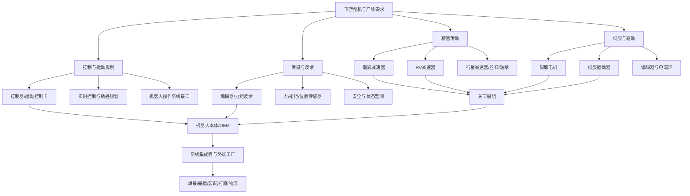

# 第45期｜工业机器人核心零部件、减速器、伺服与运动控制产业链专题

> 研究定位：A股产业链研究档案，不构成投资建议。研究重点是可验证的工业机器人需求、核心零部件竞争力、量产交付和现金流，不将人形机器人远期空间直接等同于当期业绩。

## 一、核心结论

工业机器人核心零部件应拆成五类：精密减速器、伺服电机与驱动器、控制器/运动控制、传感与反馈、关节模组及精密加工件。不同环节的技术门槛、价值量、客户认证周期和竞争格局并不相同，不能简单用“机器人概念”统一估值。

近期公司披露显示，需求正在向工业机器人和具身智能两端延伸，但兑现阶段不一致。例如，绿的谐波2026年上半年收入与利润增长，报告提及机器人需求、产能利用率及产品出货改善；这类数据值得跟踪，但仍需进一步看产品结构、客户集中度、毛利率、经营现金流及新增产能回报。[绿的谐波2026年半年度报告](https://vip.stock.finance.sina.com.cn/corp/view/vCB_AllBulletinDetail.php?id=12552650&stockid=688017)

本专题的判断框架是：**优先研究已进入成熟工业客户供应链、可重复量产的产品；把人形机器人新增需求视为增量情景，单独核验客户定点、送样、订单、量产与回款阶段。**

## 二、产业链全景

## 三、主要技术路线及商业化差异

| 环节 | 产品与竞争核心 | 主要验证指标 | 风险点 |
|---|---|---|---|
| 谐波减速器 | 轻量、紧凑、高传动比；齿形、柔轮寿命、精度和一致性 | 传动误差、回差、效率、寿命测试、批次良率 | 价格竞争、产能爬坡、客户集中 |
| RV减速器 | 高刚性、高负载，常用于工业机器人重载关节 | 扭转刚度、定位精度、振动、寿命、加工与装配良率 | 供应链长、精密加工难、验证周期较长 |
| 行星减速器/精密传动 | 多场景传动方案，性能和成本区间较宽 | 效率、背隙、寿命、尺寸、批量一致性 | 同质化、低价竞争 |
| 伺服电机与驱动 | 响应、转矩密度、控制精度、稳定性与能效 | 动态响应、温升、过载能力、故障率、认证与复购 | 价格压力、芯片和编码器依赖 |
| 控制器/运动控制 | 实时性、轨迹规划、多轴同步、开放接口与安全 | 控制周期、插补精度、多轴协同、现场稳定性 | 与整机/软件生态绑定、客户迁移成本 |
| 编码器与传感器 | 位置、速度、力矩、力觉及状态反馈 | 分辨率、漂移、抗干扰、标定一致性 | 产品验证难、系统适配成本 |
| 关节模组 | 减速器、电机、驱动、编码器及结构集成 | 功率密度、热管理、重量、可靠性、集成成本 | 单体价值量上升但系统责任和质保风险也上升 |

**关键差异：** 工业机器人往往看重长期稳定运行、节拍、维护成本和大规模一致性；人形机器人可能更看重轻量化、关节数量、功率密度、反向驱动能力和成本。两类市场有交集，但产品规格、客户认证和商业模式不能直接等同。

## 四、从订单到财务兑现

用统一阶段标记管理每家公司的业务进展：

1. **技术研发：** 样机、实验室测试或专利，尚不能证明客户需求。
2. **送样验证：** 已送到客户测试，尚未通过全部技术和质量认证。
3. **客户定点：** 获得项目/产品供应资格，仍需核对项目生命周期、采购份额和量产时间。
4. **小批量：** 有初始出货，关注良率、退货、现场可靠性和毛利率。
5. **稳定量产：** 持续交付、多批次质量稳定，关注客户扩展和复购。
6. **财务兑现：** 收入确认、应收周转、回款和经营现金流同步改善。

建议每家公司建立如下传导链：

**终端资本开支/机器人出货 → 整机厂排产 → 零部件供应商定点与订单 → 交付与验收 → 收入确认 → 毛利与费用 → 应收回款/经营现金流。**

“已取得定点”“规划年产能”“意向订单”“送样”都不能替代实际出货、确认收入和现金回收。产能扩张也需要观察利用率、良率、折旧和资本开支回报。

## 五、2026年公开披露线索

- **绿的谐波（688017）：** 2026年上半年披露营业收入约3.48亿元、归母净利润约7011万元，并提及机器人需求、产能利用率和出货改善。应进一步核验收入增长是否伴随应收、库存和经营现金流同步改善，以及新增业务中工业机器人与具身智能的具体占比。来源：[2026年半年度报告](https://vip.stock.finance.sina.com.cn/corp/view/vCB_AllBulletinDetail.php?id=12552650&stockid=688017)。
- **机器人/新松（300024）：** 半年报业务覆盖运动控制器、伺服电机与驱动器、机器人本体和系统解决方案。研究时需区分核心部件自产、机器人整机和集成项目的收入与利润贡献。来源：[机器人2026年半年度报告](https://vip.stock.finance.sina.com.cn/corp/view/vCB_AllBulletinDetail.php?id=12520560&stockid=300024)。
- **拓斯达（300607）：** 公司披露控制器、伺服驱动和感知系统等核心能力，并推进新一代机器人控制平台。需核验核心部件对外销售收入、自产自用比例、平台商业化与整机/自动化项目交付结构。来源：[拓斯达2026年半年度报告](https://money.finance.sina.com.cn/corp/view/vCB_AllBulletinDetail.php?id=12512011&stockid=300607)。
- **华中数控（300161）：** 半年报提及全闭环伺服控制方案、高性能伺服驱动以及工业机器人在3C等领域的批量应用。需核验产品收入规模、客户集中度、毛利率及项目回款，而非只看技术参数。来源：[华中数控2026年半年度报告](https://money.finance.sina.com.cn/corp/view/vCB_AllBulletinDetail.php?id=12567572&stockid=300161)。
- **中鼎股份（000887）：** 半年报摘要披露旗下机器人相关减速器、力传感器和微型电机业务的客户定点与产能信息。定点及名义产能是商业化线索，仍需追踪后续实际出货、收入占比、质量验证和现金流。来源：[2026年半年度报告摘要](https://paper.cnstock.com/html/2026-08/28/content_2261656.htm)。
- **恒工精密（301261）：** 公开报道显示公司2026年上半年机器人相关业务收入约7938万元，占总收入约10.97%。该比例可作为业务敞口起点，仍需拆分机器人关键零部件与整机/场景业务的利润贡献。来源：[上海证券报报道](https://finance.eastmoney.com/a/202608263855166095.html)。
- **步科股份（688160）：** 运动控制、电机及机电一体化相关产品，可作为伺服/控制环节研究样本。需以最新半年报分部和产品披露核实机器人相关收入，不将布局方向直接视为核心收入。

样本的业务敞口与披露粒度不同。未披露机器人相关分部收入时，应标记“待核验”，不自行估算其占比。

## 六、A股研究样本分层

| 研究层级 | 观察样本 | 核心问题 |
|---|---|---|
| 精密减速器 | 绿的谐波、双环传动、中大力德 | 谐波/RV/行星路线分别占多少收入；客户验证、良率、毛利与现金流如何 |
| 伺服与运动控制 | 汇川技术、禾川科技、步科股份、雷赛智能 | 工业自动化基本盘与机器人增量如何区分；是否有稳定批量订单 |
| 控制器与机器人平台 | 拓斯达、机器人（新松）、埃斯顿、华中数控 | 控制器/核心部件自产能力是否形成外销；整机和集成业务盈利是否稳定 |
| 关键结构件与精密制造 | 恒工精密、相关精密传动/加工厂商 | 机器人业务是否具有可量化收入；客户扩展能否转为稳定毛利 |
| 多部件/关节模组 | 中鼎股份等有明确披露的样本 | 定点、送样、量产分别处于什么阶段；系统集成后附加值和质保责任如何变化 |

该表是研究样本池，不是推荐名单。正式比较时，应以最新年报、半年报、交易所公告、客户验证披露和可比产品参数为准。

## 七、ETF映射：先核成分，再谈主题纯度

潜在映射包括机器人、工业自动化、智能制造、工业母机等主题指数，但它们可能大量持有整机厂、汽车零部件、半导体或其他自动化公司。不能仅凭ETF名称判断其对减速器或伺服的暴露。

每只候选ETF需要记录：

- 跟踪指数及编制方案；
- 最新成分股日期、核心零部件相关成分权重；
- 前十大集中度与非核心业务敞口；
- 规模、成交额、买卖价差、费用、跟踪误差；
- 成分调整频率、折溢价与交易规则。

如果核心零部件企业权重有限，应将其标记为“机器人产业链综合暴露”，而不是“减速器/伺服纯主题”。在获取并核验最新成分文件前，本专题不指定ETF代码。

## 八、资金、情绪与趋势指标

### 基本面指标
- 工业机器人产量、下游制造业资本开支与整机厂订单；
- 供应商定点、实际出货、产能利用率、良率和复购；
- 产品毛利率、研发费用率、存货、应收账款、经营现金流；
- 新增产能投产进度、折旧和资本开支回报。

### 市场指标
- 板块相对宽基指数的20/60日超额收益；
- 成分股上涨比例、站上20/60日均线的比例；
- 板块成交额相对20日均值、成交集中度；
- ETF成交额、买卖价差、规模、折溢价与成分暴露。

“主力净流入”等数据通常依赖数据商对成交行为的分类估算，并非完整可验证的机构账户流量。应保存来源、算法和时间戳，避免把估算值当成事实。

### 避免未来数据泄漏
- 半年报、年报数据以实际公开时间作为可用时间，而非报告期末。
- ETF指数成分和权重采用当时版本，不能用当前成分回填历史。
- 对指标做样本外检验，并计入费用、滑点、停牌与涨跌停约束。
- 对定点、送样、订单和产能信息保存公告日期，避免事后回看导致的幸存者偏差。

## 九、反证与主要风险

1. 人形机器人商业化时间表延后，新增需求未形成规模采购。
2. 送样和定点较多，但客户最终采购份额低、量产爬坡慢。
3. 竞争者扩产导致减速器、伺服和电机价格下行，销量增加但利润率下降。
4. 高精度产品批量一致性不足，现场故障、退货和质保成本侵蚀毛利。
5. 产能扩张快于订单，利用率偏低、库存与折旧压力增加。
6. 关键材料、轴承、编码器或芯片供应影响成本和交付。
7. 核心零部件收入占比仍小，公司整体业绩主要由其他业务决定。
8. ETF成分暴露与预期不同，股价上涨主要来自非核心成分。
9. 市场估值提前反映长期空间，短期订单与现金流无法支撑预期。

## 十、月度跟踪清单

| 维度 | 观察项 | 需要进一步研究的变化 |
|---|---|---|
| 需求 | 工业机器人出货、制造业投资、整机厂订单 | 终端订单与零部件采购同步改善 |
| 技术 | 精度、寿命、效率、温升、可靠性 | 第三方测试与客户批量验证支持技术优势 |
| 商业化 | 送样、定点、小批量、量产、复购 | 从单客户项目走向多客户稳定量产 |
| 财务 | 产品收入、毛利、库存、应收、经营现金流 | 收入与现金回收同步增长 |
| 产能 | 利用率、良率、资本开支、折旧 | 产能扩张有订单和良率支持 |
| 市场 | 相对强度、广度、成交、ETF流动性 | 市场确认与基本面改善方向一致 |

## 十一、结论

工业机器人核心零部件研究应优先围绕成熟工业应用的真实需求建立基准，再将具身智能新增需求作为独立增量情景。减速器、伺服、控制器、传感器和关节模组不能用同一套估值逻辑；技术参数、客户定点、批量交付和现金回收也必须分层判断。

下一步可将本专题与第41期电机/伺服、第42期工业母机、第43期传感器、第44期工业软件关联，建立统一的公司—产品—客户阶段—财务指标映射表。

## 参考来源

1. 绿的谐波2026年半年度报告：https://vip.stock.finance.sina.com.cn/corp/view/vCB_AllBulletinDetail.php?id=12552650&stockid=688017
2. 机器人（新松）2026年半年度报告：https://vip.stock.finance.sina.com.cn/corp/view/vCB_AllBulletinDetail.php?id=12520560&stockid=300024
3. 拓斯达2026年半年度报告：https://money.finance.sina.com.cn/corp/view/vCB_AllBulletinDetail.php?id=12512011&stockid=300607
4. 华中数控2026年半年度报告：https://money.finance.sina.com.cn/corp/view/vCB_AllBulletinDetail.php?id=12567572&stockid=300161
5. 中鼎股份2026年半年度报告摘要：https://paper.cnstock.com/html/2026-08/28/content_2261656.htm
6. 恒工精密2026年半年报相关报道：https://finance.eastmoney.com/a/202608263855166095.html
7. 步科股份2026年半年度报告相关报道：https://app.cnstock.com/zzb/zgzqb/html/2026-08/26/nw.D110000zgzqb_20260826_1-B128.htm
